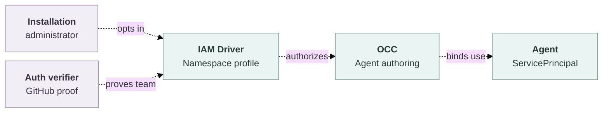

# Proposal: Let verified teams author Agents in one Namespace

- **ID:** RFC-0027
- **Created:** 2026-11-03
- **Last updated:** 2026-11-03

An Installation administrator can opt one Namespace into **Agent Operator** for
one verified GitHub team. Active members with attached accounts can create,
edit, deploy, and stop existing and new Agents there and read their revisions
without per-Agent administrator grants.

The [member draft test](../../tests/browser/console-create-agent-member.test.ts)
uses fixture grants to save a Configuration and Agent after Installation read
returns `403`. The Console then asks an administrator to grant the Agent
credential access. [Namespace policy](../../docs/reference/authorization.md#manage-namespace-policy)
writes exact identity bindings and cannot grant collection create. Adding
create alone leaves credential delegation and the [guided provisioning](../../docs/flows/agent-provisioning.md#2-occ-admits-one-job)
requirement for Installation `administer` unresolved.

## The IAM Driver contract

Only a current human with Installation `administer` and exact Namespace `read`
can enable, inspect, or withdraw the profile, or explicitly withdraw a member.
The profile defaults off. State binds the Namespace lifetime to the GitHub
provider instance and immutable organization and team IDs, with a policy
generation. The opt-in confirms that the scope includes all Agents there.
Slugs serve only as lookup inputs.

The selected IAM Driver must support this fixed policy in OCC's existing
[State and audit transaction](../../docs/flows/namespace-iam-policy.md#5-platform-state-commits-policy-and-audit-together).
It accepts only the server-defined profile and trusted membership evidence.
It supplies Namespace read, Agent create/read/update/deploy/operate,
Configuration create/read/update, and Agent revision read. Current Restrictions
still win. Profile, membership, and managed grant changes are conditional on
current state and commit with attributable audit. An unsupported Driver or
transaction refuses the operation before a write. The generic policy API keeps
its existing limits. Agent Operator grants no Installation access, IAM
administration, Agent `administer`, or deletion.

Auth verifies active membership in the selected team for the exact attached
human account and provider subject. The
[GitHub sign-in allowlist](../../docs/reference/authentication/external-sign-in.md#organization-and-team-allowlist)
can match an organization or another team. The profile requires proof for the
selected team. The first delivery uses existing account attachment. Auth and
IAM must set a finite maximum evidence age before enabling the profile.
An approved verifier can renew it, or the member can re-verify explicitly.
New work requires current positive proof. Provider errors cannot renew it.
Observed loss of membership, account disablement, or detachment invalidates it.
Local withdrawal blocks rejoin until an administrator restores eligibility
and the member proves membership again.

Dashed arrows show the proposed connections.

## Resource authority and withdrawal

Using a resource and granting its use are separate permissions. A resource owner
can approve Agent use once for an exact Namespace, resource lifetime, and purpose.
OCC resolves the accepted Configuration or Harness reference and checks that
approval and the selected resource Driver. A readable Preset or a human
`operate` grant supplies no approval. Ordinary save, deploy, and guided
provisioning share this decision. The existing transactional IAM writer grants
exact `operate` to the Agent's ServicePrincipal where required. The credential
owner must enforce the approved purpose at delivery and support withdrawal.
Members discover approved reference metadata and receive no credential material
or general credential use.

Repository choices use the current [GitHub App and Namespace policy](../../docs/reference/repository-credentials/access-levels.md).
The member may choose a permitted repository even without personal access to
it in GitHub. The saved binding limits the Agent's access. A Console default
such as Contributor applies only when offered and supplies no authority.

OCC reuses provisioning jobs, fingerprints, claims, effect receipts, and the
deployment handoff. Current authority and job ownership govern status and retry.
Other members manage the resulting Agent. The deployment controller owns
reconciliation after handoff. Use shared locks or conditional generations to
order original writes and final effect admission against withdrawal. Check the
actor, approval, claim, and original resource state. A cached IAM snapshot or
recorded intent cannot authorize later dispatch. If withdrawal wins, refuse the
new write or effect. The recorded owner inspects and settles admitted effects.
Keep unknown effects on hold with their receipts until reconciled. Stop and
deletion keep their existing lifecycle fences.

Human withdrawal ends future access from the profile. The Agent retains its
independent approval. Withdrawing that approval stops new delivery for the
affected use and invokes supported runtime revocation. Reconciliation changes
only profile-owned grants. The provider's limits govern revocation of material
already delivered.

## Delivery and evidence

- Through real HTTP and restricted PostgreSQL, two ordinary attached members
  create, edit, deploy, and read a shared Agent's revisions using an approved
  model. Cover ordinary drafts and guided provisioning. Deny stale or withdrawn
  members, other teams and Namespaces, service keys, deletion, a matching
  Restriction, and an unapproved credential passed through a Preset.
- Race withdrawal against a protected commit and provider dispatch. Check which
  side won, the Agent's continued approved use, and settlement of an unknown
  effect without duplicate dispatch. For repositories, show that a member
  without personal access can attach an approved read-only repository, the
  deployed Agent can fetch it, and push is refused.
- IAM, Auth, and credential owners review verification, effect admission,
  withdrawal, and the supported deployment before opt-in ships. GitHub
  sign-in keeps its host-only cookie and native administration startup guard.
  Native browser access and live provider behavior need separate installed proof.

Per-Agent sharing in [RFC-0010](0010-agent-access.md) keeps an administrator on
the path for each new Agent. This profile reuses the IAM evaluator and
provisioning flow. [RFC-0006](0006-basic-rbac/index.md) remains deferred, including
its general role and Group management, invocation, and audience controls.
