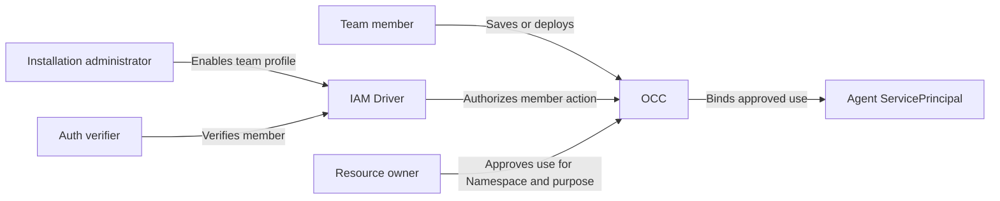

# Proposal: Let verified teams author Agents in one Namespace

- **ID:** RFC-0027
- **Created:** 2026-11-03
- **Last updated:** 2026-11-03

**Decision proposed.** Let an Installation administrator enable **Agent Operator** for one verified GitHub team in one Namespace. Teammates could then create, edit, deploy, and stop shared Agents without a grant for each Agent. Resource owners decide what those Agents can use. OCE refreshes the team roster every six hours. An administrator can withdraw a member sooner.

## Why change per-Agent sharing?

Today the member draft flow can save a Configuration and Agent with fixture grants after Installation read returns `403`. The member still needs an administrator to grant the Agent credential access. Adding collection create alone would leave both that handoff and guided provisioning’s Installation `administer` requirement unresolved. [Member draft test](../../tests/browser/console-create-agent-member.test.ts) · [Guided provisioning](../../docs/flows/agent-provisioning.md#2-occ-admits-one-job)

## Who gets access, and where?

| Who                               | What they can do                                                                                                                                                                                                                                                                                                 |
| --------------------------------- | ---------------------------------------------------------------------------------------------------------------------------------------------------------------------------------------------------------------------------------------------------------------------------------------------------------------- |
| Installation administrator        | A current human with Installation `administer` and `read` on the exact Namespace can enable, inspect, or withdraw its profile and withdraw individual members. The profile defaults off. Enabling it covers **every existing and future Agent in that Namespace**.                                               |
| Team member                       | Auth verifies active membership in the selected GitHub team for the exact attached human account and provider subject. The sign-in allowlist applies separately and can admit people from another team. [Sign-in rules](../../docs/reference/authentication/external-sign-in.md#organization-and-team-allowlist) |
| Verified member in that Namespace | Read the Namespace. Create, read, update, deploy, and operate Agents. Read Agent revisions. Create, read, and update Configurations. Current Restrictions take precedence. Installation access, IAM administration, Agent `administer`, and deletion require separate authority.                                 |

## How two teammates share an Agent

1. The administrator enables the profile for the Support team in its Namespace. Maya and Eli each verify their membership.
2. Maya saves a Configuration referencing an approved model, creates an Agent, and deploys it.
3. Eli reads its revision, edits the Agent, and can stop it. Both members use the same shared Agent.

## What can the Agent use?

A resource owner approves Agent use for an exact Namespace, resource lifetime, and purpose. Members see approved reference metadata. Credentials stay with the credential owner, who enforces the purpose at delivery and supports withdrawal.

For example, Maya can select an approved read-only repository even if her personal GitHub account cannot access it. The Agent can fetch. A push is denied. The GitHub App and Namespace policy determine the choices, and the saved binding limits the Agent. A Console default such as Contributor applies only when offered and supplies no authority. [Repository access levels](../../docs/reference/repository-credentials/access-levels.md)

## When does access end?

| Event                                                    | Outcome                                                                                                                                                                                                                                                                          |
| -------------------------------------------------------- | -------------------------------------------------------------------------------------------------------------------------------------------------------------------------------------------------------------------------------------------------------------------------------- |
| Maya leaves the GitHub team                              | OCE checks the team roster every six hours. When the next complete roster omits Maya, OCE withdraws her team-derived access and records the change.                                                                                                                              |
| An administrator needs to remove Maya now                | The administrator withdraws her in the Namespace profile. A later refresh cannot undo that decision. Restoring her access requires administrator action and fresh team proof. Account disablement or detachment also ends profile access.                                        |
| GitHub is unavailable or returns only part of the roster | OCE keeps the last verified membership decisions and retries. Previously verified members can keep working throughout the outage, even past six hours. A failed or partial read cannot admit, remove, or restore anyone. An administrator can still withdraw access immediately. |
| The resource owner withdraws an Agent approval           | New delivery for that use stops. The owner invokes supported runtime revocation. Provider capabilities govern material already delivered. Reconciliation changes only profile-owned grants.                                                                                      |

A departure during an outage may therefore go undetected until the next complete refresh. The administrator can inspect the time of the last successful refresh and withdraw a known departure sooner. OCE checks team authority at the next protected action, including from an existing session or queued work awaiting a new write or effect. Maya’s independent grants still apply. Eli can manage the shared Agent under his existing membership, and the Agent keeps its approved uses.

## What must pass before opt-in ships?

- **Shared authoring.** Through real HTTP and restricted PostgreSQL, two attached members create, edit, deploy, and read revisions using an approved model. Exercise ordinary drafts and guided provisioning.
- **Denied access.** Refuse unverified and withdrawn members, other teams and Namespaces, service keys, deletion, a matching Restriction, and an unapproved credential referenced through a Preset. Demonstrate the read-only repository example on a deployed Agent.
- **Roster refresh.** Remove Maya just after a successful refresh. Advance the clock, refresh a multi-page roster, and verify the audited withdrawal, refusal of her next team-only request and queued effect, and continued access for Eli and the Agent. Repeat with a failed final page and a missed run. After six hours, verify previously admitted members can still work, an unverified account gains no access, and the last-success timestamp is unchanged. On recovery, the first complete roster must withdraw the missing member.
- **Immediate withdrawal.** Withdraw Maya locally during a refresh. Verify her existing session loses team access immediately, a late result cannot restore her, and independent grants still work.
- **Concurrent withdrawal.** Race withdrawal against a protected commit and provider dispatch. Verify which won and settle an unknown effect without duplicate dispatch.
- **Deployment.** IAM, Auth, and credential owners review verification, effect admission, withdrawal, and the supported deployment. Native browser access and live provider behavior each need installed proof. Preserve the GitHub sign-in host-only cookie and native administration startup guard.

## Implementation contract

- **Identity and policy.** Bind the Namespace lifetime and policy generation to the GitHub provider instance and immutable organization and team IDs. Use slugs only for lookup. The IAM Driver accepts only the server-defined profile and trusted membership evidence. Condition profile, membership, and managed grant writes on current state and commit them with attributable audit. Refuse before writing if the Driver or transaction cannot support this. [State and audit transaction](../../docs/flows/namespace-iam-policy.md#5-platform-state-commits-policy-and-audit-together)
- **Roster refresh.** Before enabling the profile, verify that Auth can read the selected team’s full roster without a member signing in. Use the same GitHub membership rules as initial verification and match immutable subject IDs. Stage all pages before committing the roster for the current profile generation. Record the last successful refresh with the committed result. Discard partial or superseded reads. After a restart, use the last committed membership decisions. A member with no prior decision still needs initial team verification. Refresh only existing eligible memberships. A returning member must qualify again through the normal verification flow. [GitHub team roster](https://docs.github.com/en/rest/teams/members#list-team-members)
- **Resource binding.** For ordinary save, deploy, and guided provisioning, OCC resolves the accepted Configuration or Harness reference and checks approval and the selected resource Driver. A readable Preset or human `operate` grant supplies no delegation. The transactional IAM writer grants exact `operate` to the Agent’s ServicePrincipal where required.
- **Effect ownership.** Reuse provisioning jobs, fingerprints, claims, receipts, and deployment handoff. Current authority and job ownership govern status and retry. The deployment controller reconciles after handoff. Use shared locks or conditional generations to order writes and final effect admission against withdrawal. Recheck the actor, approval, claim, and original resource state. If withdrawal wins, refuse new work. Cached IAM or recorded intent cannot authorize dispatch. The recorded owner settles admitted effects and holds uncertain effects with their receipts. Preserve stop and deletion fences.
- **Scope.** Reuse the IAM evaluator and provisioning flow. Generic Namespace policy keeps its exact identity bindings and cannot grant collection create. Per-Agent sharing still requires an administrator for each Agent. General roles, Groups, invocation, and audience controls remain deferred. [Namespace policy](../../docs/reference/authorization.md#manage-namespace-policy) · [RFC-0010](0010-agent-access.md) · [RFC-0006](0006-basic-rbac/index.md)
