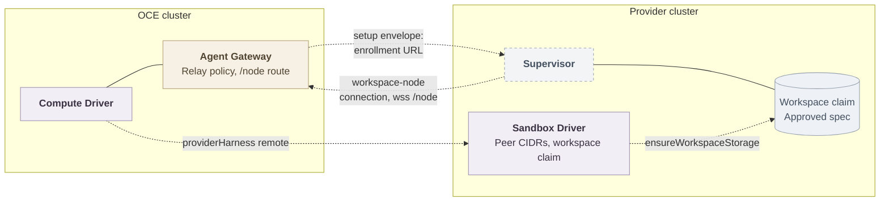

# Proposal: cross-cluster callback and workspace storage for remote Provider Harnesses

- **ID:** RFC-0027
- **Created:** 2026-11-03
- **Related:** [PR #4025](https://github.com/openclaw/openclaw-enterprise/pull/4025) (remote provider route), [PR #2183](https://github.com/openclaw/openclaw-enterprise/pull/2183) (sandbox callback isolation), [RFC-0003](0003-gateway-harness-storage-split.md) (Gateway–Harness storage split), [PR #3959](https://github.com/openclaw/openclaw-enterprise/pull/3959) (OpenShell managed Workspaces, excludes cross-cluster deployment)

## Summary

Let an Installation select a Provider Harness outside the Kubernetes Compute Driver's Pod-selection reach, by defining the two responsibilities that selection lacks: how the provider's supervisor reaches only its own Agent's Gateway for the workspace-node connection, and who creates the Agent's workspace storage in the provider cluster. Both extend the Sandbox Driver contract and reuse the per-Agent relay policy and workspace mount admission, so activation trimming keeps working. Because the network layer cannot fence a superseded revision's supervisor when source CIDRs are shared, the proposal adds an activation-time enrollment fence at the Agent Gateway and keeps the provider workspace claim Agent-scoped, deleted only at final Agent deletion.

## Motivation

A Sandbox Driver may own the dedicated Harness endpoint (the `harnessEndpoint` contract, `packages/contracts/src/drivers/sandbox/index.ts:288`). Today Compute admits that provider as a local Pod peer: `network.providerHarness` takes a namespace, Pod labels, and a Service ClusterIP (`apps/controller/src/drivers/compute/kubernetes/index.ts:514`), and the networking reference limits that bridge to owned k3d profiles. When the OpenShell gateway serves Harness endpoints from a separate cluster, Compute cannot express the provider at all.

[PR #4025](https://github.com/openclaw/openclaw-enterprise/pull/4025) adds a `{ remote: true, address, port }` form. Its live two-cluster run proved routing and sandbox creation, and also proved the two gaps this RFC must close:

1. **Callback.** The workspace node dials the Agent Gateway's Envoy route, a ClusterIP Service in the OCE cluster. Compute mints the enrollment against `getGatewayEndpoint` (`index.ts:4887`) and passes the URL to the Sandbox through the setup envelope (`openshell.ts:1018`). From the provider cluster the hostname does not resolve: the recorded run failed with `ENOTFOUND`, the revision stayed incomplete, and transport returned 503. #4025's first answer also admitted every Pod in a namespace labeled `openshell.ai/managed-by: openshell` to every Agent Gateway — a grant additive over the exact per-sandbox policy #2183 established. It is withdrawn; the branch refuses `{ remote: true }` at startup until this contract exists.
2. **Storage.** Compute creates the approved workspace PVC in the OCE cluster (`harnessWorkspaceClaim`, `index.ts:14413`) and passes its claim name through `HarnessWorkloadRequirements.workspaceMounts` (`contracts/src/drivers/sandbox/index.ts:26`). The OpenShell driver maps those mounts to sandbox volumes by the same claim name in the provider cluster (`openshell.ts:1485`), where no such claim exists; the recorded run needed a manually created PVC before the Pod could schedule.

## Goals

- A remote provider configuration that activates a revision end to end — enrollment, model turns, cutover — with no manual provider-cluster setup beyond operator infrastructure.
- The remote form preserves #2183's boundary as far as the network layer allows and supplies a fencing mechanism for the gap it cannot.
- The callback and storage responsibilities are Driver contract changes, decided here before implementation, per the repository's Driver-contract rule; the fence names its Agent Gateway owner.
- Fail closed: a remote form without a Sandbox Driver that implements the contract refuses at startup, never degrades to a broad grant.

## Non-goals

- Synchronizing or replicating workspace data between clusters. The workspace lives in the provider cluster only, matching [RFC-0003](0003-gateway-harness-storage-split.md).
- Changing the local Pod-peer provider form, embedded mode, or ordinary Agents.
- Owning the inter-cluster network itself (VPN, mesh, or routed CIDRs stay operator infrastructure).
- The broader OpenShell-owned placement and storage direction of [PR #3959](https://github.com/openclaw/openclaw-enterprise/pull/3959), which excludes cross-cluster deployment.

## Proposal

The shape of the remote topology, with proposed connections dashed:



### Callback reachability and admission

Two problems, two owners:

**Routing (how the supervisor reaches the OCE cluster).** The setup envelope already carries the exact enrollment URL; no new credential is needed. The contract requires the Agent Gateway's routed endpoint (`gatewayRouting`) to be resolvable and reachable from the provider cluster; the operator publishes its hostname through cross-cluster DNS or a routable address (LoadBalancer or NodePort in front of Envoy). Whether Compute should own a provider-facing callback setting instead is [open question 1](#open-questions).

**Admission (which sources the Gateway's network policy admits).** Extend the Sandbox Driver contract so revision-scoped peer resolution can return source CIDRs:

```ts
workspaceNodePeerAddresses?(
  context: SandboxNamespaceContext & { readonly revision: Readonly<AgentRevision> },
): Promise<readonly { readonly cidr: string }[] | undefined>;
```

An implementation returns the source addresses its supervisor for that exact revision connects from — for OpenShell, the provider cluster's egress addresses — and refuses a foreign revision, namespace, or harness, exactly as `workspaceNodePeerLabels` does (`openshell.ts:4749`).

Compute renders these CIDRs as `ipBlock` peers inside the same per-Agent `allow-gateway-workspace-node-<agentHash>` policy that today carries the label peers (`index.ts:15099`), so activation pinning, predecessor admission, and `deleteUnwrittenAgentPolicies` trimming keep their semantics: a revision with no resolved peers keeps `ingress: []`, because an empty `from` would admit every source.

**What L3 can and cannot guarantee.** With label peers, the policy selects one Sandbox's Pods: another Agent's supervisor cannot reach the Gateway, and a retired predecessor loses access at the network layer. With CIDR peers it admits an address range, not a Pod, so revisions of one Agent or Agents sharing a provider cannot be distinguished when their CIDRs overlap — and no existing mechanism fills that gap. The Gateway Deployment is per Agent, shared by its revisions (`index.ts:6516`); the revision-suffixed Gateway object is a configuration ConfigMap (`index.ts:13084`). The node's device identity is the Agent's, scoped to Agent and Harness (`index.ts:11552`) and deliberately outliving revisions (`index.ts:12233`); its revision marker is readiness bookkeeping (`index.ts:12261`), and the Gateway refuses no valid pairing. Locally this is not a gap — the L3 label pin is the fence, and #2183 rejected L7-alone reliance — but the remote form needs a new fencing mechanism.

**Predecessor withdrawal and fencing.** Activation pins the policy to the activated revision's peers, as today; differing source CIDRs alone remove the predecessor at L3. When they share CIDRs — the normal case for one provider — the RFC introduces an **enrollment fence**:

- Each revision's preparation mints its node setup for that revision; the setup envelope already exists.
- The Gateway keeps, per Agent, the enrollment it currently accepts. At activation, Compute advances that acceptance to the activated revision's enrollment, in the same transition that pins the relay policy.
- The Gateway then closes any other node connection for that Agent and refuses its credentials: a device token or unredeemed setup code from a superseded revision is rejected before any Gateway effect, so the predecessor is refused once the successor is admitted.

Building it needs a Gateway-side per-Agent accepted-enrollment record that refuses superseded credentials (today it only reports connectivity, `index.ts:12327`), an activation step in Compute, and the refusal path in the node protocol. It must not regress the local form: a maintenance re-activation pins the enrollment it already accepts.

**Dev-only variant.** For single-address topologies — one provider node, NodePort or k3d — the driver returns the provider's address as a `/32` (or `/128`): the same mechanism at its smallest range, and the shape CI can exercise. It is not a separate contract.

### Workspace storage placement and lifecycle

Extend the Sandbox Driver contract so Compute hands the approved workspace claim to the provider:

```ts
ensureWorkspaceStorage?(
  context: SandboxNamespaceContext & { readonly revision: Readonly<AgentRevision> },
  claim: { readonly name: string; readonly accessModes: readonly string[]; readonly size: string },
): Promise<void>;
```

Compute already derives the approved spec (`harnessWorkspaceClaim`) and validates the mounts the provider reports (`sandboxWorkspaceMounts`, `index.ts:12502`). In the remote form, Compute passes that spec through this method instead of creating the claim itself, and the provider creates it in its own cluster with a provider-local storage class. The existing mount admission verifies the result: the sandbox Pod must mount the approved claim name, subpaths, and paths or preparation fails.

Lifecycle follows Compute's durable-storage rule, not its revision cleanup. The claim is Agent-scoped — its name derives from the Agent (`index.ts:14405`) and successor revisions reuse it — so the Driver's `cleanup`, which runs on revision stop, retirement, and Namespace cleanup (`contracts/src/drivers/sandbox/index.ts:323`), must not delete it. [PR #308](https://github.com/openclaw/openclaw-enterprise/pull/308) established this for the OCE cluster: only Agent deletion owns durable state (`index.ts:5433`). The contract therefore adds a final-deletion member:

```ts
deleteWorkspaceStorage?(
  context: SandboxNamespaceContext & { readonly agentId: string },
): Promise<void>;
```

Compute calls it only from final Agent deletion, beside its own claim deletion (`index.ts:5436`); Namespace teardown, which removes the provider namespace itself, may clear what remains through the Driver's existing Namespace-scoped cleanup.

The claim's spec stays OCE-approved; only its placement moves, adding none of the synchronization RFC-0003 excluded.

### Driver contract changes

All contract additions below are proposals; the implementation plan owns their final shapes.

- **Sandbox Driver:** `workspaceNodePeerAddresses` (source CIDRs, revision-scoped, refuse foreign revisions), `ensureWorkspaceStorage` (create the approved Agent-scoped claim in the provider cluster), and `deleteWorkspaceStorage` (remove it at final Agent deletion only), all optional, mirroring the optionality of `workspaceNodePeerLabels`.
- **Agent Gateway:** the enrollment fence — a per-Agent accepted-enrollment record, advanced at activation, that refuses superseded node credentials — is a Gateway capability Compute drives at activation, not a Sandbox Driver member.
- **Compute Driver:** `network.providerHarness` gains the `{ remote: true, address, port }` form that #4025 renders. When the provider is remote, Compute requires the selected Sandbox Driver to implement the new members and refuses startup otherwise, as it requires `workspaceNodePeerLabels` of an OpenShell driver today (`index.ts:15030`). It renders `ipBlock` peers only from driver-resolved CIDRs, validates each as a `scopedCidr`, and refuses ranges overlapping `gatewayTrustedProxyCidrs`, since a trusted-proxy source bypasses the Gateway's own attribution.

### Configuration

```yaml
network:
  providerHarness:
    remote: true
    address: 192.0.2.10 # one exact IP; bare or /32, /128
    port: 8443 # must serve WSS
gatewayRouting:
  hostname: agents.example.com # must resolve in the provider cluster
```

The remote address keeps #4025's validation: exactly one IP, WSS endpoint, no credentials in the URL. The provider-cluster storage class is Sandbox Driver configuration, not Compute configuration; whether it needs an explicit setting is [open question 2](#open-questions).

### Failure modes

- **Remote form without contract support** — startup refusal naming the missing Driver capability; no policy is written.
- **No peers resolved** — the relay policy keeps `ingress: []`; preparation waits with a stated cause rather than admitting broadly.
- **Fence cannot be advanced** — activation fails and retries; the predecessor keeps serving, so a successor is never admitted while its predecessor retains access.
- **Unreachable callback** — the supervisor's connection fails; the revision stays incomplete and transport returns 503, as today.
- **Storage cannot be created or scheduled** (missing class, quota) — the sandbox Pod stays unschedulable; preparation fails with the provider's stated cause and retries.
- **Retirement or namespace cleanup** — revision retirement and stop preserve the Agent-scoped claim; final Agent deletion and Namespace teardown remove it. An uncertain deletion keeps the Agent's cleanup pending, as with sandbox deletion today.

### Security considerations

- The withdrawn namespace-wide grant is not reintroduced under any form.
- L4 admission by CIDR is broader than label admission, and no existing mechanism fences a superseded revision's supervisor that shares the CIDR: the Gateway accepts the Agent's device across revisions by design. The compensating control is the proposed enrollment fence, which must reject a retired supervisor's credentials before any Gateway effect; the remote form must not ship without it.
- Remote peer CIDRs must not fall inside `gatewayTrustedProxyCidrs`; Compute refuses the overlap rather than warning, because it would let the provider's supervisor speak as a trusted client.
- Workspace data moves to the provider cluster. The provider already runs the Harness and holds the workspace content by design; placing the claim there extends no trust beyond the provider boundary, and the Gateway keeps its separate private state in the OCE cluster. The enrollment URL and CA bundle keep traveling through the existing Agent-owned setup Secret.

## Alternatives considered

- **Namespace-label ingress (withdrawn).** The grant #4025 first shipped is additive over the exact relay policy, cannot be revoked by activation trimming, and depends on a label upstream OpenShell puts on Pods, not namespaces. Rejected by review.
- **Existing node acceptance alone.** Admit the provider's CIDR at L4 and rely on the Gateway's current node acceptance, which recognizes the Agent's device across revisions. Rejected: that acceptance fences nothing — a retired supervisor keeps its Gateway effects while its successor serves, and #2183 rejected L7-alone reliance.
- **Gateway-side tunnel or connection reversal.** Have the OCE cluster connect outward to the provider instead of admitting the provider's callback. The callback already connects outward; its only failure is routability, which is operator infrastructure. A tunnel adds a component and a credential without changing the admission question; an operator may still run one.
- **Provider-pre-provisioned storage.** Require the operator to create the workspace claim in the provider cluster, as the live run did by hand. Rejected: it leaves the revision incomplete until manual setup, which is the failure this RFC closes. Retained only if maintainers prefer verification over creation ([open question 2](#open-questions)).
- **Reuse the existing `executionCluster` mode.** That mode manages a second OCE-owned cluster with its own Envoy routing and `harnessEndpointCidrs`; a remote provider is provider-owned and not under Compute's reconciliation. Its CIDR-validated egress precedent informs this proposal but does not replace it.

## Migration

The platform has no production consumers. The local Pod-peer form, embedded mode, and existing policies are unchanged; no persisted data changes, and the provider-cluster claims are new resources created only by the new path. #4025's startup refusal is the migration guard: the remote form stays refused until the contract lands.

## Lifting the #4025 refusal

The refusal is replaced, not relaxed, when all of the following hold:

1. The Sandbox Driver contract carries the new members and the OpenShell driver implements them.
2. Compute validates the remote form against the selected Driver at startup and renders CIDR peers inside the per-Agent relay policy, including the trusted-proxy overlap refusal.
3. The Agent Gateway enforces the activation-driven enrollment fence, rejecting a superseded revision's node credentials before Gateway effects.
4. Workspace storage flows through `ensureWorkspaceStorage`, is verified by mount admission, and is deleted only at final Agent deletion.
5. An integration test through the regular Agent workflow exercises the remote provider end to end: activation, a model turn, foreign-node refusal before Gateway I/O, and a retired predecessor's supervisor refused after cutover.
6. The networking and sandbox Driver references document the remote form, its L4/L7 split, the fence, and the storage placement.

## Open questions

1. **Callback routing owner.** Is an operator-published `gatewayRouting.hostname` the contract, or should Compute render a provider-facing callback endpoint (for example a NodePort or LoadBalancer for Envoy) so operators do not need cross-cluster DNS?
2. **Storage ownership.** Should the provider create the claim from the approved spec, as proposed, or pre-provision it and let Compute verify it, closer to `verifyPersistentVolumeClaim`? Who names the provider-cluster storage class, and is that Driver or Installation configuration? How does this divide relate to [PR #3959](https://github.com/openclaw/openclaw-enterprise/pull/3959)'s single-cluster OpenShell-owned storage?
3. **CIDR granularity and fencing.** Must remote peer CIDRs be disjoint across Agents and revisions, with startup refusal on overlap, or is the proposed enrollment fence sufficient when they overlap? The `/32` variant makes this acute in CI, where all supervisors share one address, and the fence requires Gateway-side changes the local form does not need.
4. **Scope of initial support.** Ship the `/32` single-address variant first with the general CIDR form behind it, or land both at once?
