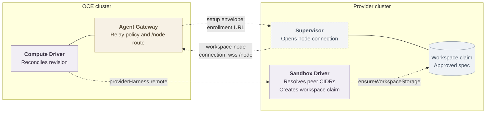

# Proposal: cross-cluster callback and workspace storage for remote Provider Harnesses

- **ID:** RFC-0027
- **Created:** 2026-11-03
- **Related:** [PR #4025](https://github.com/openclaw/openclaw-enterprise/pull/4025) (remote provider route), [PR #2183](https://github.com/openclaw/openclaw-enterprise/pull/2183) (sandbox callback isolation), [RFC-0003](0003-gateway-harness-storage-split.md) (Gateway–Harness storage split), [PR #3959](https://github.com/openclaw/openclaw-enterprise/pull/3959) (OpenShell managed Workspaces, excludes cross-cluster deployment)

## Summary

Let an Installation select a Provider Harness that runs in a cluster the Kubernetes Compute Driver cannot reach with Pod selection, by defining the two responsibilities that selection currently lacks: how the provider's supervisor reaches only its own Agent's Gateway for the workspace-node connection, and who creates the revision's workspace storage in the provider cluster. Both responsibilities extend the Sandbox Driver contract and reuse the existing per-Agent relay policy and workspace mount admission, so activation trimming and predecessor withdrawal keep working.

## Motivation

A Sandbox Driver may own the dedicated Harness endpoint (the `harnessEndpoint` contract, `packages/contracts/src/drivers/sandbox/index.ts:288`). Today Compute admits that provider as a local Pod peer: `network.providerHarness` takes a namespace, Pod labels, and a Service ClusterIP (`apps/controller/src/drivers/compute/kubernetes/index.ts:514`), and the networking reference limits that bridge to owned k3d profiles. When the OpenShell gateway serves Harness endpoints from a separate cluster, Compute cannot express the provider at all.

[PR #4025](https://github.com/openclaw/openclaw-enterprise/pull/4025) adds a `{ remote: true, address, port }` form. Its live two-cluster run proved routing and sandbox creation, and also proved the two gaps this RFC must close:

1. **Callback.** The workspace node dials the Agent Gateway's Envoy route, a ClusterIP Service in the OCE cluster. Compute mints the enrollment against `getGatewayEndpoint` (`index.ts:4887`) and passes the URL to the Sandbox through the setup envelope (`openshell.ts:1018`). From the provider cluster the hostname does not resolve: the recorded run failed with `ENOTFOUND`, the revision stayed incomplete, and transport returned 503. #4025's first answer also admitted every Pod in a namespace labeled `openshell.ai/managed-by: openshell` to every Agent Gateway. That grant is additive over the exact per-sandbox policy and defeats the isolation #2183 established, so it is withdrawn; the branch refuses `{ remote: true }` at startup until this contract exists.
2. **Storage.** Compute creates the approved workspace PVC in the OCE cluster (`harnessWorkspaceClaim`, `index.ts:14413`) and passes its claim name through `HarnessWorkloadRequirements.workspaceMounts` (`contracts/src/drivers/sandbox/index.ts:26`). The OpenShell driver maps those mounts to sandbox volumes by the same claim name in the provider cluster (`openshell.ts:1485`), where no such claim exists; the recorded run needed a manually created PVC before the sandbox Pod could schedule.

## Goals

- A remote provider configuration that activates a revision end to end: supervisor enrollment, model turns, and revision cutover, with no manual provider-cluster setup beyond operator infrastructure.
- The remote form preserves #2183's boundary as far as the network layer allows, and states exactly what it cannot guarantee.
- Both responsibilities are Driver contract changes, decided here before implementation, per the repository's Driver-contract rule.
- Fail closed: a remote form without a Sandbox Driver that implements the contract refuses at startup, never degrades to a broad grant.

## Non-goals

- Synchronizing or replicating workspace data between clusters. The workspace lives in the provider cluster only, matching [RFC-0003](0003-gateway-harness-storage-split.md).
- Changing the local Pod-peer provider form, embedded mode, or ordinary Agents.
- Owning the inter-cluster network itself (VPN, mesh, or routed CIDRs stay operator infrastructure).
- The broader OpenShell-owned placement and storage direction of [PR #3959](https://github.com/openclaw/openclaw-enterprise/pull/3959), which excludes cross-cluster deployment.

## Proposal

The shape of the remote topology, with proposed connections dashed:



### Callback reachability and admission

Two problems, two owners:

**Routing (how the supervisor reaches the OCE cluster).** The setup envelope already carries the exact enrollment URL; no new credential is needed. The contract requires that the Agent Gateway's routed endpoint (`gatewayRouting`) be resolvable and reachable from the provider cluster on the operator's inter-cluster network. Compute continues to derive the URL from `gatewayRouting.hostname` and `endpointPort`. The operator publishes that hostname through cross-cluster DNS or a routable address (LoadBalancer or NodePort in front of Envoy). Whether Compute should own a provider-facing callback setting instead of reusing `gatewayRouting` is [open question 1](#open-questions).

**Admission (which sources the Gateway's network policy admits).** Extend the Sandbox Driver contract so revision-scoped peer resolution can return source CIDRs:

```ts
/** Proposed contract addition; final shape belongs to the implementation plan. */
workspaceNodePeerAddresses?(
  context: SandboxNamespaceContext & { readonly revision: Readonly<AgentRevision> },
): Promise<readonly { readonly cidr: string }[] | undefined>;
```

An implementation returns the source addresses its supervisor for that exact revision connects from — for OpenShell, the provider cluster's egress addresses toward the OCE cluster. It must refuse a foreign revision, namespace, or harness, exactly as `workspaceNodePeerLabels` does (`openshell.ts:4749`).

Compute renders these CIDRs as `ipBlock` peers inside the same per-Agent `allow-gateway-workspace-node-<agentHash>` policy that today carries the label peers (`index.ts:15099`). Because the grant stays inside that policy, activation pinning, preparation-time predecessor admission, and `deleteUnwrittenAgentPolicies` trimming keep their current semantics: a revision with no resolved peers keeps `ingress: []`, because an empty `from` would admit every source.

**What L3 can and cannot guarantee.** With label peers, the policy selects one Sandbox's Pods, so one Agent's supervisor cannot reach another Agent's Gateway and a retired predecessor loses access at the network layer. With CIDR peers, the network layer admits an address range, not a Pod. Two revisions of one Agent, or two Agents sharing a provider, can share source CIDRs, so the network layer cannot distinguish them. Per-sandbox authority in the remote form comes from the Gateway's node credential: enrollment mints a revision-bound setup envelope and device token, and the Gateway credits only the revision whose node connects (`index.ts:11942`). The remote form therefore trades exact L3 peer selection for L4 range admission plus L7 credential admission.

**Predecessor withdrawal.** On activation, the policy is pinned to the activated revision's peers, as today. When a predecessor and its successor share source CIDRs, the pin changes nothing at L3; the enforced boundary is the Gateway's own. Each revision has its own Gateway Deployment (`gateway-<agent>-rev-<revision>`, `index.ts:8982`), so retirement removes the predecessor's Deployment, and its node credential does not pair with the activated revision's enrollment. When their CIDRs differ, the pin also removes the predecessor's range at L3.

**Dev-only variant.** For single-address topologies — one provider node, NodePort or k3d — the driver returns the provider's single address as a `/32` (or `/128`). This is the same mechanism with the smallest possible range and is the shape the fixture and development profiles can exercise in CI. It is not a separate contract.

### Workspace storage placement and lifecycle

Extend the Sandbox Driver contract so Compute hands the approved workspace claim to the provider:

```ts
/** Proposed contract addition; final shape belongs to the implementation plan. */
ensureWorkspaceStorage?(
  context: SandboxNamespaceContext & { readonly revision: Readonly<AgentRevision> },
  claim: { readonly name: string; readonly accessModes: readonly string[]; readonly size: string },
): Promise<void>;
```

Compute already derives the approved spec (`harnessWorkspaceClaim`) and validates the mounts the provider reports (`sandboxWorkspaceMounts`, `index.ts:12502`). In the remote form, Compute passes that spec through this method instead of creating the claim itself, and the provider creates the claim in its own cluster with a provider-local storage class. Compute verifies the result by the existing mount admission on the provisioned workload — the sandbox Pod must mount the approved claim name, subpaths, and paths or preparation fails. Lifecycle follows existing contracts: the Driver's `cleanup` removes the claim when the revision is retired or the namespace is cleaned up, and a claim the provider cannot create or schedule keeps the revision incomplete with a stated cause.

The claim's spec stays OCE-approved; only its placement moves. This keeps the current invariant that the Harness mounts exactly the approved workspace paths, and adds none of the synchronization RFC-0003 excluded.

### Driver contract changes

- **Sandbox Driver:** `workspaceNodePeerAddresses` (source CIDRs, revision-scoped, refuse foreign revisions) and `ensureWorkspaceStorage` (create the approved claim in the provider cluster), both optional, mirroring the optionality of `workspaceNodePeerLabels`.
- **Compute Driver:** `network.providerHarness` gains the `{ remote: true, address, port }` form that #4025 renders. When the provider is remote, Compute requires the selected Sandbox Driver to implement both new members and refuses startup otherwise, the same fail-closed refusal that requires `workspaceNodePeerLabels` of an OpenShell driver today (`index.ts:15030`). Compute renders `ipBlock` peers only from driver-resolved CIDRs, validates each as a `scopedCidr`, and refuses ranges that overlap `gatewayTrustedProxyCidrs`, since a trusted-proxy source would bypass the Gateway's own attribution.

### Configuration

```yaml
network:
  providerHarness:
    remote: true
    address: 192.0.2.10 # one exact IP; bare or /32, /128
    port: 8443 # must serve WSS
gatewayRouting:
  hostname: agents.example.com # must resolve in the provider cluster
```

The remote address keeps #4025's validation: exactly one IP, WSS endpoint, no credentials in the URL. The provider-cluster storage class is Sandbox Driver configuration, not Compute configuration; whether it needs an explicit setting is [open question 2](#open-questions).

### Failure modes

- **Remote form without contract support** — startup refusal naming the missing Driver capability; no policy is written.
- **No peers resolved** — the relay policy keeps `ingress: []`; preparation waits with a stated cause rather than admitting broadly.
- **Unreachable callback** — the supervisor's connection fails; the revision stays incomplete and transport returns 503, as today. The Gateway's route answers 404/502–504 while it converges, which the enrollment client already treats as retryable.
- **Storage cannot be created or scheduled** (missing class, quota) — the sandbox Pod stays unschedulable; preparation fails with the provider's stated cause and retries.
- **Retirement or namespace cleanup** — the Driver's `cleanup` deletes the provider-cluster claim; an uncertain outcome keeps the revision's cleanup pending, as with sandbox deletion today.

### Security considerations

- The withdrawn namespace-wide grant is not reintroduced under any form.
- L4 admission by CIDR is broader than label admission. The compensating control is the revision-bound node credential on the `/node` route: the Gateway must keep refusing a foreign or expired node even when its source address is admitted. The networking reference states this limit beside the remote form.
- Remote peer CIDRs must not fall inside `gatewayTrustedProxyCidrs`; Compute refuses the overlap rather than warning, because a trusted-proxy source would let the provider's supervisor speak as a trusted client.
- Workspace data moves to the provider cluster. The provider already runs the Harness and holds the workspace content by design; placing the claim there does not extend trust beyond the provider boundary, and the Gateway keeps its separate private state in the OCE cluster.
- The enrollment URL and CA bundle travel through the existing Agent-owned setup Secret; no new credential crosses the boundary.

## Alternatives considered

- **Namespace-label ingress (withdrawn).** The grant #4025 first shipped is additive over the exact relay policy, cannot be revoked by activation trimming, and depends on a label upstream OpenShell puts on Pods, not namespaces. Rejected by review; this RFC replaces it.
- **L7-only admission.** Admit the provider's CIDR at L4 and rely entirely on node credentials. Rejected as a loss of defense in depth: the L4 grant stays inside the per-Agent policy and is trimmed on activation, which costs little and contains a compromised or mis-credentialed peer.
- **Gateway-side tunnel or connection reversal.** Have the OCE cluster connect outward to the provider instead of admitting the provider's callback. The callback already connects outward; its only failure is routability, which is operator infrastructure. A tunnel adds a component and a credential without changing the admission question. Rejected for this contract; an operator may still run one.
- **Provider-pre-provisioned storage.** Require the operator to create the workspace claim in the provider cluster, as the live run did by hand. Rejected as the accepted configuration: it leaves the revision incomplete until manual setup, which is the failure this RFC closes. Retained as a fallback only if maintainers prefer verification over creation ([open question 2](#open-questions)).
- **Reuse the existing `executionCluster` mode.** That mode manages a second OCE-owned cluster with its own Envoy routing and `harnessEndpointCidrs`; a remote provider is provider-owned and not under Compute's reconciliation. The precedent (CIDR-validated egress to a remote execution plane) informs this proposal but does not replace it.

## Migration

The platform has no production consumers. The local Pod-peer form, embedded mode, and existing policies are unchanged; no persisted data changes. The provider-cluster claims are new resources created only by the new path. #4025's startup refusal is the migration guard: the remote form stays refused until the contract lands.

## Lifting the #4025 refusal

The refusal is replaced, not relaxed, when all of the following hold:

1. The Sandbox Driver contract carries both new members and the OpenShell driver implements them.
2. Compute validates the remote form against the selected Driver at startup and renders CIDR peers inside the per-Agent relay policy, including the trusted-proxy overlap refusal.
3. Workspace storage flows through `ensureWorkspaceStorage` and is verified by mount admission.
4. An integration test through the regular Agent workflow exercises the remote provider end to end: activation, a model turn, foreign-node refusal before Gateway I/O, and predecessor withdrawal after cutover.
5. The networking and sandbox Driver references document the remote form, its L4/L7 split, and the storage placement.

## Open questions

1. **Callback routing owner.** Is an operator-published `gatewayRouting.hostname` the contract, or should Compute render a provider-facing callback endpoint (for example a NodePort or LoadBalancer for Envoy) so operators do not need cross-cluster DNS?
2. **Storage ownership.** Should the provider create the claim from the approved spec, as proposed, or pre-provision it and let Compute verify it, closer to `verifyPersistentVolumeClaim`? Who names the provider-cluster storage class, and is that Driver configuration or Installation configuration? How does this divide relate to [PR #3959](https://github.com/openclaw/openclaw-enterprise/pull/3959), which proposes OpenShell-owned storage within one cluster?
3. **CIDR granularity.** Must remote peer CIDRs be disjoint across Agents and revisions, with startup refusal on overlap, or is the L7 credential boundary sufficient when they overlap? The dev-only `/32` variant makes this acute in CI, where all supervisors may share one address.
4. **Predecessor withdrawal with shared CIDRs.** Accept Gateway-side withdrawal (retired Gateway removal plus revision-bound readiness) as the enforced cutover boundary, or require the provider to give each revision distinct egress addresses, which single-address topologies cannot?
5. **Scope of initial support.** Ship the `/32` single-address variant first with the general CIDR form behind it, or land both at once?
