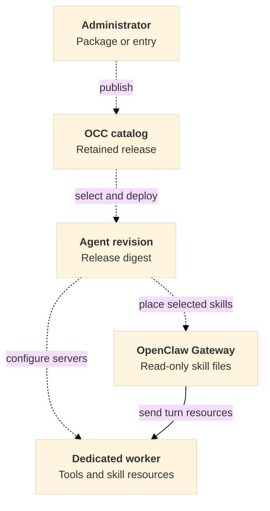

# Import plugin releases for dedicated OpenClaw Agents

- **ID** RFC-0029
- **Implementation plan** [Deliver imported plugins](../plans/0029-dedicated-openclaw-plugin-import.md)

## Decision

A Namespace administrator imports a package or chooses one entry from a marketplace in OpenClaw Enterprise (OCE). OCE shows the skills, hosted Model Context Protocol (MCP) servers, credential requirements, and unsupported components before the administrator publishes a release in that Namespace. An Agent owner selects that release in the Agent draft and deploys it to a dedicated OpenClaw Harness. A package may supply skills, hosted servers, or both.

Today the [OpenClaw Plugin Driver](../../apps/controller/src/drivers/plugin/managed-catalog.ts) reads releases shipped in OCE images. Google Workspace supplies reviewed skill instructions and a worker executable. Slack supplies a hosted server descriptor. Publishing a custom package requires a way to retain the reviewed files and deploy them independently of the image. The [managed native plugins proposal](https://github.com/openclaw/openclaw-enterprise/pull/3142) establishes the rationale for reviewing and pinning third-party releases. This RFC proposes the catalog and deployment contract for imported components.

## Import and publish a release

The OpenClaw Plugin Driver reads [Agent Plugins 1.0](https://agent-plugins.org/specification) packages and [Claude packages](https://code.claude.com/docs/en/plugins-reference). The portable reader inspects the root manifest, skill directories, and companion MCP descriptor. The Claude reader resolves declared or conventional skill roots and inline or file-based MCP declarations, including `.mcp.json`. When importing from a marketplace, the reader includes component declarations supplied by the selected entry. It resolves the entry to one package and reports unsupported source types. Inspection never runs package code.

For each skill, retain the complete selected directory, including relative references, executable scripts and assets. Validate paths against the resolved package root, reject escaping links, and apply archive and file limits before extraction. Preserve file content and executable flags. Match the pinned [OpenClaw bundle limits](https://github.com/openclaw/openclaw/blob/513c12703ad9a9161cc123e0b8ed4ecb811aa6b3/packages/gateway-protocol/src/schema/skill-library.ts#L8-L11): at most 256 files per skill including `SKILL.md`, 1 MiB per file, and 8 MiB of decoded file contents per skill. The [turn resource builder](https://github.com/openclaw/openclaw/blob/513c12703ad9a9161cc123e0b8ed4ecb811aa6b3/src/skills/runtime/resources.ts#L308-L317) also limits all delivered skills together to 8 MiB. Reject a skill that exceeds the per-skill limits during import. At deployment, reject known selections that cannot fit together. At turn preparation, fail clearly if other active skills take the combined resources over the limit. Silently truncating files would change the approved release.

For each hosted server, show the fixed HTTPS Streamable HTTP endpoint and how it can use OCE's existing credential and tool policy. A provider's credential placeholder identifies a binding requirement. The Agent owner supplies authorized bindings separately. Skill-only packages need no server or credential.

Show omitted components and their effect before publication. Examples include a local stdio server, a hook, and a provider-specific subagent. A package whose only component starts a local process has no deployable content in this scope. Bundled skill scripts may run on the worker with the Agent's existing permissions. Package install hooks, dependency installers, native Gateway extensions, and embedded-only features stay outside this import contract.

OpenClaw Control Plane (OCC) authorizes the publisher through the IAM Driver on the exact Namespace, records the publisher and source, and retains the imported content under an immutable release identity in that Namespace. The release digest covers the admitted files and their paths and modes, the server descriptors, and the selected components. Preview and publication must refer to the same bytes. A changed source requires a new preview and release. Bytes and metadata become available together, so a failed or repeated import cannot expose an incomplete release. Redeploying an admitted release must work while the publisher or marketplace is unavailable.

## Deploy and use the release

OCC presents the release through the existing Agent plugin picker. The [Plugin Driver](../../docs/reference/drivers/plugin.md) validates that the selected components can run in the Agent's placement. OCC checks the caller's permission to update the Agent and use the release. It resolves the Namespace from the stored Agent at deployment, checks release access again, and records the Namespace, release identity and digest in the Agent revision. Each Agent keeps its own credential bindings and allowed tool names.

Compute makes the selected skill directories available read-only to the Gateway outside the writable Agent workspace. The runtime launcher checks their content against the release manifest before adding the directories to Gateway skill discovery. OpenClaw already [classifies these roots as Gateway-owned](https://github.com/openclaw/openclaw/blob/513c12703ad9a9161cc123e0b8ed4ecb811aa6b3/src/skills/loading/workspace-skill-sources.ts#L38-L65). It delivers skill resources to the [dedicated worker](https://github.com/openclaw/openclaw/blob/513c12703ad9a9161cc123e0b8ed4ecb811aa6b3/src/worker/embedded-agent.runtime.ts#L99-L107) for a turn. A missing release, digest mismatch or incompatible placement prevents the candidate from becoming ready.

OpenClaw [merges skill sources in precedence order](https://github.com/openclaw/openclaw/blob/513c12703ad9a9161cc123e0b8ed4ecb811aa6b3/src/skills/loading/workspace-skill-roots.ts#L57-L93). If two selected releases provide the same effective skill name, reject the selection with the colliding names and releases. If discovery resolves an imported name to a different source, such as a same-name skill in the Agent's writable workspace, fail closed before sending the skill to the worker. Check the source when preparing each turn so a workspace change after startup cannot silently replace the reviewed instructions.

For a supported hosted server, use the [existing managed MCP flow](../../docs/flows/agent-plugins.md#2-admit-an-immutable-plugin-deployment). The Agent owner binds a compatible account when required, discovers the available tools and selects the upstream tool names. The worker calls the server under that selection. OCE must report a transport or credential binding that its dedicated runtime cannot enforce.

Dashed arrows show the proposed import and delivery steps. The solid arrow shows the existing worker turn path.

Selecting an update creates a new deployment using the new release. Removing the plugin and deploying excludes its skills and server from the new version. Restart and recovery of an existing revision use the retained content identified by that revision. A runtime may retain tools or files for a turn already in progress under its original revision.

## Managed Gateway installation

OCE owns the deployment described above. When Gateway managed mode is enabled, the native Gateway must deny operator skill installation before its first effect, including ClawHub installation, archive installation, and installation of a declared dependency. The [current managed controls](../../docs/reference/agents/gateway-managed-mode.md) protect native configuration writes. A native installer can change files without writing that configuration. Apply the denial at the [Gateway method used by native clients](https://github.com/openclaw/openclaw/blob/513c12703ad9a9161cc123e0b8ed4ecb811aa6b3/src/gateway/server-methods/skills-install.ts#L25-L37). Hiding an install control would leave the RPC callable. Trusted deployment supplies the revision's files through Compute.

## Publication authority

Namespace administrators may publish only in their own Namespace. For preview and publication, OCC resolves the Namespace from the stored resource addressed by the request and checks Namespace administration through the selected IAM Driver. The package, marketplace and request body have no authority to choose a different owner. Catalog listing and release reads require read access in that Namespace. For an Agent picker, save or deployment, OCC resolves the Namespace from the stored Agent. For Agent creation it uses the authorized destination Namespace. OCC only resolves releases owned by that Namespace and also enforces the existing Agent action.

Two Namespaces may independently publish the same package name and version, even when the bytes differ. The combination of Namespace and immutable release identity selects exactly one publication. A known release ID from another Namespace cannot be read, selected, or deployed through the first Namespace. Revision recovery uses the recorded Namespace, release identity, and digest. Audit evidence identifies the caller, Namespace, and outcome of publication and denial.

## Verification

Qualify the feature through the [implementation plan](../plans/0029-dedicated-openclaw-plugin-import.md). A fresh model turn on a dedicated OpenClaw worker must use an imported skill and its supporting file. Repeat after update and removal, and verify a selected hosted tool produces a real result for a mixed release. Exercise the managed-mode refusal through a native Gateway client.
