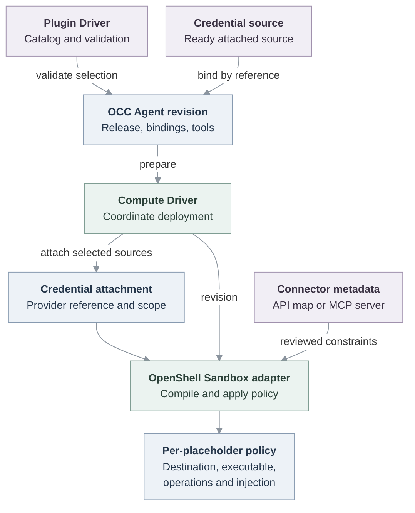

# RFC-0029: Managed OpenClaw plugins

- **Created:** 2026-10-21
- **RFC PR:** [#3142](https://github.com/openclaw/openclaw-enterprise/pull/3142)
- **Implementation plan:** [Managed OpenClaw plugins](../plans/0024-managed-native-openclaw-plugins.md)

## Decision

An operator in OpenClaw Enterprise (OCE) selects a reviewed plugin, connects an account, and selects allowed tools for hosted Model Context Protocol (MCP) servers before deploying an Agent. OpenClaw Control Plane (OCC) records the release, credential binding, and policy in the Agent revision. The Harness runs CLI commands or MCP clients inside its Sandbox; the egress path authorizes credential use before injection. Platform integrations that change Gateway behavior remain operator-managed.

Google Workspace and Slack MCP already implement the runtime paths. The remaining P0 work connects them to reusable OAuth accounts through the normal Console workflow. This proposal builds on [plugin policy](0014-plugin-policy-enforcement.md), [credential lifecycle](0023-egress-proxy-credential-lifecycle/index.md), and [saved OAuth accounts](0027-agent-oauth-connections/index.md). It defines how those capabilities compose for managed OpenClaw plugins. Decision status remains Proposed; the [plan](../plans/0024-managed-native-openclaw-plugins.md) separates merged implementation from open work.

## Plugins and execution placement

OpenClaw uses “plugin” for several kinds of integration. An OCE catalog entry describes which components a reviewed release contains and where each runs.

| Component                    | Placement and responsibility                                                                                                                                                                                  |
| ---------------------------- | ------------------------------------------------------------------------------------------------------------------------------------------------------------------------------------------------------------- |
| Skill                        | Instructions and resources made available to the model. The Gateway prepares the selected skill context for delegated turns.                                                                                  |
| CLI (command-line interface) | The Harness worker executes a reviewed binary. Google uses [gog](https://github.com/openclaw/gogcli), the OpenClaw project's Google Workspace CLI for Gmail, Calendar, Drive, and other Google services.      |
| Hosted MCP                   | The OpenClaw node host in the Harness pod runs the MCP client. The remote server executes its tools. The node advertises selected tool descriptors to the Gateway; the Gateway admits their use for the turn. |
| Gateway extension            | Code loaded into the Gateway process, such as Diffs. Channels, model providers, hooks, services, and changes to platform controls require separate platform-managed admission.                                |

The Google and Slack managed packages do not enter the native Gateway extension installer. The Gateway loads Google's skill and knows the MCP tool descriptors; the Harness performs credentialed CLI and MCP calls. Assets can be present in a shared runtime image without being activated in both processes. Gateway-native tools that require renewable credentials remain separate work, alongside channel credential delivery.

A plugin catalog entry grants neither credentials nor installation authority. The selected [Plugin Driver](../../docs/reference/drivers/plugin.md) supplies catalog metadata and validates compatible placement and supported policy. OCC authorizes the selection. Compute prepares the admitted runtime. The current `occ-plugin` catalog supports dedicated OpenClaw managed packages and curated embedded extensions. Multiple Plugin Drivers in one Installation are a separate [follow-up](../plans/0024-managed-native-openclaw-plugins.md#p1-and-separate-work).

## From selection to deployed policy

The current OpenShell path compiles policy during deployment. Editing a plugin selection changes desired state; redeployment applies it to a replacement runtime. A credential slot is a named requirement declared by a release, such as Google’s `account` slot. The Agent binds that slot to an authorized source.

This diagram describes the implemented OpenShell handoff. Compute asks the existing `CredentialGatewayDriver` adapter for source attachments, then calls `SandboxDriver.provisionHarness`. That legacy attachment interface is distinct from `CredentialProxyDriver`. The Plugin Driver has no generic install or policy-translation RPC; the Sandbox implementation owns conversion to OpenShell policy. See the [deployment flow](../../docs/flows/agent-plugins.md).

Each binding joins a release digest and credential slot to a source reference. The source attachment supplies its destination and scope restrictions; the reviewed release and Installation policy constrain executables. The Sandbox derives routes and credential injection from those inputs, plus the release's operation map or selected upstream MCP tool names. “Per-placeholder policy” describes this association; OpenShell represents it with provider attachments, network rules, and, for Google, middleware configuration.

Compute sends nonsecret package descriptors to the Gateway and worker. The runtime image contains the reviewed artifacts; startup verifies their release and executable bytes and activates the selected skill, CLI, or MCP descriptor. The worker receives the admitted placeholder and CA settings through normal startup. A CLI dependency requires a compatible image release; selecting it does not run an arbitrary package installer in a live Gateway. Multiple managed packages can coexist on one Agent.

## Credentials and connection ownership

The connection stack extends [RFC-0027](0027-agent-oauth-connections/index.md) with four distinct objects:

| Object                    | Owner and role                                                                                                                                                                                      |
| ------------------------- | --------------------------------------------------------------------------------------------------------------------------------------------------------------------------------------------------- |
| Connection template       | Administrator-approved issuer, OAuth endpoints, destination/resource envelope, scope limits, and Installation or Namespace availability.                                                            |
| OAuth client registration | The operator's client ID, authentication method, and private client secret. Multiple registrations can coexist; the selected Refresh Driver stores confidential client material.                    |
| Saved account             | A Namespace connection created by user consent. OCC records references and requested/granted scopes; Token Service owns the reusable grant and token renewal through private Secret Driver storage. |
| Agent/plugin binding      | An authorized Agent grant and a named plugin slot referring to the saved account. The binding identifies its recipient and local delivery names.                                                    |

Templates and account setup also work outside the Plugins page. From a plugin slot, the operator selects an account or starts consent with a compatible template and client. The callback saves the account, then rechecks authority and the slot before attaching it. Credentialed use requires a usable authorized credential; an unbound package can still be staged with credentialed tools inactive. Consent does not grant permission to deploy an Agent.

A plugin declares compatible issuers, recipients, and credential slots. The template/account supplies the approved server or API family. A saved account authorized for a different MCP resource needs consent for the intended server. This keeps account setup reusable without assuming every deployment of a service uses the same public hostname.

In the proposed saved-account flow, Token Service stores the initial grant, refreshes it, and supplies expiring access tokens to delivery. The sender receives no refresh grant. Authenticated MCP discovery reads a usable token from the same service. These changes are in the open OAuth stack; the merged plugin path currently consumes attached sources and their existing lifecycle, including OpenShell-owned Google renewal. The [plan](../plans/0024-managed-native-openclaw-plugins.md#p0-complete-the-connected-account-workflow) records the transition.

Credentials can be attached independently of plugins. Removing a plugin selection removes its configuration on redeployment; an independently retained credential attachment remains usable under its own policy. Explicitly detaching an account withdraws that Agent’s delivery, and fresh requests fail after withdrawal is confirmed. Deleting the saved account is a separate operation. Withdrawal must preserve other attachments and worker recovery. Shared accounts retain separate Agent grants and delivery restrictions.

Custom scopes do not add destinations or authorize new operations. They require a corresponding approved endpoint allowlist and enforceable request policy before the Agent can use them. Product-grouped Google scope selection and an effective credential-access view remain follow-ups; the current connection work supports scope selection within the template's envelope.

## Tool selection and request enforcement

### Hosted MCP

OCC calls `tools/list` using an authorized credential before deployment. The operator selects upstream tool names. Discovery results are candidates, not grants; server annotations do not establish trusted read-only classifications.

The saved selection drives three controls: the worker's `toolFilter`, the Gateway's admitted tools, and OpenShell's MCP request rules. Policy keys are the managed server binding and upstream tool name, because model-facing aliases can change on collision. OpenShell checks the actual `tools/call` name before injection, including calls made by an admitted script executable. A disabled tool cannot be reached by constructing the same MCP HTTP request manually. Native rules handle required protocol traffic without granting arbitrary tool calls. General argument restrictions require additional enforcement.

### Google CLI and scripts

The Google Workspace connector owns the reviewed operation inventory, scope requirements, and provider-specific request evaluation. The Sandbox uses that inventory to build coarse routes and configures a shared request guard with the release digest and binding restrictions. The guard authenticates the Sandbox request, resolves the reviewed connector, and delegates semantic checks before OpenShell injects the bearer. Google-specific behavior stays in the connector directory; the shared guard owns transport, authentication, and dispatch. The guard runs in the execution cluster, keeping OCC off this request path.

A destination or HTTP method alone is insufficient. For example, Google message reads with `format=metadata` and `format=full` can use the same URL but require different authority. The connector checks relevant method, path, query, body, and scope constraints. It refuses unsupported operations instead of inferring permission from a GET or POST classification. Public schema retrieval uses no credential.

The merged Google binding admits the pinned gog executable. Scripts can reuse gog; direct HTTP from other executables is added by the open saved-account stack, which keeps the same request guard for each approved executable. The [plan](../plans/0024-managed-native-openclaw-plugins.md#verification) requires separate allowed/denied proof for both callers.

### Enforcement boundary

CLI and MCP traffic leave through the same Harness Sandbox. Google uses the shared guard for provider semantics; MCP uses native OpenShell protocol rules. Both authorize before credential injection. Hiding tools from the model is a usability control, not the credential boundary. A binding does not identify which plugin caused a request. Approved processes in the same Agent Sandbox can use its effective authority; request rules constrain the credential destination and operation.

These are OpenShell adapters, not a completed implementation of the protected Credential Proxy contract. Managed paths currently reject incompatible protected-proxy wiring. Supporting another Sandbox or Credential Proxy requires an adapter that enforces equivalent admitted restrictions and qualifies the final request path.

Current MCP admission rejects overlapping routes that could bypass its restrictions. General composition of independent credential policies and plugin contributions remains open: the design must preserve separate grants while preventing a broader route from silently defeating a promised restriction. The proposed credential-access view should expose effective destinations and actions, not just the selected plugin settings. Request-time approvals, reviewer routing, and elicitation remain separate from these hard allowlists.

## ClawHub and later capabilities

ClawHub is an external registry for OpenClaw skills and plugins. It can supply discovery and release artifacts without becoming the credential owner. OCE should expose compatibility, capability, and admission status, pin a reviewed release and dependencies, and materialize admitted artifacts through its deployment lifecycle. Publisher updates require new admission and deployment. Retained admitted artifacts must support recovery during a registry outage.

The current catalog is bundled with the runtime image; ClawHub references record provenance. For Google, that provenance identifies the skill, while gog is a separately pinned executable in the image. Dynamic import, custom MCP endpoints, and their discovery egress are separate work. Gateway extensions with channels, providers, hooks, or services remain platform-managed even when distributed through ClawHub.

## Delivery and review

The [implementation plan](../plans/0024-managed-native-openclaw-plugins.md) owns completed milestones, the P0 OAuth dependency sequence, and P1 work. Review should confirm the ownership split, the OpenShell-specific enforcement boundary, and the deferred scope for policy composition, arbitrary marketplaces, and Gateway credentials. This RFC records the integrated design; current supported behavior remains in the [Plugin Driver reference](../../docs/reference/drivers/plugin.md) and [deployment flow](../../docs/flows/agent-plugins.md).
