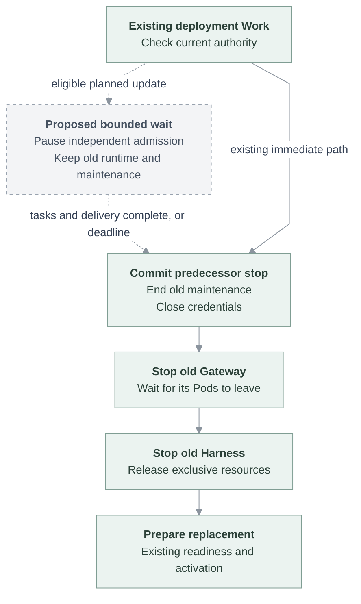

# Proposal: Let admitted tasks finish before a planned replacement

- **ID:** RFC-0030
- **Created:** 2026-11-05
- **Last updated:** 2026-11-05
- **Related:** [Image upgrades](0011-coordinated-image-upgrade.md), [pre-stop checks proposal #1045](https://github.com/openclaw/openclaw-enterprise/pull/1045)

## Decision

Add one bounded waiting stage before an ordinary planned replacement stops its
serving revision. Pause independent new work, keep the old Gateway and Harness
running with still-valid authority, and let admitted tasks and their result
delivery finish. Then use the existing exclusive replacement. Propose a maximum
of **30 minutes per serving Agent revision**; reaching that deadline starts the
existing stop path even if work remains. It does not promise readiness within
30 minutes or recovery of every interrupted task.

The first delivery covers image-only updates of Kubernetes Agents with a
dedicated Codex Harness and an OpenClaw Gateway supporting the new wait contract.
Changes to effective configuration, identity or authorization are outside this
eligibility rule. Stop, deletion and authority withdrawal remain immediate.

## Why another wait is necessary

At OCE `799ba4b8`, an isolated ordinary replacement signalled a busy Gateway;
it aborted the original run about 76 ms later and exited about 3.6 seconds after
the signal. The Harness was stopped afterward. Two synthetic tools each had
one start and no completion. Recovery did not replay their uncertain effects.
The installed stack could continue old conversations and run existing scheduled
jobs after replacement, but did not wait for those running tasks to finish.

Source was refreshed to `9ba5e7f7`. Its relevant worker, Kubernetes replacement
path and OpenClaw pin are unchanged; that newer HEAD has not had another runtime
test. The [pinned OpenClaw source](../../deploy/runtime/openclaw-source.json) is
`513c1270`: drain-mode `suspend.ready` means write custody is clear, not that tasks
are complete. Its 45-second drain budget is not a 30-minute task wait. Merely
increasing the wrapper's stop timeout cannot change when the Gateway aborts work.

## One lifecycle, with a later stop boundary

Use the existing deployment API, revision, Work queue and per-Agent reconciliation.
Insert the wait in [the worker](../../apps/controller/src/worker.ts) before normal
predecessor credential closure and `stopRevision`. Do not put it inside generic
stop or a hook also used by security withdrawal.

Before the boundary, the serving revision must retain its authorized maintenance.
Currently a newer exclusive candidate can supersede that maintenance as soon as
it is admitted. [#1045](https://github.com/openclaw/openclaw-enterprise/pull/1045)
proposes the same later boundary for replacement preflight. Share that boundary;
do not introduce a second handover owner or require its proposed probe Pods here.
Once stopping is committed, old maintenance must never recreate the predecessor.

The dashed edges below are proposed; solid edges retain the existing stop/start
path. Waiting yields Work so an idle Agent can upgrade independently.

New Gateway and Harness startup retain existing dependencies and readiness
checks; this does not introduce a promise that one always becomes ready first.

## Complexity budget

| Addition                              | Owner and boundary                                                                                                                                                                                                                            |
| ------------------------------------- | --------------------------------------------------------------------------------------------------------------------------------------------------------------------------------------------------------------------------------------------- |
| One internal record per waiting Agent | OCC's existing durable state: predecessor revision ID, absolute deadline, and `waiting` or `stopping` phase. No new database or task content.                                                                                                 |
| One optional Compute capability       | Begin/poll an eligible wait and cancel an uncommitted wait. Inputs identify the predecessor, owner and fixed deadline; results distinguish waiting, completed, unsupported and unavailable. These operations are proposed, not existing APIs. |
| One Gateway planned-wait mode         | Extend the authenticated suspension contract to keep admission paused while existing work finishes; report actual completion separately from custody readiness.                                                                               |
| Existing Work progress and timeouts   | Show waiting and deadline/forced-stop reason. Align worker convergence and release-helper waits with the new stage.                                                                                                                           |

The worker creates the record transactionally with its normal Agent/claim checks.
Retries, Controller restart and newer candidates for the same serving revision
reuse its deadline. Immediately before closing credentials, it commits `stopping`
under current ownership and authorization; this phase never returns to waiting.
Clear the record after retirement or cancellation before stop. The same existing
Agent ownership checks must prevent superseded work from stopping or resuming a
different revision.

The Gateway owns a short renewable admission lease, capped by the fixed deadline.
Polling cannot extend the deployment deadline. A dead Controller eventually
releases admission through lease expiry; a surviving Controller reacquires the
wait using the original deadline. This intentionally prefers availability over
keeping an abandoned deployment frozen. Unexpected Gateway/Harness death follows
existing recovery and cannot be reported as successful task completion.

Kubernetes Compute should reuse the administrative Gateway route and client used
by [node enrollment](../../apps/controller/src/gateway/node-enrollment-client.ts),
with exact revision/process targeting and authenticated method authorization.
Whether suspension RPCs are permitted on that route needs an isolated integration
check. This proposal grants no new public endpoint or broader credential scope.

No new release service, fleet-wide lock, message database, tool-result journal,
executor snapshot, replay engine or automatic rollback manager is included.
If implementation needs one of those, revise this RFC before expanding it.

## Observable behavior and failures

**During waiting:** already admitted turns, their necessary continuations and
approval replies can finish. New independent turns and cron occurrences do not
start. A completion observation must include task/subtask activity, admitted
queued work and pending terminal persistence/delivery, not just CPU inactivity or
write-custody release. Keep admission paused between completion and stopping.
Still-valid authorization can renew normally; revoked or expired authority is
never extended for deployment convenience.

**New input:** retain native UI outbox/reconnection behavior and stable message
identity. A rejected, unadmitted request must not be displayed as accepted. This
RFC does not claim all channels already persist/retry during the pause. Native UI
exactly-once admission must pass before advertising that path; channel-specific
gaps remain separately visible. Scheduler catch-up retains its existing policy.

**Deadline:** end the wait and perform the existing bounded stop, then replacement
readiness checks. Preserve current no-blind-replay recovery. A safe stop failure
does not authorize a second writer. Distinguish an interrupted task from a failed
deployment; report the original task outcome through its existing conversation
path, without turning a successful wait into a task-failure notification.

**Cancellation or unsupported runtime:** cancel only the matching uncommitted
lease and restore normal admission. A runtime without the capability follows
today's replacement path and explicitly reports that completion waiting was not
available. Do not silently call that first enrollment protected. Unavailability
is not completion: retry within the same deadline, then take the forced path.

The current worker convergence budget and release-helper default are both
15 minutes. Proposed accounting separates the at-most-30-minute wait from the
existing convergence allowance and includes bounded stop overhead in the outer
watch timeout. Retries must not reset either budget. A fleet watch must not add
30 minutes serially for every Agent.

## Delivery and acceptance

Review this decision first; no product behavior changes in this RFC. Split later
implementation by ownership: the upstream OpenClaw wait contract, OCE worker/
state/Compute integration, then release timeout and real-upgrade acceptance.
Keep incomplete integration disabled until its end-to-end test passes.

Use the existing isolated Kubernetes release recipe with synthetic tasks and
fixed image digests. Required observations:

1. A task spans the former stop point, keeps valid tool access, completes and
   delivers once on its original turn; idle peers upgrade while it is waiting.
2. Gateway and Harness replacement preserve an old conversation; native UI
   messages submitted during the pause each gain one admission and one effect.
3. An existing scheduled job with a test OAuth connection runs naturally before
   and after upgrade, without reauthorization or duplicate execution.
4. A task exceeds 30 minutes: stopping begins by the bounded deadline and the
   release proceeds; unknown tool effects are not replayed. Test the real timer
   once, with fast-clock tests for retries and newer candidates.
5. Controller restart, cancellation and supersession retain the cutoff and correct
   predecessor. Credential revocation and explicit stop bypass the wait; old
   maintenance cannot resurrect a stopped workload.
6. Final delivery still pending is not completion. A missing capability is explicit;
   the first supported update and its subsequent protected update are distinct.

These are acceptance requirements, not completed tests of the proposal. Native UI
offline handling, real OAuth continuity and the administrative suspension route
remain unverified. Docker, OpenShell and other Harnesses need their own qualification.

## Alternatives and review choices

Keeping today's behavior adds no engineering cost but interrupts useful work.
Polling for idleness without pausing admission is smaller, but new work can keep
arriving until the deadline. Reconstructing every interrupted execution is much
larger and still cannot safely replay uncertain side effects. The bounded wait
reduces how often recovery is needed while preserving those protections.

Reviewers should decide the proposed 30-minute bound, the initial image-only
Kubernetes/Codex scope and the one-record/two-phase design. The user-visible
tradeoff is a potentially long pause for new independent work. A shorter bound
ships faster but interrupts more tasks. The route and completion-signal checks
above must settle before implementation is described as small or deployable.
