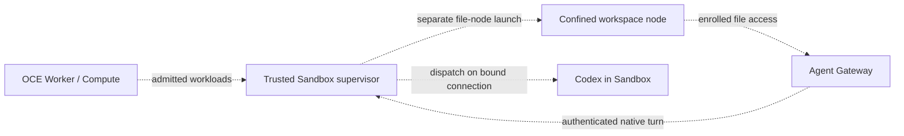

# Bind dedicated Codex turns to their Sandbox execution

- **ID:** RFC-0030
- **Created:** 2026-11-06

An operator deploys a dedicated Codex Agent on a host Sandbox. The operator opens an ordinary
Gateway chat and asks the Agent to read a file in its workspace. The Gateway needs its normal
workspace node and native Codex connection. The host Sandbox must confine the code the model runs,
and a replacement process must not inherit permission to execute a turn admitted for the original.

Allow a provider-owned dedicated Codex deployment to supply a separately confined workspace node and
a native turn endpoint bound to the current Sandbox execution. Keep the current combined workload as
the default. Reuse normal Gateway enrollment, authenticated Harness transport, and Worker activation
and retirement.

## What changes

Today, a selected provider can provision the dedicated Harness, supply its endpoint, report
authenticated readiness, and identify the exact Pods allowed to connect a workspace node to the
Gateway. Those contracts do not ask a provider to launch an independently confined file node or
authorize a native thread against the original live execution. Gateway and Harness storage
separation and protected egress remain governed by their existing proposals. See the
[Sandbox contract](../../docs/reference/drivers/sandbox.md),
[RFC-0003](0003-gateway-harness-storage-split.md), and
[RFC-0023](0023-egress-proxy-credential-lifecycle/index.md).

The selected Driver explicitly opts in to the split. Compute admits the combination only for
dedicated Codex with provider provisioning, a provider-owned Harness endpoint, and normal Gateway
enrollment. Compute adds a file-node workload to the immutable Harness requirements using the
approved image, the exact project mount and private device state, and the revision-scoped setup
reference. The provider must preserve and launch both requirements or refuse before provisioning.
The file node gets only the setup and trust inputs it needs. It gets no model credential, native
bearer, or general command authority. Its workspace role and state remain separate from the model
process, even though both use the admitted project mount. Refuse policies that give the file node
generic execution authority or accept a different node in its place.

Compute stages the approved Gateway and the revision's setup reference before the provider
provisions either workload. The provider starts the file node and prepares the original native
endpoint while model dispatch stays held. The node enrolls independently with that Gateway. Compute
separately checks authenticated native readiness for the original execution. The Worker requires
both observations for the same admitted revision before activation.

The Gateway and Compute's trusted readiness client present the revision's transport bearer over TLS
to the same trusted listener. Compute supplies a verifier to the listener. The listener compares the
presented value in memory and discards it. The raw bearer does not enter the provisioned workload
inputs, file node, or model execution, and the listener does not persist it. Transport
authentication establishes the caller's channel. Execution authorization is a separate check.

The provider's trusted supervisor binds the admitted Namespace, Agent, revision, and workload to the
original live execution, its generation, and its already-open native connection. Before reporting
readiness, it verifies the endpoint, workspace, and confinement policy. Select a native mode that
relies on external confinement only when the original Sandbox enforces the complete admitted
filesystem and egress policy for the operation.

For each native thread start, resume, fork, or turn start, the supervisor rechecks the binding and
starts the send on that same connection as one dispatch decision. The supervisor serializes
retirement and replacement with the recheck and first outbound byte. A missing, changed, retired, or
ambiguous binding closes the old dispatch path and refuses before sending. The supervisor never
opens a new connection by endpoint name to forward that request. Subsequent turns use the thread's
admitted execution. The Gateway cannot fall back to an unrestricted or different endpoint.

The dashed connections are proposed. The provider retires the execution and file node through
existing revision cleanup. If it cannot establish retirement, it reports an unknown outcome and
keeps the old channel closed. A replacement requires fresh admission and observation. If an admitted
send may already have happened, retain the request's unknown outcome and do not replay it
automatically.

## Alternatives

1. **Keep one Harness workload and use existing hooks.** This is the smallest option if the provider
   can run the stock file node inside the same workload without giving model-directed code access to
   its setup state, trusted processes, or the native listener. It preserves the current contract. It
   does not solve the pilot case when those boundaries cannot be preserved together or when the
   native client would otherwise try to start a nested Sandbox.
2. **Opt into separate confinement and bind dispatch to the original execution.** This preserves the
   normal Gateway workflow while giving each process only its own inputs. It adds a small workload
   handoff and a live ownership check. It also requires a tested two-process lifecycle. Adopt this
   option for the pilot and keep other installations on the current path.

## Rollout and verification

Start with one opt-in dedicated Codex provider. Check the existing combined deployment and
unsupported or incomplete split configurations through normal admission. Qualify a real Worker
deployment and ordinary Gateway chat that returns a new workspace marker. In that same execution,
verify that an attempted sibling read and write fail and the sibling's bytes remain unchanged.
Exercise wrong bearer, wrong node, stale and replaced execution, and cleanup after failed
provisioning and retirement. In a dispatch race, retire or replace the original after an earlier
eligibility check but before the first outbound byte. Verify that the request reaches neither the
retired connection nor its replacement. A successful direct native request is component evidence.

Submit this proposal for human review before starting the supported core change. Qualify the
implementation through the ordinary delivery path. GitHub and model credential authority stay with
their existing owners. Live repository push, PR creation, unassigned denial and withdrawal remain
separate installed checks.
