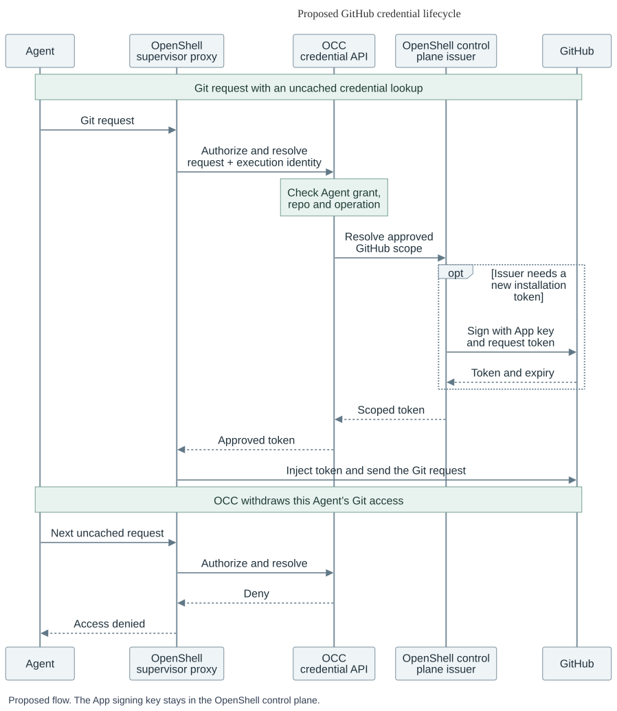

# Issue GitHub App tokens through OpenShell

- **ID:** RFC-0030
- **Created:** 2026-11-05

## Decision for review

A team gives its build Agent write access to repository A and read access to B. Later it withdraws Git while the Agent continues the same chat. Today the OCE worker signs a GitHub App JWT and exchanges it for an installation token. Move that exchange into the credential issuer embedded in the OpenShell gateway. OCE approves each Agent’s access and checks it on each protected send. The trusted OpenShell sender holds the bearer. GitHub enforces its repository permissions and branch and tag rules. [Current OCE flow](../../../docs/reference/repository-credentials/protected-openshell-git.md)

Start with built-in Git. Express the OCE grant as a provider instance, repository identity and access tier so an internal GitLab adapter can supply its own credentials. Static model keys follow the separate Gateway cleanup. [OCE Credential Proxy](../0023-egress-proxy-credential-lifecycle/index.md)

## Where the minter runs

Add a GitHub App strategy to OpenShell’s in-process Rust `TokenMinter` registry. The gateway already embeds the issuer, its storage adapter and refresh engine. The registry contains four fixed strategies. GitHub requires a new strategy and gateway configuration validation. Embedded placement puts the App key inside the gateway process’s trust boundary. The decision for OCE and OpenShell maintainers is whether that custody is acceptable for the first deployment. [Embedded storage](https://github.com/NVIDIA/OpenShell/pull/5266) · [Embedded refresh and minting](https://github.com/NVIDIA/OpenShell/pull/5283)

OpenShell’s draft API separates three jobs. `CredentialRefresh.CreateGrant` would register a refresh grant and return output references. `CredentialStore.ResolveSecrets` would return a value and its current version for trusted delivery. The issuer would call a custom `TokenMinter.Mint` with configuration, secret material and an attempt ID. The versioned gRPC contracts and remote plugin registration are proposed. A remote minter is an alternative if the App key must live outside the gateway. [OpenShell RFC 0023](https://github.com/NVIDIA/OpenShell/pull/5139) · [Proposed API](https://github.com/mrunalp/OpenShell/blob/7240ef9486fad85c4a1adb80c1574b64358221f6/rfc/0023-credential-issuer-service/README.md#credentialrefresh-contract)

## Follow A’s credential

1. **Approve.** The operator makes A and B eligible in a Namespace. The Agent owner selects them in `repositoryBindings`. Today the selected-repository profile requires one permission map for all selected repositories. OCE must admit two separate grants for this Agent and execution. A gets read/write for code and issues, B gets read. Each gets its own credential. [Enrollment](../../../docs/guides/repository-credentials/openshell-enrollment.md) · [Current binding check](../../../apps/controller/src/drivers/repo/github/credentials/registry.ts)
2. **Prepare.** OCE records the issuer, grant generation and scope before requesting background preparation. The issuer signs the JWT and posts A’s numeric `repository_ids` entry with explicit `contents` and `issues` permissions and `metadata: read`. Reject missing scope before the POST. Check the returned repositories, permissions and expiry before publication. Omitting those limits can inherit the installation’s access. Renewal cannot extend OCE approval. [GitHub issuance API](https://docs.github.com/en/rest/apps/apps#create-an-installation-access-token-for-an-app)
3. **Deliver and use.** The gateway delivers prepared material only to the trusted sender bound to that execution. The Agent gets a placeholder. On each request the sender matches the actual HTTPS origin and repository to one credential and checks current authority with the OpenClaw Control Plane (OCC). A client-supplied bearer, an ambiguous target (including a cross-repository GraphQL call), cold material or an unavailable decision must fail before forwarding. Keep direct egress, redirects and credential-producing API operations fenced. Extra path restrictions and disabling GraphQL are operator options. Public reads may still be possible. Existing `git-write` grants keep their exact-ref checks.
4. **Withdraw.** OCC records a live withdrawal for Agent 1. Its next authorization fails even if its connection is open and the token is valid. An already authorized request may finish. Verify Git-only detach for the original sandbox and material generation. Continuing the chat requires independent model access and a safely observed detach. Keep Git denied if that observation fails. Agent 2 retains its own authority.

 · [Editable diagram](request-lifecycle.mmd)

## Who recovers a lost reply?

| Missing reply                   | Owner and action                                                                                                                                                                                                                                                                                                                                                                                                                                                                          |
| ------------------------------- | ----------------------------------------------------------------------------------------------------------------------------------------------------------------------------------------------------------------------------------------------------------------------------------------------------------------------------------------------------------------------------------------------------------------------------------------------------------------------------------------- |
| OCE called the gateway          | OCE persists the operation ID and expected grant generation first. Use the gateway’s `request_id` with the same identity, workspace, method and payload. Require evidence of the original provider instance, credential key and output before binding it. A same-name provider or unknown result leaves Git unavailable. [Gateway request admission](https://github.com/NVIDIA/OpenShell/blob/d9a9196f275eb9eb5146717a11fc0772b1233392/docs/sdk/api-errors.mdx#durable-request-admission) |
| GitHub may have minted          | The issuer’s refresh engine records intent before the POST. Retry a proven unsent call under current approval. If GitHub may have issued a token, park the attempt across restart, scheduled refresh, manual rotation and reconfiguration. GitHub offers no documented mint deduplication by attempt ID. Keep any identifiable rejected or superseded token in quarantine for revocation with that exact token. Deleting a local handle cannot revoke it at GitHub.                       |
| GitHub may have accepted a push | The sender reports an unknown outcome. The caller reads the target ref through an authorized path and compares the expected SHA before deciding on another push.                                                                                                                                                                                                                                                                                                                          |

## First implementation PR and cutover

Start upstream with one repository and one permission tier through the existing `ConfigureProviderRefresh` gateway entry point. Port OCE’s [scope construction](../../../apps/controller/src/drivers/repo/github/credentials/provider-transport/request-options.ts), [candidate capture](../../../apps/controller/src/drivers/repo/github/credentials/prepared-owner.ts) and [response validation](../../../apps/controller/src/drivers/repo/github/credentials/installation-token-response.ts). Test a successful mint, then drop the reply after the fixture receives the POST. Restart the gateway, advance past retry time, run a sweep and request rotation. The ambiguous case must have one POST and zero published outputs. Return a token with excessive permissions in another case and verify exact-token retirement with zero delivery.

Next, OCE and OpenShell must connect authenticated preparation and recovery to sender-only delivery. Prove Agent processes cannot read or export the token, then connect both permission groups to the running sender. Remove the old OCE signer, exchange wiring and worker key mount only after their last callers and outstanding tokens have drained under the original owner. Keep repository policy, OCC’s grant check and unrelated Token Service and model Gateway paths.

## Installed acceptance

Use one GitHub App installation with access to private A, B and C. Confirm independently that C is readable and both test branches permit writes by the App. Disable alternative credentials. Give Agent 1 A-write and B-read, and Agent 2 an independent A grant.

| Action in the running deployment     | Required observation                                                                                                                                                                                                                                                                                                         |
| ------------------------------------ | ---------------------------------------------------------------------------------------------------------------------------------------------------------------------------------------------------------------------------------------------------------------------------------------------------------------------------- |
| Agent 1 pushes a unique commit to A  | An independent reader sees its SHA on the remote branch.                                                                                                                                                                                                                                                                     |
| Agent 1 reads B, then pushes to B    | It reads a known ref. The push fails and the ref keeps its original SHA.                                                                                                                                                                                                                                                     |
| Agent 1 reads C                      | The private read fails while the independent reader still reads C.                                                                                                                                                                                                                                                           |
| Withdraw all Git grants from Agent 1 | Keep an HTTPS client open across withdrawal and record its connection ID. While the material is unexpired, repeat a previously allowed request. Observe the withdrawal denial and zero GitHub requests for that attempt. Get a fresh model reply in the same execution and chat, and a fresh private read of A from Agent 2. |

Run with the deployed gateway, supervisor and mandatory pre-credentials hook. Record identities, expiry, decisions and ref SHAs without token values. This installed test remains to be run.
