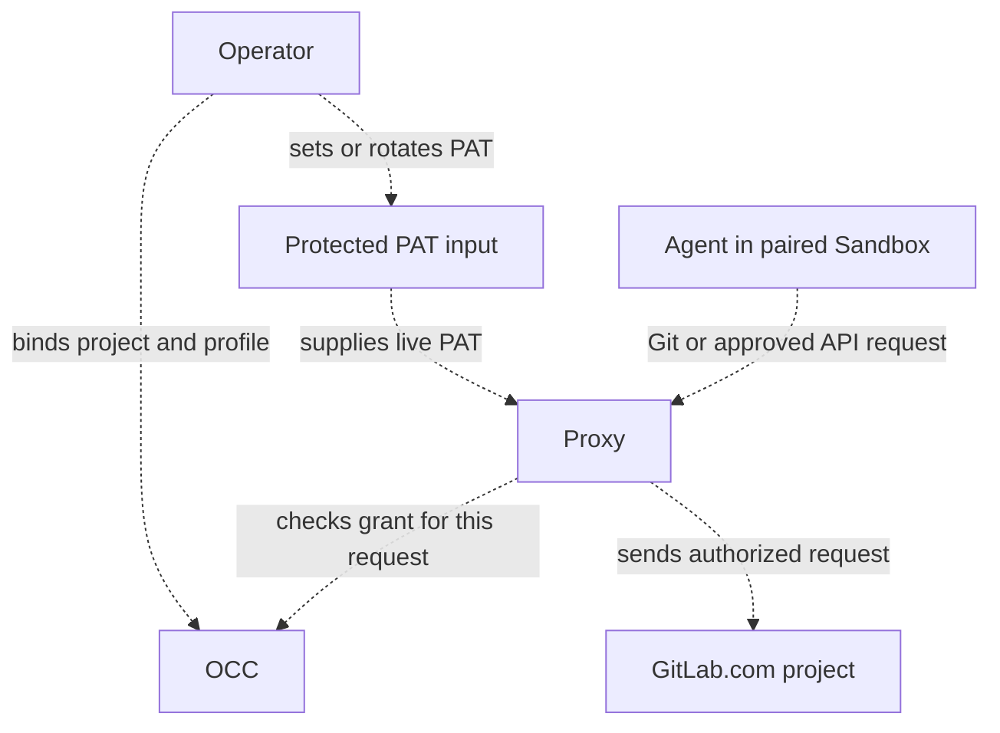

# Proposal: Support GitLab.com repository credentials

- **ID:** RFC-0030
- **Created:** 2026-10-21
- **RFC PR:** [#3137](https://github.com/openclaw/openclaw-enterprise/pull/3137)
- **Implementation plan:** [0030-gitlab-repository-credentials](../plans/0030-gitlab-repository-credentials.md)
- **Related:** [Feature request #3135](https://github.com/openclaw/openclaw-enterprise/issues/3135), [RFC-0023: Credential Proxy and credential lifecycle](0023-egress-proxy-credential-lifecycle/index.md), [implementation PR #2487](https://github.com/openclaw/openclaw-enterprise/pull/2487)

## Summary

Teams that keep source in GitLab must mirror their projects to GitHub or run Agents without repository access. We propose binding an Agent to one GitLab.com project. The selected Credential Proxy would authenticate approved requests with a project service account’s personal access token (PAT). The Agent would receive neither the PAT nor general API access.

The design includes opening a draft merge request from an approved branch.

### Decision for the first supported path

The first supported GitLab path uses a **protected live static PAT**. It does
not depend on Token Service preparation. Token Service preparation remains a
future replacement source and is not part of GitLab composition until its
provider contract and implementation are accepted.

The operator owns the GitLab service account and its PAT. The protected
credential owner receives the PAT through the existing protected service-input
path, keeps it outside Agent files and logs, and lends it only to an admitted
request. The Credential Proxy remains the authority for the final send: it
checks the current execution, Agent revision, project, profile, operation, and
withdrawal state immediately before GitLab I/O. A valid PAT does not authorize
a request by itself.

### Current authority for an open session

The current authority for an existing GitLab session is the OCC persisted
standing approval for the exact active Agent revision, Namespace, project
binding, profile, approval generation, and scope fingerprint. The admission
snapshot is only the session's original binding; it is not current authority.

Before each GitLab request starts, the selected delivery owner must obtain or
validate a short-lived send permit against that OCC state. The permit must
match the session's active revision and binding and must be rejected when the
Namespace grant is withdrawn, the project or profile is reassigned, the
approval generation changes, or the scope fingerprint no longer matches.
The check must complete before the first upstream byte. PAT availability,
session liveness, cancellation, and a deadline are necessary local checks but
are not sufficient authority.

The native PAT implementation in this branch does not yet perform this OCC
current-grant check. It checks local token availability and timing only. The
first supported path therefore remains a release gate until the owner and
permit contract are implemented and demonstrated through the regular Agent
workflow.

The supported lifecycle is:

1. **Create:** The operator creates a project service account and PAT in
   GitLab, with only the Git and draft-merge-request permissions qualified by
   the live acceptance run. OCE accepts the PAT only through its protected
   credential input. A broad bootstrap token or an experimental token-creation
   flow is not a supported production prerequisite.
2. **Rotate:** The operator stages a replacement PAT in the protected
   credential input. New sends use the replacement after configuration reload
   and final authorization. The old PAT remains available only until admitted
   sends using it finish or reach their deadline, then the operator revokes it
   in GitLab. Rotation never widens the OCE project or profile grant.
3. **Expire:** An expired, revoked, missing, or unqualified PAT fails closed
   before GitLab I/O. The first path does not mint or renew PATs.
4. **Retire:** Withdrawal closes new use before the operator removes the
   protected input and revokes the PAT in GitLab. Existing sends may finish
   only if they already passed the final authorization check. An uncertain
   mutation remains unresolved and is never replayed automatically.

This choice is a release gate, not an implementation claim. Live GitLab
qualification must prove that the selected service-account creation and
permission procedure works on a supported GitLab.com project before the
composition is enabled.

## Goals

- Add GitLab.com while preserving GitHub. Each Installation selects one Git provider for this release; one Agent revision cannot bind both providers.
- Support Git reads, approved branch pushes, and draft merge-request creation.
- Authorize each Git or API request for the bound project. Deny missing, expired, or revoked credentials and disallowed operations.
- Record attributable audit evidence for successful writes, denied operations, and uncertain upstream outcomes. Do not record the PAT or request bodies.
- Document setup, verification, expiry, rotation, and revocation.

## Non-goals

- Binding GitHub and GitLab to the same Installation or Agent revision. Revisit this in a separate design.
- Self-managed GitLab or configurable upstream hosts.
- Human-delegated access as the default team workflow.
- Merge, approve, or administer merge requests.
- Giving an Agent a GitLab token or general API access.
- Requiring automatic PAT creation or rotation for the first release.
- Claiming this research spike tested a live GitLab.com project.

## Proposal

### Provider and project binding

The existing `repo` capability lists approved projects and resolves bindings. The proposed GitLab Repo Driver binds a numeric project ID to its canonical Git path on `https://gitlab.com`. The sender uses the ID for API routes, the path for Git, and the approved ref for pushes. Reject any origin, path, or project ID that differs from the binding. For this release, Installation configuration selects exactly one provider: GitHub or GitLab. Reject an Agent revision that requests bindings from both providers.

Current composition selects GitHub and configures `gh`. Its repository sender admits Git operations and a [draft pull request](../../packages/contracts/src/prepared-github-egress.ts). Its separate installation profile admits GitHub REST and GraphQL. GitLab needs client configuration and a mapping from each approved operation to its Git exchange or API method, route, and request fields.

Use the existing GitHub draft-operation lifecycle as a model for operation identity, one-send behavior, and receipt handling. Keep GitLab request and response validation in its provider owner; do not treat the GitHub-specific contract as a general provider interface.

### GitLab mapping to the GitHub team runbook

The GitHub runbook uses an organization-owned App installed only on selected repositories. It stores the private key in the protected credential path, then binds and verifies access through the normal Agent workflow. GitLab's closest team-owned model is a project service account with a personal access token (PAT). It is project-bound, available on all GitLab.com tiers, and limited to 100 accounts per top-level group on Free. A top-level group Owner must verify identity. This model does not use GitHub's App installation and private-key flow. [GitLab service accounts](https://docs.gitlab.com/user/profile/service_accounts/)

| GitHub team runbook step                                                         | GitLab.com counterpart and gap                                                    |
| -------------------------------------------------------------------------------- | --------------------------------------------------------------------------------- |
| Create an organization-owned App; disable webhooks and user OAuth.               | Create a project service account; authenticate Git and API requests with its PAT. |
| Grant selected repository permissions and install on only intended repositories. | Assign the minimum project role and project-bound fine-grained grants.            |
| Record App, installation, and repository IDs.                                    | Save the project ID and canonical path; do not accept them from Agent input.      |
| Put the App private key in the protected service input.                          | Keep the PAT in the protected service credential path, outside Agent files/logs.  |
| Bind through the registry and use the normal Agent flow.                         | Bind the project; fix the host to gitlab.com and authorize every request.         |
| Verify changes and PR creation, then retire and rotate credentials.              | Verify Git and draft MR; deny other operations. Track expiry and rotate safely.   |

### Capability parity with GitHub

These profiles describe the proposed GitLab tasks. The adapter may use `glab` or call the API directly. OCE enforces the selected profile even when the PAT grants more. GitLab distinguishes code download from push and MR reads from creation. [Git permissions](https://docs.gitlab.com/auth/tokens/fine_grained_access_tokens_other/), [REST permissions](https://docs.gitlab.com/auth/tokens/fine_grained_access_tokens_rest/).

| Profile and GitHub task                                                | GitHub usage                                                        | GitLab usage                                                                                                                                                                                                                                                |
| ---------------------------------------------------------------------- | ------------------------------------------------------------------- | ----------------------------------------------------------------------------------------------------------------------------------------------------------------------------------------------------------------------------------------------------------- |
| `git-read`: inspect project, issues, PRs, diffs, checks                | `gh repo view`, `gh issue list/view`, `gh pr list/view/diff/checks` | [`glab repo view`](https://docs.gitlab.com/cli/repo/view/), [`glab issue list/view`](https://docs.gitlab.com/cli/issue/list/), [`glab mr list/view/diff`](https://docs.gitlab.com/cli/mr/list/), [`glab ci status`](https://docs.gitlab.com/cli/ci/status/) |
| `git-write`: push branch; create or discuss draft PR; issues read-only | `git push`, `gh pr create --draft`, `gh pr comment`                 | `git push`, [`glab mr create --draft`](https://docs.gitlab.com/cli/mr/create/), [`glab mr note`](https://docs.gitlab.com/cli/mr/note/)                                                                                                                      |
| `git-full`: add issue creation and comments                            | `gh issue create/comment`                                           | [`glab issue create`](https://docs.gitlab.com/cli/issue/create/), [`glab issue note`](https://docs.gitlab.com/cli/issue/note/)                                                                                                                              |

For draft creation, the sender builds `POST /projects/:id/merge_requests` from the bound project ID, an approved source branch, an explicit target branch, and a title prefixed with `Draft:`. Both branches must already exist in that project. Reject a missing branch, a foreign `target_project_id`, or unapproved fields before sending the create. This operation cannot push, fork, mark ready, merge, or approve. [Create a merge request](https://docs.gitlab.com/api/merge_requests/#create-a-merge-request) · [Draft titles](https://docs.gitlab.com/user/project/merge_requests/drafts/)

Record a durable OCE operation ID before the first HTTP write. It correlates OCE work; it does not make GitLab's create request idempotent. The documented create request has no client operation key, so never repeat its `POST` after GitLab may have received it. If the sender proves it wrote no HTTP bytes, record that the create was not sent. Otherwise keep the outcome unknown. Do not infer success from a matching title or branch pair. An authorized operator must reconcile the operation against GitLab evidence; if that evidence cannot identify the result, leave the operation unresolved. Record each attempt's success, authorization denial, provider failure, or unknown result with its actor, bound project, provider, and operation identity. Use the existing mutation and authorization-denial audit events; record an unknown external result as a mutation failure with a fixed result state. If audit persistence fails, do not report completion or resend the request; retain the unresolved operation until its result and audit evidence are reconciled. Do not include the PAT or request body. [GitLab create API](https://docs.gitlab.com/api/merge_requests/#create-a-merge-request)

Service accounts can hold fine-grained PATs: GitLab's API documents `granular_scopes` on rotated service-account tokens. The statement that fine-grained-token enforcement excludes service accounts describes enforcement, not token capability. GitLab documents project-bound Code Download/Push and Merge Request Read/Create permissions. However, its project service-account token endpoint documents coarse scopes; fine-grained PAT creation for the current user is an experimental GraphQL mutation. Validate a supported setup before finalizing the runbook. If this requires a broad bootstrap token, revoke it before binding. Rotation preserves granular grants but revokes the old token when issuing its replacement, so update the protected credential as one controlled operation. [Fine-grained PATs](https://docs.gitlab.com/auth/tokens/fine_grained_access_tokens/), [Git and REST permissions](https://docs.gitlab.com/auth/tokens/fine_grained_access_tokens_other/), [service-account token API](https://docs.gitlab.com/api/service_accounts/), [GraphQL token creation](https://docs.gitlab.com/api/graphql/reference/experimental/mutations/#personalaccesstokencreate).

### Relationship to RFC-0023 and its implementation

RFC-0023 remains Proposed. Its [merged implementation](https://github.com/openclaw/openclaw-enterprise/pull/2487) gives the OpenClaw Control Plane (OCC) ownership of grants, execution identity, expiry, and withdrawal. Reuse its provider-scoped grant identity and delivery records. For GitLab, the paired Sandbox must prevent direct access. The selected Credential Proxy must check the execution, current grant, and actual operation before using the PAT. Withdrawal denies the next request even while the PAT is valid. A request that already passed that check may finish. Keep any possibly-sent mutation with an unknown result visible in the durable operation state and audit evidence until an operator reconciles it.

GitLab issues the PAT. With a live secret, the operator rotates or revokes it in GitLab and updates the protected secret. With a prepared credential, Token Service owns acquisition, custody, and retirement through a GitLab adapter. Requests cannot issue or renew tokens. Ending a sender’s lease releases its local copy. The source owner handles revocation at GitLab.

### Architecture

Dashed arrows show the proposed GitLab path. The sender uses the selected PAT source.

## Delivery and verification

Use one running Agent, the selected Credential Proxy and paired Sandbox, and an authorized GitLab.com project. Record the installed versions, tier, project role, token grants, PAT expiry, and rotation result.

1. Clone a commit absent locally. Push a known commit to the allowed branch and verify its SHA at GitLab. Open a draft MR and verify its draft status, project, branches, and head commit in GitLab. Drop the reply to a separate create. Verify recovery sends no second `POST`; if the original operation cannot be identified in GitLab, keep it unresolved for an authorized operator.
2. Attempt a forbidden push and a request for the nearest forbidden project or profile. Verify that both requests are denied before GitLab I/O and that each denial is attributable in OCE audit. Withdraw or reassign the OCE binding while the PAT is still valid. Try a fresh fetch and send from the same Agent. Verify denial while its conversation still works. Use an observer that saw the allowed Git traffic to confirm zero upstream requests after withdrawal or reassignment. Record any gap in that observation.
3. Verify successful writes and uncertain creates have attributable audit evidence with the provider, project, actor, and OCE operation identity. Confirm audit records contain no PAT or request body. Submit a revision with both provider selections and verify admission refuses it while single-provider GitHub and GitLab revisions remain independently supported.

The [implementation plan](../plans/0030-gitlab-repository-credentials.md) covers credential failures and token non-disclosure. The branch now loads a GitLab Backend with `repository.nativeSender` without GitHub prepared custody, and the focused Installation, provider, and stored-material checks pass. These are composition and material-reader checks, not an upgrade run against an existing Installation with its persisted bindings. AWS qualification of the disposable OCE deployment reached a ready Agent and real model turn, but it did not qualify GitLab composition or live GitLab I/O. The live Agent lane still needs authorized GitLab inputs and an Installation-deployed Agent. Final-send authorization after withdrawal or reassignment remains an open contract and proof item: the current native PAT sender checks local token availability, cancellation, and deadlines, but does not re-read current Namespace or project grants before GitLab I/O. Stock OpenShell’s refusal of unqualified Git access is a separate result.

## Rationale and alternatives

GitLab.com supports project service accounts, and GitLab documents permissions that can bound project Git and REST operations. The documented service-account API does not establish a stable fine-grained token creation procedure for this release. The first path therefore requires an operator-supplied protected PAT and a live qualification of its exact creation, scope, expiry, rotation, and revocation procedure. OCE must enforce its own project and operation boundary independently of the PAT's permissions.

Support lets teams keep GitLab as their source of truth and retain their review and CI path while using the managed workflow already available for GitHub.

## Unresolved questions

1. **Product maintainers:** Approve or reject shipping native development-only PAT delivery for the first supported path. Approval must name the protected PAT owner and the supported creation, scope, expiry, rotation, and retirement procedure.
2. **Credential and Repo maintainers:** Which exact GitLab API operations and audit details do the selected profiles require?
3. **Credential and Repo maintainers:** Implement and qualify the current-grant authority contract above. A Namespace withdrawal or project/profile reassignment must deny the next request before GitLab I/O; a PAT’s continued validity is not sufficient.
4. **Future Token Service maintainers:** What provider contract will replace the protected live PAT, including preparation, custody, renewal, retirement, and the same final-send authorization boundary?

## References

- [Repository credentials team runbook](../../docs/guides/repository-credentials/team-runbook.md)
- [Current repository credential reference](../../docs/reference/repository-credentials.md)
- [Repository policy contract](../../packages/contracts/src/drivers/repo/index.ts)
- [Protected repository-delivery contract](../../packages/contracts/src/protected-repository-git.ts)
- [Credential Proxy Driver contract](../../packages/contracts/src/drivers/credential-proxy/index.ts)
- [Current provider composition](../../apps/controller/src/composition/repository-credentials/platform.ts)
- [GitHub client router](../../apps/controller/src/drivers/repo/github/credentials/client/router.ts)
- [GitHub draft-operation client](../../apps/controller/src/drivers/repo/github/credentials/client/draft-pr.ts)
- [Prepared GitHub operation contract](../../packages/contracts/src/prepared-github-egress.ts)
- [Audit log reference](../../docs/guides/topics/audit-log.md)
- [RFC-0008: Repository credentials](0008-repository-credentials/index.md)
- [RFC-0023: Credential Proxy and credential lifecycle](0023-egress-proxy-credential-lifecycle/index.md), [merged implementation PR #2487](https://github.com/openclaw/openclaw-enterprise/pull/2487)
- [RFC format example, PR #3050](https://github.com/openclaw/openclaw-enterprise/pull/3050)
- [GitLab service accounts](https://docs.gitlab.com/user/profile/service_accounts/)
- [GitLab fine-grained PATs](https://docs.gitlab.com/auth/tokens/fine_grained_access_tokens/)
- [GitLab fine-grained Git permissions](https://docs.gitlab.com/auth/tokens/fine_grained_access_tokens_other/)
- [GitLab fine-grained REST API permissions](https://docs.gitlab.com/auth/tokens/fine_grained_access_tokens_rest/)
- [GitLab service-account token API](https://docs.gitlab.com/api/service_accounts/)
- [GitLab GraphQL token creation](https://docs.gitlab.com/api/graphql/reference/experimental/mutations/#personalaccesstokencreate)
