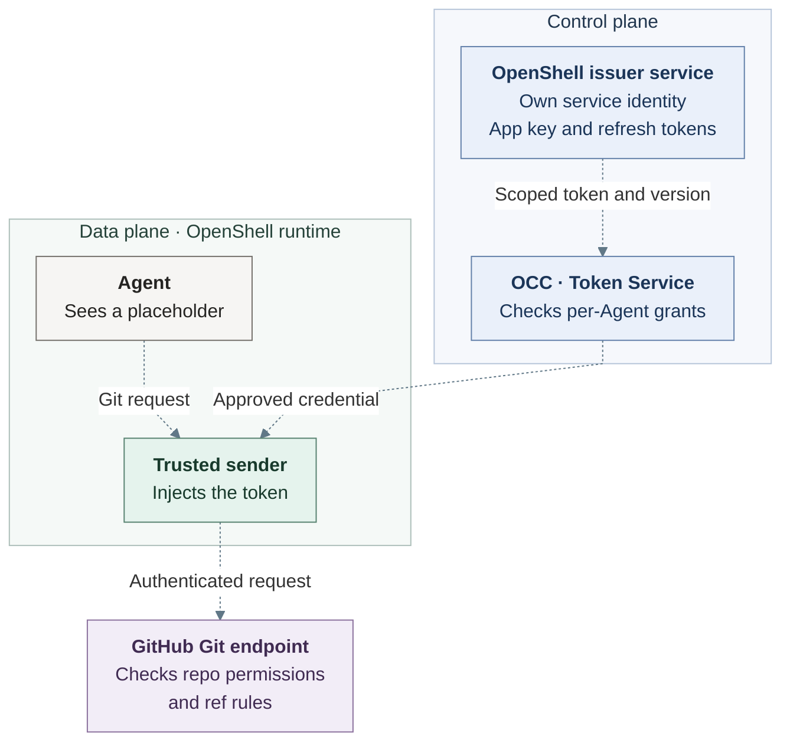
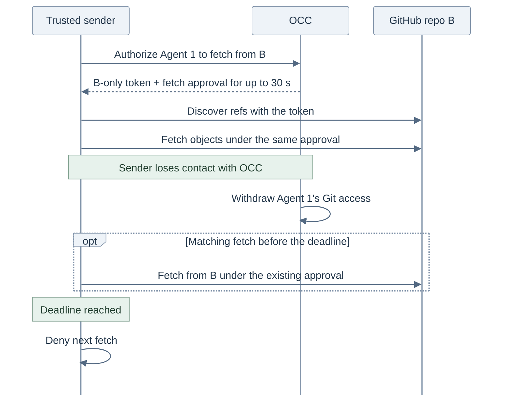

# Move provider credential lifecycles to OpenShell

- **ID:** RFC-0030
- **Created:** 2026-11-05

## Decision for review

Give an Agent write access to repository A and read access to B. The OpenClaw Control Plane (OCC) decides what this Agent may do. The separate OpenShell credential service holds the GitHub App key and mints a token for the approved scope. A trusted sender injects it. The Agent sees a placeholder.

GitHub is the first integration. Use OpenShell as the issuer behind OCE’s existing Token Service for managed, renewable provider credentials. OCC keeps consent, source registration and per-Agent grants. The issuer mints and renews tokens, retires grants, and recovers exchanges whose outcome is unknown. A migrated static key uses the issuer’s versioned store. [OCE lifecycle contract](https://github.com/openclaw/openclaw-enterprise/blob/18130677062c69c16b68fefc97e1a75bbdfe1c4f/specs/rfcs/0023-egress-proxy-credential-lifecycle/contracts.md#credential-access-and-lifecycle)

## Proposed architecture

On OpenShell, the supervisor proxy is the trusted sender. It runs outside the Agent. OCC returns a scoped credential to that sender after it authorizes the request. For a migrated grant, only the issuer signs with the GitHub App key or renews with the saved OAuth refresh token.

On a cache miss, the sender calls OCC, which asks the issuer for the approved scope. The arrows trace the credential back to the sender and into its request to GitHub.

## What moves to OpenShell?

| Credential          | What the issuer must do                                                                                                                                                                                             |
| ------------------- | ------------------------------------------------------------------------------------------------------------------------------------------------------------------------------------------------------------------- |
| GitHub App          | Exchange a signed App JWT for the approved repository IDs and permissions. Verify the returned scope before releasing the token. If GitHub may have minted one, reconcile the original attempt before another mint. |
| Saved OAuth account | Renew with zero Agents attached. Commit the successor refresh token and access token together. Retire the grant when OCC disconnects the account.                                                                   |
| Static provider key | Store operator replacements as new versions in `CredentialStore`. Resolve the approved value without a refresh grant or mint.                                                                                       |

OCE already registers GitHub grants and saved OAuth accounts with its Token Service. OCC handles browser consent and code exchange. The local issuer can renew a saved account before it has any Agents. Detaching one Agent leaves the account available to another authorized Agent. [Token Service](https://github.com/openclaw/openclaw-enterprise/pull/4853) · [Saved accounts](https://github.com/openclaw/openclaw-enterprise/pull/4671) · [Per-Agent delivery proposal](https://github.com/openclaw/openclaw-enterprise/pull/4673)

## What happens on a protected request?

By default, the trusted sender asks OCC to authorize each captured request and resolve its credential. The issuer can return a token it already minted. OCC rechecks access before release. With a sender time to live (TTL) of zero, withdrawing a grant denies the next fresh send. [Online request flow](request-lifecycle.svg) · [Editable diagram](request-lifecycle.mmd)

For v1, we propose one opt-in exception on OpenShell. OCC can authorize a sender to fetch from one read-only repository for up to 30 seconds. Git discovery and object transfer can share that approval. A disconnected sender can start a matching fetch until the fixed deadline. Pushes and GitHub API requests still need a fresh OCC decision. The trial duration and scope are open for review. [Cache key, alternatives and acceptance](github-integration.md#authorization-across-senders)

### Fetch and withdraw access

This example uses the proposed OpenShell cache for one Agent fetching from read-only repository B. The authorization deadline covers both ref discovery and object transfer. The sender checks the execution, repository, operation and deadline before each send.

With TTL zero, both discovery and object transfer require OCC. Withdrawal of this Agent’s Git grant leaves its chat and a second Agent’s independent grant available. [Installed withdrawal test](github-integration.md#installed-acceptance-test)

## Proposed issuer contract

Deploy the issuer alongside OpenShell or separately, with its own process and service identity. Give the enrollment client authority to provision signing keys and refresh grants. Give the OCC resolver access only to the approved grant’s named output. The gateway can use neither the signer nor the refresh token.

For a cold Git request, extend `EnsureFresh` to start or join issuance for an authorized delivery. Read the committed version through `ResolveSecrets`. If OCC loses a mutation reply, replay the same operation ID to recover its recorded result. An uncertain provider exchange stays with the issuer. [Upstream API proposal](https://github.com/NVIDIA/OpenShell/pull/5139)

OpenShell has merged the embedded refresh engine. Remote delivery authorization and recovery still need implementation. [Embedded engine](https://github.com/NVIDIA/OpenShell/pull/5283) · [Proposed embedded versioning](https://github.com/NVIDIA/OpenShell/pull/5315)

During OAuth cutover, stop every old writer for the selected grant and transfer its last confirmed version under one durable transfer ID. If the acknowledgment is lost, look up the transfer before reopening delivery. [OAuth ownership transfer diagram and recovery procedure](../../plans/0030-openshell-credential-service.md#move-one-existing-grant-during-a-maintenance-window)

[Migration plan and OAuth acceptance](../../plans/0030-openshell-credential-service.md) · [First GitHub integration and installed test](github-integration.md)
