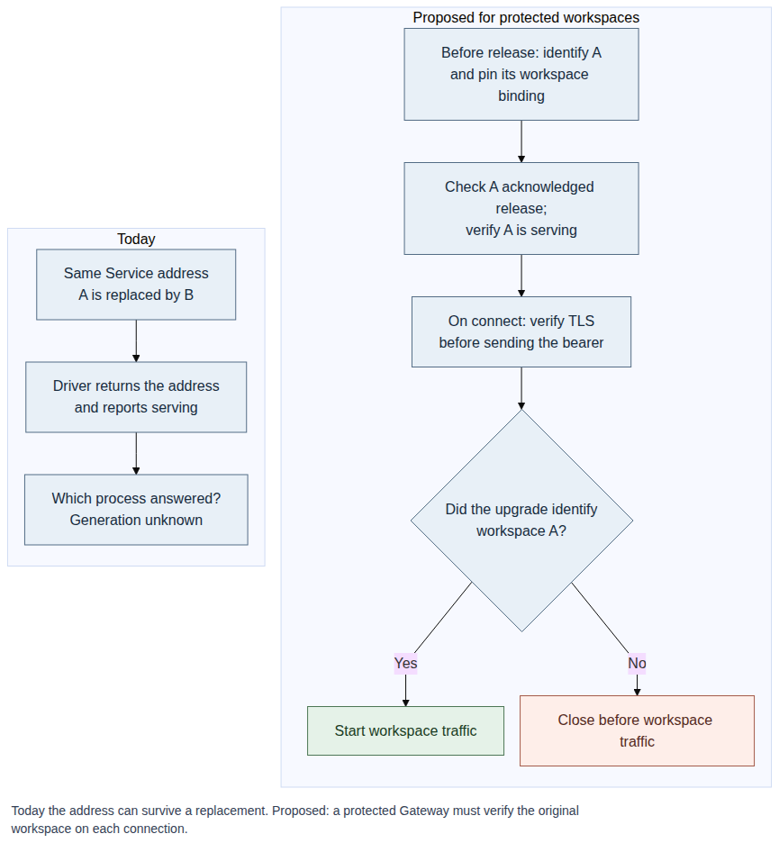

# Proposal: Coordinate Gateway and workspace rollout for protected Codex Agents

- **ID:** RFC-0031
- **Created:** 2026-11-09

## Problem and decision

Deploying a protected Codex Agent brings two components into service. The Agent
Gateway handles chat and routes requests to Codex. The Sandbox runs Codex in its workspace.
Kubernetes manages the Gateway rollout, while the Sandbox Driver manages the
workspace. They can become ready at different times. The
[current Sandbox contract](../../../docs/reference/drivers/sandbox.md#harness-transport)
provides an endpoint and a startup check. Deployment also needs to know which
workspace has been released for this Agent revision and when it can take traffic.

This RFC defines that handoff. Compute identifies the workspace during
preparation, checks that it acknowledged release and is serving, then activates
the revision. The Gateway verifies the same workspace each time it connects.

[Open full-size SVG](request-lifecycle.svg) · [Mermaid version](request-lifecycle.mmd)

## Scope

Operators opt in through [Sandbox Driver selection](../../../docs/reference/drivers/selection.md)
for protected dedicated Codex revisions. Ordinary revisions and bundled OpenShell
keep their existing behavior. [Storage placement](../0003-gateway-harness-storage-split.md),
credential delivery, repository access, and tool permissions are unchanged.

## Contract

### Prepare the exact workspace

After provisioning, Compute calls the selected Sandbox registration’s optional,
read-only `protectedWorkspaceEndpoint`. The Sandbox uses its retained signed
reservation and authenticated observation to verify the Installation, Agent,
revision, execution, and original workspace. A workload header or Pod name
cannot establish that identity.

Compute pins four values in immutable, read-only configuration for that
revision’s Gateway: **secure WebSocket origin, provider CA bundle, remote
workspace root, and original process generation**. The binding and diagnostics
contain no credentials or tool traffic. Preparation needs no transport token
and does not move traffic off the serving predecessor.

### Serve only after release

1. **Compute checks release and readiness.** The same Sandbox must observe the
   original workspace acknowledge the signed release for that startup and
   pinned generation. Compute reads the binding again and compares all four pins
   without replacing them. It then calls the same Driver’s bearer-authenticated
   `harnessStatus` with the retained revision requirements. Only `serving`
   permits activation.
2. **The Gateway checks every connection.** It authenticates the pinned origin
   using only the pinned CA before sending the HTTP Upgrade or bearer. The
   relay verifies the bearer and that the original workspace is still current,
   then returns HTTP 101 with exactly one generation proof header. If the proof is missing, duplicated,
   or different, the Gateway closes without sending or accepting a native frame.
   The provider must keep the TLS identity for this origin exclusive to the
   admitted Host: the bearer is already sent by the time the proof arrives.
   Existing per-turn Sandbox checks still apply.

## Rationale

For example, a Kubernetes Service can keep its address when the original
workspace exits and a replacement starts. The replacement may answer the
startup check while the release still belongs to the original. Retire the
affected revision and admit a new one for the replacement. A temporary
observation failure leaves the revision pending during bounded reconciliation.

## Delivery and verification

Test the Sandbox, Compute, and Gateway together through preparation, release,
and activation. Verify that a replacement at the same address cannot take
traffic. Change a pin, fail status after acknowledgement, and reject invalid
TLS or generation proof at the relevant connection step. Verify ordinary and
OpenShell paths stay unchanged.
