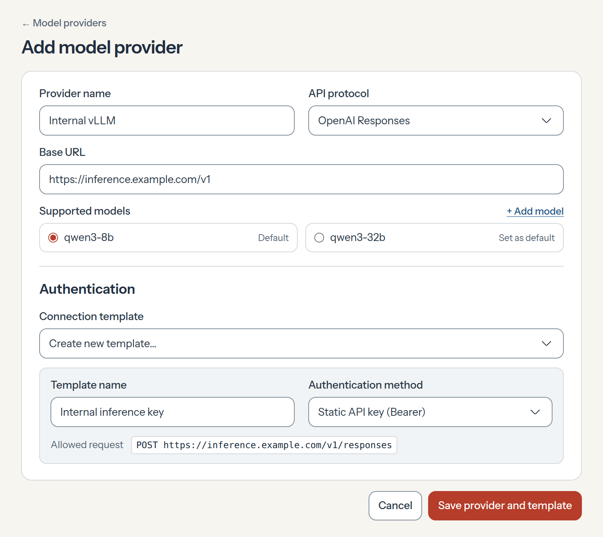
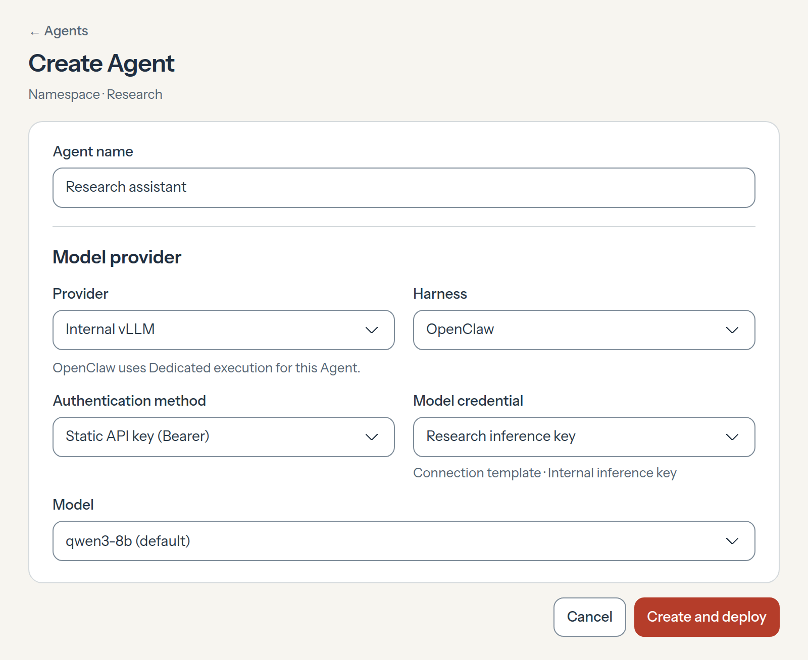

# RFC-0031 · Reusable model providers

An admin should be able to set up an inference endpoint once and give several teams an **Internal vLLM** option in **Create Agent**. Today an Installation has one [default model provider](../0028-shared-model-provider.md), and each deployment can supply an [inline override](../0030-agent-harness-overrides.md). We propose replacing the per-Agent URL override with a saved Model Provider. The admin configures the endpoint and API format once. Agent creators select the provider by name.

## An admin sets up Internal vLLM

The admin enters the base URL, selects the API format, and lists the model IDs to offer. They can choose a default model and supply any metadata the Harness needs, such as context and output limits. In this example both models use OpenAI Responses.

The admin selects a compatible Connection Template or creates one inline. Today [Connection Templates](../../../docs/reference/connection-templates.md) support OAuth. We propose a **static API key (Bearer)** template. The Console uses the URL and format to show which request the admin is approving. A team saves its key once as a Namespace credential created from that template. The provider stores the template reference.

## An Agent creator reuses it

[PR #4544](https://github.com/openclaw/openclaw-enterprise/pull/4544) proposes entering a custom endpoint during Agent creation. With a saved provider, the creator first chooses **Internal vLLM** and a compatible **Harness**. Next they choose the authentication method and a saved credential, here **Research inference key**. The **Model** field comes last. The creator can keep the provider’s default, **qwen3-8b**, or choose another listed model their credential can access. A second Agent can reuse the key with permission. Another team can use its own key with the same provider.

## Deploy through the existing revision flow

On first and later deployments, the Agent identifies its provider and model. To use a different endpoint, the creator selects another provider. OpenClaw Control Plane resolves the selected provider’s URL and protocol into the existing [Harness provider settings](../../../docs/reference/drivers/kubernetes-compute/model-provider.md) and saves them with the Agent revision. Recovery uses that snapshot. The current **Authorized base URL** field on Create Agent controls where the key may be sent. With a saved provider, the credential’s approved Connection Template supplies that restriction. Admission checks the [credential binding](../../../docs/reference/credential-sources.md) against the selected endpoint, so the creator has no URL to enter or override. The selected model and its metadata remain in Agent Configuration.

For a private endpoint, Compute also configures the network access the trusted sender needs, within Installation policy. The sender checks the actual destination and operation before adding the key. Editing the provider or template cannot authorize an existing key for a new destination or operation. A running revision keeps its original settings.

Verify the proposal by deploying two Agents with the same provider. Each should complete a turn in which the private model requests a tool, the Harness executes it, and the model responds to the result. Deploying with a key authorized for a different destination should fail before the endpoint receives the key.
