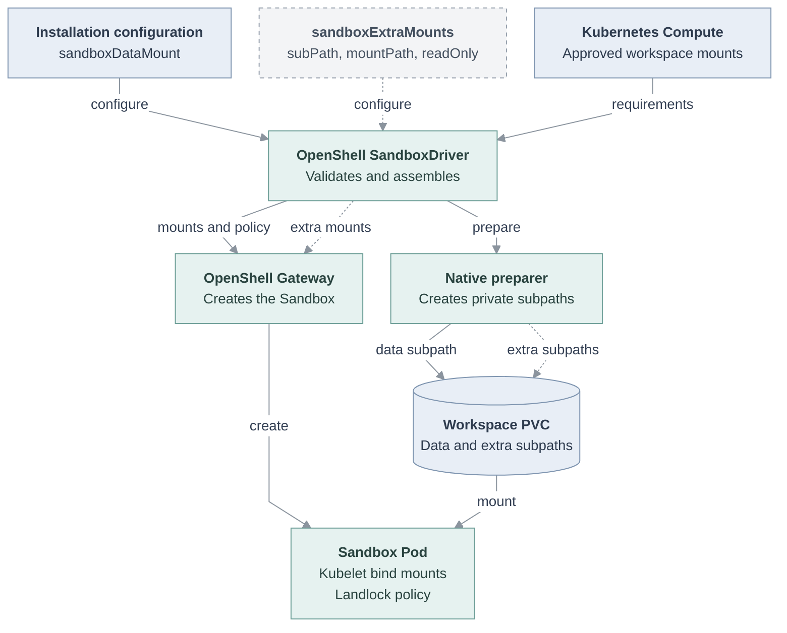
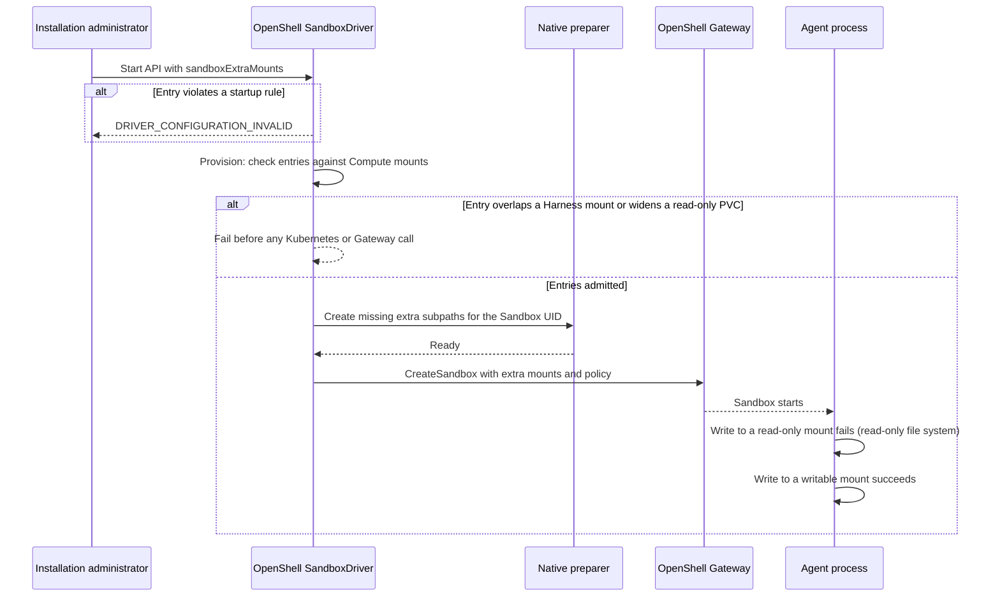

# Proposal: Extra PVC subpath mounts for OpenShell Sandboxes

- **ID:** RFC-0032
- **Created:** 2026-11-09
- **Last updated:** 2026-11-09
- **RFC PR:** pending
- **Related:** [PR #4847][pr-4847]

<a id="problem-and-decision"></a>

## Summary

Add an optional Installation setting, `kubernetes.sandboxExtraMounts`, to the
OpenShell SandboxDriver. Each entry mounts one more subpath of the PVC that
`kubernetes.sandboxDataMount` already reuses, at its own path under `/sandbox/`,
with an explicit `readOnly`. A read-only entry becomes a kubelet read-only bind
mount and joins the OpenShell filesystem policy's read-only set; a writable entry
joins the read-write set. The decision under review is whether the Driver's
configuration contract should expose these subpaths beyond the Harness workspace
mounts that Compute supplies, with the isolation rules below.

## Motivation

A legal document-review Agent must read, but never change, the original
documents, the text derived from them, the reviewer's determinations and the
retention rules. It must write its own working record.

Today a Sandbox's PVC mounts are the Harness workspace mounts that Compute
approves, one of which the data mount places under `/sandbox/`, and the
per-revision runtime root ([`workspaceVolumeMounts`][src]). An Installation
administrator cannot add another mount, so every directory the Agent can use for
this task is inside one read-write tree.

The filesystem policy cannot fix this. OpenShell enforces it with
[Landlock][landlock], whose rules only grant access. For each file access, the
kernel combines every rule on the path from the file to the root; there is no
deny rule. While the data mount is in the read-write set, a read-only rule for a
child directory adds nothing; a direct check confirmed writes in the child still
succeed.

<a id="scope"></a>

## Goals

- **G1:** An administrator can mount extra subpaths of the data mount's PVC,
  each read-only or writable, without a new claim or lifecycle.
- **G2:** A read-only extra mount refuses writes from every process in the
  Sandbox, whether or not a policy applies to that process.
- **G3:** An entry cannot reach outside its PVC, overlap the data mount, Harness
  workspace mounts or runtime paths, or widen access Compute approved.
- **G4:** Native OpenClaw finds every extra subpath present before it starts.

## Non-goals

- How content reaches a read-only subpath. Another writer with access to the
  PVC places it; this RFC does not define that writer.
- Other PVCs, other volume types, per-Agent mount selection, or changes to the
  Compute workspace contract.

<a id="design"></a>

## Proposal

The OpenShell SandboxDriver stays the owner. It already combines Installation
configuration with Compute's workload requirements into Sandbox volume mounts,
filesystem policy and native preparation; the proposal adds one input to each.

```yaml
kubernetes:
  sandboxDataMount: { subPath: workspace, mountPath: /sandbox/enterprise, readOnly: false }
  sandboxExtraMounts:
    - { subPath: matter/originals, mountPath: /sandbox/matter/originals, readOnly: true }
    - { subPath: matter/record, mountPath: /sandbox/matter/record, readOnly: false }
```

**Schema.** `sandboxExtraMounts` is an optional list. Each entry has exactly
`subPath`, `mountPath` and a boolean `readOnly`; startup refuses other keys,
like the rest of `kubernetes`. The entries apply to every Sandbox the Driver
provisions, on the PVC that Sandbox's data mount reuses.

**Validation.** API startup and Sandbox provisioning refuse an entry when:

- `subPath` is absolute, has a `.`, `..` or empty segment, starts with
  `openshell-runtime-`, or equals or nests with the data mount subpath, another
  extra mount, or an approved Harness workspace subpath on that PVC;
- `mountPath` is outside `/sandbox/`, has a bad segment, or equals or nests with
  the data mount path, `/sandbox/.openclaw-runtime`, `/sandbox/.openclaw-mounts`,
  an approved Harness mount path, or another extra mount;
- `readOnly` is not an explicit boolean, or is `false` on a PVC whose approved
  mounts are all read-only.

Startup also refuses a read-only extra mount listed in
`policy.filesystem.readWrite`, and reports `DRIVER_CONFIGURATION_INVALID`.
Checks that need Compute's requirements run at provisioning and fail before any
Kubernetes or Gateway call.

**Mounts and policy.** Each entry becomes another volume mount of the data
mount's PVC volume, with its `subPath` and `readOnly`. Filesystem policy assembly
classifies each path as read-only or read-write, as it does for Harness mounts.

**Preparation.** For native OpenClaw, the existing permission preparer creates
each writable extra subpath as a `0700` directory owned by the Sandbox UID, like
other writable mounts. It creates a missing read-only subpath the same way and
leaves an existing one, and its contents, unchanged. Dedicated Codex has no
preparer; the kubelet creates a missing subpath, as it does for the data mount.

**Trust boundary.** Read-only protection comes from the mount, not the policy.
The container runtime sets up a `readOnly` volume mount as a read-only bind
mount, which refuses writes from every process in the container, root included,
and does not depend on a Sandbox policy. The policy entry keeps Landlock and the
mount in agreement. Because an extra mount cannot sit under the data mount, no
Landlock grant on the data mount covers it.

### Architecture

Solid arrows exist on `main`. Dashed arrows are proposed in PR #4847.



### Request lifecycle

Proposed flow, implemented in unmerged PR #4847.



## Acceptance Criteria

- **AC-1 (G1, G2):** Given one read-only and one writable extra mount, when a
  native OpenClaw Agent is deployed through the regular Agent workflow, then its
  write to the read-only path fails and its write to the writable path succeeds.
  Verify with the regular Agent workflow integration test.
- **AC-2 (G3):** Given each invalid entry in the validation rules, when the API
  starts or provisions a Sandbox, then it refuses the entry before any Kubernetes
  or Gateway call. Verify with `tests/integration/sandbox-driver-startup.test.mjs`.
- **AC-3 (G1, G4):** Given valid entries, when the Driver provisions native
  OpenClaw, then each entry is mounted on the data mount's PVC with its
  `readOnly`, the policy classifies it, and the preparer creates missing
  subpaths without changing an existing read-only one. Verify with the same test.

## Delivery and verification

1. **Driver change.** PR #4847 adds the schema, validation, mounts, policy
   classification and preparation. It is open and unmerged.
2. **Workflow coverage.** The regular Agent workflow integration test for AC-1
   is being added to PR #4847.
3. **Merge** after this RFC is reviewed and AC-1 passes.

PR #4847's focused tests cover AC-2 and AC-3. For AC-1 it records a manual k3d
run (OpenShell v0.1.6, K3s v1.36.4, Landlock ABI 9, SELinux enforcing): the
read-only mounts were `ro` in `mountinfo`, `touch` as the Sandbox UID failed on
each with "Read-only file system" and succeeded on the record, and an Agent turn
through the Gateway showed the same. Nesting an extra mount under the data mount
stopped startup with `DRIVER_CONFIGURATION_INVALID`. Automated AC-1 evidence is
pending, and no OpenShift run is recorded.

<a id="alternatives-and-open-decisions"></a>

## Rationale and alternatives

The proposal reuses the existing claim, mount, policy and preparer owners and
puts read-only enforcement where the kernel enforces it for every process.

- **Keep current behavior.** Nothing in the Sandbox stops the Agent from
  changing its originals and determinations.
- **Place read-only directories elsewhere in the Pod.** The data mount is the
  only PVC mount the administrator controls; the rest is image, tmpfs and
  OpenShell runtime.
- **Make the data mount read-only.** The Agent's workspace (memory,
  instructions, skills and its record) must be writable.
- **Add a stricter nested Landlock layer.** Nested Landlock domains intersect,
  so this could work, but it changes OpenShell's enforcement code, not
  configuration, and protects only the process tree it covers.

## Unresolved questions

- **Native preparation in OpenShell.** The preparer is a temporary workaround
  (`TODO(openshell-private-subpath-preparation)` in [`openshell.ts`][src]). If
  OpenShell adds private subpath preparation, OpenShell and Driver maintainers
  decide whether it also creates extra subpaths. The binding invariant: it must
  not change an existing read-only directory.
- **Sandbox UID changes.** A read-only subpath the preparer creates is `0700`
  for the Sandbox UID of that run and is never changed later, so a revision
  running as another UID could not read it (unverified).
  [PR #4864][pr-4864] proposes binding the preparation identity to the revision;
  Driver maintainers decide whether extra mounts follow it.

## References

- [PR #4847: mount extra PVC subpaths with their own access][pr-4847]
- [OpenShell SandboxDriver reference][driver-ref]
- [OpenShell Sandbox provisioning flow][flow]
- [Driver source: `openshell.ts`][src]
- [Landlock: unprivileged access control][landlock]
- [Kubernetes volumes: read-only mounts][k8s-ro]

[pr-4847]: https://github.com/openclaw/openclaw-enterprise/pull/4847
[pr-4864]: https://github.com/openclaw/openclaw-enterprise/pull/4864
[driver-ref]: ../../docs/reference/drivers/openshell-sandbox.md
[flow]: ../../docs/flows/openshell-sandbox-provisioning.md
[src]: ../../apps/controller/src/drivers/sandbox/openshell.ts
[landlock]: https://docs.kernel.org/userspace-api/landlock.html
[k8s-ro]: https://kubernetes.io/docs/concepts/storage/volumes/#read-only-mounts
