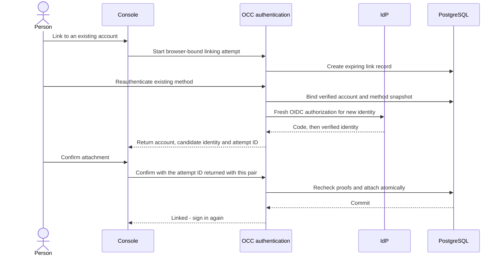

# Proposal: Link an existing account during OIDC sign-in

- **ID:** RFC-0034
- **Created:** 2026-11-10
- **Last updated:** 2026-11-11
- **Implementation plan:** [RFC-0034 delivery](../plans/0034-oidc-account-linking.md)
- **Related:** [Issue #5179](https://github.com/openclaw/openclaw-enterprise/issues/5179),
  [RFC-0032](0032-oidc-account-enrollment.md),
  [shipped enrollment implementation](https://github.com/openclaw/openclaw-enterprise/pull/5144)

## Summary

Let a person attach a new OpenID Connect (OIDC) identity to an existing OpenClaw
Enterprise (OCE) account through an explicit browser flow. Require fresh proof
through an existing authentication method, verification of the new OIDC identity,
and confirmation of the pair. Preserve the account, IAM Principal, ownership,
Roles, and Group memberships. Email matching does not authorize attachment.

This is an opt-in extension of human authentication. It changes attachment
authority from administrator-only to administrator-or-proven-account-owner;
it does not grant users account-administration permissions.

## Motivation and current behavior

The shipped implementation identifies an external identity by provider instance
and `sub`. Unknown identities can create accounts under
[enrollment policy](../../docs/reference/authentication/team-enrollment.md), but
an existing email produces a conflict. An administrator must attach the identity
to an existing account. Neither a valid token nor a matching email proves that
the person controls that account.

Source baseline: `af35ce905`. The relevant owners are:

- [Human login](../../apps/controller/src/auth/human-login.ts): browser-bound
  starts, callbacks, provider exchange, enrollment, and session issuance.
- [OIDC verification](../../apps/controller/src/auth/oidc.ts): configured provider
  instance, signed claims, and admission policy.
- [PostgreSQL human authentication](../../packages/occ/src/state/human-authentication.ts):
  account versions, authentication methods, attempts, sessions, and attachment.
  `attachExternal` advances the account version, deletes its sessions, and audits
  a new attachment in one transaction.

RFC-0034 changes RFC-0032's exclusion of self-service linking. It preserves that
RFC's account-creation behavior and historical text.

## Goals and scope

- Let an existing account owner link an OIDC identity without administrator help.
- Preserve identity and access; refuse transfer of an identity assigned elsewhere.
- Apply current account disablement, provider admission, freshness, and recovery
  rules throughout the flow.
- Prove the result through normal sign-in and authorized Agent use.

Account merging, email-based linking, alternative email claims, self-service
password reset, and profile updates are excluded. Multiple configured OIDC
providers remain [issue #5180](https://github.com/openclaw/openclaw-enterprise/issues/5180).
One account can nevertheless have several subjects from the currently configured
provider. Direct GitHub OAuth handling is not reintroduced.

## Proposal

### Operator policy and ownership proof

Add `auth.oidc.linking.enabled`, default `false`, with equivalent installation
profile `controlPlane.oidc.linking.enabled` and environment setting
`OCC_AUTH_OIDC_LINKING_ENABLED`. Accept only boolean configuration values, and
`true` or `false` for the environment value. Enabling it requires the existing
OIDC and guarded PostgreSQL authentication composition. It is independent of
`enrollment.createAccount.enabled`; linking does not require account creation.

There is one proof policy: reauthenticate through a method already attached to
the target account. A current OCE session, email claim, service API key, or
provider display name is insufficient. An existing session may preselect the
account, but cannot replace proof. The authenticated method determines the
account; the browser cannot authorize a caller-supplied target user ID.

Supported ownership proofs are:

- **Password:** verify the existing password through the guarded password
  verifier and its admission limits. Apply `passwordSignIn` and recovery-user
  policy. A password prohibited by `recovery-only` cannot authorize linking.
- **Configured external method:** run a new authorization-code exchange for an
  already attached identity. Request `max_age=0` and validate signed `auth_time`.
  The identity must resolve to the account snapshot captured for this proof.
  An unknown identity cannot enroll while proving ownership.

External reauthentication requires a provider that supplies verifiable fresh
authentication, including when it is a broker. Missing or invalid `auth_time`
fails this proof. The same requirement applies to the new OIDC identity.
Ordinary sign-in keeps its current compatibility requirements. An operator must
verify which authentication method each provider or broker enforces before enabling
linking. A signed authentication time alone cannot establish that an upstream
provider required a password or MFA. Use administrator attachment when the
provider cannot meet the Installation's assurance requirements.
Native Google sign-in is not automatically qualified.
[OIDC Core](https://openid.net/specs/openid-connect-core-1_0.html#AuthRequest)
defines `max_age` and the associated `auth_time` requirement.

Email is not required for linking. Absent, different, or unverified email cannot
select a target or supply proof, and does not invalidate independently verified
ownership. Existing account email and name remain unchanged.

### Browser workflow

The Console sign-in page offers **Link OIDC to an existing account** when enabled.
An unknown-identity refusal may offer the same action without disclosing whether
an email exists. Starting this action discards the unsuccessful login attempt;
it never reuses that callback as proof or silently converts enrollment to linking.
An owner must select this action before using a new identity if ordinary login
would otherwise create a new account.

The proposed sequence is:

The confirmation page identifies the existing OCE account, a recognizable provider
name or issuer, the provider instance ID, and the candidate's exact subject.
Optional signed profile labels are display hints only. Two tabs can show different
verified pairs in the same browser. To bind consent to the pair the person saw,
OCC returns an opaque attempt ID with that pair. The Console retains the ID with
the displayed pair and includes it in the confirmation request. Before attachment,
OCC requires the ID to match the locked, browser-bound link record.

The person can cancel or restart with a different IdP account. No attachment
occurs on a callback, a GET request, or without confirmation.

After commit, clear the browser's OCE session and linking cookies and offer
**Continue with OIDC**. This starts ordinary sign-in under the newly attached
method. Reusing the linking proof to mint a session is unnecessary and excluded.
Use the existing validated return destination to resume Console navigation after
sign-in; do not accept arbitrary redirect URLs.

### Attempt state and freshness

The existing PostgreSQL human-authentication owner stores one short-lived link
record. Bind it to the Installation, a random browser secret, policy fingerprint,
account and method snapshot, candidate provider instance and subject, and proof
expiry. Store only the browser-secret hash. Keep passwords, authorization codes,
and provider tokens out of this record, URLs, logs, and audit details.

Use these states: started, owner verified, candidate verified, and consumed.
Confirmation requires candidate verified. Failure, cancellation, or browser sign-out invalidates the
attempt. A new start invalidates the previous attempt for that browser. There is
no asynchronous workflow or new worker.

The entire attempt expires five minutes after database creation; transitions do
not extend it. Each provider exchange uses a distinct existing login-attempt
record with state, nonce, PKCE, and browser binding. Bind each child attempt to
its parent and purpose so ordinary login, owner proof, and candidate proof cannot
be substituted. Callback consumption remains one-use.

For both external proofs, require signed `auth_time` and `iat` no earlier than
that challenge's start minus the existing 60-second clock allowance, and no later
than current time plus that allowance. Keep all existing signature, issuer,
audience, nonce, subject, and expiry checks. Confirmation must precede both token
expiries and the link-record expiry. Token issuance time alone is not evidence of
fresh authentication or refreshed broker membership.

Capture the account version and existing method before password verification, or
resolve the existing external method with the challenge-start freshness check.
At confirmation, reject account or method changes since that snapshot. Recheck
current password/recovery policy, configured provider instances, linking enablement,
and the effective admission-policy fingerprint. Apply configured OIDC admission
to both external exchanges. Policy changes invalidate pending links.

Keep browser binding in an HttpOnly, Secure, SameSite cookie on HTTPS. Every
state-changing browser request requires exact-Origin validation and existing
CSRF protection. Extend existing sign-in admission and password limits to these
purposes, including confirmation. Count link records and child login attempts
against the existing 1,000-record Installation capacity and expire them through
request-driven cleanup. Eviction requires restarting; it cannot authorize
attachment. Secret possession never bypasses proof validation.

### Atomic attachment and access

Expose a dedicated self-service operation in `PostgresHumanAuthentication`;
do not weaken the administrator gate on `attachExternal`. Both operations share
the attachment mutation and database invariants. The self-service operation
accepts a validated link record, not administrator credentials or an arbitrary
actor/target pair. Existing administrative account routes retain their IAM checks.

In one transaction, lock and consume the link record, lock the account and proof
method in the established order, and verify the current snapshot, enabled account,
Installation association, and Principal. Then:

1. Refuse a candidate assigned to any other account, including a disabled one.
   Preserve the existing database uniqueness constraint for provider and subject.
2. Insert the external method, advance the account version, and revoke all account
   sessions, as administrator attachment does. This also invalidates older proofs
   and session-bound native Agent access.
3. Append `authentication.method.attach` with the account owner's Principal as
   actor, target user/method identifiers, link-attempt identifier, and
   `source: self-service`. Commit the audit and attachment together.

Do not change the user ID, Principal, email, name, resource ownership, Role
bindings, or Group memberships. Never invoke account creation or initial-grant
logic from either proof exchange or confirmation. Later ordinary OIDC sign-in
still applies the existing admission and Group-enrollment policy; this is distinct
from the linking mutation and must be stated in the operator documentation.

A fresh flow for a candidate already attached to this same account returns
already-linked without another mutation, version increment, or attach audit.
A concurrent flow with an obsolete account snapshot is refused instead. No
request transfers an identity or merges accounts.

### Failure and recovery

Use generic refusal before account proof; do not expose account existence or
another account's identity assignment. After proof, a conflict can say that the
identity cannot be linked and recommend administrator help, without naming its
owner. Return `409` for stale state or assignment conflict, `429` with
`Retry-After` for throttling, and `503` for unavailable required dependencies.
Expired or invalid proofs require a new attempt.

A failed transaction leaves no partial attachment, session revocation, or success
audit. An uncertain commit response returns `503` without automatic confirmation
retries or compensating deletion. Restart the explicit linking flow using the
original method; a committed link resolves as already-linked. Do not recover by
sending an unconfirmed candidate through ordinary sign-in, which could create an
account when enrollment is enabled. Use administrator inspection if proof is no
longer available. Linking never removes the original method.

A committed attachment survives a lost response or failed subsequent sign-in.
All previous sessions remain revoked. Normal sign-in can issue a session only
while the account and method remain valid. Account disablement, revocation, and
method removal serialize with linking; a later administrative mutation wins over
an earlier successful link.

Administrator attachment, detachment, and designated recovery remain available.
When recovery-only policy blocks a user's only existing method, linking cannot
repair that lack of proof. The user needs administrator attachment. Audit matched
link denials without credentials or unverified profile claims; use existing
unmatched-callback counters for requests that prove no attempt ownership.

## Acceptance Criteria

The [delivery record](../plans/0034-oidc-account-linking.md#verification) records
implemented checks, real-provider proof, and remaining verification. Fixtures alone
do not establish provider reauthentication or Agent chat.

- **AC-1 — Existing owner:** With linking enabled, manually create a default-user
  account, an Installation and Agent, and grant only the intended Agent access.
  Through the browser, prove its password, authenticate a new OIDC subject,
  confirm, and sign in again. Verify a real Agent/model chat and denial outside
  its grants. Compare persisted user, Principal, ownership, bindings, and Groups
  before/after; only the method, version, sessions, and audits may change during
  linking. Repeat with creation disabled and enabled.
- **AC-2 — External ownership:** Repeat using an already attached external method
  and a second OIDC subject with a real IdP. Verify two distinct fresh challenges,
  confirmation, and later login through either method. Exercise reused IdP/broker
  sessions and prove stale or missing `auth_time` is refused.
- **AC-3 — No email authority:** Matching verified email alone cannot link.
  Different or absent email succeeds only with both proofs. Reject forged tokens,
  wrong issuer/audience/nonce, failed admission, wrong passwords, prohibited
  recovery-only passwords, disabled accounts, and unknown owner-proof identities;
  create no user, method, or grant on these denials.
- **AC-4 — Races and replay:** Against real PostgreSQL and two controller instances,
  race two accounts for one candidate and two attempts for one account. Prove at
  most one valid mutation and no transfer. Refuse replay, cross-browser/purpose
  substitution, expired attempts/tokens, changed policy, and changed account or
  proof method. Exercise both commit orderings with disable/revoke/detach.
  Through the Console in two tabs, confirm an outdated pair. Require a conflict,
  with accounts, methods, versions, sessions, and attachment audits unchanged.
  The current pair must still succeed exactly once. The confirmation route must
  also reject missing or altered attempt IDs and replay.
- **AC-5 — Atomicity and recovery:** Inject audit failure and an actual lost COMMIT
  response through the existing database fault harness. Verify rollback versus
  a complete durable link, no partial grants, and the documented recovery. Check
  that old Console sessions and native Agent handles fail after attachment and
  fresh sign-in succeeds. Repeating an already-linked flow changes nothing.
- **AC-6 — Supported UX and operations:** Verify the default-disabled path, explicit
  start, confirmation, cancel, throttling, conflict, and provider outage. Update
  Console stories and capture native GitHub screenshots/video for the implemented
  flow. Document enablement, reauthentication qualification, Group-enrollment
  interaction, unsupported proof methods, conflicts, and administrator recovery.

## Delivery and decisions for review

The [implementation plan](../plans/0034-oidc-account-linking.md) covers configuration/profile/Helm parity, schema and transaction changes,
HTTP/OpenAPI contracts, Console integration, and AC-1 through AC-6. Update the
current authentication reference, OIDC guide, authentication flow, database/API
cheat sheets, and testing guide with implementation. The current implementation is described in the
[current account-linking reference](../../docs/reference/authentication/account-linking.md).

The user authorized implementation after RFC submission. Maintainer review of
the new account-owner attachment authority and provider reauthentication
requirement remains separate from implementation and verification.

## Rationale and alternatives

**Verified-email linking** is shorter for the user, but gives the issuer authority
over existing OCE accounts and requires policies for reassignment and account
selection. It is not part of this proposal.

**A current session plus new OIDC proof** avoids reauthentication, but lets a
stolen session add a durable authentication method. Fresh ownership proof is
required instead.

**Administrator-only attachment** remains the recovery path and default behavior.
It cannot meet self-service onboarding. **Issuing a session inside linking** saves
one login but adds a special proof exception after version advancement; ordinary
sign-in provides the existing session checks without that exception.
