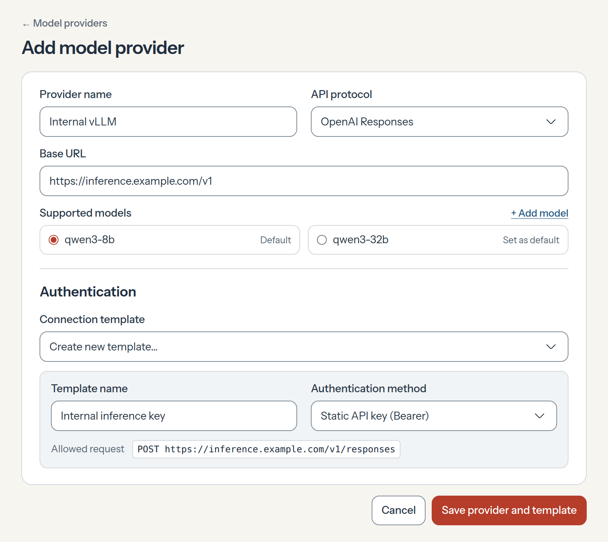
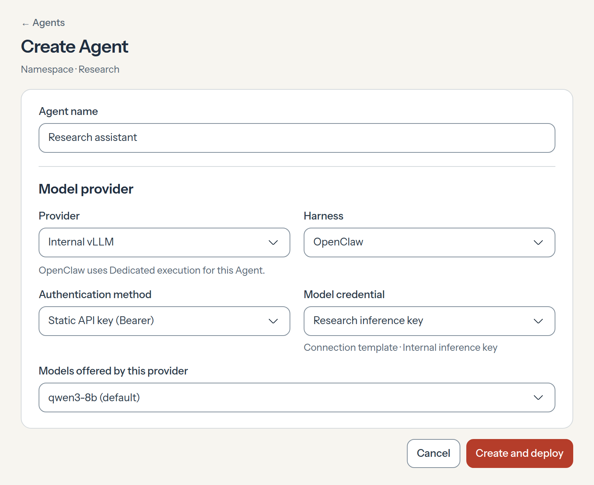

# RFC-0034 · Reusable model providers

An admin should be able to set up an inference endpoint once and give several teams an **Internal vLLM** option in **Create Agent**. Today an Installation has one [default model provider](../0028-shared-model-provider.md), and each deployment can supply an [inline override](../0030-agent-harness-overrides.md). We propose replacing the per-Agent URL override with a saved Model Provider. The admin configures the endpoint and API format once. Agent creators select the provider by name.

## An admin sets up Internal vLLM

The admin enters the base URL, selects the API format, and lists the model IDs to offer. They can choose a default model and supply any metadata the Harness needs, such as context and output limits. In this example both models use OpenAI Responses.

The admin selects a compatible Connection Template or creates one inline. Today [Connection Templates](../../../docs/reference/connection-templates.md) support OAuth. We propose a **static API key (Bearer)** template. The Console uses the URL and format to show which request the admin is approving. A team saves its key once as a Namespace credential created from that template. The provider stores the template reference.

## An Agent creator reuses it

[PR #4544](https://github.com/openclaw/openclaw-enterprise/pull/4544) proposes entering a custom endpoint during Agent creation. With a saved provider, the creator first chooses **Internal vLLM** and a compatible **Harness**. Next they choose the authentication method and a saved credential, here **Research inference key**. The **Models offered by this provider** picker comes last. It lists the models the admin configured, with **qwen3-8b** selected by default. The inference endpoint decides whether the selected credential can use that model. A second Agent can reuse the key with permission. Another team can use its own key with the same provider.

## Data model

The Installation can offer several providers. One Agent selects **Internal vLLM** and another selects **OpenAI**. Each Agent stores a provider reference. The Harness gets its routing configuration from the selected provider. The credential gets its allowed request from the approved template version, so **Create Agent** can drop the **Authorized base URL** field.

| Record               | What it owns                                                                                                                                                                                                                                  |
| -------------------- | --------------------------------------------------------------------------------------------------------------------------------------------------------------------------------------------------------------------------------------------- |
| Model Provider (new) | Stable ID, display name, inference base URL, API format, supported models, optional default model ID, and a Connection Template reference. Model IDs are local to the provider. Each entry owns its model metadata.                           |
| Connection Template  | A new static-key variant specifies bearer authentication and the allowed destinations and operations. Saving the template creates a version the credential owner can approve.                                                                 |
| Namespace credential | A Credential Source references the Secret that holds the key and the template version approved for that key. Multiple credentials can use the same template.                                                                                  |
| Agent draft          | A new provider reference selects the route. Agent Configuration selects the model ID, and the existing `harnessAuth` binding selects the Credential Source the Agent may use.                                                                 |
| Agent revision       | Records the selected provider ID and the admitted credential binding. Its Harness settings snapshot holds the resolved URL and protocol. Its Configuration snapshot holds the selected model and metadata. Recovery reads these saved values. |

## Deploy through the existing revision flow

OpenClaw Control Plane resolves the provider reference into the existing [Harness provider settings](../../../docs/reference/drivers/kubernetes-compute/model-provider.md). Compute translates those settings into the native Codex or OpenClaw configuration. Admission checks the selected model against the provider catalog and the resolved route against the [credential binding](../../../docs/reference/credential-sources.md). For example, if an Agent switches from an internal endpoint to OpenAI but keeps a key approved only for the internal endpoint, admission refuses the deployment before either endpoint receives the key.

For a private endpoint, Compute also configures the network access the trusted sender needs, within Installation policy. The sender checks the actual destination and operation before adding the key. Editing the provider or template cannot authorize an existing key for a new destination or operation. A running revision keeps its original settings.

Verify the proposal by deploying two Agents with the same provider. Each should complete a turn in which the private model requests a tool, the Harness executes it, and the model responds to the result. Deploying with a key authorized for a different destination should fail before the endpoint receives the key.
