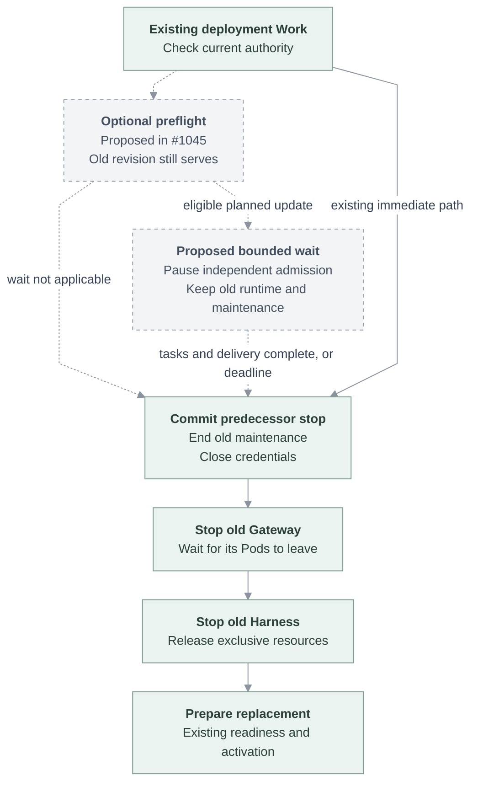

# Proposal: Let admitted tasks finish before a planned replacement

- **ID:** RFC-0036
- **Created:** 2026-11-05
- **Last updated:** 2026-11-10
- **RFC PR:** [#4857](https://github.com/openclaw/openclaw-enterprise/pull/4857)
- **Related:** [Image upgrades](0011-coordinated-image-upgrade.md), [pre-stop checks proposal #1045](https://github.com/openclaw/openclaw-enterprise/pull/1045)

## Decision

Add one bounded waiting stage before an ordinary planned replacement stops its
serving revision. Pause independent new work, keep the old Gateway and Harness
running with still-valid authority, and let admitted tasks and their result
delivery finish. Then use the existing exclusive replacement. Propose a maximum
of **30 minutes per serving Agent revision**. At or after that fixed cutoff, the
next authorized reconciliation starts the existing stop path without another
completion wait, even if work remains. A Controller outage can delay that pass;
this does not promise wall-clock stopping or readiness during an outage, or
recovery of every interrupted task.

The first delivery covers image-only updates of Kubernetes Agents with a
dedicated Codex Harness and an OpenClaw Gateway supporting the new wait contract.
The Compute Driver establishes eligibility from admitted snapshots; core worker
code does not identify specific vendors. Changes to effective configuration,
identity or authorization are outside this eligibility rule. Stop, deletion and
authority withdrawal bypass completion waiting.

## Why another wait is necessary

At OCE `799ba4b8`, an isolated ordinary replacement signalled a busy Gateway;
it aborted the original run about 76 ms later and exited about 3.6 seconds after
the signal. The Harness was stopped afterward. Two synthetic tools each had
one start and no completion. Recovery did not replay their uncertain effects.
The installed stack could continue old conversations and run existing scheduled
jobs after replacement, but did not wait for those running tasks to finish.

Source was refreshed to `9ba5e7f7`. Its relevant worker, Kubernetes replacement
path and OpenClaw pin are unchanged; that newer HEAD has not had another runtime
test. The [pinned OpenClaw source](../../deploy/runtime/openclaw-source.json) is
`513c1270`: drain-mode `suspend.ready` means write custody is clear, not that tasks
are complete. Its 45-second drain budget is not a 30-minute task wait. Merely
increasing the wrapper's stop timeout cannot change when the Gateway aborts work.

## One lifecycle, with a later stop boundary

Use the existing deployment API, revision, Work queue and per-Agent reconciliation.
Insert the wait in [the worker](../../apps/controller/src/worker.ts) before normal
predecessor credential closure and `stopRevision`. Do not put it inside generic
stop or a hook also used by security withdrawal.

Before the boundary, the serving revision must retain its authorized maintenance.
Currently a newer exclusive candidate can supersede that maintenance as soon as
it is admitted. [#1045](https://github.com/openclaw/openclaw-enterprise/pull/1045)
proposes the same later boundary for replacement preflight. Use one sequence:
revalidate ownership and authority, run optional candidate-only preflight, wait
if eligible, then commit the single stop boundary. A failed preflight should not
pause users. Newer candidates run their own preflight but inherit the serving
revision's existing cutoff. Its proposed probe Pods remain separate work.

The same stop fact must govern maintenance, native-admin access and deployment
status, including replacements that skip waiting. Today
[native-admin](../../apps/controller/src/http/native-admin.ts) becomes unavailable
merely because a newer exclusive successor exists. Preserve currently authorized
access during an explicitly owned pre-stop operation, so reconnections and
approval replies work; expose stopping after commitment. The lifecycle owner's
authenticated handoff must still be possible at that boundary. Do not add a
second availability rule or coordinator. Once stopping is committed, old
maintenance must never recreate the predecessor.

The dashed edges below are proposed; solid edges retain the existing stop/start
path. Waiting yields Work so an idle Agent can upgrade independently.

New Gateway and Harness startup retain existing dependencies and readiness
checks; this does not introduce a promise that one always becomes ready first.

## Complexity budget

| Addition                                                | Owner and boundary                                                                                                                                                                                                                                       |
| ------------------------------------------------------- | -------------------------------------------------------------------------------------------------------------------------------------------------------------------------------------------------------------------------------------------------------- |
| One small lifecycle fact per predecessor being replaced | Extend an existing OCC Agent/Work lifecycle record with predecessor revision ID, fixed cutoff when waiting, and the pre-stop/committed-stop distinction. Prefer typed fields on existing storage; no new table or database is required by this proposal. |
| One optional Compute capability                         | Begin/poll an eligible wait and cancel an uncommitted wait. Inputs identify the predecessor, owner and fixed deadline; results distinguish waiting, completed, unsupported and unavailable. These operations are proposed, not existing APIs.            |
| One Gateway planned-wait mode                           | Extend the authenticated suspension contract to keep admission paused while existing work finishes; report actual completion separately from custody readiness.                                                                                          |
| Existing Work progress and timeouts                     | Show waiting and deadline/forced-stop reason. Align worker convergence and release-helper waits with the new stage.                                                                                                                                      |

Reuse the existing Work claims, per-Agent serialization, Namespace-to-Agent locks
and yielding. Current Work timestamps are candidate-scoped, pending Work cannot
carry `result_data`, and admitted revisions are immutable; those fields cannot
store this policy unchanged. Use the existing state store's clock for the cutoff.

The worker records the pre-stop operation transactionally under its existing
claim/Agent checks. Retries, restart and newer candidates reuse the predecessor's
cutoff. Before credential closure or any stop effect, persist `stopping` under
current candidate/predecessor ownership and authority. It never returns to waiting.
Retain that fact until retirement; a newer cancellation cannot erase it. On
pre-stop cancellation, preserve this attempt's no-stop outcome in existing Work
evidence before clearing temporary wait data. Missing or legacy evidence is
unknown, not permission to recreate a predecessor or claim it still serves.

The Gateway owns a short renewable admission lease, capped by the fixed deadline.
Polling cannot extend the deployment deadline. A dead Controller eventually
releases admission through lease expiry; a surviving Controller reacquires the
wait using the original deadline. This intentionally prefers availability over
keeping an abandoned deployment frozen. Unexpected Gateway/Harness death follows
existing recovery and cannot be reported as successful task completion.

A completion observation is valid only for its matching live admission lease and
Gateway process. Reuse/extend OpenClaw's exact-process suspension handoff to consume
that lease at committed shutdown. Lease expiry or process change invalidates the
observation: before commitment, reacquire and reobserve within the original
deadline, or take the deadline-forced path. After durable stop commitment, finish
retirement without reopening normal maintenance. An uncertain handoff is not a
protected completion. The record is stop intent, not proof that a Pod has exited.

Kubernetes Compute should reuse the administrative Gateway route and client used
by [node enrollment](../../apps/controller/src/gateway/node-enrollment-client.ts),
with exact revision/process targeting and authenticated method authorization.
The native CLI supplies a handoff owner, but its exit alone does not retire the
Kubernetes workload. Isolated qualification must prove route authorization,
process targeting, handoff availability at the stop boundary and Pod deletion
ordering without restarting the old Gateway. This proposal grants no new public
endpoint or broader credential scope.

No new release service, fleet-wide lock, message database, tool-result journal,
executor snapshot, replay engine or automatic rollback manager is included.
If implementation needs one of those, revise this RFC before expanding it.

## Observable behavior and failures

**During waiting:** already admitted turns, their necessary continuations and
approval replies can finish. New independent turns and cron occurrences do not
start. A completion observation must include task/subtask activity, admitted
queued work and pending terminal persistence/delivery, not just CPU inactivity or
write-custody release. Keep admission paused between completion and stopping.
Still-valid authorization can renew normally; revoked or expired authority is
never extended for deployment convenience.

**New input:** V1 rejects new independent task requests while admission is paused.
Tell the caller that the request was not accepted and can be retried after the
deployment completes; do not display it as accepted or queued. V1 does not add a
queue or promise automatic resubmission after deployment. Existing task
continuations and approval replies remain allowed as described above. Scheduler
catch-up retains its existing policy.

**Deployment visibility:** use the existing deployment UI to show "Waiting for
ongoing tasks to finish." Metrics and logs must expose the wait duration and its
outcome: completion, deadline expiry or cancellation.

**Deadline:** end the wait and perform the existing bounded stop, then replacement
readiness checks. Preserve current no-blind-replay recovery. A safe stop failure
does not authorize a second writer. Distinguish an interrupted task from a failed
deployment; report the original task outcome through its existing conversation
path, without turning a successful wait into a task-failure notification.

**Cancellation or unsupported runtime:** cancel only the matching uncommitted
lease and restore normal admission. A runtime without the capability follows
today's replacement path and explicitly reports that completion waiting was not
available. Do not silently call that first enrollment protected. Unavailability
is not completion: retry within the same deadline, then take the forced path.

The current worker convergence budget and release-helper default are both
15 minutes. Proposed accounting separates the at-most-30-minute wait from the
existing convergence allowance and includes bounded stop overhead in the outer
watch timeout. Retries must not reset either budget. A fleet watch must not add
30 minutes serially for every Agent.

## Delivery and acceptance

Review this decision first; no product behavior changes in this RFC. Split later
implementation by ownership: the upstream OpenClaw wait contract, OCE worker/
state/Compute integration, then release timeout and real-upgrade acceptance.
Keep incomplete integration disabled until its end-to-end test passes.

Use the existing isolated Kubernetes release recipe with synthetic tasks and
fixed image digests. Required observations:

1. A task spans the former stop point, keeps valid tool access, completes and
   delivers once on its original turn; idle peers upgrade while it is waiting.
2. Gateway and Harness replacement preserve an old conversation. New independent
   task requests during the pause are visibly rejected, with no admission or
   execution. After deployment, an explicit retry in that conversation is admitted
   and executes once; no rejected request is queued for later execution.
3. An existing scheduled job with a test OAuth connection runs naturally before
   and after upgrade, without reauthorization or duplicate execution.
4. A task exceeds 30 minutes with an available Controller: the first authorized
   pass at/after the cutoff starts stopping without another wait. A Controller
   returning after the cutoff does the same. Unknown tool effects are not replayed.
   Test the real timer once; use fast clocks for retries and newer candidates.
5. Controller restart, cancellation and supersession retain the cutoff and correct
   predecessor. Credential revocation and explicit stop bypass the wait; old
   maintenance cannot resurrect a stopped workload.
6. Final delivery still pending is not completion. Exercise lease expiry/process
   change between completion and handoff, and native UI/approval reconnection
   during waiting. A missing capability is explicit; first enrollment and the
   subsequent protected update are distinct.
7. The existing deployment UI shows task-completion waiting; metrics and logs
   expose its duration and distinguish completion, deadline expiry and cancellation.

These are acceptance requirements, not completed tests of the proposal. Native UI
rejection/retry behavior, real OAuth continuity and the administrative suspension route
remain unverified. Docker, OpenShell and other Harnesses need their own qualification.

## Alternatives and review choices

Keeping today's behavior adds no engineering cost but interrupts useful work.
Polling for idleness without pausing admission is smaller, but new work can keep
arriving until the deadline. Reconstructing every interrupted execution is much
larger and still cannot safely replay uncertain side effects. The bounded wait
reduces how often recovery is needed while preserving those protections.

Reviewers should decide the proposed 30-minute bound, the initial image-only
Kubernetes/Codex scope and the one-record/two-phase design. The user-visible
tradeoff is a potentially long pause for new independent work. A shorter bound
ships faster but interrupts more tasks. The route and completion-signal checks
above must settle before implementation is described as small or deployable.
