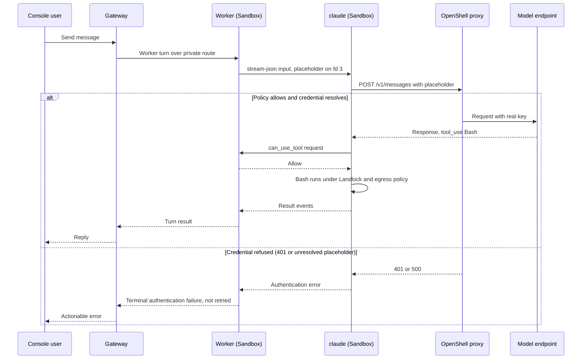

# Proposal: Run Claude Code in the dedicated OpenShell Harness

- **ID:** RFC-0037
- **Created:** 2026-11-11
- **Last updated:** 2026-11-11
- **RFC PR:** Draft; link added once opened
- **Evidence:** [Sandbox spike](spike-evidence.md)
- **Related:** [Embedded Claude Code runtime, draft #3027](https://github.com/openclaw/openclaw-enterprise/pull/3027),
  [Harness execution topology](../../../docs/flows/harness-execution-topology.md),
  [OpenShell Sandbox provisioning](../../../docs/flows/openshell-sandbox-provisioning.md),
  [OpenShell Credential Gateway](../../../docs/reference/drivers/openshell-credential-gateway.md)

## Summary

Offer Claude Code as the model runtime of a **dedicated OpenClaw Agent** whose
Harness runs in an OpenShell Sandbox. The `claude` process runs inside the
Sandbox, as a child of the OpenClaw native worker that already runs model turns
there. It is driven by upstream OpenClaw's `claude-cli` backend, not by an OCE
fork. The Gateway stays trusted and never receives model credentials. OpenShell
enforces the filesystem, network and credential boundaries. Claude Code uses
its native tools, including Bash, inside those boundaries. Draft
[#3027](https://github.com/openclaw/openclaw-enterprise/pull/3027) supplies the
pinned binary and the managed-settings hardening; this RFC moves both into the
Sandbox.

## Motivation

Draft #3027 runs Claude Code next to an embedded OpenClaw Gateway, and refuses
`claude-cli` in dedicated mode. Embedded mode puts identity, model credentials
and an agent with a shell in one Pod
([topology](../../../docs/flows/harness-execution-topology.md), line 175). OCE's
protected shape is the dedicated Harness: the Harness keeps the workspace and
model credentials, and the Gateway keeps neither (same document, lines 152 and
157). Today OpenShell supports only dedicated OpenClaw and Codex
(`apps/controller/src/drivers/sandbox/openshell.ts:3095`).

The owner set three constraints on 2026-11-11:

- Build on upstream `claude-cli`.
- Native Bash or Gateway exec are both acceptable, with a slight preference for
  native Bash.
- Claude Code must run inside the OpenShell Sandbox.

## Goals

- **G1.** `claude` runs only inside the Harness OpenShell Sandbox. It uses the
  pinned binary from the OCE runtime image.
- **G2.** The model credential reaches the process only as an OpenShell
  placeholder. Only the Sandbox proxy resolves it, and only at the configured
  Messages endpoint.
- **G3.** #3027's managed settings, read-only configuration skeleton and
  telemetry deny-by-default all carry over. OpenShell enforces them, and the
  workload cannot rewrite them.
- **G4.** Native tools, including Bash, run under OpenShell's filesystem and
  egress policy. Denials are audited.
- **G5.** Authentication and credential failures are classified quickly and are
  not retried.
- **G6.** Create, turns, restart, Console, Stop and Delete behave like dedicated
  OpenClaw.

## Non-goals

- Embedded-mode Claude Code (#3027's scope).
- Subscription login (`CLAUDE_CODE_OAUTH_TOKEN`).
- Claude Code as its own Harness id.
- Changing how dedicated Codex or OpenClaw custody credentials.

## Proposal

### Architecture

```mermaid
---
config:
  theme: base
  themeVariables:
    fontSize: 14px
    primaryTextColor: "#344054"
    lineColor: "#8B949E"
  flowchart:
    curve: linear
---
flowchart LR
  subgraph GW["Agent Gateway Pod (trusted, no model credential)"]
    G["<b>OpenClaw Gateway</b><br/>sessions, Console, approvals"]
  end
  subgraph SB["Harness OpenShell Sandbox (uid 10001, Landlock, no capabilities)"]
    W["<b>OpenClaw native worker</b><br/>claude-cli backend, loopback MCP"]
    C["<b>claude</b> 2.1.304<br/>stream-json session, native tools"]
    B["Bash children"]
    P["<b>OpenShell proxy</b><br/>placeholder resolution, L7 policy, OCSF"]
  end
  M["Model endpoint<br/>POST /v1/messages"]
  G -.->|"private WSS route (existing)"| W
  W -.->|"stdio and fd 3 placeholder"| C
  C -.-> B
  C -.->|"x-api-key placeholder"| P
  B -.->|"denied unless policy allows"| P
  P -.->|"real key substituted"| M
  classDef gate fill:#F7F1E5,stroke:#B3A078,color:#514532
  classDef pending fill:#F3F4F6,stroke:#98A2AE,color:#44505F,stroke-dasharray:4 4
  class G,P gate
  class W,C,B pending
```

All edges are proposed. The Gateway-to-worker route and the proxy exist today
for dedicated OpenClaw.

**Q1: where `claude` runs.** OpenShell's controller creates the Harness Pod
from the OCE runtime image. The supervisor
`/.openshell/runtime/openshell-sandbox` is the entrypoint
([spike](spike-evidence.md#pod)). The pinned binary goes into that same image at
`/usr/local/bin/claude`, as #3027 installs it (`deploy/runtime/Dockerfile:469-497`
at `0996e46b`). No second image is needed.

The native worker is profiled with `cloudWorkers` and `inference: "worker"`
(`runtime-entrypoints.ts:2751-2775`). It spawns `claude` with OpenClaw's
existing live stdio session. That session keeps:

- the `can_use_tool` permission relay;
- the loopback MCP server on 127.0.0.1;
- credential delivery over fd 3.

Spawning `claude` from the worker needs upstream change **U1**. Today a
`requiredProfile` session always resolves to the embedded `openclaw` runtime
(`src/gateway/worker-environments/placement-session-runtime.ts:209` at upstream
`513c1270`).

**Q2: settings, skeleton, telemetry and credential.**

*Managed settings.* #3027 renders `managed-settings.json` in an init container.
It sets `disableAllHooks`, the hardening and telemetry-denial environment, the
model slots and the base URL (`runtime-entrypoints.ts:2568-2633` on #3027).
In the dedicated design, the trusted OpenShell workspace preparer renders the
same JSON onto a PVC subPath (`openshell.ts:1457-1530`). The Sandbox mounts it
`read_only` at `/etc/claude-code`.

*Configuration skeleton.* The skeleton goes on its own read-only mount, at a
path outside every read-write tree. Only `projects/` (transcripts) is a separate
writable mount on persistent storage. `CLAUDE_CONFIG_DIR` points at the
skeleton.

*Who enforces the filesystem.* **OpenShell enforces it.** Landlock is a
`hard_requirement` (`openshell.ts:2323`), and `/etc` is read-only by default
(`openshell.ts:377`). The Pod's `read_only` mount adds defence in depth. The
spike's workload owned the files, yet Landlock still refused overwrite, plant
and rename attempts ([T1–T5](spike-evidence.md#bash)).

Landlock is allow-list only, so a read-only directory cannot sit under a
writable parent. For that reason the skeleton must not live under the runtime
`HOME` (`openshell.ts:356`).

*Secrets in settings.* Managed settings carry no secret. A static placeholder
fails closed: the proxy returns a 500 and never forwards the request
([spike](spike-evidence.md#credential)).

*Credential.* OCE adds an `anthropic` source type to the OpenShell Credential
Gateway (change **O4**). The source sends the key as an `x-api-key`
header and lists `/usr/local/bin/claude` among its binaries. Its network rules
allow only `POST /v1/messages` and `POST /v1/messages/count_tokens`, not the
generic `${pathname}/**` (`credential-gateway/openshell.ts:541`). The worker
passes the revision-scoped placeholder to `claude` over fd 3.

*Where the Credential Proxy sits.* The credential boundary is the OpenShell
proxy inside the Harness Sandbox. No proxy sits in the Gateway.

*Telemetry.* #3027's default of `telemetry.enabled: false` stays. Two things
deny it:

- the environment variables in managed settings;
- a provider profile that grants no telemetry hosts. OpenShell's stock
  `claude-code` provider grants `statsig.anthropic.com` and `sentry.io`, so OCE
  authors its own profile.

With telemetry left un-denied, the spike recorded six attempts to the vendor
API host, each denied by OpenShell's policy. With telemetry denied, there were
none ([spike](spike-evidence.md#telemetry)). Opting in adds the telemetry
hosts to the network policy.

**Q3: native Bash or Gateway exec.** Recommendation: **native Bash**, with
OpenShell as the boundary. This matches dedicated Codex, which runs
`danger-full-access` inside OpenShell (`openshell.ts:368`).

| Concern | Native Bash in the Sandbox | Gateway exec (`mcp__openclaw__exec`) |
|---|---|---|
| Egress | OpenShell policy applies to `claude` and its descendants. The spike denied arbitrary hosts, the vendor API, metadata and the Kubernetes API. | Under U1, exec runs in the same Sandbox under the same policy. Under today's Gateway placement it would run in the Gateway Pod, which breaks the in-Sandbox requirement. |
| Approval | Claude's permission prompt goes through the `can_use_tool` relay to OpenClaw's approval surface. | OpenClaw exec approvals. |
| Audit | Claude transcripts, relay events and OpenShell OCSF denial logs. | OpenClaw tool events and OCSF. |
| Parity | Same model as Codex. Native tool behaviour. | Same model as dedicated OpenClaw. |

The model only ever sees a placeholder, so native Bash cannot read the
credential. However, OpenShell applies a provider rule to every descendant of a listed binary. A
`curl` started from Bash reached the model endpoint with the credential
substituted. The same `curl` run outside `claude` was denied
([T11](spike-evidence.md#bash)). Restricting the route to Messages-only
narrowed this to calls that already spend the credential; a Bash-child
`GET /v1/models` then got a 403 ([spike](spike-evidence.md#l7)).

Upstream change **U2** lets managed turns keep native file and shell tools, but
only when the operator declares an external sandbox. Today
`managedNativeTools` is limited to `Agent` and `Workflow`
(`extensions/anthropic/cli-backend.ts:84-104`).

**Q4: changes, by owner.**

| ID | Owner | Change |
|---|---|---|
| U1 | OpenClaw | Let a `cloudWorkers.requiredProfile` session select the configured CLI runtime, and run the `claude-cli` backend locally in the worker. |
| U2 | OpenClaw | Add an operator-declared external-sandbox mode that allows native `Bash`, `Read`, `Edit`, `Write`, `Grep` and `Glob` in managed turns. The default stays unchanged. |
| U3 | OpenClaw | Classify a 401 and an unresolved-placeholder 500 as terminal authentication failures and bound Claude Code's internal retries. Today the spike saw about 3 minutes of retries. |
| O1 | OCE contracts and admission | Accept the Claude Code runtime for dedicated OpenClaw on the OpenShell Sandbox Driver only. Lift #3027's dedicated refusal. |
| O2 | OCE runtime image | Ship the #3027 binary pin and `verifyClaudeCodeRuntime` readiness. |
| O3 | Sandbox Driver | The preparer renders managed settings and the skeleton onto read-only mounts. Add the writable `projects/` mount and the environment pins. |
| O4 | Credential Gateway | Add the `anthropic` source type, its Messages-only rules, `/usr/local/bin/claude` binary and telemetry hosts only on opt-in. |
| O5 | Console | Runtime selector and telemetry toggle for dedicated Agents. Status, Stop and Delete stay unchanged. |

Upstream changes land first, then OCE bumps its OpenClaw pin. OCE does not
patch OpenClaw.

**Q5: private gateway routing.** The design adds no new route. The worker
dials the Gateway over the existing private WSS route. Dedicated storage
already requires gateway routing and node enrollment
(`kubernetes/index.ts:1410`). Development clusters install the routing
controllers unconditionally since `2d89bf25`
(`internal/occdev/openshell_k3d.go:330-336`). The remaining risk is any
installation without private routing: it refuses dedicated deployment with
`DEPENDENCY_UNAVAILABLE` before Claude Code is involved.

### Request lifecycle

This lifecycle is proposed. The spike proved the `claude`-to-model leg inside
a stock OpenShell 0.1.6 Sandbox.

## Acceptance Criteria

Every criterion runs against a real OCE installation with the OpenShell Sandbox
Driver, private routing and the pinned image. Evidence is a CI integration test
where marked, or a recorded dogfood run.

- **AC-1 (G1, G6).** An admin creates a dedicated OpenClaw Agent with the
  Claude Code runtime through the Console. The Harness Pod runs the OpenShell
  supervisor, `claude --version` reports the pin, and readiness fails closed if
  the binary or settings are missing. Evidence: CI and dogfood.
- **AC-2 (G1, G4).** A turn produces a model reply. The proxy log shows the
  credential substituted, and the process environment holds only a
  placeholder. A Bash tool call runs in the workdir. Evidence: dogfood.
- **AC-3 (G3).** From Bash, attempts to rewrite managed settings, plant user or
  remote settings, or rename the configuration directory are refused.
  Transcripts persist. Evidence: CI.
- **AC-4 (G2, G4).** From Bash, requests to an arbitrary host, the vendor API,
  the metadata address and the Kubernetes API are denied with OCSF records. A
  non-Messages route on the model endpoint is denied. Evidence: CI.
- **AC-5 (G3).** With telemetry off, `claude` makes no denied attempt to
  telemetry hosts. With it on, only the opted-in hosts are reached.
  Evidence: dogfood.
- **AC-6 (G5).** A revoked or wrong key surfaces as a terminal authentication
  failure within 30 s, with no retry loop. Evidence: CI.
- **AC-7 (G6).** After a Harness restart, `--resume` recalls an earlier fact.
  Evidence: dogfood.
- **AC-8 (G6).** The Console shows the conversation and status. Stop and Delete
  remove the Sandbox and its provider. Evidence: dogfood with media.

## Delivery and verification

1. U1–U3 upstream, each with its own tests. U1 and U2 are independent.
2. O2 and O4. Neither depends on U1.
3. O3 and O1, behind U1. Then the OpenClaw pin bump.
4. O5 and the dogfood run that covers AC-1 to AC-8.

The [spike](spike-evidence.md) gives early evidence for parts of AC-2, AC-3,
AC-4, AC-5 and AC-7 on stock OpenShell 0.1.6, without OCE in the loop.

It did not cover:

- the OpenClaw worker driving `claude`;
- persistent volumes and restart;
- read-only mounts, as opposed to Landlock alone;
- the Console, Stop and Delete;
- settings precedence under the full OCE stack.

## Rationale and alternatives

- **Node placement** (`execHost: "node"`, `agent.cli.claude.run.v1`) already
  exists upstream (`src/agents/cli-runner/execute-node-claude.ts`). OCE would
  only add the command to the workspace node's `--commands` list
  (`runtime-entrypoints.ts:5012`). It is not the recommendation because:
  - it runs a one-shot `-p` per turn;
  - it strips `--mcp-config`, so OpenClaw's tools are lost
    (`src/node-host/invoke-agent-cli-claude-params.ts`);
  - each run needs a node exec approval;
  - the Gateway prepares and forwards the credential environment
    (`src/agents/cli-runner/execute.ts:326-333`).

  It remains the fallback if U1 stalls.
- **Gateway-local `claude-cli`** (#3027's shape) puts the agent's shell in the
  trusted Pod, which breaks the in-Sandbox requirement.
- **A Claude Code Harness id** would duplicate OpenClaw's session, Console and
  approval plumbing.

## Unresolved questions

1. **Owner.** Should native tools beyond Bash, such as `WebFetch`, be enabled?
   They are bounded by egress policy either way.
2. **Owner.** Is the Messages-only route acceptable, or are other model routes
   needed (for example batches)?
3. **OpenClaw maintainers.** U2's configuration shape, and whether U1 must
   preserve placement-incompatible model change rejection (upstream #136833).

## References

- [Spike evidence](spike-evidence.md)
- `apps/controller/src/drivers/sandbox/openshell.ts`
- `apps/controller/src/drivers/credential-gateway/openshell.ts`
- `apps/controller/src/drivers/compute/kubernetes/runtime-entrypoints.ts`
- Upstream OpenClaw at `513c12703ad9`: `extensions/anthropic/cli-backend.ts`,
  `src/gateway/worker-environments/placement-session-runtime.ts`,
  `docs/gateway/cli-backends.md`
