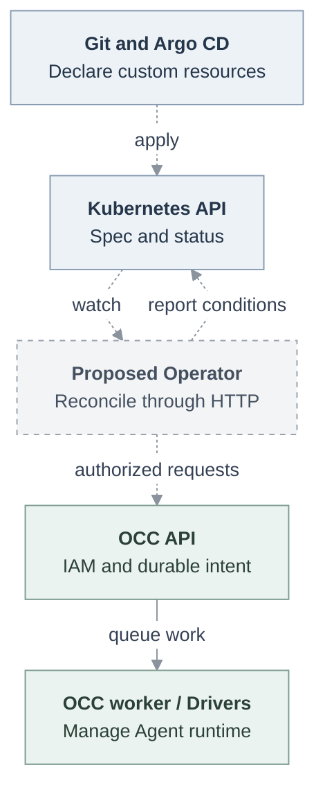

# Proposal: Manage Enterprise Agents through Kubernetes custom resources

- **ID:** RFC-0037
- **Created:** 2026-11-11
- **Last updated:** 2026-11-12
- **Implementation plan:** [Operator delivery](../plans/0037-kubernetes-agent-operator.md)
- **Related:** [Platform architecture](../../docs/design.md),
  [Agent provisioning](../../docs/flows/agent-provisioning.md),
  [Namespace lifecycle](0035-namespace-driver-lifecycle.md)

## Summary

Add an optional Kubernetes Operator that translates custom resources into
authorized OpenClaw Control Plane (OCC) API operations. Argo CD applies the
resources from Git. OCC retains Agent lifecycle, IAM, audit, PostgreSQL state,
and Driver ownership. Users need no local CLI or synchronization script after
bootstrap. This is a proposal, not an implemented Kubernetes API.

## Motivation and current evidence

An operator wants to install OpenClaw Enterprise (OCE), commit Agent definitions,
and observe deployment health in Argo CD. Today,
[OCC is a service, not an Operator](../../docs/guides/concepts.md#control-plane).
Helm installs infrastructure; it does not define Agents as custom resources.
The local GitOps pilot translates YAML through `occ` into HTTP operations.

At source baseline `61b0fb0`, `provisionAgent` accepts a client request ID and
queues first-time provisioning. Repeating the same actor, Namespace, request ID,
and input recovers the work; different input conflicts.
[Configuration updates](../../docs/reference/configuration.md) support
`expectedGeneration`. Ordinary deployment accepts Harness overrides, not a
general desired-state identity or expected Configuration generation. These
mechanisms help, but do not establish continuous declarative ownership,
recoverable updates, or prune behavior.

## Scope and state ownership

Git owns the declared Agent settings. Kubernetes stores their desired spec and
observed status. OCC owns the authorized desired deployment and runtime facts.
The Operator translates between these representations; it does not manage
Agent Pods, workload Secrets, routes, PVCs, or NetworkPolicies directly. Existing
Drivers continue to create and clean up those resources.

Dashed links below are proposed. The solid API-to-runtime path already exists;
the diagram does not establish installed-runtime proof.



The first delivery supports dedicated Agents, one private Telegram bot per
Agent where the selected Installation supports it, and inline Agent
Configuration. It does not introduce a Channel resource, replace IAM with
Kubernetes RBAC, automate human OAuth consent, or declare all platform resources.
CRDs for Roles, Backends, shared Configurations, and Installation Drivers are
outside this delivery. Installation values remain Helm-managed. Native Telegram
support is a separate runtime prerequisite, not a capability this Operator adds.

The initial alpha is narrower: it references existing Namespace/Secret resources,
adopts a reviewed existing dedicated Agent, applies settings with durable receipts
and releases ownership on Retain. New resource creation, Secret import/rotation
and Delete cleanup remain proposed. The [current branch contract](../../docs/reference/kubernetes-agent-operator.md)
and [delivery plan](../plans/0037-kubernetes-agent-operator.md) separate that subset
from the full acceptance criteria. API, PostgreSQL and scoped Kubernetes SDK
checks do not establish Argo or genuine Telegram delivery.

## Proposed Kubernetes API

Use namespaced resources under the proposed group
`enterprise.openclaw.ai/v1alpha1`. Names and fields require maintainer review.

| Kind            | Responsibility                                                                                                                                              |
| --------------- | ----------------------------------------------------------------------------------------------------------------------------------------------------------- |
| `OCEConnection` | Administrator-owned HTTPS endpoint, expected Installation identity, service-key reference, approved target Namespace scope, and approved input Secret keys. |
| `OCENamespace`  | Create an OCC Namespace or reference an existing one through a local Connection. Report its server-generated ID and readiness.                              |
| `OCESecret`     | Import one approved local Kubernetes Secret key into an OCC Namespace Secret. Report metadata, never its value.                                             |
| `OCEAgent`      | Own one Agent and its private Configuration, desired running/stopped state, credential references, native admin enablement, and deployment status.          |

References stay in the custom resource's Kubernetes namespace. That namespace
need not equal the Driver's workload namespace. A Connection authorizes which
OCC Namespace identities or create requests it can address. Namespace creation
requires a separately provisioned principal with the relevant authority; an
Agent author cannot request new IAM grants or broaden a Connection's scope.
An existing Namespace remains externally owned. No resource adopts an existing
Agent, Configuration, or Secret by matching its display name.

Support an explicit administrator-authorized adoption of an existing Agent for
cutover from another reconciler. Name its exact OCC Agent and Configuration IDs,
verify Namespace ownership and exclusive Configuration use, and compare the
reviewed settings with their current generations before acquiring management.
Persist the transfer receipt before reporting adoption. Stop the former
reconciler before transfer; a matching spec acquires ownership without deploying
another revision or starting another channel poller. A conflict leaves the
existing Agent untouched. Adoption by name or automatic takeover remains refused.

Use structural schemas, CEL rules for immutable references, a `/status`
subresource, and printer columns for readiness and active revision. Keep
`configuration.values` as an explicitly preserved native JSON object; OCC
performs authoritative native and Driver admission. Reject unknown fields in
the typed envelope. Kubernetes schema acceptance does not mean deployment
admission succeeded.

The following **proposed syntax** assumes an administrator-created Connection
named `enterprise`, a separately supplied Kubernetes Secret named
`nyx-bot-token`, and a ready authorized model credential source. Replace the
credential-source placeholder before use. The Configuration fragment reuses an
Installation-approved model setup; a token reference alone does not select a
model or enable an Installation's channel profile.

```yaml
apiVersion: enterprise.openclaw.ai/v1alpha1
kind: OCENamespace
metadata:
  name: assistants
  namespace: agents
spec:
  connectionRef: enterprise
  create:
    name: assistants
  deletionPolicy: Retain
---
apiVersion: enterprise.openclaw.ai/v1alpha1
kind: OCESecret
metadata:
  name: telegram-token
  namespace: agents
spec:
  namespaceRef: assistants
  sourceSecretKeyRef:
    name: nyx-bot-token
    key: token
  deletionPolicy: Retain
---
apiVersion: enterprise.openclaw.ai/v1alpha1
kind: OCEAgent
metadata:
  name: telegram-agent
  namespace: agents
spec:
  namespaceRef: assistants
  executionMode: dedicated
  desiredState: running
  nativeAdmin: true
  harnessAuth:
    method: credential_source
    sourceId: REPLACE_WITH_READY_NAMESPACE_SOURCE_ID
  configuration:
    values:
      messages:
        visibleReplies: automatic
      plugins:
        entries:
          telegram:
            enabled: true
      channels:
        telegram:
          enabled: true
          dmPolicy: allowlist
          allowFrom: ["123456789"] # Replace with the allowed user's ID.
          groupPolicy: disabled
          streaming:
            mode: partial
          botToken:
            source: env
            provider: default
            id: TELEGRAM_BOT_TOKEN
    secretBindings:
      TELEGRAM_BOT_TOKEN:
        secretRef: telegram-token
        delivery:
          type: env
  deletionPolicy: Retain
```

`nativeAdmin` uses OCC's server-derived origin and credential preparation, not
user-supplied Gateway passwords. `harnessAuth` follows the existing same-OCC-
Namespace contract. Secret-backed model authentication can reference an
`OCESecret`; an existing credential source uses its OCC ID. Do not add a CRD
containing OAuth access or refresh tokens.

## Reconciliation and required Enterprise changes

This proposed integration extends existing resource ownership and provisioning.
It does not add a Compute Driver contract. Add a persisted external-management
record to the owning Agent, Configuration, Namespace, and Secret lifecycles.
Its identity combines an administrator-registered source cluster, authenticated
management authority, Kubernetes namespace UID, kind, and resource UID. Database
uniqueness constraints prevent duplicate bindings. Names are presentation only.
Credential rotation preserves the registered authority; it does not create a
new owner. Recreating a CR with a new UID cannot silently adopt old resources.
Resolved Connection/Namespace UIDs and OCC identities are immutable for that
binding. Reusing a referenced Kubernetes name cannot retarget an existing Agent.

For first-time managed creation, require Agent `create` and `administer` on the
Namespace collection plus Configuration `create`, and the existing exact source
permissions. This delegates creation within that Namespace without Installation
administration. Ordinary provisioning keeps its Installation `administer`
requirement. Persist the source, actor and initial generation in the provisioning
plan, then publish external ownership atomically with Agent creation. The worker
reauthorizes that same delegated scope. Recover the accepted request by its
original actor, Namespace and request ID before applying newer desired input;
status loss must not create another job. A released owner cannot reacquire the
Agent through creation replay.

Add authorized apply, read, and release operations with these semantics:

1. Authenticate the registered authority and authorize each affected resource
   operation, referenced credential, and target Namespace. Registration grants
   no permission. The worker reauthorizes before effects as it does today.
2. Persist the management identity, expected management version, request key,
   accepted input fingerprint, and recoverable operation result. A repeated key
   with identical input returns the same operation; changed input conflicts.
   Recover by management identity if the response or Kubernetes status was lost.
3. Reuse first-time provisioning for initial creation. For later changes, check
   both management freshness and Configuration generation. Save the accepted
   settings and one deployment intent through the existing lifecycle. Recover
   external writes through existing durable effect receipts; do not claim a
   PostgreSQL transaction makes a Secret Driver write atomic.
4. Admit at most one Agent revision per accepted effective desired state.
   Include dependency versions in that state. Metadata-only changes do not
   deploy. An explicit retry nonce can request another attempt after a terminal
   failure; polling never creates an unbounded series of replacement revisions.
5. Mark owned draft fields as externally managed. Console and ordinary API
   writes to those fields must fail with a clear conflict, including deployments
   that would bypass the accepted intent. Agent conversations and session
   preferences remain runtime state. Provide an audited administrator suspension
   and ownership-release path; a safety stop cannot be undone by the next poll.

The Operator uses a rate-limited queue, watches declared dependencies, performs
periodic observation, and elects a leader per installation of the Operator.
Server versions and request receipts also fence delayed requests from a former
leader. Transport timeouts retain the unresolved operation. Authentication and
authorization failures stop mutation and report a condition; they do not retry
with broader credentials. Required dependencies missing before admission leave
the current deployment unchanged. Deletion or revocation of a live credential
follows OCC's existing withdrawal behavior, not an availability promise.

## Secrets and OAuth

Argo CD applies Secret references; a separately operated secret manager can
populate the Kubernetes input Secret. The Operator imports its value through
the authorized OCC Secret API. Approved names and keys come from the
administrator-owned Connection. Reject controller service keys and arbitrary
Secret references. Use namespace-scoped watches and exact-name Secret reads;
do not grant a cluster-wide Secret watch. Anyone allowed to bind an approved
Secret to an Agent can cause that Agent to consume it; grant that permission
deliberately.

Never put input values or credential fingerprints in CR status, Events, logs,
or Git. Secret UID/resourceVersion and OCC secret-version receipts identify a
dependency change. Rotation reconciles the OCC Secret and admits a deployment
when the runtime delivery requires it, including environment delivery. It does
not mutate Configuration on every observation.

Removing an input Kubernetes Secret blocks new reconciliation but does not revoke
the value already imported into OCC. Report that distinction. Revoke a live
credential through its supported OCC lifecycle; never imply that removing a Git
reference or an input Secret invalidates the bot token at Telegram.

ChatGPT OAuth still requires a person's initial consent through the supported
Enterprise flow. A declared Agent can remain pending until its referenced
source is ready and its service principal has exact access. Report
`CredentialsReady=False`, reason `AuthorizationRequired`, without a device code
or token. Supported refresh remains with the credential provider. Revocation or
expiry requiring consent returns the Agent to that condition. Namespace-local
sources cannot be copied into another tenant to bypass consent or IAM.

## Status, Argo CD, and deletion

Report `observedGeneration`, accepted dependency versions, OCC resource IDs,
operation ID, requested and active revision IDs, last observation time, and
conditions `Accepted`, `CredentialsReady`, `Reconciling`, `Ready`, and
`Stalled`. Each condition carries its observed generation and a sanitized reason.
`Ready=True` requires current dependencies, successful deployment completion,
and a fresh supported runtime observation for that revision. An accepted API
request or selected revision is insufficient. Propose observation every 30 seconds
and a 90-second maximum age: when observation fails beyond that age, the Operator
reports readiness as unknown. Readiness does not prove a Telegram model round trip.

Ship Argo CD health customization: missing/current-generation progress maps to
`Progressing`, a confirmed terminal failure to `Degraded`, explicit management
suspension to `Suspended`, and current verified readiness to `Healthy`. The Lua
check must compare generations and dependency versions. A successfully stopped
desired Agent reports convergence separately from serving readiness; it must
not keep the Application progressing forever. Argo `Synced` alone means its
Kubernetes spec matches Git.

Use [Argo custom health checks](https://argo-cd.readthedocs.io/en/stable/operator-manual/health/)
for these projections. Also monitor the Operator Deployment: if it stops,
resource conditions stop updating. A previous Ready condition is not a
continuous availability guarantee; the health Lua must not claim independent
runtime observation.

Install CRDs, Enterprise prerequisites/Helm release, Operator and credentials,
then tenant resources through ordered Applications or sync waves. Dependency
checks remain necessary regardless of ordering. Argo owns CR specs; the Operator
owns status and finalizers; OCC owns generated workloads. Argo must not prune
those workloads independently.

Default deletion policy is `Retain`. Finalization releases management ownership
but leaves resources, credentials, and any running Agent in OCC; subsequent
administration uses the normal API. Explicit `Delete` on an Agent waits for OCC
stop/deletion completion and removes only its owned Configuration when
unreferenced. On API failure, keep the finalizer and report the blocked cleanup.
Never remove it on a timeout. A Secret deletes only when explicitly requested
and unreferenced. A created Namespace can use `DeleteEmpty`; an existing
Namespace is always retained. Never cascade into other owners' resources.
Deleting a Connection waits for its dependants to finish or be explicitly
retained. Persistent workspace disposal follows existing OCC deletion semantics;
`Retain` is not a backup.
Follow [Kubernetes finalizer semantics](https://kubernetes.io/docs/concepts/overview/working-with-objects/finalizers/)
for asynchronous cleanup; an owner reference cannot clean up an OCC database resource.

## Alternatives and review decisions

Keep the script or run it as an Argo Job: cheaper initially, but does not provide
continuous ownership, health, or reliable cleanup. Have the Operator create Pods
directly: bypasses OCC IAM, audit and lifecycle, so reject that design. Make
Kubernetes the platform's only state store: a broader architecture replacement
that would also affect non-Kubernetes Drivers, outside this proposal.

Request maintainer review of the optional component/workspace boundary, external
management contract and IAM, proposed API group, and retention defaults before
implementation. The [platform design](../../docs/design.md) remains authoritative;
this RFC does not approve new deployment behavior.

## Acceptance criteria

- **AC-1:** A real Argo Application creates a Namespace, approved Secret binding,
  and Agent through OCC and reaches current-generation healthy status without
  a user's CLI. A second Agent has separate identity, state, token and policy.
- **AC-2:** A committed settings change produces one revision. Repeated sync,
  lost responses, Operator restart, stale leadership, and lost status produce
  no duplicate resource or deployment. Effective Secret rotation reconciles once.
- **AC-3:** Cross-tenant references, unapproved Secret reads, stale writes,
  name-based adoption, direct managed-field writes and credential misuse fail
  with attributable audit evidence. An audited safety stop stays stopped.
- **AC-4:** Argo distinguishes admission, deployment, readiness, stop and failure.
  Prune exercises explicit delete and default retention with real finalizers,
  including unavailable OCC and resource-name reuse with a new UID.
- **AC-5:** Authorized native Telegram users exchange a model reply before and
  after update; unauthorized users are refused. An OAuth source can transition
  from consent-required to ready without putting tokens in Git or status.

## Manual Notes

## Changelog

- 2026-11-11: Drafted the optional Operator, custom-resource ownership, required
  OCC extensions and real GitOps acceptance scope against `61b0fb0`.
