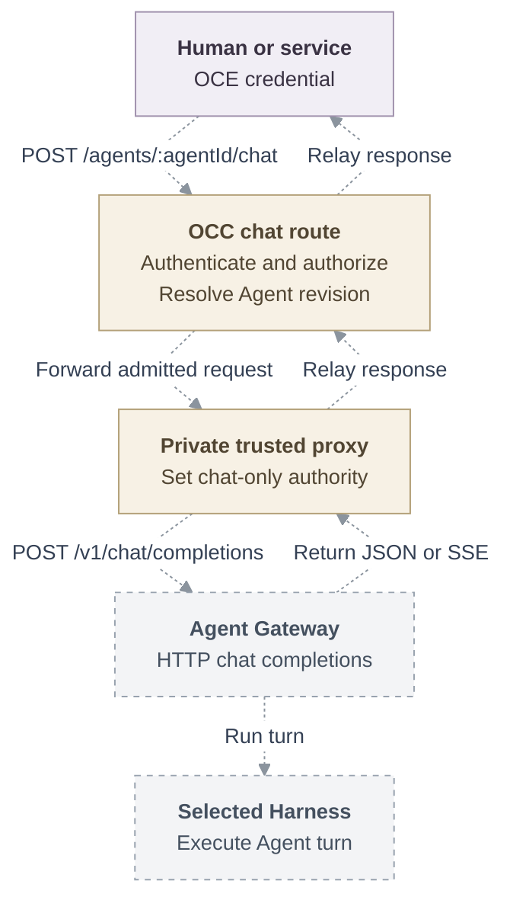

# Proposal: Submit Agent turns through HTTP chat completions

- **ID:** RFC-0040
- **Created:** 2026-11-16
- **Last updated:** 2026-11-16
- **Related:** [Agent access](0010-agent-access.md), [browser chat](0031-oidc-agent-chat.md), [Compute contract](../../docs/reference/drivers/compute.md)

## Summary

Add `POST /agents/:agentId/chat` to OpenClaw Control Plane (OCC). Human sessions
and service API keys can submit work to a deployed Agent when their principal
has exact-Agent `operate` permission. OCC forwards completion parameters to the
Agent's OpenClaw `POST /v1/chat/completions` endpoint and returns JSON or a
Server-Sent Events (SSE) stream. OCC owns routing, identity, and conversation
scope. For Agents managed by Kubernetes Compute, the runtime endpoint is enabled
by default and accepts this traffic through a trusted proxy with chat authority
only.

## Motivation

Pollers, monitoring services, and workflow engines need to submit Agent turns
without posting to a messaging channel or borrowing a human browser session.
OpenClaw already provides an [HTTP completion interface](https://docs.openclaw.ai/gateway/openai-http-api).
OCE's [native browser proxy](../../docs/reference/agent-native-admin.md#who-can-open-it)
requires a human session and rejects service API keys. The missing capability
is an OCE-authorized path to the existing runtime interface.

## Goals and scope

- Submit a real Agent turn using existing OCE authentication and `operate` grants.
- Preserve JSON and SSE completion responses and supported completion parameters.
- Start a fresh conversation by default; permit explicit continuation scoped to
  the authenticated principal and Agent.
- Keep the Gateway private and prevent caller-selected routing or elevation.

V1 applies to the existing supported Agent and Harness modes of the Kubernetes
Compute Driver, including when OCC runs outside Kubernetes. Docker and SSH
Compute are excluded; their authentication and endpoint defaults do not change.
This proposal does not add support for experimental Kubernetes topologies.

This proposal does not add a durable task queue, run-status API, automatic
retries, scheduling, a Responses endpoint, or a new messaging Channel. A
completion may execute Agent tools; it is not merely a model inference request.

## Proposal

OCC authenticates the request, loads the Agent, derives its Namespace from
stored ownership, and authorizes `operate`. It resolves the selected running
revision through that revision's Compute Driver. The Driver supplies the exact
private completion endpoint and native agent target; OCC does not discover
infrastructure or construct a Kubernetes-specific route.

OCC validates the request, records admission, applies the reserved-field rules
below, and forwards it once. The Gateway owns execution and conversation state.
OCC relays the result without adding its usual success envelope. The controller
worker does not execute or persist chat work.

The dashed connections below are proposed. Existing authentication, IAM,
Compute routing, Gateway, and Harness components remain their respective owners.



## Interface changes

### API and conversation scope

`POST /agents/:agentId/chat` accepts `application/json`. The path ID identifies
an OCE Agent, not a native OpenClaw agent. There is no caller-supplied Namespace.
Unknown Agents and Agents outside the caller's authorized scope return `404`.
Authentication failures return `401`; authenticated callers lacking `operate`
on an otherwise visible Agent receive `403`.

| Input                   | Contract                                                                                                                                              |
| ----------------------- | ----------------------------------------------------------------------------------------------------------------------------------------------------- |
| `messages`              | Required Chat Completions message array; native message validation applies.                                                                           |
| `stream`                | Optional boolean, default `false`; `true` selects SSE.                                                                                                |
| `model`                 | Optional compatibility value `"openclaw"`. Other values return `400`. OCC replaces it with the Driver's exact native target.                          |
| `user`                  | Optional opaque conversation label, 1–128 UTF-8 bytes. It is not a user identity. OCC replaces it with a scoped value.                                |
| Other completion fields | Forward unchanged, including nested values. The selected runtime validates and implements supported fields; OCC does not promise every OpenAI option. |

For continuation, OCC sends a versioned SHA-256 digest of an unambiguous tuple:
Installation ID, Namespace ID, Agent ID, principal kind, principal ID, and
`user`. Use the stable authenticated principal, not a session ID or API-key ID,
so credential rotation does not fork the conversation. Identical labels from
different principals or Agents must produce different native conversations.
Without `user`, OCC omits upstream `user`, preserving OpenClaw's fresh-session
behavior. The digest is a routing value, not a credential.

Continuation uses Gateway-owned history. Callers send new messages rather than
replaying the full prior transcript. History survives only as guaranteed by the
existing Agent runtime storage contract; this API adds no cross-revision history
transfer. It does not join browser, channel, or another principal's sessions.
This scopes conversation selection, not the shared Agent workspace or tool
identity. Existing Agent tool policies still govern access to shared resources.

OCC rejects caller-supplied `x-openclaw-*` routing/authority headers and unknown
query parameters. It builds upstream headers from an allowlist, stripping OCE
credentials, cookies, forwarding headers, and `x-occ-*` identity claims. Body
fields never become transport headers. Redirects from the upstream endpoint
are not followed.

Example request body (omit `user` for a fresh conversation):

```json
{
  "messages": [{ "role": "user", "content": "Investigate this service alert." }],
  "stream": true,
  "user": "incident-42"
}
```

Successful JSON returns the native Chat Completions object. SSE preserves native
event order, chunks, and the completion terminator, without buffering the full
response. Relay content type and safe rate-limit headers; never relay cookies
or infrastructure/authentication headers. Before streaming starts, OCC errors
use its existing error envelope; native application errors retain their native
status and body. Transport failures return `502`, unavailable/disabled Agents
return `503`, and OCC deadlines return `504`. After SSE headers are sent, a
transport failure closes the stream without a success terminator.

Proposed v1 limits are 20 MiB per request, 60 seconds to receive the body,
10 seconds to establish the upstream connection, and 10 minutes total from
admission. These route limits must also be supported by the deployment's proxy
configuration. A stricter native limit still applies. Oversized requests return
`413`; body-read deadlines return `408`. Streaming uses backpressure and does
not accumulate an unbounded response in OCC memory.

### IAM, trusted proxy, and audit

Use the existing `operate` action on the exact Agent. Add no IAM action,
resource kind, or principal type. Human requests retain the normal session and
CSRF checks; service keys retain their existing authentication checks.

The private route must require trusted-proxy authentication and set
`x-openclaw-scopes: operator.sessions.write`, intersected with the native
identity's permitted scopes. Missing scope or identity headers must fail
closed. Neither token/password fallback nor `operator.admin` is acceptable for
this route. Native runtime qualification must prove that this scope admits HTTP
chat while preserving session and tool restrictions; matching WebSocket behavior
alone is insufficient. If upstream needs changes, deliver and pin those first.

A shared native transport identity does not become the caller's OCE identity.
OCC attributes each request to its authenticated principal and binds its session
routing accordingly. This proposal does not introduce personal provider
inheritance or a general OCE-to-native user-profile mapping.

Authorize before forwarding. Recheck credential validity, principal status,
exact-Agent permission, and selected revision every 25 seconds during an active
request; each recheck has a 5-second deadline. Revocation, dependency failure,
Agent stop, deletion, or revision replacement aborts the upstream request and
closes the response. Pin each request to its admitted revision; never reroute a
partially executed turn.

Use the existing audit sink for admission, denial, completion, and interrupted
or uncertain outcomes. Record the request ID, principal, authentication method,
Agent, Namespace, revision, timestamps, streaming mode, and outcome. Do not log
prompts, responses, credentials, or raw conversation labels. Admission audit
failure prevents forwarding; completion audit failure cannot undo execution
and must surface through the existing audit-failure reporting path.

Disconnects and deadlines abort the upstream connection. They do not prove
that execution stopped or undo tool effects. OCC never retries automatically.
The conversation label is not an idempotency key; retrying may execute work
again. Concurrent requests use native session scheduling; this API adds no
cross-request ordering guarantee.

### Configuration and Compute Driver

The Kubernetes Compute Driver defaults
`gateway.http.endpoints.chatCompletions.enabled` to `true`. Preserve an explicit
`false` as an operator opt-out and return `disabled`. No browser-UI feature flag
or browser launch is required. Changes take effect when a revision starts;
enabling this default does not silently modify a running revision.

When HTTP chat is enabled, the Driver renders omitted `gateway.auth.mode` as
`trusted-proxy` and retains compatible explicit `trusted-proxy` configuration.
It refuses explicit `password`, `token`, or `none` modes before deployment.
It also refuses trusted-proxy settings that cannot enforce the required identity
and scope ceiling. The Driver provisions the private route with its required
identity and scope settings as part of the normal Kubernetes Agent lifecycle.
Opting out of HTTP chat retains the existing Kubernetes authentication rules;
it does not authorize an otherwise unsupported mode.

Enablement must be paired with the private trusted-proxy route and network
policy. Direct Gateway ingress remains inaccessible to external callers.
Although the native switch also enables model-list and embedding routes, OCC
exposes only the exact completion POST; the chat proxy denies other paths and
methods. It does not enable Responses or change native administration access.

Extend the [Compute Driver](../../packages/contracts/src/drivers/compute/index.ts)
with an optional capability:

```ts
interface AgentChatCompletionsEndpoint {
  readonly url: string;
  readonly model: string;
}

type AgentChatCompletionsResolution =
  | ({ readonly status: "available" } & AgentChatCompletionsEndpoint)
  | { readonly status: "disabled" }
  | { readonly status: "unavailable" }
  | { readonly status: "unsupported" };

getChatCompletionsEndpoint?(
  revision: AgentRevision,
): AgentChatCompletionsResolution;
```

`url` is the exact private HTTP(S) completion URL, without embedded credentials;
`model` is the exact native agent target owned by that OCE Agent. The Driver
owns topology-specific routing, trusted identity injection, scope ceilings, and
default configuration. Export both types through the package's top-level index.
The method never returns `undefined`. The Driver interprets native configuration
and runtime capabilities; OCC maps the result without inspecting those settings.

After authentication, Agent lookup, and authorization, OCC resolves the request
in this order:

1. If the selected Compute Driver has no method, return `501`.
2. If the Agent is stopped, has no selected running revision, or the revision's
   recorded Compute owner differs from the selected Driver, return `503` without
   calling the method or forwarding traffic.
3. Call the method for that exact revision and use this mapping:

| Driver result | Meaning                                                                                            | HTTP outcome                                                            |
| ------------- | -------------------------------------------------------------------------------------------------- | ----------------------------------------------------------------------- |
| `available`   | The Driver resolved a supported, enabled private route and native target.                          | Forward once and relay the native success (`200`) or application error. |
| `disabled`    | That revision explicitly disables HTTP chat.                                                       | `503`; do not forward.                                                  |
| `unavailable` | The supported route cannot currently be resolved or served.                                        | `503`; do not forward.                                                  |
| `unsupported` | The revision's topology, mode, or runtime lacks the required chat capability or scope enforcement. | `501`; do not forward.                                                  |

Within the Driver, resolve unsupported capability before checking opt-out or
transient availability. For a supported revision, explicit opt-out takes precedence over transient
availability. `available` is route resolution, not proof of live readiness;
a later connection failure remains `502`, and OCC deadlines remain `504`.
Never fall back to the administrative or browser endpoint.

Implement this capability only in Kubernetes Compute for v1. Docker and SSH
Compute leave it absent and therefore return `501`. Qualify each existing
supported Kubernetes Agent/Harness mode without expanding experimental topology
support. Do not change existing browser endpoint signatures or their human-only
admission rules. Submit this RFC for human review before implementing the new
Driver member or changed configuration behavior.

### Database entities

None. OCC stores no chat transcript, conversation mapping, run record, or queued
work item. Existing Agent, principal, revision, and audit storage retain ownership.

## Acceptance Criteria

Extend the regular Agent workflow in the real-runtime QA matrix. Use the real
Fastify API, PostgreSQL/IAM, private proxy, pinned OpenClaw runtime, selected
Harness, and authorized model credentials. Mock completions do not establish
these outcomes.

- **AC-1 — Intake:** Deploy a Kubernetes Compute Agent through normal provisioning
  without enabling browser chat, including with OCC hosted outside Kubernetes.
  Both a human session and a service key with `operate` receive a real
  JSON completion and an incrementally delivered SSE completion. A harmless
  Agent tool action demonstrates execution through the selected Harness.
- **AC-2 — Authority:** Unauthenticated, read-only, and wrong-Agent requests
  cause no turn. Spoofed identity, scope, session, model, and routing inputs
  cannot elevate access or target another native agent. Direct Gateway requests,
  missing trusted headers, and other paths on the private chat route are denied.
- **AC-3 — Conversations:** Requests without `user` are independent; repeated
  labels for the same principal and Agent continue history. The same label for
  another principal or Agent cannot select that history through this API. Rotating a
  service key for the same principal preserves continuation.
- **AC-4 — Failures:** Prove revocation during streaming, stopped/unavailable
  Agents, revision replacement, upstream disconnect, deadlines, and request-size
  rejection. Verify aborted responses do not report success or trigger retries.
  Verify the ordered status mapping, including `501` for absent/unsupported
  capability and `503` for stopped, undeployed, mismatched-owner, disabled, and
  unavailable cases; none forwards a turn.
- **AC-5 — Deployment and evidence:** Each supported Kubernetes Agent/Harness mode
  passes default enablement and private-route isolation checks. Omitted auth
  becomes trusted proxy; compatible explicit trusted proxy works; incompatible
  explicit modes fail before deployment. Explicit opt-out returns `503`.
  Docker and SSH Compute return `501` without changing their defaults. Audit
  records identify the real principal and outcome without message content or
  secrets. Native model-list/embedding routes remain unexposed through this API.

## Delivery and verification

After RFC submission, prepare an implementation plan for runtime qualification,
the Compute capability, OCC admission/relay, and real Agent workflow coverage.
Update the owning API/OpenAPI contract and generated API cheat sheet, Agent and
Compute references, operator guide, runtime flow, and QA documentation with the
implementation. Review the permissions cheat sheet for the added use of `operate`.

This RFC is a proposal, not implementation or live verification. Current-source
review used OCE `f2359730fa6e3762944dd3f64a539db5cc273769` and the upstream
HTTP completion documentation. The numerical limits above are proposed review
defaults. No runtime acceptance criterion has been executed for this RFC.

## Rationale and alternatives

Reusing HTTP completions preserves a familiar request/response interface and
avoids a new execution engine. Borrowing browser sessions excludes service
credentials. Exposing raw Gateway tokens gives callers broader native authority
and bypasses OCE authorization. A durable task API could add status, retries, and
idempotency later, but requires a separate lifecycle and persistence decision.
