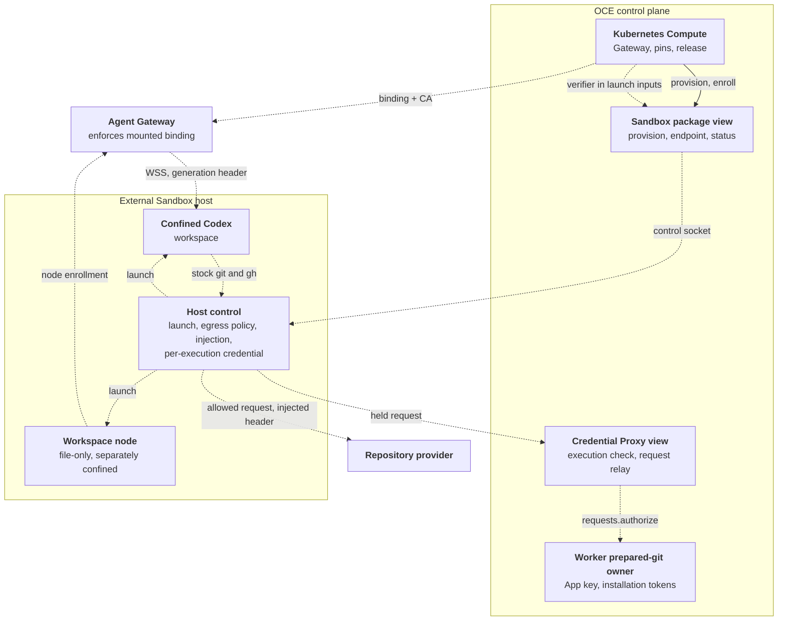
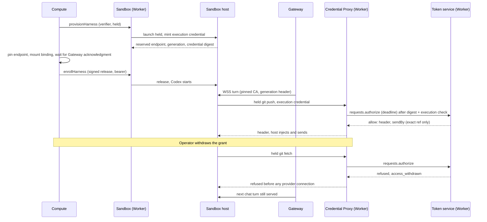

# Proposal: Run dedicated Codex Agents in an external Sandbox through the existing Driver contracts

- **ID:** RFC-0040
- **Created:** 2026-11-16
- **Last updated:** 2026-11-17
- **RFC PR:** [#6346](https://github.com/openclaw/openclaw-enterprise/pull/6346)
- **Related:** [Sandbox contract](../../docs/reference/drivers/sandbox.md),
  [Credential Proxy contract](../../docs/reference/drivers/credential-proxy.md),
  [Driver packages](../../docs/reference/drivers/selection.md#package-identity-and-factory-exports),
  proposed [RFC-0030](https://github.com/openclaw/openclaw-enterprise/pull/4889),
  [RFC-0031](https://github.com/openclaw/openclaw-enterprise/pull/5119),
  [RFC-0023 protected workspace amendment](https://github.com/openclaw/openclaw-enterprise/pull/5783),
  [RFC-0016 packaged Credential Gateway amendment](https://github.com/openclaw/openclaw-enterprise/pull/5083)

## Summary

An operator installs a Sandbox Driver package that runs each dedicated Codex Harness on a host-level sandbox outside
the Pods that Kubernetes Compute owns; the host enforces filesystem and network confinement. The Agent works like any
other OCE Agent. This RFC defines that **external Sandbox profile** as a composition of existing and proposed
primitives, and adds only what none of them owns (the "this RFC" rows of the contract surface). Strands Box is the
worked example; its code stays in an installable example package.

## Motivation

OCE is designed to confine Agents with different Sandboxes behind one set of contracts. OpenShell is bundled; the
second implementation is an [example Driver for Strands Box](https://github.com/openclaw/openclaw-enterprise/tree/6beef115bc4f65f7ae0a4316cbcccb5bd8e86ebd/deploy/examples/strands-box),
a Linux host sandbox whose egress gateway intercepts every connection. Its pilot reached ordinary chat, but put
provider-shaped names into core and imported controller source, which an installed package cannot do.

Four proposals cover parts of the core: RFC-0030 (ordinary external workspace owner), RFC-0031 and the RFC-0023
amendment (protected workspace endpoint and pin), and the RFC-0016 amendment (one package registration). None draws
the line between "a primitive any external Sandbox uses" and "this provider's adapter", and the whole is too large to
review as one change.

## Goals

1. An external Sandbox package needs **no provider-specific code in core**. Every core member it uses has a generic
   name, documentation and a provider-free conformance test.
2. Ordinary chat and workspace files work on an external Sandbox, with the Gateway enforcing the binding to the
   original provider execution (RFC-0030).
3. Protected repository access uses the **same GitHub App installation-token flow and request decision as
   OpenShell**. No token or key enters the workload. Withdrawal refuses fresh Git before any provider traffic while
   the chat continues.
4. The package installs through the existing [Driver package loader](../../docs/reference/drivers/selection.md#select-the-installed-driver),
   and the loader validates every optional member it declares.

## Non-goals

- A bundled, in-tree provider Driver (see the alternatives).
- A separate credential issuer service, any token flow parallel to the Worker's prepared-git owner, or an OCE-run
  forwarding sender: the Sandbox host injects.
- Changing [native prepared Git](../../docs/reference/repository-credentials/prepared-native-git.md) admission, which
  still refuses a Sandbox selection.
- Multi-node control transport between the Worker and an external host (question 2).
- Provider upstream changes; a provider's gaps belong in its package's known-gaps list.

## Proposal

### Owners

| Owner | Decides and holds | Never holds |
|---|---|---|
| Kubernetes Compute | Gateway workload, revision pins, signed release, activation, cleanup of what it created | provider host state |
| Sandbox package, `sandbox` view (runs in API and Worker) | Harness provisioning on the host, execution identity, endpoint and status observations, the Gateway bearer during `harnessStatus` and enrollment | the bearer in Harness launch inputs (verifier only) or host state, repository tokens |
| Sandbox host (outside the confinement) | the workload launch, its egress policy, the per-execution credential, workspace mounts, injection of the credential OCE releases | App keys, GitHub request rules, a stored repository token |
| Sandbox package, `credential_proxy` view (Worker only) | execution authentication, relay of each held request to OCE's request decision | the App key, GitHub request rules, a credential from its own material read |
| Worker prepared-git owner (existing) | GitHub App key, repository-scoped installation tokens, grant checks, request classification, ref and draft rules, use records | — |
| Agent Gateway runtime | enforcement of the mounted binding on every native connection and turn | provider credentials |

### Contract surface

The profile uses the existing Sandbox members `provisionHarness`, `harnessEndpoint`, `harnessStatus`, `enrollHarness`,
`harnessHome` and `validateWorkspaceSetup`, unchanged. It adds:

| Member or behaviour | Owner of the decision |
|---|---|
| `SandboxDriver.harnessTransportCredential?: "verifier"`: the Harness launch requirements carry the transport verifier, not the bearer Secret reference; read on every reconcile | this RFC ([#6345](https://github.com/openclaw/openclaw-enterprise/pull/6345)) |
| `SandboxDriver.maintenanceIntervalMs?` and `existingHarnessOnly` in the Harness contexts: maintenance of an active revision reports a missing Harness and never recreates it | this RFC ([#6098](https://github.com/openclaw/openclaw-enterprise/pull/6098)) |
| `SandboxHarnessEndpoint.externalWorkspaceOwner.generationSha256` + Gateway external-sandbox turn policy | RFC-0030 |
| Protected workspace capability, first-choice pin, consumer acknowledgment, bootstrap Gateway for the first node setup | RFC-0031, RFC-0023 amendment |
| One package registration with `sandbox`, `credential_gateway` and `credential_proxy` views | RFC-0016 amendment |
| `CredentialProxyDriver.bindRepositoryGit(authority, requests)`: the Worker supplies `requests.authorize`, OCE's GitHub request decision | this RFC ([#6350](https://github.com/openclaw/openclaw-enterprise/pull/6350)) |
| Everything below | this RFC |

**Names and one binding format.** Compute mounts the ordinary binding at `/etc/openclaw-external-workspace/`:
`ca.pem` and `binding.json` with exactly the keys `format: "external-workspace-v1"`, `url`, `workspaceRoot` and
`generationSha256`, in any order. The amendment's protected binding would use `/etc/openclaw-protected-workspace/` and
`protected-workspace-v1`; the prototype still shares the ordinary directory. The provider proves the generation with
exactly one response header, `x-openclaw-workspace-generation`. `workspaceRoot` comes from the validated endpoint.
The Gateway's enforcement ships upstream in OpenClaw first; OCE carries a downstream patch until the pinned OpenClaw
includes it.

**Public node-launch export.** `@openclaw-enterprise/controller/workspace-node-launch` exports the stock file-only
node command allowlist and the Codex-only and combined programs that Compute renders. A package that runs the node
outside a Pod uses it instead of importing controller source.

**Validation.** The installed loader refuses a registration whose optional members have the wrong type or value: a
declared Harness hook that is not a function, `harnessTransportCredential` other than `"verifier"` or without
`provisionHarness` and `harnessEndpoint`, `maintenanceIntervalMs` that is not a positive integer or lacks
`provisionHarness`, or a protected capability with a missing observer or an unknown version. Compute refuses a
malformed endpoint observation, such as an owner without a generation, before it pins, routes or releases. Each
addition has its validator case.

**Transport bearer.** The verifier keeps the bearer out of the Harness launch inputs only: the package's
`harnessStatus` and protected enrollment still receive it. The package sends it only to the Harness after verifying
the pinned TLS peer, as RFC-0030 requires of the Gateway, and never puts it in launch inputs, host state, logs or the
workload.

**Worker control mount (optional).** For a host control plane on a local Unix socket, the chart gains
`worker.sandboxControlClaimName`, an existing PVC claim mounted read-only at `/run/openclaw-sandbox-control` in the
Worker only. It requires `controlPlane.nodeSelector[kubernetes.io/hostname]`, refuses `executionCluster.enabled`,
reuse of the bootstrap claim and overlap with the database CA mount. Empty leaves the chart unchanged. The Driver's
own configuration names the socket path under that directory.

**Execution credential for a paired Credential Proxy.** Without mTLS (see the alternatives), the paired Sandbox mints
one random credential per admitted execution and sends it only to its trusted host, whose egress presents it with each
held request. The Sandbox reports only its SHA-256 and the live process identity. The Proxy compares digests in
constant time, binds the request to that execution and process, and rechecks the binding before it answers. As for
protected inference, the principal is the
[whole admitted execution](../../docs/reference/drivers/credential-proxy.md#registration-and-execution-release),
siblings included. The credential identifies the execution, not the request; per-request freshness comes from OCE's
request decision. This is a pattern inside one paired registration, not a new contract member.

**GitHub request decision.** The host's egress holds each GitHub request and asks the Proxy, which obtains a
credential only from `requests.authorize`, never from its own material read. It passes the request without credentials
(TLS-verified target, headers, the whole body up to 4 MiB) and a deadline at most 30 s ahead. OCE reads the material,
classifies the request with the bundled route's code, authorizes it online, records one possible use, and answers
`allow` or `refused` with a reason code for the Agent. The grant owns the ref policy. A refusal, a timeout or a passed
`sendBy` ends the request before any provider byte. Current rules (questions 4 and 5): `allow` carries `sendBy` and
one `authorization` header value, which the host adds to that request and never retries or stores; OCE allows uses
only after the recipient confirms each material version (`beginInstall`, `confirmInstall`), again after renewal, which
for a request-time recipient means it is ready to ask per request and holds no value.

The value is the grant's installation token, so `sendBy` and the ref rules bind honest use only; OCE never promises
the same credential twice. A standing token delivered to the host at start gets no per-request decision and does not
meet this contract. A Sandbox whose trusted process shares the workload's kernel or serves any local process is an
accepted gap, which its package documents with a deployment mitigation.

**Conformance kit.** `tests/conformance/external-sandbox-*` uses a fixture package modelled on the existing
protected-execution fixture, not a real provider. Each criterion below has one case there. A provider package runs the
same cases against its own host.

### Architecture

Dashed arrows are proposed; solid arrows exist on main.

### Request lifecycle

Proposed protected deployment, push and withdrawal for the worked example.

### Worked example: Strands Box

The example package exports one registration. Its Sandbox view drives a nonroot host service over the Worker control
mount and creates a relay Deployment that the Gateway reaches through `network.providerHarness`. Box's egress gateway
asks a request-time credential source on the host, which the Credential Proxy view answers through
`requests.authorize`. Provider limits and accepted gaps are on the package's known-gaps page; none needs a change in
core.

## Acceptance Criteria

Real Kubernetes Compute, Worker, Gateway image and prepared-git owner in every case. The provider host may be the
fixture package (kit) or a real host (installed).

- **AC-1 — Ordinary chat (Goal 2):** Given an Installation that selects the package with an ordinary dedicated Codex
  Agent, when the operator deploys and chats, then the reply comes from the confined Harness, the Agent reads and
  writes a workspace marker, sibling paths are refused, and no Gateway bearer appears in the Harness launch inputs.
  Kit case and one installed run.
- **AC-2 — Binding and peer enforcement (Goal 2):** A missing, duplicated or different generation header, a replaced
  execution, or a changed binding file closes the Gateway connection before the Gateway sends another native frame.
  Neither the Gateway nor the package's readiness and enrollment clients send the bearer to an unverified TLS peer.
  Kit case.
- **AC-3 — Protected push (Goal 3):** Given a protected revision granted one repository, when the Agent pushes a branch
  and opens a draft, then the Worker token service minted the installation token, OCE's request decision recorded each
  request, the provider sees the App as actor and the granted ref, and no token or key exists in the workload.
  Installed run with independent provider readback joined to OCE's use records.
- **AC-4 — Refusal before egress (Goal 3):** A wrong repository, a wrong ref or a second draft is refused by OCE's
  request decision although the material is readable; a missing execution credential, or one from a replaced or ended
  execution or another process, by the Proxy. Neither reaches the provider, and a second request from the live
  execution succeeds. Kit case: the fixture package and the bundled route decide alike.
- **AC-5 — Withdrawal (Goal 3):** After the operator withdraws the grant, a fresh fetch or push is refused before any
  provider traffic, and the next chat turn in the same conversation succeeds. Kit case and installed run.
- **AC-6 — Validation (Goal 4):** Each malformed optional member is refused at registration with a typed startup
  error (controller lifecycle test). A valid registration whose endpoint owner lacks a generation is refused by
  Compute before pinning, routing or release (kit case).
- **AC-7 — No provider in core (Goal 1):** The kit passes with the fixture package. Core and its tests contain no
  provider name, and OpenShell selections behave as before. Static check plus the existing OpenShell suites.

## Delivery and verification

1. Verifier-only transport (#6345; such a Harness also prepares its own Codex plugins) and maintenance cadence
   (#6098), both inert unless declared.
2. RFC-0030 implementation with the generic names and the upstream OpenClaw change (#6354), the node-launch export and
   validators (#6353), and the kit (#6355).
3. RFC-0023 amendment implementation, then the paired registration of the RFC-0016 amendment.
4. Optional Worker control mount (#6356), and the request decision port (#6358, #6350).
5. The example package with its own tests and manual lanes, after an installed AC-3 to AC-5 run.

No installed run exists yet; the draft PRs' tests and the pilot's chat are component evidence only.

## Rationale and alternatives

- **Keep provider names in core.** Smallest diff now, but each later provider adds its own directory, header and
  chart value, and the contract blurs into the adapter.
- **A bundled in-tree Driver** (earlier RFC-0024 draft). Couples OCE releases to the provider's cadence and
  architecture, and hides contract gaps in one codebase.
- **Admit native prepared Git with an ordinary external Sandbox.** Reuses the qualified broker, but changes a product
  rule and splits recipient identity between broker and Sandbox.
- **A separate credential issuer service.** Rejected: new infrastructure parallel to the Worker token service.
- **An importable GitHub classifier.** Rejected: isolated Driver runtimes resolve only relative imports, and a copy
  drifts from the Worker's rules.
- **Execution identity by client certificate.** Not available when the Sandbox's egress presents none. A bearer bound
  to the execution and process is the strongest identity such a Sandbox can present.

## Unresolved questions

1. **Umbrella or consolidation** (RFC reviewers): keep RFC-0030, RFC-0031 and the RFC-0023 amendment as separate
   decisions indexed here, or fold them into this RFC. Either way, the generic names and the token-flow rule bind.
2. **Worker control transport** (maintainers): accept the chart mount, or require an authenticated TCP control
   endpoint, which lifts the same-node constraint; today's node selector pins the whole control plane to that host.
3. **Ordinary and protected binding directories** (RFC-0023 amendment owner): one directory with a `mode` field,
   or two fixed directories as proposed here.
4. **Request-time release** (repository-credentials owners): an injector installs nothing. Keep its readiness
   declaration per material version, or add per-request release evidence?
5. **Decision shape** (Sandbox owners): keep the header value, or return a typed credential (scheme, token, receipt)
   that the Sandbox places by its own configuration? Whole body or receive-pack prefix? A request-phase endpoint in
   core?

## References

- [Sandbox contract: Harness transport](../../docs/reference/drivers/sandbox.md#harness-transport).
- [Protected OpenShell Git](../../docs/reference/repository-credentials/protected-openshell-git.md) for the token flow being reused.
