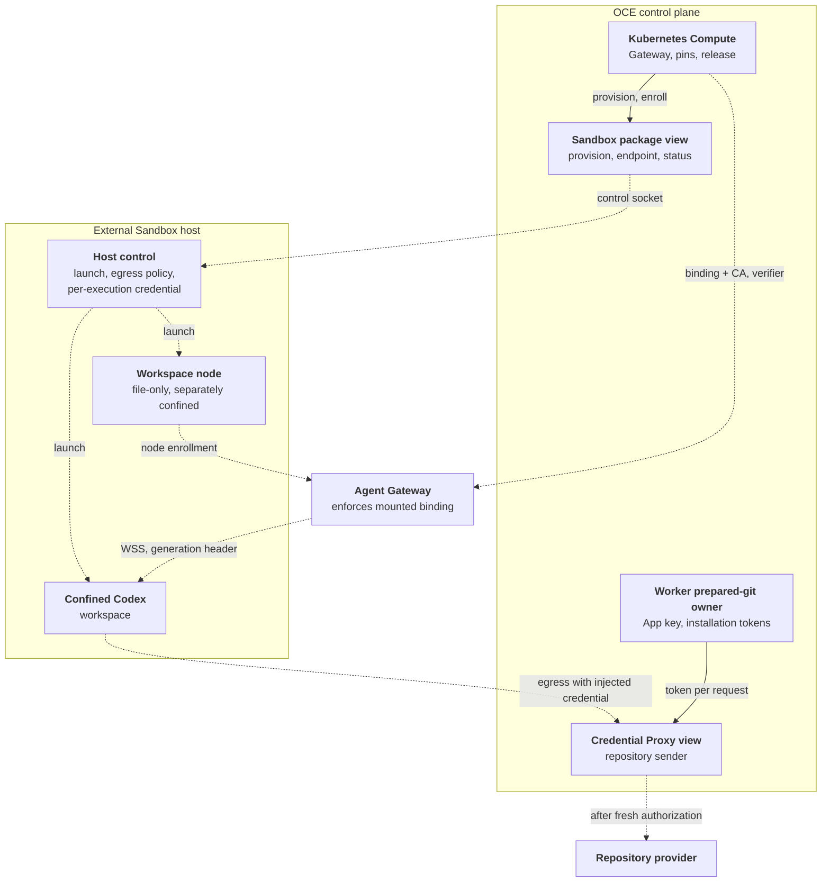

# Proposal: Run dedicated Codex Agents in an external Sandbox through the existing Driver contracts

- **ID:** RFC-0040
- **Created:** 2026-11-16
- **Last updated:** 2026-11-16
- **RFC PR:** [Review URL when available]
- **Related:** [Sandbox contract](../../docs/reference/drivers/sandbox.md),
  [Credential Proxy contract](../../docs/reference/drivers/credential-proxy.md),
  [Driver packages](../../docs/reference/drivers/selection.md#package-identity-and-factory-exports),
  proposed [RFC-0030](https://github.com/openclaw/openclaw-enterprise/pull/4889),
  [RFC-0031](https://github.com/openclaw/openclaw-enterprise/pull/5119),
  [RFC-0023 protected workspace amendment](https://github.com/openclaw/openclaw-enterprise/pull/5783),
  [RFC-0016 packaged Credential Gateway amendment](https://github.com/openclaw/openclaw-enterprise/pull/5083)

<a id="problem-and-decision"></a>

## Summary

An operator installs a Sandbox Driver package that runs each dedicated Codex Harness outside the Pods that Kubernetes
Compute owns. The Harness runs on a host-level sandbox, and the host enforces filesystem and network confinement.
The Agent works like any other OCE Agent: ordinary chat, workspace files, and protected repository access through the
Worker's existing GitHub App token service, with withdrawal while the chat continues. This RFC defines that
**external Sandbox profile** as one composition of existing and already proposed primitives. It adds only the pieces
none of them owns: generic names and one binding format, a public export for the stock workspace-node launch,
installed-package validation for every new member, an optional Worker control mount, the expected execution-credential
pattern for a paired Credential Proxy, and a conformance kit that names no provider. Strands Box is the worked example.
Strands-specific code stays in an installable example package.

## Motivation

OCE is designed to confine Agents with different Sandboxes behind one set of contracts. OpenShell is bundled. The
second implementation is an [example Driver for Strands Box](https://github.com/openclaw/openclaw-enterprise/tree/6beef115bc4f65f7ae0a4316cbcccb5bd8e86ebd/deploy/examples/strands-box).
Strands Box is a Linux host sandbox built on user and network namespaces, Bubblewrap, and an egress gateway that
intercepts every connection and can inject phantom credentials. The pilot reached a working ordinary chat, and it also
found that core had absorbed provider-shaped names and private imports:
- a trust directory `/etc/openclaw-box-owner`, a response header `x-openclaw-box-owner`, and the runtime patch
  `openclaw-codex-box-owner.patch`;
- a chart value `worker.strandsBoxControlClaimName` mounted at `/run/strands-box`;
- the package's host helpers import `apps/controller/src/drivers/compute/kubernetes/runtime-entrypoints.ts` by relative
  path, which an installed package cannot do;
- the installed-package validator (`packages/occ/src/driver-contract.ts`) checks `harnessHome` but none of the new
  optional members.

The work is too large to review as one change. It also has no agreed boundary between "a primitive any external
Sandbox uses" and "this provider's adapter". Four proposals cover parts of the core: RFC-0030 (ordinary
external workspace owner), RFC-0031 and the RFC-0023 amendment (protected workspace endpoint and pin), and the RFC-0016
amendment (one package registration for Sandbox, Credential Gateway and Credential Proxy). None of them describes the
profile as a whole or the parts listed above.

<a id="scope"></a>

## Goals

1. An external Sandbox package needs **no provider-specific code in core**. Every core member it uses has a generic
   name, generic documentation and a conformance test that names no provider.
2. Ordinary chat and workspace files work on an external Sandbox, with the Gateway enforcing the binding to the
   original provider execution (RFC-0030).
3. Protected repository access uses the **same GitHub App installation-token flow as OpenShell**: the Worker's token
   service prepares a repository-scoped token, and the paired Credential Proxy reads it for each request. No token or key
   enters the Sandbox. Withdrawal refuses fresh Git before any provider traffic while the chat continues.
4. The package installs through the existing [Driver package loader](../../docs/reference/drivers/selection.md#select-the-installed-driver),
   and the loader validates every optional member it declares.

## Non-goals

- A bundled, in-tree provider Driver (the earlier RFC-0024 draft, closed). The provider stays an installable package.
- A separate credential issuer service, or any token flow parallel to the Worker's prepared-git owner.
- Changing [native prepared Git](../../docs/reference/repository-credentials/prepared-native-git.md) admission, which
  still refuses a Sandbox selection.
- Multi-node control transport between the Worker and an external host (see the unresolved questions).
- Provider upstream changes. A provider's own gaps belong in its package's known-gaps list.

<a id="design"></a>

## Proposal

### Owners

| Owner | Decides and holds | Never holds |
|---|---|---|
| Kubernetes Compute | Gateway workload, revision pins, signed release, activation, cleanup of what it created | provider host state |
| Sandbox package, `sandbox` view (runs in API and Worker) | Harness provisioning on the host, execution identity, endpoint and status observations | the Gateway bearer (verifier only), repository tokens |
| Sandbox host (outside the confinement) | the workload launch, its egress policy, a per-execution credential, workspace mounts | App keys, installation tokens |
| Sandbox package, `credential_proxy` view (Worker only) | the repository sender, per-request authorization, the request journal | the App key |
| Worker prepared-git owner (existing) | GitHub App key, repository-scoped installation tokens, grant checks | — |
| Agent Gateway runtime | enforcement of the mounted binding on every native connection and turn | provider credentials |

### Contract surface

The profile uses the existing Sandbox members `provisionHarness`, `harnessEndpoint`, `harnessStatus`, `enrollHarness`,
`harnessHome` and `validateWorkspaceSetup`, unchanged. It adds:

| Member or behaviour | Owner of the decision |
|---|---|
| `SandboxDriver.harnessTransportCredential?: "verifier"`: Compute delivers the transport verifier, never the raw bearer, to a provider-owned dedicated Harness | this RFC (smallest piece, can land first) |
| `SandboxHarnessEndpoint.externalWorkspaceOwner.generationSha256` + Gateway external-sandbox turn policy | RFC-0030 |
| Protected workspace capability, first-choice pin, consumer acknowledgment, bootstrap Gateway for the first node setup | RFC-0031, RFC-0023 amendment |
| One package registration with `sandbox`, `credential_gateway` and `credential_proxy` views | RFC-0016 amendment |
| Names, binding format, public node-launch export, validation, Worker mount, conformance kit | this RFC (below) |

**Names and one binding format.** Compute mounts the ordinary external-workspace binding at
`/etc/openclaw-external-workspace/` as `binding.json` `{format: "external-workspace-v1", url, workspaceRoot,
generationSha256}` plus `ca.pem`. The protected binding stays at the amendment's `/etc/openclaw-protected-workspace/`
with `format: "protected-workspace-v1"`. The provider proves the generation with exactly one response header,
`x-openclaw-workspace-generation`. `workspaceRoot` comes from the validated endpoint and is no longer hard-coded.
The Gateway code that enforces the binding is a Codex-extension feature, so it ships upstream in OpenClaw first.
OCE carries it as a downstream patch only until the pinned OpenClaw includes it.

**Public node-launch export.** The controller's Driver SDK package (`@openclaw-enterprise/occ`) exports the stock
file-only workspace-node command allowlist and Codex-only entrypoint argv that Compute uses today. A package that
runs the node outside a Pod uses that export rather than importing controller source.

**Validation.** The installed loader refuses a registration whose optional members have the wrong type or value:
`harnessTransportCredential` other than `"verifier"`, a protected capability with a missing observer or an unknown
version, or an endpoint owner without a generation. Each contract addition in this profile adds its validator case.

**Worker control mount (optional).** An external host often exposes its control plane on a local Unix socket. The
chart gains `worker.sandboxControlClaimName`, an existing prebound PVC mounted read-only at
`/run/openclaw-sandbox-control` in the Worker only. It requires `controlPlane.nodeSelector[kubernetes.io/hostname]`,
refuses `executionCluster.enabled`, and refuses reuse of the bootstrap claim and any overlap with other mounts. Empty
leaves the chart unchanged. The Driver's own configuration names the socket path under that directory.

**Execution credential for a paired Credential Proxy.** A Sandbox whose egress gateway terminates TLS cannot carry
client certificates from the workload, so the Proxy cannot identify the recipient by mTLS. The paired Sandbox
therefore mints one random credential per admitted execution. It sends the credential only to its trusted host, which
injects it into the workload's egress for the Proxy's exact destination as a placeholder that the gateway swaps in.
It reports only the credential's SHA-256 and the live process identity. The Proxy compares a digest in constant time,
binds the request to that execution and process, and rechecks the binding before it sends anything upstream. As the
Credential Proxy contract already says for protected inference, the principal is the
[whole admitted execution](../../docs/reference/drivers/credential-proxy.md#registration-and-execution-release),
siblings included. This is a pattern inside one paired registration, not a new contract member; the conformance kit
checks its externally visible behaviour.

**Conformance kit.** `tests/conformance/external-sandbox-*` uses a fixture package modelled on the existing
protected-execution fixture, not a real provider. Each criterion below has one case there. A provider package runs the
same cases against its own host when its host is available.

### Architecture

Dashed arrows are proposed; solid arrows exist on main.



### Request lifecycle

Proposed protected deployment, push and withdrawal for the worked example.

```mermaid
sequenceDiagram
  participant C as Compute
  participant S as Sandbox (Worker)
  participant H as Sandbox host
  participant G as Gateway
  participant P as Credential Proxy (Worker)
  participant T as Token service (Worker)
  C->>S: provisionHarness (verifier, held)
  S->>H: launch held, mint execution credential
  H-->>S: reserved endpoint, generation, credential digest
  C->>C: pin endpoint, mount binding, wait for Gateway acknowledgment
  C->>S: enrollHarness with signed release
  S->>H: release; Codex starts
  G->>H: WSS turn (pinned CA, generation header)
  H->>P: git push with injected credential
  P->>P: digest + execution check, fresh authorization
  P->>T: read installation token for this grant
  P-->>H: push result (exact ref only)
  Note over C,P: Operator withdraws the grant
  H->>P: fresh git fetch
  P-->>H: 403 before any provider connection
  G->>H: next chat turn still served
```

### Worked example: Strands Box

The example package exports one registration. Its Sandbox view talks to a nonroot host service over a Unix socket on
the Worker control mount. It creates a relay Deployment that the Agent Gateway reaches through
`network.providerHarness`, and reports Box's run generation. The host runs Codex under `box run`, runs the file-only node
under Bubblewrap outside Box, and pins each egress destination to host, port and IPv4. It hands the per-execution
credential to Box as an `env://` phantom route that only the Proxy's destination receives. The Credential Proxy view
runs the repository sender in the Worker and binds it with `bindRepositoryGit` to the existing prepared-git
authority. Provider limits (public-root-only upstream trust, Linux ARM64 releases only, distribution AppArmor
defaults) are listed in the package's known-gaps page with workarounds. They need no change in core.

## Acceptance Criteria

Real Kubernetes Compute, Worker, Gateway image and prepared-git owner in every case. The provider host may be the
fixture package (kit) or a real host (installed).

- **AC-1 — Ordinary chat (Goal 2):** Given an Installation that selects the package with an ordinary dedicated Codex
  Agent, when the operator deploys and chats, then the reply comes from the confined Harness, the Agent reads and
  writes a workspace marker, sibling paths are refused, and no Gateway bearer appears in the provider's launch inputs.
  Verify with the kit case and one installed run.
- **AC-2 — Binding enforcement (Goal 2):** A missing, duplicated or different generation header, a replaced execution,
  or a changed binding file closes the Gateway connection before any native frame. Kit case.
- **AC-3 — Protected push (Goal 3):** Given a protected revision granted one repository, when the Agent pushes a branch
  and opens a draft, then the Worker token service minted the installation token, the provider sees the App as actor,
  the ref is the granted one, and no token or key exists in the Sandbox host or workload. Installed run with
  independent provider readback joined to the Proxy journal.
- **AC-4 — Refusal before egress (Goal 3):** A wrong repository, a wrong ref, a missing or replayed execution credential,
  or a credential from a replaced execution is refused by the Proxy without a provider connection. Kit case.
- **AC-5 — Withdrawal (Goal 3):** After the operator withdraws the grant, a fresh fetch or push is refused before any
  provider traffic, and the next chat turn in the same conversation succeeds. Kit case and installed run.
- **AC-6 — Loader validation (Goal 4):** Each malformed optional member is refused at registration with a typed
  startup error. Controller lifecycle test.
- **AC-7 — No provider in core (Goal 1):** The kit passes with the fixture package. Core and its tests contain no
  provider name, and OpenShell selections behave as before. Static check plus the existing OpenShell suites.

## Delivery and verification

1. Verifier-only transport, with its validator and kit case (small, inert unless declared).
2. RFC-0030 implementation with the generic names, the upstream OpenClaw change, and the public node-launch export.
3. RFC-0023 amendment implementation (first-choice pin, consumer acknowledgment, bootstrap Gateway), then the paired
   registration of the RFC-0016 amendment.
4. Optional Worker control mount.
5. The example package with its own tests and manual lanes, after an installed AC-3 to AC-5 run.

Nothing in this RFC has run yet. The pilot's ordinary chat on a real host and the local sender rehearsal are component
evidence only.

<a id="alternatives-and-open-decisions"></a>

## Rationale and alternatives

- **Keep provider names in core.** Smallest diff for the first provider. The second provider would then need its own
  directory, header and chart value, and reviewers could not tell the contract from the adapter.
- **A bundled in-tree Driver** (earlier RFC-0024 draft). It couples OCE releases to the provider's release cadence and
  architecture, and it hides contract gaps inside one codebase.
- **Admit native prepared Git with an ordinary external Sandbox.** It reuses the qualified broker, but it changes a
  product rule and splits recipient identity between the broker and the Sandbox.
- **A separate credential issuer service.** Rejected: it is new infrastructure parallel to the Worker token service.
- **Execution identity by client certificate.** Not available through a TLS-terminating egress gateway. A bearer bound
  to the execution and process is the strongest identity such a Sandbox can present.

## Unresolved questions

1. **Umbrella or consolidation** (RFC reviewers): keep RFC-0030, RFC-0031 and the RFC-0023 amendment as separate
   decisions indexed here, or fold them into this RFC. Either way, the generic names and the token-flow rule bind.
2. **Worker control transport** (maintainers): accept the chart mount, or require an authenticated TCP control
   endpoint, which lifts the same-node placement constraint. The mount stays opt-in and inert either way.
3. **Ordinary and protected binding directories** (RFC-0023 amendment owner): one directory with a `mode` field,
   or two fixed directories as proposed here.
4. **Ref policy owner** (repository-credentials owners): the paired Proxy enforces an exact ref locally. Should
   that move to the token service's grant so that every Proxy inherits it?

## References

- Example package and pilot evidence:
  [`deploy/examples/strands-box/`](https://github.com/openclaw/openclaw-enterprise/tree/6beef115bc4f65f7ae0a4316cbcccb5bd8e86ebd/deploy/examples/strands-box).
- [Sandbox contract: Harness transport](../../docs/reference/drivers/sandbox.md#harness-transport).
- [Credential Proxy contract](../../docs/reference/drivers/credential-proxy.md).
- [Protected OpenShell Git](../../docs/reference/repository-credentials/protected-openshell-git.md) for the token flow being reused.
