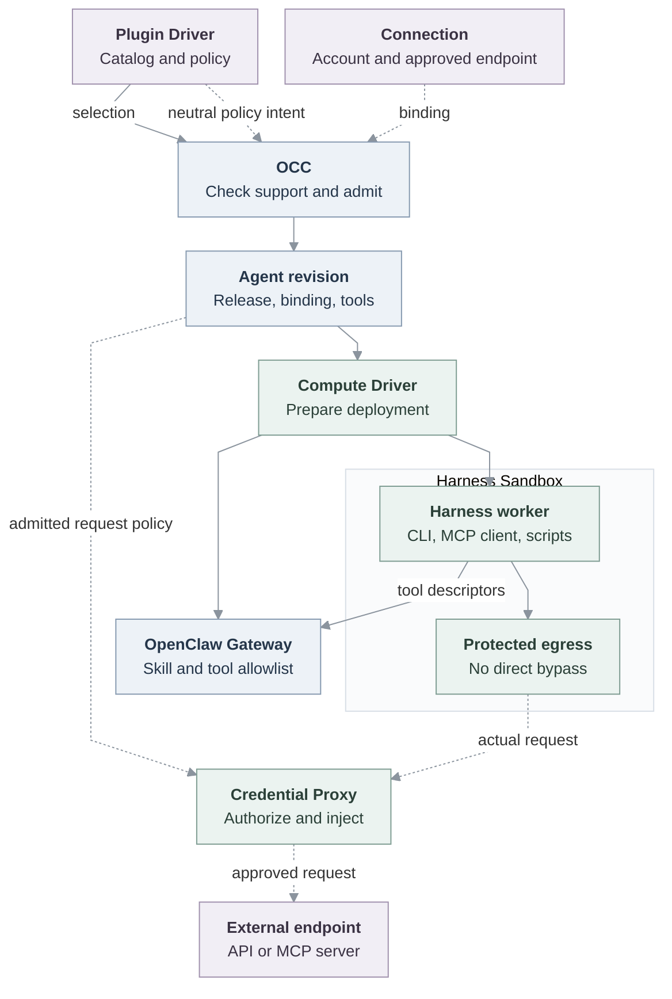

# RFC-0040: Managed OpenClaw plugins

- **Created:** 2026-10-21
- **Last updated:** 2026-11-17
- **RFC PR:** [#3142](https://github.com/openclaw/openclaw-enterprise/pull/3142)
- **Implementation plan:** [Managed OpenClaw plugins](../plans/0040-managed-openclaw-plugins.md)

## Decision

OpenClaw Enterprise (OCE) lets an administrator select reviewed plugins, connect accounts through the existing credential system, and choose which tools an Agent can use before deployment. The Plugin Driver describes the plugin and its requested permissions. OpenClaw Control Plane (OCC) admits the selection only when the selected credential and execution stack can enforce those permissions. The Credential Proxy authorizes credentialed requests, and the Sandbox prevents the Harness from bypassing that path.

## Plugins and deployment

A plugin is a reviewed, versioned catalog entry with one or more components:

- **Skill:** Instructions and resources that OpenClaw makes available to the model. The Gateway prepares the selected skill context for delegated turns.
- **CLI:** An executable or script that runs on the dedicated Harness worker. Google Workspace uses [gog](https://github.com/openclaw/gogcli), the OpenClaw project's CLI for Gmail, Calendar, Drive, and other Google services. Compute delivers and verifies the reviewed artifact or selects a compatible runtime image.
- **Hosted MCP:** A remote Model Context Protocol server. The OpenClaw node host on the Harness worker runs the MCP client. It advertises selected tool descriptors to the Gateway, which applies its tool policy for the turn. The remote server executes the tool.

The Plugin Driver supplies catalog entries, checks compatible Harness placement, and validates requested plugin policy. OCC records the selected release, owning Driver, account bindings, and policy in the Agent revision. Compute coordinates deployment, and OpenClaw activates the selected skill or worker component. Selecting an entry does not run arbitrary package installation code in the Gateway.

Reviewed uploads admit skills and hosted MCP descriptors. CLI executables come from an operator-pinned runtime artifact or image. A future import from a registry such as ClawHub must use the same admission boundary: OCC pins the admitted artifact and its dependencies, and publisher updates require a new admission and deployment. Channels, providers, hooks, and other Gateway integrations remain platform-managed. Codex has its own Plugin Driver and approval behavior; see [multiple Plugin Drivers](0029-multiple-plugin-drivers.md) and [plugin policy enforcement](0014-plugin-policy-enforcement.md).

## Credentials and account bindings

OAuth setup belongs to OCC's credential system, independently of any Plugin Driver. An administrator configures a connection template and an OAuth client registration in **Credentials**. The template defines its issuer, scope limits, and credential destinations; an MCP template can be created from the server URL and its authorization metadata. OCC stores confidential client material through the Secret Driver. A user completes the same OCC consent flow whether they start from Credentials or a plugin's account picker. Token Service owns the saved grant, access-token resolution, and renewal. See [OAuth connections](0027-agent-oauth-connections/index.md) and [Credential Proxy and credential lifecycle](0023-egress-proxy-credential-lifecycle/index.md).

A plugin that needs credentials declares a named account requirement. An Agent binds each selected plugin instance and account slot to an authorized saved connection. The binding identifies the account and intended endpoint; the endpoint need not be fixed in the plugin release when the template admits different service instances. Multiple accounts or instances retain separate identities and grants, even when they use the same server URL. Native invocations select an account-qualified MCP server, and admitted scripts select a binding-specific placeholder or equivalent protected route. The trusted egress path must resolve that selector to the exact binding before authorization; it rejects an ambiguous request. OCC checks the caller's authority, the Agent grant, issuer, protected resource, and destination before accepting the binding. Actual granted scopes bound credential use; the selected enforcer checks them when a connector policy requires particular operation scopes. The Plugin Driver receives credential metadata, not client secrets or tokens.

Authenticated MCP discovery resolves a usable token through the credential lifecycle and returns candidate upstream tool names. Discovery does not itself authorize those tools. Removing a plugin selection removes that selection on redeployment; independently attached credentials and Agent grants require explicit removal. Disconnecting a saved account ends that account's lifecycle for its consumers. Custom OAuth scopes require a corresponding approved endpoint allowlist and an enforceable request policy; adding a scope cannot extend the destination envelope by itself.

## Policy capabilities and admission

The Plugin Driver declares policy requirements in implementation-neutral terms for each account binding: the approved destination and requested operations, such as upstream MCP tool names or connector-defined API actions. Its policy capabilities describe the settings the plugin understands. The Credential Proxy Driver advertises the operation policies that its implementation can enforce and validates the requested policy. For MCP, that capability means inspecting `tools/call` and matching the upstream tool name; support for MCP transport alone is insufficient. The Sandbox must separately prevent bypass. The Plugin Driver does not need the Credential Proxy implementation name or its configuration format.

OCC checks compatibility when an administrator saves the credential binding and again when it admits a deployment. The admitted policy can narrow the connection template and credential grant, but cannot expand either. OCC does not offer an enforcement setting that the selected stack cannot implement. OpenClaw can still filter the tools visible to the model, but that filter is not an execution-wide credential restriction. If a saved policy cannot be enforced at deployment, OCC rejects the candidate before releasing it to serve. The execution stack must verify that the admitted enforcement is installed; failure or an unavailable authorizer denies credentialed traffic.

For hosted MCP, the concrete Credential Proxy inspects the actual JSON-RPC request before credential injection. It authorizes required protocol traffic separately from `tools/call`, and permits a call only when `params.name` is in the selected set for that account binding and endpoint. Model-facing aliases and untrusted server annotations are not authorization keys. The worker's `toolFilter` and the Gateway's tool allowlist expose the same selection to the model, but they do not replace request authorization: a script can construct an MCP request without going through native tool dispatch. The Sandbox routes both callers through the same protected egress path and prevents direct bypass.

For a CLI or custom script calling an API, the connector supplies the reviewed operation definitions and the concrete Credential Proxy enforces them before injection. A Google operation may depend on the path, method, query, body, and granted scopes; HTTP method alone does not classify reads and writes. If an account is bound more narrowly than its saved grant, authorization must enforce the narrower binding. A broader independent route to the same credential must not defeat a restriction presented as enforceable. When the execution stack cannot distinguish overlapping bindings, OCC rejects that configuration.

The proposed flow uses the selected Credential Proxy and Sandbox; it does not add another plugin-specific request filter, listener, or service. Dashed arrows show the proposed neutral policy handoff and request authorization.

## Acceptance criteria

- **AC-1 — Deployment:** An administrator selects a reviewed skill, CLI, or hosted MCP release for a dedicated OpenClaw Agent. The correct Gateway context and worker artifact become available after deployment; an incompatible placement is rejected before cutover.
- **AC-2 — Accounts:** A user connects an account through OCC, grants an Agent access, and binds the account to a plugin instance. Discovery and execution use the authorized account and Token Service renewal without exposing tokens to the Plugin Driver or Harness. Withdrawing one Agent's grant leaves other grants usable.
- **AC-3 — Enforcement:** With an account that can read and write, a selected MCP read tool succeeds through native dispatch and a direct script. A disabled write tool reaches neither the upstream server nor a credential-bearing alternate route. Unsupported policy or ambiguous account routing is rejected before deployment.

Detailed delivery steps and verification evidence belong in the [implementation plan](../plans/0040-managed-openclaw-plugins.md). Current supported behavior belongs in [Agent plugins](../../docs/reference/agent-plugins.md).

## Changelog

- 2026-11-17: Separate plugin, account, and request-enforcement ownership; move delivery status to the implementation plan.
