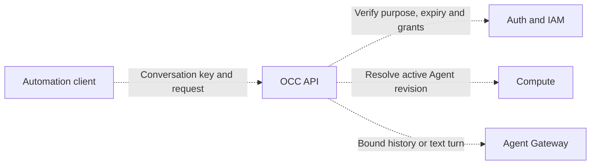

# Passwordless service access to a saved Agent conversation

- **ID:** RFC-0040
- **Source baseline:** OCE `ddfbef0b5502`, OpenClaw `513c12703ad9`

## Decision

Let an administrator authorize an automation client to read or send messages in **one existing Agent conversation**. The client calls the OCC HTTPS API with a revocable, expiring credential for a non-Agent ServicePrincipal. It can reconnect and continue the same work without a person opening a browser for each turn.

Today an [OCC service key](../../docs/reference/authentication/service-api-keys.md) can read an Agent when IAM allows it. [Native chat](../../docs/reference/agent-native-admin.md) separately requires a human session, even for a caller with Agent `administer`. In a local test of stock OCC over TCP with real PostgreSQL, an issued Namespace service key read its assigned Agent and received a 403 for a sibling. The native launch also returned 403 with exact-Agent administration granted. Revocation made the next admitted REST read return 401. [RFC-0031](0031-oidc-agent-chat.md) owns the browser flow. The [Agent Tasks proposal](https://github.com/openclaw/openclaw-enterprise/pull/3624) creates a new session for a Task. Here the caller needs the conversation that already contains its work.

## Issuing access

A human Installation administrator can issue through an enrolled session, including OIDC where configured. An Installation-scoped service administrator can issue through the ordinary OCC API. Both issuers must hold Installation `administer`, cover the target principal’s current grants, and hold `administer` on the selected Agent. The issuer selects a Namespace service principal and an existing conversation on that Agent. The service principal must hold current `operate` on the Agent. Issuers select `read`, `send` or both. A read-only credential cannot submit a turn.

| Proposed operation                                                 | Contract                                                                                                                                                                    |
| ------------------------------------------------------------------ | --------------------------------------------------------------------------------------------------------------------------------------------------------------------------- |
| `POST /namespaces/{ns}/agents/{agent}/conversation-keys`           | Resolve the supplied session reference on the active Agent, require an unambiguous existing conversation, and issue a key once with an expiry and the requested operations. |
| `DELETE /namespaces/{ns}/agents/{agent}/conversation-keys/{keyId}` | Require issuer authority and match the stored Namespace and Agent before revocation. A stopped Gateway or reset session cannot prevent revocation.                          |
| `GET /namespaces/{ns}/agents/{agent}/conversation/messages`        | With `read`, return bounded recent user and assistant text for the bound conversation.                                                                                      |
| `POST /namespaces/{ns}/agents/{agent}/conversation/messages`       | With `send`, accept plain message text and a required idempotency key. Return a receipt for the operation.                                                                  |
| `GET /namespaces/{ns}/agents/{agent}/conversation/operations/{id}` | Let the same authorized sender reconcile an earlier submission without reading the transcript or submitting again.                                                          |

The auth owner uses a separate Better Auth key configuration. Its server-authored binding records the Installation, Namespace, ServicePrincipal, OCE Agent, native Agent, canonical session key, stored session ID, lifecycle revision and permitted operations. OCC obtains the native fields from the current Gateway. A REST issuer must already know the canonical reference or the short reference from the Console’s named chat URL. A short reference may include an ID prefix and a display-name hint. The Gateway applies its native resolution rules and confirms one current saved conversation. The caller cannot supply a destination host. Ambiguous names, stale references, and a missing saved session fail without creating a key or a chat. Recheck issuer authority and the selected target before issuance.

Use the existing expiry, one-time delivery and revocation mechanisms. OCC cannot retrieve the plaintext later. The proposed CLI writes the one-time response to a new file with mode `0600` and refuses to overwrite it. The provisioning job stores it in the worker’s secret store and retains the nonsecret key ID for revocation. The client reads a protected mount and sends the key in `x-api-key` over verified HTTPS. It can then read, submit and reconcile without a browser or a person relaying messages. To rotate, issue a replacement for the same binding after rechecking authority, switch the worker’s secret mount and revoke the old key ID. The client cannot extend its own grant. Ordinary service keys keep their existing permissions. Conversation keys cannot open the Console, obtain browser cookies, administer an Agent, or authenticate to unrelated OCC routes.

### Conversations backed by a separate native thread

A saved Gateway conversation can stay open while its harness attaches a different native thread. For a service send, the harness identifies that attachment with an opaque generation. OCC binds the key’s `send` permission to that generation. Detaching or replacing the attachment invalidates that permission, even if the old thread is later reattached. A replacement process or connection can continue when the harness verifies the same attachment generation and durable thread. If the harness cannot support a requested send, issuance returns `503`. Reads retain their own Gateway conversation binding.

At native admission, the harness rechecks the attachment and its authority to submit. The native turn owner may start a distinct turn, queue the input for a distinct turn, or refuse before accepting input. A service send must never steer a competing turn or answer a pending approval. Checking for an idle thread before submission cannot guarantee that outcome. A Gateway acknowledgment records admission. Reconnecting alone cannot settle an uncertain write. Reconcile the original operation without resending it and keep `outcome_unknown` until operation-specific evidence resolves it.

## Serving a request

OCC verifies the key, current ServicePrincipal and exact Agent grant on every call. It uses Compute's existing chat endpoint with its session-writing ceiling. The current Kubernetes implementation requires a qualified chat-enabled Agent configuration even for a headless client. At issuance and use, the Gateway checks whether its authenticated profile may read or write this exact session for the requested operation. The first release supports writes only to sessions created by the serving chat profile. A session visible to that profile can still be ineligible for writes. OCC administration does not change native ownership. OCC authenticates its backend client under that ceiling, separately from the caller’s HTTP conversation key. If the Gateway requires a paired device, provision a dedicated service device through its supported enrollment and protect its private key in the controller’s secret store. Installation acceptance must exercise the backend client with its exact scopes. The private routing credential stays in OCC. The caller cannot supply a Gateway address, RPC method, session selector or channel destination. Recheck key validity and current IAM authority after resolving the target and immediately before releasing history or dispatching a turn. Bind the selected OCC revision to its authenticated runtime peer on that connection. A stable Agent URL alone cannot identify the serving revision. Refuse the operation when the route cannot prove its target or scope. Revocation bars new admissions. A turn admitted before revocation may finish, while any subsequent read requires current authority.

The Gateway owns the transcript and its identity. For reads, the Gateway must select the current, persisted conversation and its active history window in the same snapshot. OCC verifies the returned binding before releasing any text. A physical ID alone can address archived history. A missing, archived, ephemeral or replaced conversation is ineligible. For sends, the Gateway must check the bound incarnation when accepting the turn and again before executing queued work. It must treat the message as literal local text or reject command input before effects. A missing, reset or replaced session must never create a conversation or redirect the turn. A controller or Gateway replacement can serve the key again when it verifies the same binding.

The pinned `chat.send` checks the stored session ID. Its normal lifecycle can still roll a session while keeping that ID, and command handling can precede ordinary admission. Advertise each machine operation only after the selected Gateway can prove its contract. In particular, requesting literal interpretation through the pinned generic send requires administrative authority. Implement the generation check and literal handling in the native chat owner under the existing chat ceiling. Human chat keeps its normal command and rollover behavior.

## Interrupted sends

OCC atomically reserves the caller’s idempotency key and a server-generated native run ID before dispatch. One worker owns dispatch. The reservation binds the ServicePrincipal, Agent, conversation incarnation and a keyed request fingerprint. Only the server-generated ID goes to the Gateway. The caller supplies a UUID as the idempotency key and uses that UUID as the OCC operation ID for status lookup, even if the first HTTP response was lost. Reusing it with different text returns a conflict. Concurrent requests, a replacement controller and credential rotation must all resolve to the same reservation. A Gateway acknowledgment returns `202 accepted`. The client can correlate a later assistant reply with the reserved run. A disconnect after dispatch, or a crash while its effect is uncertain, yields `202 outcome_unknown` when OCC can respond. A later request returns the existing receipt and may reconcile it against the Gateway's original run. It cannot resend. Record the native run ID and use a content-free, exact-conversation receipt to resolve status. Keep an uncertain reservation or a tombstone that refuses redispatch after receipt cleanup. A later lookup must distinguish an expired operation from one that has never been submitted.

These guarantees assume a continuous receipt history. Restoring an older OCC database can erase a reservation for a turn that the Gateway already accepted. A disposable PostgreSQL rehearsal restored three saved receipts. Reserving the same post-backup operation in the restored copy produced a different native run ID. The rehearsal stopped at reservation before any Gateway dispatch. Restored copies must start with machine sends disabled by a control outside the restored database. Resume reads only after revalidating key revocations and current access. Resume sends only after the operator reconciles every accepted or uncertain post-backup operation with the surviving Gateway, or uses a supported recovery procedure that prevents redispatch. An empty lookup in the restored database cannot establish that a message was never sent.

OCC returns `401` for invalid, expired or revoked credentials and `403` for insufficient authority. It returns `409` for a stale binding or idempotency conflict and `503` for an unavailable or unsupported operation. Keep messages in the Gateway. Audit the attributable caller, target, operation and outcome without copying text, transcript content, tokens or upstream credentials into audit records.

## Acceptance Criteria

- On a dedicated Codex harness, resume the original thread and correlate its reply. Replace the attachment, then reattach the old thread ID. Verify the old send permission delivers zero input in both cases. Race a competing turn and verify it receives zero machine input. Lose the connection after a possible write and verify zero redispatch. In a separate case, reconnect to an unchanged attachment, verify its continuity, and submit a fresh operation.
- Issue and rotate a conversation key through an authorized issuer. An ordinary service key for the same principal, a different Agent, and a read-only key attempting a send are each refused before any Gateway write.
- Start from a human-created named chat owned by the serving profile. Refuse a write to a visible session owned by another profile. For the eligible chat, read its previous reply, submit one new message, observe one Gateway acknowledgment, and read the reply for that run after reconnect while another participant uses the chat. Verify the same stored conversation on the installed runtime.
- Exercise revoked and expired keys, removed IAM grants, a changed revision, a reset with a reused session ID, a missing or private chat, inherited channel delivery, and command-shaped inputs. Verify that delivery remains local. Verify no cross-conversation read or turn.
- Lose the acknowledgment and interrupt the controller after dispatch. Concurrent clients and a rotated key must see the original receipt or an explicit unknown outcome, with at most one native send.
- Take a backup, send a message, then restore the earlier database while keeping the Gateway history. Retry that operation UUID. Verify the original receipt, an unknown outcome, or an explicit refusal and count zero second dispatches. After supported recovery re-enables sends, retry the same UUID again and verify zero additional dispatches. Submit a new UUID and verify exactly one delivery.
- Verify certificate validation, bounded body and history sizes, request cancellation, owner-only key delivery and content-free diagnostics. The issuer bootstrap, network route and stored conversation must each be checked independently on the selected installation.

## Delivery and alternatives

Ship issuance, revocation and bound reads with their real OCC, IAM and Gateway tests. Ship sends with the native incarnation guard and durable receipt together. A workload OIDC exchange could later identify the same principal and binding. Introducing that exchange is unnecessary for the first client. Reusing a person's cookie, accepting general service keys on the native-admin proxy, or giving the client a Gateway operator credential would discard the purpose and conversation boundaries.
