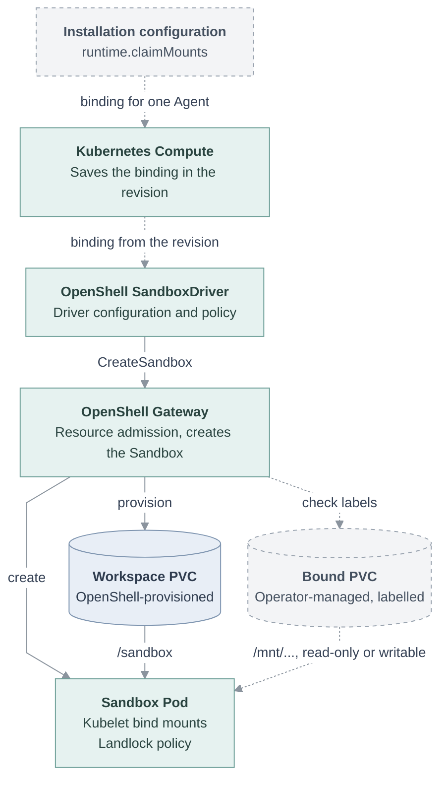

# Proposal: Operator-bound claim mounts for managed OpenShell Agents

- **ID:** RFC-0041
- **Created:** 2026-11-09
- **Last updated:** 2026-11-17
- **RFC PR:** [#5286](https://github.com/openclaw/openclaw-enterprise/pull/5286)
- **Related:** [PR #4432][pr-4432], [RFC-0038](0038-operator-scratch-volumes.md), [PR #4847][pr-4847], [OpenShell #5465][os-5465]

<a id="problem-and-decision"></a>

## Summary

Let an Installation operator bind one existing PersistentVolumeClaim (PVC) to one Agent in a managed OpenShell Workspace. The binding lists subpaths of the claim, each with a mount path under `/mnt/` and an explicit `readOnly`. Kubernetes Compute saves the binding in the Agent revision. The OpenShell SandboxDriver sends it to OpenShell as driver configuration. OpenShell approves the claim and mounts it beside the workspace that OpenShell provisions. OCE never creates, reads, prepares or deletes the claim or its content.

The decision under review is whether the Driver configuration contract should carry this binding. This proposal depends on managed Workspaces ([PR #4432][pr-4432]) and replaces the approach in [PR #4847][pr-4847], which mounted subpaths of an OCE-owned PVC.

## Motivation

A legal document-review Agent must read, but never change, the original documents, the text derived from them, the reviewer's determinations and the retention rules. It writes its own working record. The documents and the record must remain after the Agent is deleted.

In a managed Workspace, OpenShell provisions the Harness storage. OCE sends OpenShell only a runtime class and container resources as driver configuration, so no OCE setting can give an Agent a read-only mount.

OpenShell 0.1.6 offers three ways to put content in a Sandbox. Only the third meets the need:

- `sandbox upload` and SSH/tar copy files into the writable workspace. They cannot make a directory read-only, and the files are deleted with the Sandbox.
- A read-only entry in the filesystem policy ([Landlock][landlock]) applies only to the Agent's process tree. A write through `kubectl exec` succeeded.
- A `driver_config.kubernetes` mount of an existing PVC outside `/sandbox` coexists with the OpenShell workspace. A write under a read-only mount fails with `EROFS` from the Agent process and through `kubectl exec`. The same mount under `/sandbox` replaces the workspace, as OpenShell documents.

[OpenShell #5465][os-5465] records the third result. It was closed because OpenShell needed no change.

A second check on 2026-11-17 (OpenShell 0.1.6 on OpenShift, without OCE) added two facts. The Agent process cannot read or write a mount whose path the filesystem policy does not list; with the paths listed, it read the read-only mount and wrote to the writable mount. The group and mode bits of the read-only directory changed after the Sandbox started, probably because the kubelet applies the Pod's `fsGroup` to the volume.

<a id="scope"></a>

## Goals

- **G1:** An Installation operator can give one Agent read-only and writable directories from an existing claim, beside the OpenShell workspace.
- **G2:** A read-only mount refuses writes from every process in the Sandbox.
- **G3:** OCE makes no Kubernetes call on the claim. OpenShell decides whether a Sandbox can attach it.
- **G4:** An Agent revision keeps the binding it was admitted with.
- **G5:** The claim and its content remain after the Agent is deleted.

## Non-goals

- Workspaces where OCE owns the Harness PVC, and the PVC layout of PR #4847.
- A claim that an Agent or its deployer selects. The Agent API cannot select a claim or a mount path.
- Creating the claim, loading its content, or preparing its directories.
- More than one claim for an Agent, and volume types other than PVCs.

<a id="design"></a>

## Proposal

A binding is one `runtime.claimMounts` entry.

```yaml
drivers:
  compute:
    id: compute-kubernetes
    configuration:
      runtime:
        claimMounts:
          - namespaceId: ns_example
            agentId: agent_example
            claimName: matter-0421
            mounts:
              - { subPath: originals, mountPath: /mnt/matter/originals, readOnly: true }
              - { subPath: derived, mountPath: /mnt/matter/derived, readOnly: true }
              - { subPath: determinations, mountPath: /mnt/matter/determinations, readOnly: true }
              - { subPath: retention, mountPath: /mnt/matter/retention, readOnly: true }
              - { subPath: record, mountPath: /mnt/matter/record, readOnly: false }
```

**Schema.** `runtime.claimMounts` is an optional list in the Kubernetes Compute configuration, beside `runtime.scratchVolumes` (RFC-0038). Each binding has exactly four keys: `namespaceId` and `agentId` (OCE IDs), `claimName`, and `mounts`. Each mount has exactly three keys: `subPath`, `mountPath` and `readOnly`. The key names are for Driver maintainers to settle.

**Validation.** API and worker startup refuse the configuration when:

- `claimMounts` is set and `managedOpenShell` (PR #4432) is not;
- two bindings name the same Agent, or a binding has no mount;
- `claimName` is not a DNS subdomain;
- `subPath` is absolute or has a `.`, `..` or empty segment;
- `mountPath` is not below `/mnt/`, has a `.`, `..` or empty segment (a trailing slash included), or equals, contains or is inside another `mountPath` in the binding;
- `readOnly` is missing or is not a boolean, or a binding or mount has an unknown key.

**Revision admission.** Kubernetes Compute saves the matching binding, or its absence, in the Agent revision when it admits the revision. A later change to the Installation configuration does not change a saved revision; it applies through a new revision. If the managed Workspace cannot apply the new binding to the Agent's existing Sandbox, the new revision is refused and the Sandbox keeps its mounts.

**Forwarding.** The binding does not enter the Harness workspace mount list, which stays empty in managed Workspaces. The OpenShell SandboxDriver adds one `driver_config.kubernetes.volumes` entry for the claim and one `containers.agent.volume_mounts` entry for each mount, with its `sub_path` and `read_only`. The volume is `read_only` when every mount is read-only.

**Filesystem policy.** The Agent process cannot reach a mount path that the policy does not list. The Driver adds each read-only mount path to the read-only set and each writable mount path to the read-write set. It also adds the parent directory of each mount to the read-only set, so that the Agent can list the directory that contains the mounts, such as `/mnt/matter`.

**OpenShell resource admission.** OpenShell resource admission is the only approval of the claim. The gateway's resource admission configuration defines the labels that a claim must have. OCE does not read the claim. When OpenShell refuses the Sandbox, the deployment fails with OpenShell's reason.

**Operator prerequisites.** Before the operator deploys the revision:

- the OpenShell gateway has `allow_driver_config = true` and resource admission that requires labels;
- the claim exists in the Agent's OpenShell-managed Kubernetes namespace and has those labels;
- each `subPath` directory exists, the Sandbox user can read it, and the Sandbox user can write to each directory mounted with `readOnly: false`.

**Lifecycle.** Agent deletion deletes the Sandbox and its workspace, and does not change the claim.

**Trust boundary and limits.** Read-only protection comes from the mount, which refuses writes from every process in the container. The policy entry only lets the Agent process reach the path. Limits:

- The kubelet can change the group ownership and mode bits of files on the claim through `fsGroup`, although no Sandbox process can write through a read-only mount. Use the claim for one Agent only, so that this change does not affect other users of the claim.
- OCE cannot detect a claim that was replaced by another claim with the same name and labels.

### Architecture

Solid arrows exist in [PR #4432][pr-4432]. Dashed arrows are proposed.



## Acceptance Criteria

- **AC-1 (G1, G2):** Given a binding with one read-only and one writable mount of a labelled claim, when a native OpenClaw Agent and a Codex Agent are deployed in a managed Workspace, then `/sandbox` is the OpenShell workspace, each Agent reads the read-only path and lists the parent directory of the mounts, a write to the read-only path fails from each Agent and through `kubectl exec`, and a write to the writable path succeeds. Verify with a real OpenShell test that deploys the Agents through the Agent API.
- **AC-2 (G1):** Given each invalid configuration in the validation rules, startup refuses it. Verify with the Kubernetes Compute conformance tests.
- **AC-3 (G3):** Given a claim without the required labels, deployment fails with OpenShell's reason, and OCE makes no Kubernetes call on the claim. Verify with the real OpenShell test.
- **AC-4 (G4):** Given an Agent revision admitted with a binding, when the Installation configuration changes, then the saved revision keeps its binding and a new revision records the new one. If the managed Workspace cannot apply the new binding to the existing Sandbox, the new revision is refused and the Sandbox keeps its mounts. Verify with the Kubernetes Compute conformance tests.
- **AC-5 (G5):** Given a deployed Agent with a binding, when it is stopped, started and then deleted, then the Sandbox has the mounts after each start, and the claim and its files are unchanged after deletion. Verify with the real OpenShell test.

## Delivery and verification

1. **Base.** Managed Workspaces, [PR #4432][pr-4432].
2. **Driver change.** A new PR adds the setting, validation, forwarding and policy entries. PR #4847 is superseded and none of its code is reused.
3. **Merge** the Driver PR after this RFC is accepted and AC-1 passes on real OpenShell.

<a id="alternatives-and-open-decisions"></a>

## Rationale and alternatives

- **Subpaths of the OCE-owned PVC (PR #4847).** Rejected: managed Workspaces move that PVC to OpenShell, and its directories are deleted with the Agent.
- **Extend RFC-0038.** Rejected: its scratch volume is one writable mount at a fixed path, and OCE reads the claim. This proposal needs several read-only mounts, and OCE must not read the claim.
- **A mount list on the Agent deployment.** Rejected: the deployer would select the claim. This proposal keeps that choice with the Installation operator.
- **File transfer, or filesystem policy only.** Rejected: see [Motivation](#motivation).

## Unresolved questions

- **Claim placement.** OpenShell creates the Sandbox namespace. How does an operator create a claim there before the first deployment?
- **Changing a binding.** Can a managed Workspace change the mounts of an existing Sandbox? PR #4432 refuses a static policy change when it replaces a workload, and OpenShell 0.1.6 has no Sandbox update call.
- **Metadata on read-only content.** Can a managed Workspace prevent the `fsGroup` change on the bound claim?
- **Sandbox user.** How does the operator learn the user ID that must read and write the directories? See [OpenShell #5047][os-5047].
- **Label refusal.** Does OpenShell refuse an unlabelled claim as its documentation states? The gateway in the 2026-11-17 check required no labels, so the refusal is not yet observed.

## References

- [OpenShell Kubernetes driver configuration][os-driver]
- [OpenShell external resource admission][os-admission]
- [Scratch volumes][scratch]

[pr-4432]: https://github.com/openclaw/openclaw-enterprise/pull/4432
[pr-4847]: https://github.com/openclaw/openclaw-enterprise/pull/4847
[os-5465]: https://github.com/NVIDIA/OpenShell/issues/5465
[os-5047]: https://github.com/NVIDIA/OpenShell/issues/5047
[os-driver]: https://github.com/NVIDIA/OpenShell/blob/v0.1.6/crates/openshell-driver-kubernetes/README.md
[os-admission]: https://github.com/NVIDIA/OpenShell/blob/v0.1.6/docs/how-it-works/gateways/configuration.mdx
[scratch]: ../../docs/reference/drivers/kubernetes-compute/configuration.md#scratch-volumes
[landlock]: https://docs.kernel.org/userspace-api/landlock.html
