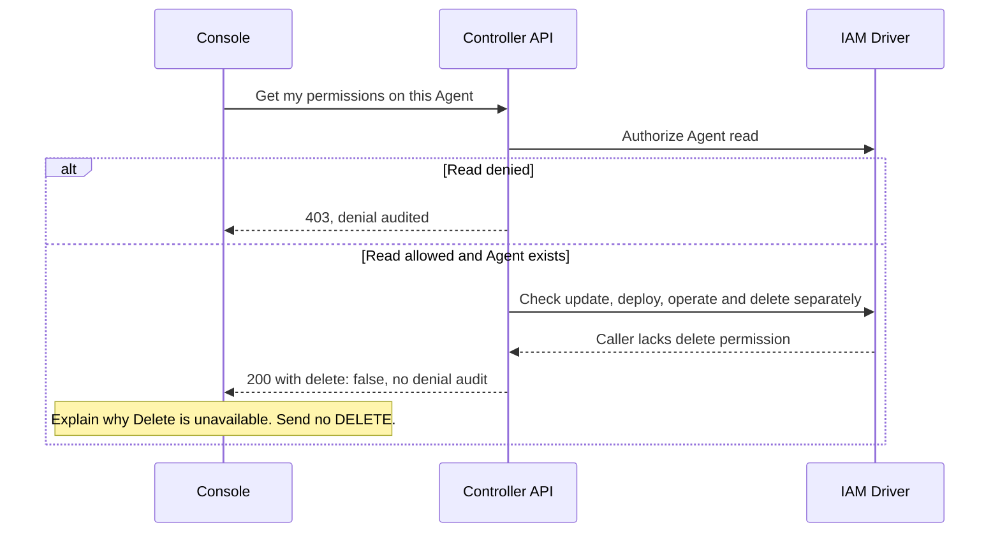

# Proposal: Explain unavailable Agent actions before a caller confirms them

- **ID:** RFC-0043
- **Owner:** Console and IAM maintainers (proposal; needs human review)
- **Created:** 2026-10-01
- **Last updated:** 2026-10-15
- **RFC PR:** [#836](https://github.com/openclaw/openclaw-enterprise/pull/836), including a draft implementation
- **Related:** [Basic RBAC](31-basic-rbac/index.md), [Agent access](36-agent-access.md),
  [Agent deletion](../plans/28-agent-deletion.md), [Agent stop](../plans/29-agent-stop.md)

## Summary

Someone with read-only access can select **Delete Agent**, confirm **Permanently delete Agent**,
and only then learn that they lack permission. The controller correctly refuses the request. We
want the Console to explain “Your access does not include deleting this Agent” beside the
disabled action, before asking someone to consider a deletion they cannot perform.

**Decision for API and IAM maintainers:** expose two reads that report the caller’s *primary*
permission for a few named actions. A `false` lets the Console explain an unavailable action. A
`true` can go stale or omit another required permission. If the read fails, preserve the control’s
usual behavior. The controller still authorizes the actual request. Before adopting the draft,
Console maintainers should make sure that `delete: false` arriving *during* confirmation means
no `DELETE` is sent, and decide whether Agent update is the right test for opening a draft.

## What the controller would promise

The controller authorizes the read, checks that the resource exists, then asks the selected IAM
Driver about the signed-in caller. There is no parameter for asking about someone else, and the
response contains no grants, roles or binding IDs. The examples show the `data` field; the draft
also returns the usual `meta.requestId`.

| Read and required access | Example `data` | What the controller asks IAM |
| --- | --- | --- |
| `GET /namespaces/{namespaceId}/agents/{agentId}/permissions` · read that Agent | `{ "update": false, "deploy": true, "operate": false, "delete": false }` | Evaluate each named action against `agent/<agentId>` in that Namespace. |
| `GET /namespaces/{namespaceId}/permissions` · read that Namespace | `{ "agents": { "create": false } }` | Evaluate Agent create against `agent/<namespaceId>`, the target used by the create operation. |

A caller denied the *read* gets the usual audited `403`; a missing resource yields `404`. In a
successful read, `delete: false` is an answer, not an attempted deletion to audit as a denial.
Each flag comes from its own `authorize()` call, against the same target as `operationTarget()`
for that action. If the Driver fails, the decision names a different Driver, or the decision or
its evidence is invalid, return `503` for the summary. Do not turn uncertainty into four false answers.

Agent detail adds one request. The controller authorizes the read, then checks update, deploy,
operate and delete separately. Request metadata (`x-openclaw-permissions`) says what an operation
*requires*, not what this caller *has*.
Learning from a failed delete comes too late; trying a delete to discover permission might
actually delete the Agent. Dedicated reads avoid adding these evaluations to every Agent in a
list, exposing administrator-only access bindings, or introducing a general `POST /iam/check`
policy probe. [#725](https://github.com/openclaw/openclaw-enterprise/pull/725) addressed related
Console feedback. The existing administrator check is `requireInstallationAdmin` in
`apps/controller/src/index.ts`; the sharing card is in `console/agents/access.mjs`.

**Proposed request flow.** Both branches start with a read. In the second, the caller learns they
cannot delete the Agent, even if they opened the confirmation while the read was pending.

## How the Console would use the answer

Fetch the relevant summary alongside the page reads. On the Agent list, `agents.create` informs
**Create Agent**. On Agent detail, `deploy`, `operate` and `delete` inform **Deploy new version**,
**Stop Agent** and **Delete Agent**, respectively. Existing reasons to disable an action, such as
the Agent’s state, still apply. An older controller, a network failure or a `503` leaves the
Console without this advice; preserve the actual operation’s success or useful `403` feedback.

The example caller above has Agent deploy but lacks Agent operate. A first deployment can still
require operate to provision connection credentials; admission can also depend on Configuration
read, access to a bound Secret or service account access. The summary is read once per page
load. If access is revoked while the page is open, the controller still checks the request. If
access is granted while the action is disabled, reload the page to see it.

## What to settle in the draft

1. **`delete: false` arrives while confirmation is open.** Open Delete while the summary is
   pending, deliver `delete: false`, then try to confirm. The draft disables the button *behind*
   the dialog, but the open dialog can still send `DELETE`. Stop has the same gap. Once a false
   answer is known, explain it in the dialog and send no write. Exercise the submit path, not just
   the initial disabled button. This is a Console behavior requirement. The controller remains the
   authority.
2. **Opening a draft is not updating an Agent.** The header’s **Create new version** opens the
   draft Configuration view. The draft disables that header on `update: false`, yet correctly
   leaves **View draft** in the version list. A caller can have Configuration update, Agent deploy
   and the other necessary grants without Agent update. Decide the navigation separately from
   permissions to edit Configuration, Credentials, Plugins or Workspace; this RFC does not gate
   those editors.
3. **Published meaning and names.** API and IAM maintainers should confirm primary permission is
   sufficient, especially for deploy, and choose IAM names such as `operate` or Console terms
   such as `stop`. Put the advisory meaning in OpenAPI and the API reference before clients depend
   on either spelling.

The draft reports API tests for the example caller, false answers without a denial audit, and
the `403` and `404` read paths. Its browser tests cover known false answers and a failed summary
followed by an actual denial; they do not resolve the open-dialog case. External IAM Driver and
live installation behavior remain unverified. Storybook loading, permission and error states,
final screenshots and a walkthrough are also outstanding.
