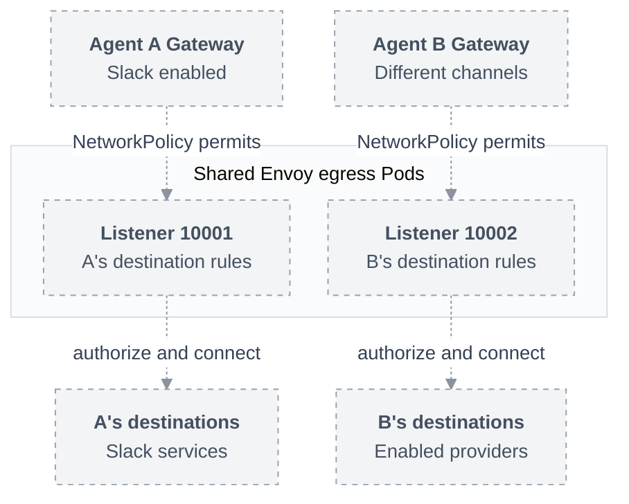

# Proposal: Per-Agent channel egress through Envoy

- **ID:** RFC-0043
- **Created:** 2026-11-18
- **Last updated:** 2026-11-18
- **Related:** [Gateway outbound proxy proposal, PR #4952](https://github.com/openclaw/openclaw-enterprise/pull/4952), [workload identity scope, #106](https://github.com/openclaw/openclaw-enterprise/issues/106), [workload delivery, #107](https://github.com/openclaw/openclaw-enterprise/issues/107).

## Summary

Extend the Channel Driver to declare required network destinations. OpenClaw
Control Plane (OCC) combines each Agent's enabled-channel rules and enforces them
through dedicated Envoy egress Pods. Before workload identity is available,
each Agent uses a separate listener port protected by Kubernetes NetworkPolicies.
Replace the bundled Slack proxy with this path. Implement Slack first while
supporting different destination sets immediately, so Microsoft Teams can follow
without changing the isolation model.

This is a proposal, not implemented behavior. It proposes an alternative to
PR #4952's installation-wide destination policy; it does not change that PR's
status or authorize its implementation.

## Motivation

The [Channel Driver](../../docs/reference/drivers/channel.md) currently validates
credentials and looks up provider identities. Kubernetes Compute separately
recognizes Slack and Microsoft Teams and grants enabled Gateways access to one
configured proxy. The [bundled Slack server](https://github.com/openclaw/openclaw-enterprise/blob/b401e36cb8754af762120e28cbf150e379482fef/apps/controller/src/slack-proxy.mjs)
allows CONNECT to Slack domains on port 443. It cannot express different
destination sets for different Agents.

Provider requirements belong with their Channel Driver. Infrastructure effects
belong with Compute. Envoy provides the shared forwarding and authorization
engine; OCC generates its configuration rather than maintaining a custom proxy
server for each provider.

## Goals and boundaries

- Permit each Agent to reach the union of its enabled channels' destinations,
  without granting another Agent's destinations.
- Reject channel activation when its enforced route is unavailable.
- Cover both Gateway connections and OCC's Slack validation/directory requests.
- Preserve separate Harness networking and existing private Gateway routing.

Microsoft Teams implementation, general-purpose internet access, credential
injection, and SPIFFE/SPIRE deployment are separate work. This proposal does not
enable currently unsupported channel/Harness topologies.

## Proposal

### Ownership and traffic

Channel Drivers declare destinations. Trusted composition maps each provider ID
to exactly one installed Channel Driver. Admission and Compute use the same
resolver; a missing or ambiguous mapping rejects activation. At each deployment,
OCC resolves the saved revision's enabled providers and derives their current rules.
Kubernetes Compute allocates listeners, installs rules and NetworkPolicies,
supplies the Gateway's proxy endpoint, and removes resources through normal
Agent reconciliation.

Compute sets the Gateway's `HTTPS_PROXY` directly to its assigned Envoy CONNECT
listener, for example `http://channel-egress.openclaw-system.svc:10001`.
Envoy is the proxy; traffic does not pass through the old Slack proxy first.

The installation provisions a dedicated egress Gateway and Envoy fleet. It can
reuse the Envoy Gateway controller, but must not merge egress Pods with the
[private workspace routing fleet](../../docs/reference/gateway-routing.md).
Egress Pods do not receive workspace-routing administrative credentials.

The diagram shows proposed connections. Ports are illustrative.



### Listener isolation

One listener per Agent does not scale: listener configuration and port allocations
grow with the Agent count. This is an interim solution until Agent workload
identity is available. The target design uses shared listeners and per-Agent
routing rules enforced by Envoy's authorization engine, selected by verified
identity rather than a dedicated port. See [future workload identity](#future-workload-identity).

Each serving Agent has its own actual Envoy listener port. Separate Service
names forwarding to the same port do not provide isolation. Both Gateway
egress and Envoy ingress policies bind the exact managed namespace, Agent,
Gateway role, and eligible revision to that port. Harness Pods and other Agents
receive no grant. Agents without enabled channels receive no channel listener.

NetworkPolicies are additive: implementation must check the complete policy set
for broader grants that bypass this restriction. Workloads must not control the
labels or Kubernetes resources used for admission. Direct provider access stays
denied; existing required internal connectivity remains separately authorized.

Envoy's HTTP RBAC filter authorizes the normalized CONNECT target and port before
forwarding. Its ALLOW policy denies unmatched requests. Ordinary HTTP proxying,
unapproved ports, and caller-supplied identity headers do not grant access.
Provider TLS remains end-to-end inside the tunnel. A destination grant permits
that service endpoint, not particular Slack workspaces, accounts, or API actions.

Envoy performs DNS resolution. The connection must use an address checked against
the permitted destination and installation restrictions. Loopback, link-local,
metadata, private, cluster/service, node, and other nonpublic destinations remain
denied, including DNS rebinding and IPv6 paths. A provider rule cannot override
these restrictions. Kubernetes egress rules provide an additional boundary;
they do not substitute for validating the actual upstream address.

### Activation and cleanup

Startup records whether channel egress is configured and available. OCC remains
running when it is unavailable; attempts to activate affected channels fail
explicitly. Admission checks are preliminary. Before applying a deployment or
retry, the worker resolves the current Drivers and derives and validates the
complete destination set for that revision. Compute uses that set consistently
through the attempt and checks readiness before starting the channel-enabled
Gateway. A listening socket or healthy controller alone is insufficient: the
listener, destination policy, and network grants must be installed.

No separate destination-policy snapshot is persisted. A deployment retry after
a worker restart or Driver upgrade derives the current rules again, so its
destination set can differ from admission or a previous attempt. Compute
reconciles that set for the target revision and recovers its existing bindings
before allocating a port; it does not change another Agent's policy. Deployed
Envoy configuration remains installed between attempts.

Compute reserves a port before publishing configuration. Managed Kubernetes
resources retain recoverable listener ownership, port, and generation, scoped by
namespace, Agent, and revision. Allocation must be concurrency-safe across workers
and restarts. Unknown ownership or exhaustion rejects activation. The implementation
plan must define allocation and recovery using those resources; this does not
require a new database entity or an independent allocation store.

A replacement revision gets a temporary separate listener if its policy differs.
Preparing it must not widen the serving revision's access. Only the eligible
Gateway Pods can reach each listener. After cutover, Compute retires the old
binding. Reconciliation must not let cleanup for an older revision delete the
current binding.

Removal of a channel or Agent revokes the corresponding access and closes
affected established tunnels before cleanup is reported complete. Removing an
ALLOW rule alone does not close an existing Slack WebSocket. A port remains
reserved until old workloads cannot reach it and old connections are gone.
Uncertain cleanup retains the reservation and reports failure for retry.

Proxy failure never enables direct internet fallback. Existing unaffected
channels may continue under their installed policies; unavailable egress blocks
new activations and connections that depend on it.

### OCC provider requests and Slack removal

OCC's credential validation and directory lookup use a separate listener restricted
to the authorized OCC API Pods and the provider destinations those operations
need. They do not select an Agent's listener or reuse its credentials. Existing
caller authorization and Secret access checks remain in force.

Remove the custom Slack server, its Helm workload and policies, profile renderer
wiring, and obsolete proxy settings after both consumer paths use Envoy. Remove
Slack-specific destination decisions from Compute. The Slack Driver initially
declares the apex and subdomains of `slack.com`, `slack-edge.com`, and
`slack-msgs.com`, on TCP 443, preserving today's destination scope.

## Interface changes

### Channel Driver and destination rules

Add this required method to the [shared contract](../../packages/contracts/src/drivers/channel/index.ts):

```ts
interface ChannelDriver extends Driver {
  // Existing members remain.
  enableRouting(): readonly NetworkDestinationRule[];
}

type NetworkDestinationRule = Readonly<{
  destination:
    | { kind: "dns"; name: string; match: "exact" | "subdomains" }
    | { kind: "ip"; address: string }
    | { kind: "cidr"; cidr: string };
  ports: readonly number[];
}>;
```

The method is deterministic, takes no credentials, and has no infrastructure
side effects. Each implementation represents a provider; composition resolves
the enabled provider to that instance. The method declares requirements, not
proof that routing is enabled. Empty results grant no destinations; exceptions
reject activation. Existing validation and lookup members retain their behavior.

Rules permit TCP ports expressed as integers from 1 through 65535. DNS names are
normalized to lowercase ASCII names. `exact` permits only that name;
`subdomains` permits descendants at label boundaries and excludes the apex.
Names contain no wildcard syntax, URL, path, or port. IPs and CIDRs require
canonical IPv4 or IPv6 syntax; IP literals require an explicit matching IP/CIDR
rule. Malformed or unsupported rules fail admission. Private-address exclusions
still apply. Any rule form not proven enforceable must be rejected, never ignored.

No existing type fits this contract:
[SandboxNetworkGrant](../../packages/contracts/src/sandbox-policy.ts) includes
an executable identity and different wildcard semantics;
[EgressRoute](../../packages/contracts/src/drivers/credential-proxy/index.ts)
binds credential-mediated operations. Add the shared destination type and schema
under contracts and export them through the top-level index. Do not change those
existing contracts' meaning.

### Configuration, API, storage, and IAM

- **Configuration:** replace the single `runtime.channels.proxyUrl`/`managedProxy`
  selection with managed channel-egress configuration. Installation inputs must
  identify the egress fleet, listener port range, reserved OCC listener, and
  qualified listener capacity. Disabled is the default. Exact field names,
  numerical limits, and Envoy resources are a validation-gate decision below;
  activation must fail when inputs are absent or capacity is exhausted.
- **API:** no new public endpoint or caller-selected proxy. Existing Agent
  deployment/admission operations expose routing failures through their existing
  error/status mechanisms; saving a draft does not establish channel readiness.
- **Storage:** no separate destination-policy snapshot or new database entity.
  Rules derive from the saved revision and current Drivers on deployment or
  retry. Managed Kubernetes resources hold generated Envoy configuration and
  recoverable listener bindings, as described in activation and cleanup.
- **IAM:** no new user action or resource kind. Existing exact-resource grants
  remain required. Extend worker Kubernetes RBAC only for the managed egress
  resources and allocation records; do not grant Agent service accounts access.
- **Compute behavior:** channel preparation and cleanup now reconcile per-Agent
  routing. Failure to provide it rejects channel activation. Each attempt retains
  its resolved Driver identities and derived rules through application; a retry
  resolves them again.

### Future workload identity

After the workload identity work supplies a verified Gateway identity, Agents
can share listeners. With X.509-SVIDs, Envoy verifies mTLS and matches the SPIFFE
URI identity plus CONNECT destination in its RBAC policies. OCC binds eligible
Gateway identities to Agent policies and publishes rules. The Gateway needs its
own component identity, not the Harness's SVID.

This retains `enableRouting()` and changes policy selection from a protected
listener port to authenticated identity. The identity work owns SVID delivery,
rotation, transport choice, and eligibility. No temporary credential issuer or
no-op authorization path is introduced. JWT-SVID transport, if selected there,
requires a separately verified integration. Identity revocation must also cover
established tunnels.

## Acceptance Criteria

Use the regular Agent deployment workflow with an authorized operator, provisioned
Secrets, PostgreSQL, enforcing Kubernetes NetworkPolicies, the selected Envoy
Gateway version, and real Gateway images. Extend the existing
[Kubernetes integrations](../../docs/testing/kubernetes.md) and
[Slack proof](../../docs/testing/slack.md); mocks do not prove enforcement.

- **AC-1 — Slack:** enable Slack, deploy, perform a genuine Slack exchange, and
  complete OCC credential validation/directory lookup through their respective
  Envoy listeners. Capture installed rules and observable results without secrets.
- **AC-2 — Isolation:** deploy Agents with different rule sets, including an
  Agent without channels. Prove allowed CONNECT succeeds; another Agent's
  listener, unlisted hosts/ports, direct internet, and Harness access fail.
  Real controlled endpoints can qualify transport, but must not be reported as
  Microsoft Teams integration. Teams delivery repeats this with its real Driver.
- **AC-3 — Failure:** with Envoy absent, policy rejected, or capacity exhausted,
  activation fails while OCC remains usable. No broad or direct fallback appears.
- **AC-4 — Lifecycle:** change channel rules during replacement, disable channels,
  delete an Agent, restart workers, and race allocations. Prove revision isolation,
  termination of revoked tunnels, retry-safe cleanup, and safe port reuse. Change
  a Driver's rules between admission and a deployment retry; verify that the retry
  derives and enforces the current set without changing another Agent's policy.
- **AC-5 — Address restrictions:** exercise malformed targets, domain-boundary
  lookalikes, explicit IPs, DNS changes to prohibited addresses, and IPv4/IPv6
  restrictions through real Envoy connections. Unsupported forms fail explicitly.
- **AC-6 — Replacement:** verify packaged installation contains no custom Slack
  proxy and retains private Gateway routing and supported model execution.

## Delivery and validation gate

Submit this RFC for human review before Driver implementation. Create a separate
implementation plan that maps work and evidence to AC-1 through AC-6.

Before committing to resources, qualify inbound CONNECT, per-listener RBAC,
dynamic forwarding, checked upstream addresses, configuration acknowledgement,
and connection termination on the repository's selected Envoy Gateway version
(currently v1.6.7). Native Envoy capability does not prove that its Gateway API
integration exposes the complete combination. Prefer supported resources; any
required extension or version change needs explicit review in this RFC.

The networking implementation owner must also specify recoverable listener bindings,
field names, port range, and tested capacity. Count temporary replacement and OCC
listeners. A full fleet rejects activation; automatic sharding is outside this
delivery. Record these decisions before implementation begins.

On implementation, update the Channel Driver reference, Slack guide, Gateway
networking reference, relevant flows, configuration cheat sheet, and the affected
architecture ownership claim. This draft changes no current-behavior reference.
Initial qualification is recorded in the
[implementation plan](../plans/0043-channel-egress.md#qualification-gate).
Envoy Gateway v1.6.7's supported resources do not enforce upstream-address
restrictions. Adding downstream resolved-address RBAC to Envoy v1.36.6 also
failed a real test: a DNS answer's public first address passed authorization,
but an alternate loopback address received the connection.

The implementation proposes retaining Envoy Gateway v1.6.7 and using a separate
egress fleet pinned to Envoy v1.39.4. A scoped `EnvoyPatchPolicy` would install
CONNECT-target RBAC, dynamic-forward-proxy strict-DNS subclusters, and upstream
RBAC before the upstream codec. Strict-DNS subclusters give each selected host
one concrete address; upstream RBAC checks that address on every attempt.
Native probes passed Slack TLS and rejected the selected private alternate
addresses. Gateway integration, revocation, and capacity remain unqualified.
This extension and image change require explicit review before production
implementation; they do not change the private workspace ingress fleet.

## Rationale and alternatives

- **Keep/generalize the Slack server:** retains custom forwarding code and does
  not itself establish per-Agent permissions. PR #4952 pursues a broader shared
  proxy policy; this proposal requires distinct policies now.
- **One shared unauthenticated listener:** cannot securely select different Agent
  policies from caller-supplied IDs. A fleet-wide union grants excess access.
- **Proxy per Agent:** provides isolation but adds per-Agent Pods and operations.
  Listener ports share the fleet at the cost of allocation and capacity limits.
- **Wait for SPIFFE:** removes temporary port management but blocks Slack and
  Teams delivery on workload identity. Protected listeners retain enforcement
  without implementing a second identity system.

## References

- [Envoy HTTP RBAC](https://www.envoyproxy.io/docs/envoy/latest/configuration/http/http_filters/rbac_filter) and [CONNECT](https://www.envoyproxy.io/docs/envoy/latest/intro/arch_overview/http/upgrades).
- [Envoy dynamic forward proxy and address risks](https://www.envoyproxy.io/docs/envoy/latest/configuration/http/http_filters/dynamic_forward_proxy_filter.html).
- [Kubernetes NetworkPolicy semantics](https://kubernetes.io/docs/concepts/services-networking/network-policies/).
- [SPIRE and Envoy integration](https://spiffe.io/docs/latest/microservices/envoy/).
- [Current Compute owner](../../apps/controller/src/drivers/compute/kubernetes/index.ts) and [Slack Helm resources](https://github.com/openclaw/openclaw-enterprise/blob/b401e36cb8754af762120e28cbf150e379482fef/deploy/helm/openclaw-enterprise/templates/slack-proxy.yaml).
