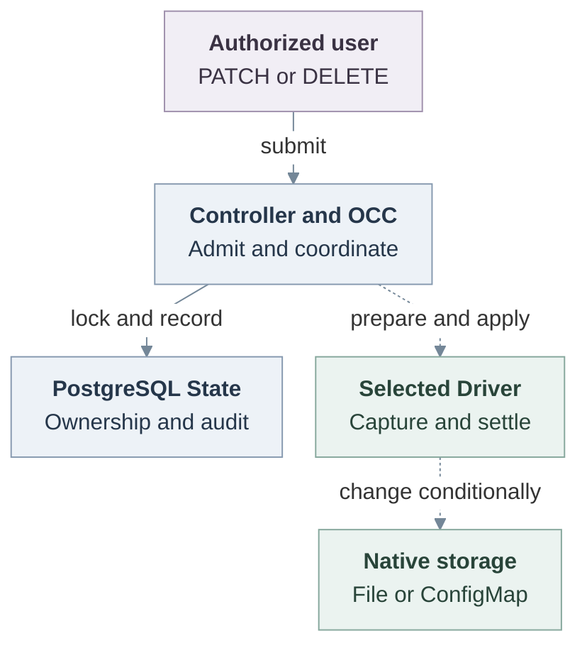
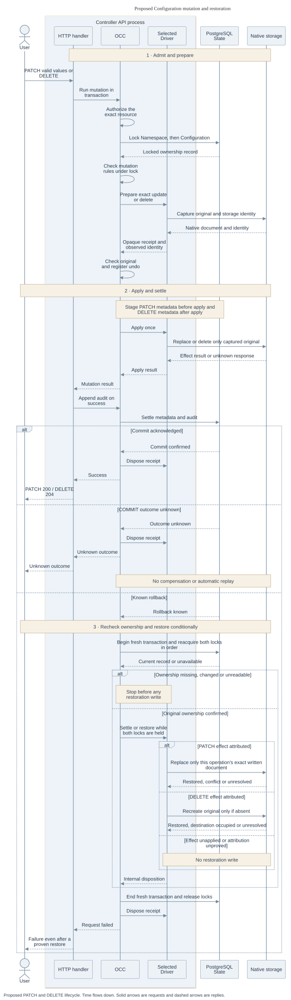

# Conditional restoration of Configurations

## Problem and decision

An authorized user may need to replace or remove an older Configuration that the platform can still read. The controller changes the stored document and records the change in PostgreSQL. If the database transaction rolls back after storage changes, the controller tries to undo the storage change with an ordinary Driver write. That write can reject a document that is still readable under the rules for stored content. Before undoing a write, the controller also needs to know whether the current document still belongs to the failed operation.

Give the selected Configuration Driver a way to capture what it is about to change and put it back under two conditions. The OpenClaw Control Plane (OCC) must know that PostgreSQL rolled back and confirm that the original ownership record still applies. The Driver must prove that the storage effect belongs to this operation and that undoing it will preserve another writer's work. Those proofs let the controller restore a readable older document without admitting that same content as a new write.

A Configuration is a Namespace-owned document with native OpenClaw settings. Its generation is the number OCC assigns to each recorded version. The Driver stores the document in a file or a Kubernetes ConfigMap, while PostgreSQL State records the platform's ownership and generation. These stores can disagree after a failure. A user should get the usual success response after commit. If PostgreSQL rolls back, the request still fails, even when the Driver can restore the original document. When either owner lacks the evidence it needs, the controller can leave storage ahead of State, or leave State with a record for a missing document.

This capability is proposed and unimplemented at source commit `d8d985bc57d5d6861f244bac8b3f18d070658ca2`. The routes, stored-read compatibility and best-effort compensation already exist there.

Existing entry and State calls are solid. Dashed arrows show the proposed Driver operations. The [request lifecycle](#rollback-and-receipt-lifetime) shows when those operations can undo a storage change.

## Scope

The complete delivery covers the existing PATCH and DELETE paths, both bundled Drivers, and a compatibility rule for the Driver an Installation selects from an installed package. Proving the authenticated HTTP path with PostgreSQL and filesystem storage is the first checkpoint. Kubernetes and installed-package qualification remain required. The [acceptance criteria](#acceptance-criteria) specify the evidence each supplier owes.

The existing request shapes, credential validation, deployment admission and PostgreSQL unknown-COMMIT classification still govern these operations. The new capability is internal to OCC and the Configuration Driver. Public API clients keep their existing privileges. Other persistence and durable crash recovery stay with their existing owners.

## Contract

### Ownership and placement

The operator selects the Driver through existing trusted Installation setup. Production defaults to the bundled Kubernetes Driver and can select an installed package. Default Compose development uses the filesystem Driver. The HTTP handler, OCC and the selected Driver run inside the controller API process. The Driver reaches the filesystem or the Kubernetes API. PostgreSQL persists Configuration ownership, including Secret bindings, and records the success audit in the same transaction as the metadata change.

OCC owns authorization, resource identity, generation and the transaction decision. The Driver owns the storage representation and conditions on a physical write. The proposed internal call gives OCC an opaque receipt for one operation. The receipt represents the original native document and the evidence the Driver needs to identify its storage effects. PostgreSQL State supplies the ownership record. It does not supply a copy of the native document. The Driver contribution registry continues to define configuration and dispatch it to its owner.

### Prepare and apply

For an illustrative, unexecuted repair, a user with update permission reads generation 7 of an older Configuration and sends `PATCH /namespaces/:namespaceId/configurations/:configurationId` for that same resource. The body supplies a valid replacement in `values` and may include `expectedGeneration: 7`. A supplied generation must be a positive safe integer. An omitted `expectedGeneration` targets the current recorded generation. `secretBindings` is optional. Omission retains the recorded bindings. The handler passes the request to OCC.

1. OCC checks IAM `update` or `delete` on the exact Configuration in its Namespace. OCC locks the Namespace before locking the Configuration record. It verifies the immutable kind and provisioning rules. PATCH compares a supplied `expectedGeneration` with the locked record. A mismatch retains the existing 409 conflict. OCC checks separate Secret permissions and Namespace scope for bindings. New POST and PATCH values must pass current OCC and Driver validation before any native write. Values eligible only for stored reads still fail fresh-write validation.
2. OCC asks the selected Driver to prepare the authorized update or delete. Preparation captures the exact original native document and its storage identity without changing storage. The Driver binds the receipt to itself, that Namespace and Configuration, and this one operation. OCC overlays State-owned Secret bindings on the read it returns to callers. Only the Driver can supply the original native document for the receipt.
3. OCC checks the captured document against the locked ownership record and bases generation calculations on that same observation. Existing repair can admit a locked document up to 100 generations ahead of State. A repair PATCH advances past the actual captured generation. Ordinary GET and deployment still require an exact match to State and refuse unrecorded content. The Driver must use that admitted observation when applying the forward mutation. It either atomically checks the original document and storage identity at apply or captures and applies under one storage fence. An intervening writer causes refusal before its document can be displaced.
4. OCC stages the PATCH metadata change and registers compensation before asking the Driver to apply. The Driver applies the prepared write at most once. OCC verifies the PATCH result against the expected ownership and generation. The HTTP handler appends the attributable audit event within the transaction. After commit, PATCH returns HTTP 200 with the Configuration in `data` and the request ID in `meta`.

To remove the same Configuration, an actor with delete permission sends DELETE to the same route. OCC rechecks that authority while holding the Namespace lock. It refuses deletion when an Agent still references the Configuration or an applicable provisioning record still holds it. For an admitted deletion, the Driver removes the exact prepared document. OCC removes the ownership record and its targeting access bindings in State. After the transaction commits, the handler returns HTTP 204. The [installed compatibility rule](#installed-driver-compatibility) covers confirmed absence and missing capability.

The Driver keeps the receipt and native values sensitive. OCC uses an opaque reference. Receipt contents, native values from restoration and raw storage errors stay out of HTTP errors, logs, audit details and public artifacts. Restoration accepts only the captured document through that bound receipt. The HTTP interface exposes no historical-write mode.

### Rollback and receipt lifetime

PostgreSQL settles State and its audit together. The Driver's effect is external to that transaction. The existing Kubernetes backend budget starts at handler entry and stops new forward calls after 12 seconds. Audit and commit sit outside that budget. Compensation runs in a separate phase with backend per-call timeouts.

OCC opens a fresh State transaction only after a known rollback. One example is an audit append that fails after the Driver has applied the mutation. It takes the Namespace lock and then the Configuration lock. It compares the full original ownership record, including Namespace, ID, kind, generation, creation time and Secret bindings. A missing, changed or unreadable record gives OCC no authority to write. OCC holds both locks through any conditional restore. The Driver then checks its own storage evidence. If the result of COMMIT is unknown, the existing PostgreSQL classification applies. The caller receives the existing dependency-unavailable response with an unknown outcome. The controller performs neither compensation nor automatic replay.

The Driver reports one of four internal outcomes:

- `restored` means the conditional restoration is proved.
- `not-applied` means the Driver has positive evidence that the forward mutation did not happen.
- `superseded` means evidence shows that ownership changed or another object occupies the destination.
- `unavailable` means the observation, attribution or settlement is unresolved.

An uncertain result gives no authority for a second destructive action. The Configuration owner can inspect permitted current evidence with the operator and make a separately authorized repair request if its ordinary checks hold. A known rollback can leave State and storage divergent when the ownership or storage checks cannot establish safe restoration.

For human review, keep the receipt in the process for one live attempt. The Driver owns its contents. Cancellation before apply discards the unused receipt. After a possible effect, keep the receipt only through that attempt's settlement and, following known rollback and a successful locked ownership check, at most one conditional restore. Commit, terminal compensation or refusal, or terminal uncertainty ends custody and disposes of the captured document. A controller restart or replacement can lose both receipt and document. State, committed audit and storage can survive independently. A request identifier cannot recover lost material or establish the outcome.

Proposed lifecycle. Time flows down. Solid arrows are requests and dashed arrows are replies. [Editable Mermaid source](index/request-lifecycle.mmd).

### Storage conditions

For PATCH restoration, the Driver must atomically verify and replace only the exact document written by this operation. Proof binds the native content and logical identity to the storage revision and this particular mutation, or uses equivalent backend evidence. Equal generations or equal content alone cannot prove who made the write.

For DELETE restoration, the Driver first proves this prepared delete applied. It must recreate the document with an atomic create-if-absent operation. If a replacement already occupies the destination, it stays in place. Recreation preserves the original native content, Namespace, ID, kind, generation and creation time. Kubernetes can assign a new UID and `resourceVersion` to the recreated ConfigMap.

- **Filesystem.** All participating writes must use one cross-process fence per resource on the shared root. This includes ordinary create, update and delete, exact creation where supported, and provisioning cleanup through existing Driver calls. The Driver checks and changes the file under that fence and uses no-clobber recreation. The fence coordinates participating writers. Unmanaged host writes are outside its scope.
- **Kubernetes.** The Driver uses the actual ConfigMap UID and `resourceVersion` to condition replacement and deletion on the observed object. The UID identifies the object and `resourceVersion` identifies the observed version. Create-if-absent must preserve an intervening object. If a response is lost, the Driver needs surviving evidence that identifies the exact operation. Absence alone cannot attribute a delete.

Before either Driver claims support, its owner must define native equality, the exact identity proof, and how it attributes an update, deletion or restoration when the response is lost. Human RFC review must settle these choices. If the Driver cannot prove attribution or settlement, it reports `unavailable`. The failed operation may leave its storage effect in place.

### Installed Driver compatibility

For human review, keep the capability optional at Installation setup. If the exact selected Driver lacks the capability or exposes a malformed one, OCC refuses an affected PATCH or DELETE before the native mutation with the existing dependency-unavailable response. This can make a previously usable write unavailable on an older package. Ordinary paths that do not depend on the capability remain usable. In particular, existing DELETE may remove metadata alone when the selected Driver confirms absence under the existing exact inspection rule. Ambiguous or failed inspection cannot supply that confirmation.

## Implementation

1. Define the internal capability at the contracts package's top-level entry point. The TypeScript shape remains open. Use ordinary OCC lookup and runtime capability checks for the exact selected Driver in both production composition and direct construction.
2. Connect preparation, apply and compensation to the existing OCC transaction. Keep backend algorithms inside each Driver. Implement the shared-root filesystem guarantee first, then complete the Kubernetes and installed-package paths.
3. Update the maintained Configuration flow and Driver reference after both bundled Drivers implement and qualify the contract. Document installed behavior from the genuine package check.

## Verification

### Acceptance criteria

- **HTTP, PostgreSQL and filesystem.** Run the same TypeScript regression on the pinned pre-fix and repaired source through authenticated HTTP, application-role PostgreSQL and the real filesystem Driver. Check PATCH and DELETE success, authorization, invalid new input before a native change, and known rollback after an audit failure with valid and readable older originals. Read back GET, native storage, ownership and committed audit. Lose the acknowledgment to a real COMMIT and verify the unknown outcome, durable state and absence of compensation or replay. Cover healthy leftover repair, same-generation foreign writes, missing, changed or unreadable ownership, and deletion restoration without clobbering a replacement. Exercise receipt disposal and process-local loss. Register the test in the PostgreSQL CI lane and verify normal discovery and CI type-checking without unexplained skips.
- **Independent writers.** Run two OS processes against one filesystem root. While the first HTTP request holds the State locks after preparation, have a participating Driver writer advance the native document. Verify stale apply leaves that document and generation intact. Separately, after rollback and before compensation reacquires its locks, let the second authenticated HTTP writer commit using the same database. Verify that its metadata, audit and native document survive. Show that a writer waits when compensation holds the State locks through restoration.
- **Kubernetes.** Use the genuine Driver with real ConfigMaps in an authorized disposable cluster. Exercise UID and `resourceVersion` conflicts independently, including stale and same-generation effects. Verify rollback with valid and historical originals, invalid fresh input, lost responses with and without attributable effects, and a create-if-absent race that preserves its winner. Record the source, substrate readback and cleanup. Mock-client checks supplement this evidence.
- **Installed packages.** Through ordinary controller selection, use genuine packages with absent, malformed and valid capabilities. Observe refusal before mutation and the supported path when present. Prove metadata-only deletion after genuine exact absence and refusal when absence cannot be confirmed.

### Status and review

The proposal uses source inspection. Local baseline and repaired regressions, hosted CI, live cluster and installed qualification, and release evidence remain pending. The RFC owner must obtain independent security and publication review of the exact outgoing files and PR text before submission. Submission permits separately authorized implementation subject to applicable holds. Human approval is a separate decision. A human must manually merge the RFC.

## References

- [Configuration Driver contract](../../../docs/reference/drivers/configuration.md) and [persistence flow](../../../docs/flows/configuration-driver/persistence-and-revisions.md) describe current ownership and operation.
- [HTTP routes](../../../packages/contracts/src/api/routes.ts) and [request schemas](../../../packages/contracts/src/api/common.ts) own the public interface.
- [PostgreSQL testing](../../../docs/testing/postgresql.md) describes the test environment.
