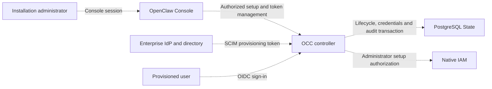
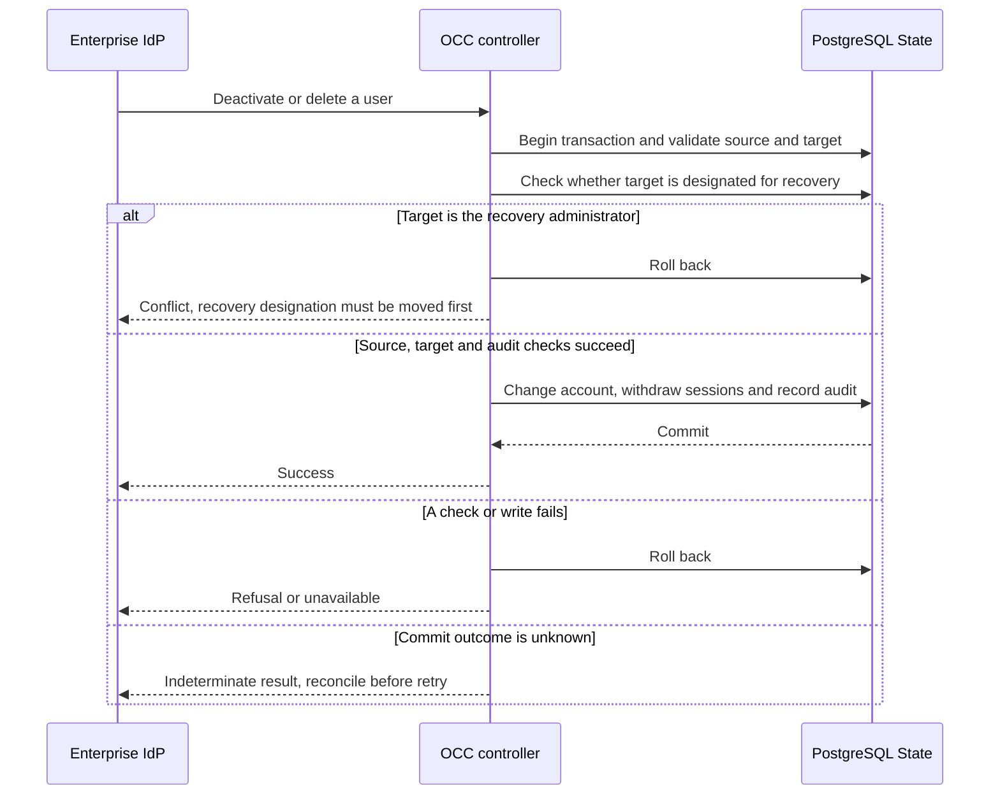

# Proposal: Provision users and groups through SCIM

- **ID:** RFC-0044
- **Created:** 2026-11-17
- **Last updated:** 2026-11-19
- **RFC PR:** [#6520](https://github.com/openclaw/openclaw-enterprise/pull/6520)
- **Implementation plan:** [SCIM provisioning](../plans/0044-scim-provisioning.md)
- **Related:** [RFC-0032](https://github.com/openclaw/openclaw-enterprise/blob/97db98be9a0317b98897e2a98d2cda8cc24159bd/specs/rfcs/0032-oidc-account-enrollment.md), [identity provider mapping proposal](https://github.com/openclaw/openclaw-enterprise/pull/4207)

## Summary

OpenClaw Enterprise will support optional System for Cross-domain Identity Management (SCIM) 2.0 provisioning from one directory per installation: users in v0, then groups and direct memberships in v1. OpenID Connect (OIDC) verifies sign-in; native identity and access management (IAM) retains authorization.

## Motivation

Enterprises want to use their existing identity provider (IdP) and directory to automate user provisioning in OpenClaw Enterprise. SCIM provides a standard integration for account lifecycle management which allows for automated onboarding and offboarding and standardized group synchronization without maintaining a separate directory in OpenClaw. This reduces manual administration and keeps the enterprise directory as the source of truth for the identities it manages, while OpenClaw continues to manage authorization.

## Goals

- **G1:** Provision a human account before first sign-in with a stable server ID and zero implicit grants.
- **G2:** Let an authenticated directory withdraw that account and its sessions in one committed operation.
- **G3:** Synchronize groups owned by the directory source and their direct user memberships.
- **G4:** Preserve an independent administrator who can recover the installation during directory or provider failure.
- **G5:** Let an authorized administrator configure and revoke provisioning access without exposing stored credentials.

## Out of scope

- Role and binding administration, mapping groups to roles, and any use of synchronized membership as an authorization input to a separate decision.
- Nested groups, service identities, bulk operations and password authentication through SCIM.
- User profile fields such as `roles` and `userType` are descriptive.
- Handling how offboarding leaves existing IAM bindings, service principal keys, agents, workloads and downstream credentials under their respective owners.
- Provisioning tokens with limited lifetime will be deferred. Initially tokens will be valid until rotated or SCIM is disabled.

## Proposal

### Architecture

Proposed ownership and trust boundaries:

The OpenClaw Control Plane (OCC) controller owns the HTTP contract. PostgreSQL `State` commits source authorization, account and external method changes, principal creation, session withdrawal and mutation audit together. It stores directory groups and direct memberships with referential integrity, scoped to the installation and source. Neither IAM nor sign-in claim mapping uses those memberships. No `Driver` interface or permission changes are required.

### User Deactivation & Deletion

OpenClaw protects the designated recovery administrator from deactivation or deletion. An authorized installation administrator must first transfer the recovery designation to another qualifying administrator through OpenClaw's existing recovery workflow. The recovery protection applies only when the target is the designated recovery account; an unavailable recovery administrator does not block offboarding other users.

Proposed user deactivation flow:

### Configuring SCIM

SCIM is disabled by default. An operator can enable it only when OpenClaw is configured to use OIDC through the managed identity provider. Password sign-in must be limited to administrator recovery accounts when enabled.

An installation administrator configures SCIM in the OpenClaw Console and generates a provisioning token for the installation's directory source and identity provider. The Console displays the token once so the administrator can copy it into the IdP's provisioning settings. OpenClaw stores only a hash of the token and its version in PostgreSQL; the plaintext token cannot be retrieved later. Tokens are valid until rotated or SCIM is disabled. An administrator can rotate or revoke the token in the Console. Rotation immediately invalidates the previous token when the change commits, so provisioning may be interrupted until the administrator updates the IdP. Revocation also takes effect immediately. Each operation checks the current token version and commits the change with its audit event. If the outcome is uncertain, the Console checks the recorded version and audit status before allowing another attempt. Old tokens fail subsequent requests, including discovery. Revocation does not delete synchronized users, groups or memberships.

Group provisioning is a separate setting that an administrator must explicitly enable. It is disabled by default.

### User Accounts (v0)

1. Authenticate every request under `/scim/v2` over HTTPS. Expose `/Users` through POST, GET, PUT, PATCH, DELETE and list requests. Return an ID generated by the server that clients cannot modify, and a `Location` header on creation. Support bounded equality filters, including `userName`, `externalId`, `active` and email value, and pagination starting at index 1 with a maximum page size of 200. Return SCIM resources and errors as `application/scim+json`. Advertise the `User` schema and its supported profile extension through `/Schemas` and `/ResourceTypes`. In v0, and whenever the group capability is disabled, omit group discovery and return 404 for group schema, resource type and resource routes.
2. On initial creation, a source may provide an eligible `externalId` as its directory anchor. Bind the method to the exact provider, issuer/client and configured signed claim. With `sub`, the IdP must map the exact subject for that client. With Entra `oid`, require an issuer specific to the tenant, profile scope, validated tenant and GUID object ID. Validate signature, issuer, audience and nonce. Never infer identity from email, name or an unverified claim.
3. Keep optional, mutable SCIM `externalId` metadata separate from the original anchor. A later rename or removal preserves the sign-in method. A user created without an anchor stays unlinked even after a metadata edit or manual grant. Reject conflicts with existing manual, recovery or privileged identities. Refuse alternate methods and account creation at first sign-in on the managed provider.
4. Apply all PATCH operations atomically. Updating `active` to `false` through PATCH or PUT disables the user without deleting the SCIM resource. Updating it to `true` reactivates the same user, who must sign in again. PUT with `active` omitted preserves current activation. Discard password inputs before persistence, audit or output. Treat profile values and request filters as sensitive in diagnostics.
5. Deactivation or deletion locks the target account and checks the current recovery designation in the same transaction, serialized with designation changes. Reject withdrawal of the designated recovery administrator with 409, but do not require a recovery availability or IAM policy check for an unrelated target. Session withdrawal, account change and audit commit together. Deactivation preserves the user and directory memberships. DELETE removes the SCIM resource and its membership edges, withdraws its authentication methods and sessions, and returns 204; subsequent requests for that resource return 404 and list results omit it. A later POST may create a new user with the same username or eligible directory subject, but receives a new SCIM and account identity and cannot inherit the deleted user's sessions or grants. The old SCIM ID is never reassigned.

### Groups and membership (v1)

- **Creation -** When groups are enabled, advertise the core Group schema and resource type and support POST, GET, list, PUT, PATCH and DELETE at /scim/v2/Groups. Require displayName, assign an immutable ID and return a Location header. Enforce externalId uniqueness per source and resource type, support bounded equality filters on displayName and externalId, and reuse the /Users protocol contract. Names are mutable labels, not identity or policy keys; do not match groups by name.
- **Membership -** Each group member must identify a SCIM user in the same installation and source. The endpoint must atomically reject unknown or foreign users and ignore nested groups. Support bounded, deduplicated member updates, filtered PATCH removal and full PUT replacement.
- **Deletion -** Deleting a group removes only its directory record and membership edges. Group and membership changes do not affect user activation, sessions, or IAM grants.
- **Error Handling and Audit logs -** Return a generic 401 for invalid source credentials, 400 for invalid input, 404 for missing resources, 409 for uniqueness or recovery conflicts, and 503 for unavailable dependencies. Record successful lifecycle operations with attributable source and resource IDs.

## Acceptance Criteria

- **AC-1 — Administrator setup (G5):** An administrator can generate, rotate and revoke a token in the Console. The token appears only at issuance and has no expiration; later reads do not expose it, unauthorized users cannot manage it, and rotation or revocation immediately invalidates the old token. Verify through Console browser tests, controller integration tests, database and audit checks, including stale versions, uncertain outcomes and provisioning interruption until the IdP uses the replacement.
- **AC-2 — Users API (G1, G5):** Given an enabled v0 installation and a valid directory token, the IdP can create, list, update and delete users through the real API. Discovery exposes users and groups in v1. Pagination and retries behave as documented, passwords are omitted, and source boundaries are enforced. Verify with protocol integration tests.
- **AC-3 — Identity and authorization (G1):** Given a provisioned user and signed OIDC tokens, the original subject can sign-in after a metadata rename; a replacement subject or unlinked user cannot take over the identity. After DELETE, a new POST may provision the same eligible subject under a new identity without restoring prior grants or sessions. Verify with actual session admission, principal and policy reads.
- **AC-4 — Invalidating Sessions (G2):** Given active sessions, setting `active:false` disables the user and invalidates sessions; setting `active:true` restores the same account but not its sessions. DELETE returns 204, removes the resource from discovery and makes its old ID return 404. Account changes and audit commit together, including under concurrent user deactivations or audit failure. Verify with database integration tests, fault injection and readback after uncertain writes.
- **AC-5 — Recovery and rollout (G4):** Deactivation of a designated recovery administrator is refused until an authorized administrator moves the designation to a qualifying successor. Deactivating or deleting an unrelated user succeeds even if recovery access is indeterminate. Migration, provider cutover, and rollback preserve recovery access. Invalidated sessions are immediately consistent across database replicas. Verify with concurrent recovery designation changes, staging migration, restore, recovery login and replica checks.
- **AC-6 — User interoperability (G1, G2, G4, G5):** Given a dedicated test IdP, verified HTTPS and an enabled staging installation, the directory completes onboarding, updates, token rotation and offboarding during an active session. Verify with provider receipts and OpenClaw account, session and audit results; the criterion remains open without those prerequisites.
- **AC-7 — Group capability (G3, G5):** Given a v1 installation, an authorized administrator can explicitly enable group provisioning. Discovery and group routes become available. Disabled groups return 404 and revoked tokens cannot access them. Verify with Console, controller and deployment integration checks.
- **AC-8 — Group synchronization (G3):** Given enabled groups and users from the same directory source, the IdP can perform group CRUD, filtering and atomic membership additions, removals and replacements. Invalid or foreign references fail without partial writes, duplicate delivery creates no duplicate edges, and concurrent user deletion leaves no dangling membership. Verify against the database, including audit failures and races.
- **AC-9 — Authorization separation (G3):** Given existing IAM policy and signed-in users, group creation, membership changes and deletion do not alter grants, effective permissions, activation or sessions. Verify by comparing real IAM decisions and session state before and after mutations.
- **AC-10 — Group interoperability (G3):** Given a dedicated IdP, verified HTTPS and v1 staging, the directory synchronizes groups and direct memberships, retries failures and reconciles after disablement and re-enablement within agreed limits. Verify with provider receipts and persisted group and membership results.

## Delivery and verification

Deliver v0 (AC-1 through AC-6) and v1 (AC-7 through AC-10) as independently reviewed milestones and focused PRs merged in dependency order. Schema migration and recovery testing precede enablement; v1 also requires consistent capability configuration across replicas. Existing account migration is separate, and rollback must not reopen uncontrolled enrollment..

## Unresolved questions

- **Denial telemetry — prakash-oai:** Decide fields, rate limits and retention.
- **User Deletion and Disabling — freeqaz-openai:** Set first attempt success and latency targets. Deletion and deactivation must remain atomic and protect recovery access regardless of the target.
- **Existing users and groups — kevinlin-openai:** Decide matching fields, conflict handling and administrator authorization for adopting existing users or native groups.

## References

- [Account enrollment and explicit exclusions](https://github.com/openclaw/openclaw-enterprise/blob/97db98be9a0317b98897e2a98d2cda8cc24159bd/specs/rfcs/0032-oidc-account-enrollment.md)
- [Identity provider mapping proposal](https://github.com/openclaw/openclaw-enterprise/pull/4207)
- [OCE architecture](https://github.com/openclaw/openclaw-enterprise/blob/97db98be9a0317b98897e2a98d2cda8cc24159bd/docs/design.md) and [authorization](https://github.com/openclaw/openclaw-enterprise/blob/97db98be9a0317b98897e2a98d2cda8cc24159bd/docs/reference/authorization.md)
- [SCIM schema](https://www.rfc-editor.org/rfc/rfc7643) and [SCIM protocol](https://www.rfc-editor.org/rfc/rfc7644)
