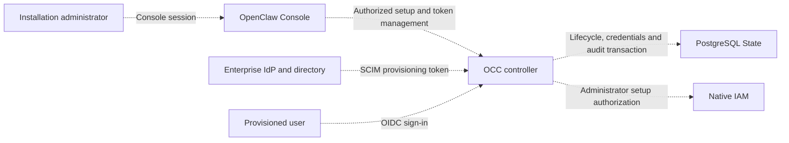
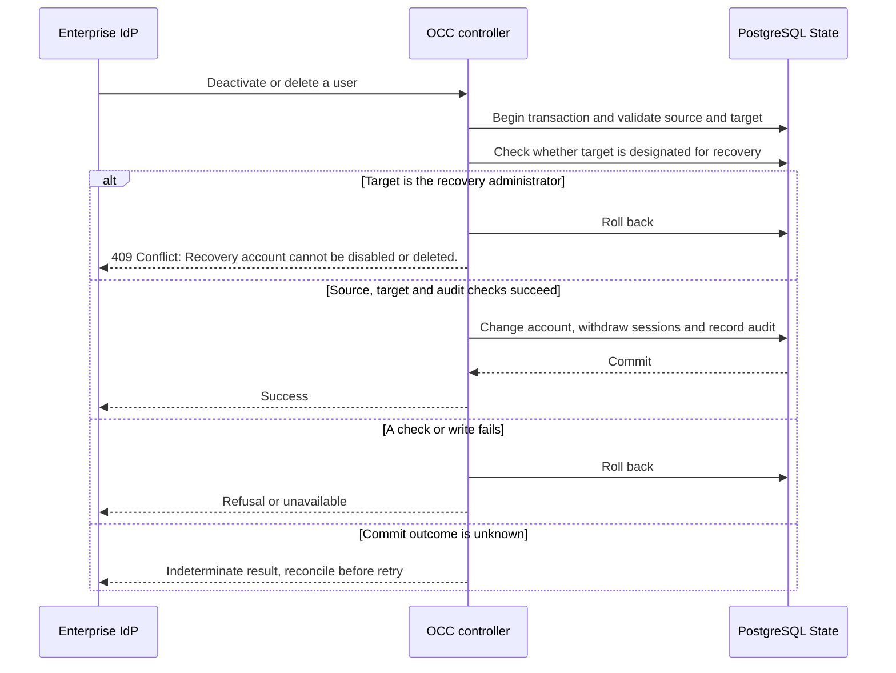

# Proposal: Provision users and groups through SCIM

- **ID:** RFC-20261117-scim-provisioning
- **Created:** 2026-11-17
- **Last updated:** 2026-11-25
- **RFC PR:** [#6520](https://github.com/openclaw/openclaw-enterprise/pull/6520)
- **Implementation plan:** [SCIM provisioning](../plans/20261117-scim-provisioning.md)
- **Related:** [RFC-0032](https://github.com/openclaw/openclaw-enterprise/blob/97db98be9a0317b98897e2a98d2cda8cc24159bd/specs/rfcs/0032-oidc-account-enrollment.md), [identity provider mapping proposal](https://github.com/openclaw/openclaw-enterprise/pull/4207)

## Summary

OpenClaw Enterprise will support optional System for Cross-domain Identity Management (SCIM) 2.0 provisioning from one directory per installation: users in v0, then groups and direct memberships in v1. OpenID Connect (OIDC) verifies sign-in; native identity and access management (IAM) retains authorization.

## Motivation

Enterprises want to use their existing identity provider (IdP) and directory to automate user provisioning in OpenClaw Enterprise. SCIM provides a standard integration for account lifecycle management which allows for automated onboarding and offboarding and standardized group synchronization without maintaining a separate directory in OpenClaw. This reduces manual administration and keeps the enterprise directory as the source of truth for the identities it manages, while OpenClaw continues to manage authorization.

## Goals

- **G1:** Provision each user before first sign-in with a stable server ID. OpenClaw adds the user to configured default groups unless the IdP manages their membership. SCIM grants no permissions directly.
- **G2:** Let an authenticated directory withdraw that account and its sessions in one committed operation.
- **G3:** Synchronize groups owned by the directory source and their direct user memberships.
- **G4:** Preserve an independent administrator who can recover the installation during directory or provider failure.
- **G5:** Let an authorized administrator configure and revoke provisioning access without exposing stored credentials.

## Out of scope

- Creating, changing, or deleting OpenClaw roles or role bindings through SCIM.
- Nested groups, service identities, bulk operations and password authentication through SCIM.
- User profile fields such as `roles` and `userType` are descriptive.
- Handling how offboarding leaves existing IAM bindings, service principal keys, agents, workloads and downstream credentials under their respective owners.
- Provisioning tokens with limited lifetime will be deferred. Initially tokens will be valid until rotated or SCIM is disabled.

## Proposal

### Architecture

Proposed ownership and trust boundaries:

The OpenClaw Control Plane (OCC) controller owns the HTTP contract. The SCIM and administrator APIs use the same checks to enforce the rules in **User Accounts (v0)**. PostgreSQL `State` commits source authorization, account and external method changes, principal creation, session withdrawal and mutation audit together. It stores directory groups and direct memberships with referential integrity, scoped to the installation and source. The IdP controls membership in each synced OpenClaw group through SCIM. Members inherit the permissions OpenClaw assigns to that group. No `Driver` interface or permission changes are required.

### User Deactivation & Deletion

OpenClaw protects the designated recovery administrator from deactivation or deletion. Only an administrator whose account is managed outside SCIM and who can sign in locally may serve as the recovery administrator. While SCIM is enabled, administrators cannot transfer the recovery designation to another account. When SCIM is disabled, OpenClaw’s normal transfer rules apply. The IdP can never reassign the designation. The recovery protection applies only when the target is the designated recovery account; an unavailable recovery administrator does not block offboarding other users.

Proposed user deactivation flow:

### Configuring SCIM

SCIM is disabled by default. Before enabling SCIM, an operator must configure an OIDC provider for [external sign-in](../../docs/reference/authentication/external-sign-in.md). Password sign-in must be limited to administrator recovery accounts when enabled.

An installation administrator configures SCIM in the OpenClaw Console and generates a provisioning token for the installation's directory source and identity provider. The Console displays the token once so the administrator can copy it into the IdP's provisioning settings. OpenClaw stores only a hash of the token and its version in PostgreSQL; the plaintext token cannot be retrieved later. Tokens are valid until rotated or SCIM is disabled. An administrator can rotate or revoke the token in the Console. Rotation immediately invalidates the previous token when the change commits, so provisioning may be interrupted until the administrator updates the IdP. Revocation also takes effect immediately. Each operation checks the current token version and commits the change with its audit event. If the outcome is uncertain, the Console checks the recorded version and audit status before allowing another attempt. Old tokens fail subsequent requests, including discovery. Revocation does not delete synchronized users, groups or memberships.

Group provisioning is a separate setting that an administrator must explicitly enable. It is disabled by default.

### User Accounts (v0)

1. Authenticate every request under `/scim/v2` over HTTPS. Expose `/Users` through POST, GET, PUT, PATCH, DELETE and list requests. Return an ID generated by the server that clients cannot modify, and a `Location` header on creation. Every SCIM user must have a nonblank `userName`. OpenClaw compares usernames without regard to case and returns `409 Conflict` if another SCIM user in the same installation already has that username. OpenClaw uses the primary email address, or the only address supplied. If the IdP supplies no email, OpenClaw uses `userName` if it’s a valid email address. If there’s no usable address or the choice is ambiguous, OpenClaw returns `400 Bad Request`. OpenClaw trims whitespace and lowercases the selected address. If another account already uses it, OpenClaw returns `409 Conflict`. Email alone never establishes identity. For the user’s display name, OpenClaw uses the first nonblank value in this order: `displayName`, `name.formatted`, or the normalized email address. Support bounded equality filters, including `userName`, `externalId`, `active` and email value, and pagination starting at index 1 with a maximum page size of 200. Return SCIM resources and errors as `application/scim+json`. Advertise the `User` schema and its supported profile extension through `/Schemas` and `/ResourceTypes`. In v0, and whenever the group capability is disabled, omit group discovery and return 404 for group schema, resource type and resource routes.
2. On initial creation, a source may provide an eligible `externalId` as its directory anchor. Bind the method to the exact provider, issuer/client and configured signed claim. With `sub`, the IdP must map the exact subject for that client. With Entra `oid`, require an issuer specific to the tenant, profile scope, validated tenant and GUID object ID. Validate signature, issuer, audience and nonce. Never infer identity from email, name or an unverified claim.
3. Keep optional, mutable SCIM `externalId` metadata separate from the original anchor. A later rename or removal preserves the sign-in method. A user created without an anchor stays unlinked even after a metadata edit or manual grant. When the IdP provisions a user, OpenClaw checks for an existing account in the same installation linked to the same OIDC provider and stable user ID defined in item 2. If exactly one eligible account matches, the IdP automatically takes over provisioning for that account. The user keeps the same account, resources, and permissions. Only the designated recovery administrator’s account is ineligible. If the match is ambiguous, the account is ineligible, or only the email address or username matches, OpenClaw returns `409 Conflict` and leaves existing accounts unchanged. Accounts managed through SCIM cannot use alternate sign-in methods. When SCIM is enabled for an OIDC provider, OpenClaw still uses that provider to authenticate users but disables rules that create accounts or change group membership at sign-in. If SCIM is turned off, those rules stay disabled until an administrator re-enables them.
4. Apply all PATCH operations atomically. Updating `active` to `false` through PATCH or PUT disables the user without deleting the SCIM resource. Only the IdP can disable or reactivate an account managed through SCIM. OpenClaw administrators can revoke active sessions but cannot change the account’s activation status. Reactivation requires a fresh sign-in. PUT with `active` omitted preserves current activation. When `PUT` or `PATCH` changes a user’s profile, OpenClaw checks the resulting username, email, and display name against the rules in item 1. An invalid profile returns `400 Bad Request`. A username or email already used by another account returns `409 Conflict`. In either case, OpenClaw rejects the entire update and leaves the account unchanged. Discard password inputs before persistence, audit or output. Treat profile values and request filters as sensitive in diagnostics.
5. Before disabling or deleting a user, OpenClaw locks the account and checks whether it is the designated recovery account. If so, OpenClaw returns `409 Conflict` and leaves the account unchanged. Session withdrawal, account change and audit commit together. Deactivation preserves the user and directory memberships. DELETE removes the SCIM resource and its membership edges, withdraws its authentication methods and sessions, and returns 204; subsequent requests for that resource return 404 and list results omit it. OpenClaw blocks sign-in but keeps the account, its Principal, and the Owner role bindings that record which resources the user owns. SCIM deletion doesn’t stop the user’s running agents. If the IdP provisions the same user again after deletion, OpenClaw issues a new SCIM ID and reconnects the original account and Principal only if the OIDC provider and stable user ID match. The user must sign in again. They regain access to resources they still own and receive permissions through their current group memberships. All other direct roles remain inactive until an OpenClaw administrator approves them again. The old SCIM ID is never reassigned.

### Groups and membership (v1)

- **Creation -** When groups are enabled, advertise the core Group schema and resource type and support POST, GET, list, PUT, PATCH and DELETE at /scim/v2/Groups. Require displayName, assign an immutable ID and return a Location header. Enforce externalId uniqueness per source and resource type, support bounded equality filters on displayName and externalId, and reuse the /Users protocol contract. On first sync, OpenClaw matches the IdP group to an existing group in the same installation by normalized name. For the initial match, OpenClaw ignores capitalization and leading or trailing whitespace. If no group matches, OpenClaw creates one. If multiple groups match, OpenClaw returns `409 Conflict` and leaves all groups unchanged. OpenClaw returns a stable SCIM group ID. The IdP uses that ID for subsequent changes, even if the group is renamed. No manual mapping will be available initially.
- **Membership -** The IdP is the source of truth for the group’s entire membership. A full replacement removes anyone omitted from the list, even if an OpenClaw administrator added them locally. An incremental update changes only the memberships it specifies. When adding members or replacing the membership list, OpenClaw checks that each user ID exists in the same installation and directory. If any ID fails that check, OpenClaw rejects the request and leaves the group unchanged. Adding an existing member or removing someone already absent succeeds. This includes removing a user whose account was deleted. Other valid changes in the same request still apply. OpenClaw ignores nested groups. Support bounded, deduplicated member updates, filtered PATCH removal and full PUT replacement.
- **Deletion -** When the IdP deletes a synced group, OpenClaw stops syncing it but keeps the group, its current members, and its role bindings. Members retain the access the group provides.
- **Error Handling and Audit logs -** Return a generic 401 for invalid source credentials, 400 for invalid input, 404 for missing resources, 409 for uniqueness or recovery conflicts, and 503 for unavailable dependencies. Record successful lifecycle operations with attributable source and resource IDs.

## Acceptance Criteria

The [implementation plan](../plans/20261117-scim-provisioning.md#acceptance-criteria) specifies the full checks and evidence for each criterion.

- **AC-1 — Administrator setup (G5):** An administrator can issue, rotate, or revoke a token in the Console. Plaintext appears once. Tokens do not expire; rotation and revocation invalidate the old token immediately.
- **AC-2 — Users API (G1, G5):** Validate user profiles, directory isolation, and existing-account matches through the API. After a lost create response, lookup returns the original ID and a duplicate create returns `409 Conflict`.
- **AC-3 Identity and authorization (G1):** Neither profile edits nor administrators can transfer an account. Reprovisioning restores the matching Principal and ownership. Old sessions stay invalid; other direct roles require fresh approval. Check default and synced memberships.
- **AC-4 — Invalidating Sessions (G2):** Only the IdP changes activation. Deactivation invalidates sessions. Deletion also retires the SCIM ID. Account changes and audits commit together, including under concurrent requests.
- **AC-5 — Recovery and rollout (G4):** Protect only the designated recovery account. Block administrator transfers while SCIM is enabled; permit eligible transfers when disabled. Verify independent local recovery after migration, rollback, provider changes, and restoration.
- **AC-6 — User interoperability (G1, G2, G4, G5):** Verify onboarding, updates, rotation, and offboarding during an active session against a dedicated test IdP and HTTPS staging installation.
- **AC-7 — Group capability (G3, G5):** Expose group discovery and routes only when explicitly enabled. Reject revoked tokens.
- **AC-8 — Group synchronization (G3):** Apply membership updates atomically. Invalid additions or replacements fail; removing an absent member succeeds alongside valid changes. User deletion leaves no dangling memberships.
- **AC-9 — Group permissions (G3):** Exercise zero, one, and multiple name matches, then rename and update by ID. Members inherit existing group permissions. Group deletion preserves members and bindings.
- **AC-10 — Group interoperability (G3):** Verify synchronization, retries, and reconciliation after re-enablement against a dedicated test IdP and HTTPS staging installation.

## Delivery and verification

Deliver v0 (AC-1 through AC-6) and v1 (AC-7 through AC-10) as independently reviewed milestones and focused PRs merged in dependency order. Schema migration and recovery testing precede enablement; v1 also requires consistent capability configuration across replicas. v0 includes automatic matching of eligible existing accounts. Rolling back SCIM does not automatically restore rules that create accounts or update group membership at sign-in.

## Unresolved questions

- **Denial telemetry — prakash-oai:** Decide fields, rate limits and retention.
- **User Deletion and Disabling — freeqaz-openai:** Set first attempt success and latency targets.

## References

- [Account enrollment and explicit exclusions](https://github.com/openclaw/openclaw-enterprise/blob/97db98be9a0317b98897e2a98d2cda8cc24159bd/specs/rfcs/0032-oidc-account-enrollment.md)
- [Identity provider mapping proposal](https://github.com/openclaw/openclaw-enterprise/pull/4207)
- [OCE architecture](https://github.com/openclaw/openclaw-enterprise/blob/97db98be9a0317b98897e2a98d2cda8cc24159bd/docs/design.md) and [authorization](https://github.com/openclaw/openclaw-enterprise/blob/97db98be9a0317b98897e2a98d2cda8cc24159bd/docs/reference/authorization.md)
- [SCIM schema](https://www.rfc-editor.org/rfc/rfc7643) and [SCIM protocol](https://www.rfc-editor.org/rfc/rfc7644)
