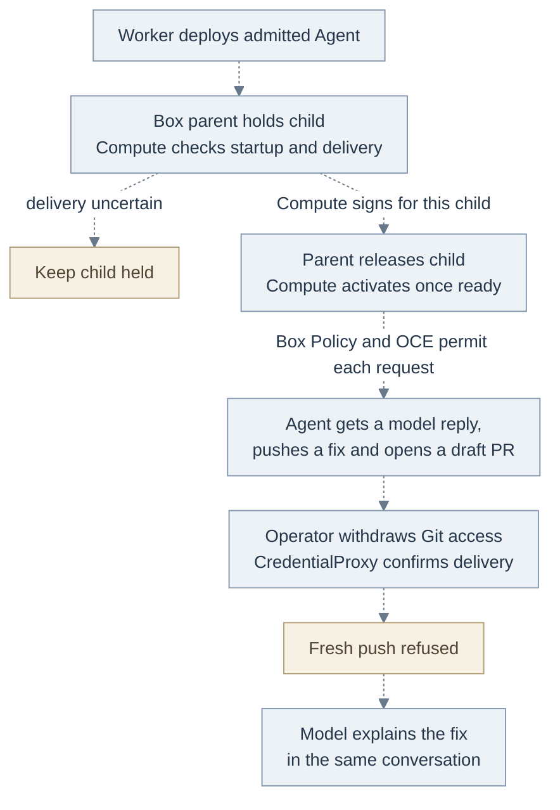

# Strands Box protected execution

**Human review and manual human merge required.**

- **ID:** RFC-20261118-strands-box
- **Created:** 2026-11-18
- **RFC PR:** [#6505](https://github.com/openclaw/openclaw-enterprise/pull/6505)
- **Implementation plan:** [TASK-0053](../../plans/0053-strands-box-convergence.md)
- **Related:** [RFC-0023: Credential Proxy and credential lifecycle](../0023-egress-proxy-credential-lifecycle/index.md)

## Decision

A Codex Agent needs permission to push a fix to GitHub. Giving its shell a GitHub token would also
let any code that can read the token take it outside the Agent. We propose Strands Box as an
optional Sandbox for OpenClaw Enterprise (OCE). Box would isolate the Agent's processes and control
their network access. TokenService would issue credentials, CredentialProxy would deliver them to a
trusted Box parent, and the parent would add them to approved requests as they leave the Sandbox.
An operator could withdraw Git access after the Agent opens a draft pull request, then ask the Agent
to explain the fix in the same conversation.

**Choosing Box grants no access.** Explicit, authorized grants to the Agent determine which
routes and credentials its processes may use. No separate operator opt-in is required. The
initial isolated pilot limits where we qualify this behavior, not what the Agent may do.

The Box callback identifies the route, not the executable. Grant access to the Agent only if
every process in its Sandbox may use it. A compromised tool can push to the same permitted ref
as the shell even though neither can retrieve the token. Use separate Agents when processes
need different rights.

## Goals

- **Safe startup:** Select compatible Drivers, report startup failures, and release only the intended
  contained child after trusted delivery is current.

- **Enforceable scope:** Let every process in the selected Agent use only routes and credential
  bindings that both Box Policy and OCE permit, without exposing the credential to the child.

- **Installed journey:** Complete inference and authorized Git work on clean ARM64 Helm, then
  withdraw Git while the same conversation remains usable.

## From deployment to Git withdrawal

The proposed path below follows one Agent with separate grants for HTTP inference and Git.

1. **Hold the child until it is safe to run.** The Worker deploys the admitted Agent with the paired
   Sandbox and CredentialProxy Drivers. The Box parent starts a contained child and pauses it before
   it can run Agent code. A child that fails here may never become ready. Compute authenticates its
   status while the Pod is unready so the Worker can report a sanitized terminal failure. Before
   signing a release, Compute verifies containment, the launcher's acknowledgment for this child,
   and current policy and credential versions on the target and every instance that can serve
   protected requests (a serving copy).
   The parent verifies the release against the child's fresh challenge. A replacement needs its own
   release. Compute activates the revision only after authenticated serving status and the normal
   readiness, transport, and routing checks.
2. **Authorize each request.** The Agent asks the model for a fix, pushes the commit to its assigned
   repository, and opens a draft pull request under an explicit grant. For each protected request,
   Box Policy must permit the operation and OCE must authorize this execution to use the credential
   binding for the destination, port, method, and path. Only then may the parent replace the
   child's placeholder with the credential on a verified TLS connection to the trusted provider.
   A denial by either authority stops the request before injection.
3. **Withdraw Git and continue the conversation.** The operator removes the Git binding. CredentialProxy
   confirms withdrawal when every applicable serving copy reports and can enforce the new policy.
   A fresh push fails. A push that already passed its final check may still reach GitHub, so read
   back the ref before deciding what happened. OCE can still authorize the separate model
   binding. The next reply shows that the Agent stayed available while Git access ended.

## Interface changes

### APIs

No changes to existing public HTTP endpoints. Proposed startup, status, and release fields remain
pending agreement by the owners of v1 credential-push admission; this RFC does not select their names.

### IAM

An authorized administrator must explicitly grant the Agent the route. Injection also requires
authority to use that credential at Agent scope; who may grant that use remains open. Each binding
applies only to one authenticated current execution of the Agent revision. Before provisioning,
[admission](strands-box-agent-policy.md#decision) must
refuse mixed subjects and any restriction the Driver cannot enforce. Never reinterpret legacy,
ambiguous, or executable-specific grants as Agent-wide.

### Database entities

The Worker and State owners still need to agree how to persist and recover the identity of a held
startup. This proposal leaves the storage representation open.

### Driver contracts

Installation compares `drivers.credential_proxy.contract` with the verified package manifest's
`oce.credentialProxyContract` before loading the module. Both must select `deployment` for the new
contract. Omitting both preserves legacy Git authority. TokenService issues credentials and
CredentialProxy delivers them. The [held startup contract](strands-box-held-launch.md) builds on
Compute's Box-specific failure read and the Sandbox enrollment callback. It specifies how Compute
would authenticate a held startup through the selected Sandbox and verify delivery before release.

## Simplifications

Keeping the existing execution path does not add protected Box execution. Giving the child a token
would be simpler, but would let code inside the Sandbox retrieve it. Instead, try a native Box
parent that creates its child directly in the same Pod container. This avoids
transferring a descriptor to an independently launched receiver, which would require authenticating
both endpoints. The cost is proving isolation inside the container. Kubernetes NetworkPolicy covers
the whole Pod, so the native boundary must prevent the child from reading the parent's vault or
bypassing its injector. The [launch alternatives](strands-box-held-launch.md#delivery-alternatives-and-open-decisions)
describe the conditions for a separate receiver.
No infrastructure simplifications.

## Acceptance Criteria

For positive credential cases, start with authorized Agent grants for the route and credential
use. Bind them to the authenticated execution of that revision. Use the
normal Worker deployment, paired Drivers, and the
[companion criteria](strands-box-held-launch.md#acceptance-criteria). Use a real Box parent and child
for cases that launch a child. Use invented credentials for
containment checks; AC-5 additionally requires clean ARM64 Helm, reviewed images, and authorized
model-provider and GitHub access. Verify each criterion through the supported workflow with integration
or reproducible manual evidence from its real dependencies.

- **AC-0 — Contract selection** ([Safe startup](#goal-startup)): Deploy with matching and incompatible
  credential-proxy package selections. Observe successful selection for a matching package and refusal
  before module load for an incompatible package, with no child, module loads, or factory calls.

- **AC-1 — Startup failure** ([Safe startup](#goal-startup)): Cause a contained child to fail while its
  Pod is unready. Observe Compute authenticate the status and the Worker report a sanitized terminal
  failure; the revision must not activate.

- **AC-2 — Current delivery** ([Safe startup](#goal-startup)): Deploy with one stale serving copy.
  Observe that the child remains held and no release is signed until every required copy is current.
  Failed delivery or an unknown reply must not be reported as successful delivery.

- **AC-3 — Replacement** ([Safe startup](#goal-startup)): Replace the held child and present the old
  release. Observe its rejection, then authenticate and release the new startup before activation.

- **AC-4 — Admitted scope** ([Enforceable scope](#goal-scope)): In the
  [isolated pilot](strands-box-agent-policy.md#acceptance-criteria), give the Agent both grants
  without a separate opt-in. Have two real subprocesses use the same route and binding. Verify
  both injections at a trusted origin and that neither process can retrieve the credential.
  With Box selected but neither grant, require no access to that route or credential. Independently
  deny the operation in Box Policy and revoke the binding in OCE; either must stop a fresh
  protected request before injection or forwarding.

- **AC-5 — Installed journey** ([Installed journey](#goal-journey)): Run separate withdrawal and expiry
  journeys, each starting with a fresh Git grant. Obtain a real HTTP model reply, push an authorized
  commit, open a draft pull request, and read back both Git effects at GitHub. After the journey's
  confirmed withdrawal or expiry, require a fresh push denial, an unchanged GitHub ref, and a
  successful next model turn in the same conversation. Reconcile any unknown push or draft-creation
  effect at GitHub without replaying it; a rejected withdrawal is incomplete.

All five milestones in [TASK-0053](../../plans/0053-strands-box-convergence.md) are pending. V1
covers HTTP API-key inference and refuses personal access tokens, interactive login, and WebSocket
credential delivery. The plan requires installed and provider evidence in addition to source checks.
Missing prerequisites leave the affected criteria unverified.
