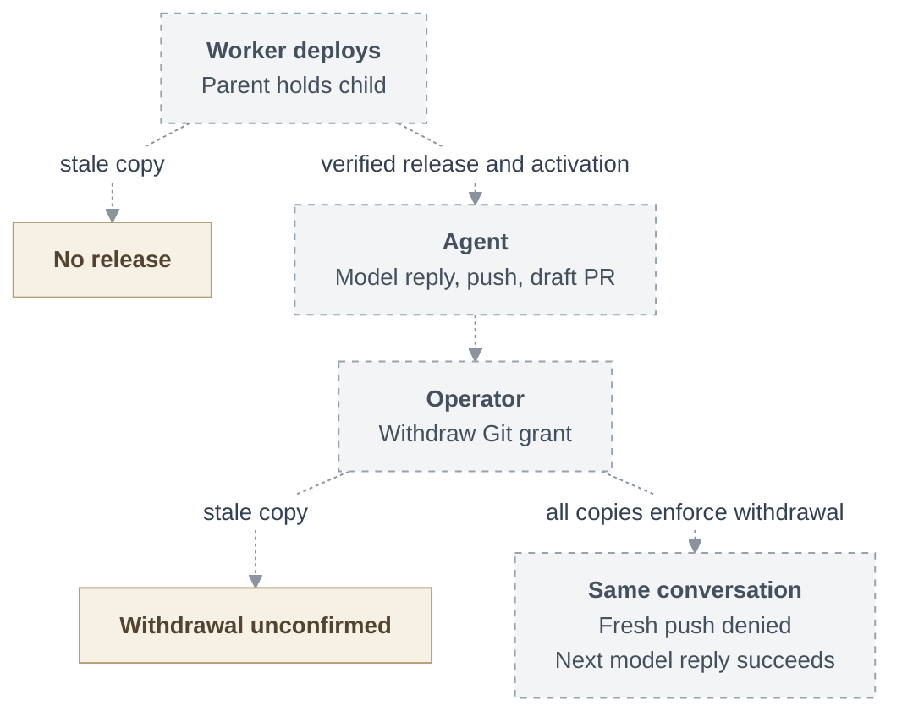

# Strands Box protected execution

**Human review and manual human merge required.**

- **ID:** RFC-20261118-strands-box
- **Created:** 2026-11-18
- **Last updated:** 2026-11-22
- **RFC PR:** [#6505](https://github.com/openclaw/openclaw-enterprise/pull/6505)
- **Implementation plan:** [TASK-0053](../../plans/0053-strands-box-convergence.md)
- **Related:** [RFC-0023: Credential Proxy and credential lifecycle](../0023-egress-proxy-credential-lifecycle/index.md)

## Summary

After a Codex Agent pushes a fix and opens a draft pull request, an operator should be able to
withdraw Git access and continue the conversation. We propose separate
model and Git grants for an Agent in Strands Box. A trusted parent would add credentials to
authorized requests. No process in the Agent's execution context may read, reconstruct or
exfiltrate a reusable credential.

## Motivation

A shell can export a readable key. Even with the key hidden, every process can use the granted
route because Box cannot identify the caller's executable. Use separate Agents for processes
with different rights.

| Path                                                                                                                                                         | Who holds the credential?                   | Evidence and limits                                                                                                                                                                               |
| ------------------------------------------------------------------------------------------------------------------------------------------------------------ | ------------------------------------------- | ------------------------------------------------------------------------------------------------------------------------------------------------------------------------------------------------- |
| Merged in-Pod Sandbox ([#6370](https://github.com/openclaw/openclaw-enterprise/pull/6370), [listener TLS](https://github.com/openclaw/openclaw/pull/201499)) | Codex can read the key by default.          | Helm model turns, replacement refusal, files and memory on ARM with the [Box #482 container agent](https://github.com/strands-agents/box/pull/482). Stock Box lacks this dependency.              |
| [Draft preview #6948](https://github.com/openclaw/openclaw-enterprise/pull/6948), off by default                                                             | Separate trusted supervisor container       | Two callers shared a placeholder in component checks (`a27c810`). Both received HTTP 401 with the masked invented key. Installed inference with a real key, Git and withdrawal remain unverified. |
| Protected execution proposed here                                                                                                                            | Native Box parent supervising its own child | Not implemented. The separate-host Git demonstration cannot qualify any of these paths.                                                                                                           |

### Interim preview for a dedicated Codex API key

**May every contained process exercise all the dedicated key's
authority at `POST https://api.openai.com/v1/responses`?** Callers control headers, query and body,
including model selection, provider tools and remote MCP servers. A compromised tool could ask the
trusted provider to send Agent data to such a server and incur charges. No spend cap is verified.
Approval would cover Responses authority alone. The same credential secrecy requirement applies.

`policy.network.experimentalOpenAiModelCredential` requires a dedicated least-privilege provider
identity and dedicated Codex with `api_key` authentication. Allow only that public HTTPS route on
port 443. Refuse aliases, managed plugins and standalone search. Only the supervisor mounts the
key read-only. Box reads `env://OPENAI_API_KEY`, supplies a fresh placeholder per execution and
substitutes the key on egress. Refuse missing or malformed placeholders.

Stop the old execution, confirm retirement, rotate the provider key, then deploy the new Agent
revision. If retirement is uncertain, hold deployment.

## Goals

- **Safe startup.** Release only the intended child after verified delivery.

- **Enforceable scope.** Authorize operations and credential use separately without exposing credentials.

- **Installed journey.** End Git access independently of inference on ARM64 Helm.

## Proposal

Dashed arrows show the proposed sequence.

1. The parent holds the child before Agent code runs. TokenService issues credentials.
   CredentialProxy pushes them and checks receipts for exact policy and credential versions
   on the target and every copy that can serve requests.
2. Compute checks authenticated status, containment, delivery and the launcher's acknowledgment
   before signing. The parent verifies the release against this child's identity and fresh challenge.
   Activation requires authenticated serving status, readiness, transport and routing checks.
3. For each request, Box Policy must permit the operation. OpenClaw Enterprise must authorize
   this execution's credential use for the source, destination, port, method and path. Only then
   may the parent replace the placeholder over verified TLS to a trusted provider.
4. CredentialProxy confirms withdrawal only when every applicable copy reports and enforces
   the exact new version. Rejected withdrawal remains incomplete. A push past its final check
   can still start after confirmation. Reconcile unknown GitHub effects by reading
   back the ref or draft without replay.

## Interface changes

### APIs

No changes to public HTTP endpoints. The v1 credential-push admission owners must agree on
startup, status and release fields.

### IAM

Selecting Box grants nothing. An authorized administrator grants the Agent a route. Who may
separately grant credential use remains open. No additional opt-in applies. Bind access to one
authenticated current execution of the Agent revision per Sandbox. [Admission](strands-box-agent-policy.md#decision)
rejects ambiguous or mixed subjects and unenforceable restrictions before provisioning. Never
widen legacy or executable-specific grants. Prefer local checks where policy permits. Preserve
required online authorization and exact dispatch guarantees.

### Database entities

No changes. Worker and State owners must decide how to persist and recover startup identity.

### Driver contracts

Protected execution requires `deployment` in Installation's `drivers.credential_proxy.contract`
and the verified manifest's `oce.credentialProxyContract`. Omitting both preserves legacy Git authority. Paired
Sandbox and CredentialProxy Drivers support [held startup](strands-box-held-launch.md).
V1 supports HTTP API-key inference and refuses personal access tokens, interactive login and
WebSocket credential delivery.

## Simplifications

The supervisor preview requires restarts for rotation and supports neither Credential Sources
nor Git. It cannot meet AC-5. Direct launch removes descriptor transfer and [authentication of a separate
receiver](strands-box-held-launch.md#delivery-alternatives-and-open-decisions). NetworkPolicy
covers the whole Pod, so we must prove the child cannot inspect the parent's vault or bypass
injection inside their shared container. No infrastructure simplifications.

## Acceptance Criteria

Record [integration or reproducible manual evidence](strands-box-held-launch.md#acceptance-criteria)
through Installation, Worker and the paired Drivers. Use real Box processes, invented credentials
for containment and both Agent grants for authorized requests.

- **AC-0** ([Startup](#goal-startup)). Deploy both valid selections. Incompatible selections
  produce zero module loads, factory calls or children.

- **AC-1** ([Startup](#goal-startup)). Fail the child while the Pod is unready. Compute authenticates
  status. Worker reports sanitized terminal failure without activation.

- **AC-2** ([Startup](#goal-startup)). Leave one copy stale or lose a delivery reply.
  Require no signed release until readback confirms every version.

- **AC-3** ([Startup](#goal-startup)). Replace the child. Reject the old release and binding.
  Require fresh authentication and release before activation.

- **AC-4** ([Scope](#goal-scope)). In the [isolated pilot](strands-box-agent-policy.md#acceptance-criteria),
  verify injection at a trusted origin for two subprocesses sharing one route and binding.
  Neither can retrieve the credential. Deny either permission independently and both together.
  Require zero injections or forwarded protected requests.

- **AC-5** ([Journey](#goal-journey)). On clean ARM64 Helm with reviewed images and authorized
  providers, obtain a real reply, push to the assigned repository and open a draft. Read back
  both at GitHub. Test confirmed withdrawal and expiry separately with fresh grants. Require
  a fresh push of a different commit to fail authorization. Verify an unchanged ref and another
  reply in the same conversation.

## Delivery and verification

[TASK-0053](../../plans/0053-strands-box-convergence.md#ordered-pull-requests) maps AC-0–AC-5 to five pending
milestones. All remain unverified. Separately qualify the preview with an installed
Codex reply, key disclosure checks and denied requests inside Box.
