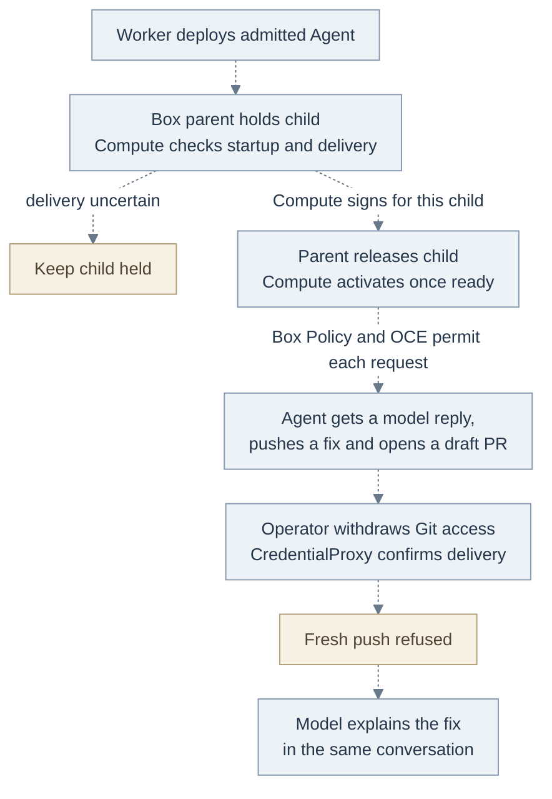

# Strands Box protected execution

**Human review and manual human merge required.**

- **ID:** RFC-20261118-strands-box
- **Created:** 2026-11-18
- **RFC PR:** [#6505](https://github.com/openclaw/openclaw-enterprise/pull/6505)
- **Implementation plan:** [TASK-0053](../../plans/0053-strands-box-convergence.md)
- **Related:** [RFC-0023: Credential Proxy and credential lifecycle](../0023-egress-proxy-credential-lifecycle/index.md)

## Decision

A Codex Agent needs permission to push a fix to GitHub. Giving its shell a GitHub token would also
let any code that can read the token take it outside the Agent. We propose Strands Box as an
optional Sandbox for OpenClaw Enterprise (OCE). Box would isolate the Agent's processes and control
their network access. TokenService would issue credentials, CredentialProxy would deliver them to a
trusted Box parent, and the parent would add them to approved requests as they leave the Sandbox.
An operator could withdraw Git access after the Agent opens a draft pull request, then ask the Agent
to explain the fix in the same conversation.

**Opt in only when every process in this Agent may use every admitted route and credential binding.**
The selected Box callback identifies the route a request takes but cannot identify the executable
that sent it. In the initial isolated pilot, the operator explicitly selects one authenticated
execution of one Agent revision as the principal. A shell and a tool can both push to the same
permitted ref. A compromised tool can make that push even though it cannot retrieve the token.
Use separate Agents when the processes need different rights.

## From deployment to Git withdrawal

The proposed path below follows one Agent with separate grants for HTTP inference and Git.

1. **Hold the child until it is safe to run.** The Worker deploys the admitted Agent with the paired
   Sandbox and CredentialProxy Drivers. The Box parent starts a contained child and pauses it before
   it can run Agent code. A child that fails here may never become ready. Compute authenticates its
   status while the Pod is unready so the Worker can report a sanitized terminal failure. Before
   signing a release, Compute verifies containment, the launcher's acknowledgment for this child,
   and current policy and credential versions on the target and every instance that can serve
   protected requests (a serving copy).
   The parent verifies the release against the child's fresh challenge. A replacement needs its own
   release. Compute activates the revision only after authenticated serving status and the normal
   readiness, transport, and routing checks.
2. **Authorize each request.** The Agent asks the model for a fix, pushes the commit to its assigned
   repository, and opens a draft pull request under an explicit grant. For each protected request,
   Box Policy must permit the operation and OCE must authorize this execution to use the credential
   binding for the destination, port, method, and path. Only then may the parent replace the
   child's placeholder with the credential on a verified TLS connection to the trusted provider.
   A denial by either authority stops the request before injection.
3. **Withdraw Git and continue the conversation.** The operator removes the Git binding. CredentialProxy
   confirms withdrawal when every applicable serving copy reports and can enforce the new policy.
   A fresh push fails. A push that already passed its final check may still reach GitHub, so read
   back the ref before deciding what happened. OCE can still authorize the separate model
   binding. The next reply shows that the Agent stayed available while Git access ended.

## Interface changes

### APIs

No changes to public HTTP endpoints. The owners of v1 credential-push admission must agree on public
startup, status, and release fields before implementation selects names.

### IAM

An authorized administrator must delegate the route at Agent scope. Injection also needs separate,
reviewed authority for the Agent to use the credential at that scope. Admission must refuse grants
that mix Agent-wide and executable-specific subjects, and any executable, port, or other restriction
the selected Driver cannot enforce. The [Agent-wide policy](strands-box-agent-policy.md)
defines these checks under the existing RFC-0023 protection levels.

### Database entities

No changes.

### Driver contracts

Installation compares `drivers.credential_proxy.contract` with the verified package manifest's
`oce.credentialProxyContract` before loading the module. Both must select `deployment` for the new
contract. Omitting both preserves legacy Git authority. TokenService issues credentials and
CredentialProxy delivers them. The [held startup contract](strands-box-held-launch.md) builds on
Compute's Box-specific failure read and the Sandbox enrollment callback. It specifies how Compute
would authenticate a held startup through the selected Sandbox and verify delivery before release.

## Simplifications

Keeping the existing execution path does not add protected Box execution. Giving the child a token
would be simpler, but would let code inside the Sandbox retrieve it. Instead, try a native Box
parent that creates its child directly in the same Pod container. This avoids
transferring a descriptor to an independently launched receiver, which would require authenticating
both endpoints. The cost is proving isolation inside the container. Kubernetes NetworkPolicy covers
the whole Pod, so the native boundary must prevent the child from reading the parent's vault or
bypassing its injector. The [launch alternatives](strands-box-held-launch.md#delivery-alternatives-and-open-decisions)
describe the conditions for a separate receiver.

## Acceptance Criteria

Use the normal Worker deployment and the [companion criteria](strands-box-held-launch.md#acceptance-criteria).

- **AC-0 through AC-3 — Select and release the intended child.** Refuse incompatible packages before
  module load. Report a validated startup failure from an unready Pod. Keep the child held if one
  serving copy is stale. After replacement, reject the previous release and verify the new startup
  before activation.
- **AC-4 — Prove the admitted scope.** In the [isolated pilot](strands-box-agent-policy.md#acceptance-criteria),
  have two real subprocesses use the same route and binding. Verify both injections at a trusted
  origin and that neither process can retrieve the test credential. Independently deny the operation
  in Box Policy and revoke the binding in OCE. Each must prevent a fresh protected request from
  reaching the provider.
- **AC-5 — Verify the result on clean ARM64 Helm.** With reviewed images and authorized provider
  access, obtain a real HTTP model reply. Read back the pushed commit and draft pull request at
  GitHub. After confirmed Git withdrawal, verify a fresh push is refused and the next model turn
  succeeds in the same conversation.

All five milestones in [TASK-0053](../../plans/0053-strands-box-convergence.md) are pending. V1
covers HTTP API-key inference and refuses personal access tokens, interactive login, and WebSocket
credential delivery. The plan requires installed and provider evidence in addition to source checks.
