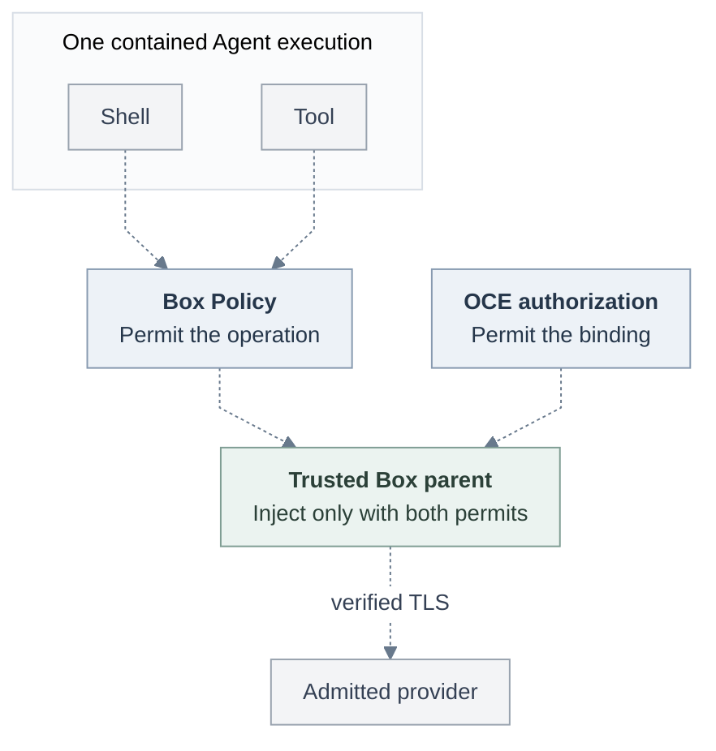

# Agent-wide Box policy for protected execution

Companion to [RFC-20261118-strands-box](index.md).

At Box commit `956764b58f2c5ccb12bb7048fd1ced3d8ca1b5d4`, the callback identifies a route within a
Box but cannot identify the calling executable. We propose to qualify explicit grants to the Agent
in an isolated pilot. Implementation and qualification are pending.

## Decision

**The grant names the principal.** Choosing Box or participating in the pilot grants no access.
An authorized administrator must explicitly delegate the route to the Agent. Credential injection
also needs separate, reviewed authority for the Agent to use that credential. No extra operator
selection is required. The [choice of credential-use authority](index.md#iam) is pending.

Grant access at Agent scope only if **every process in the Sandbox may use it**. A compromised
shell, tool, or Model Context Protocol (MCP) server could push an allowed ref, spend model quota,
or send data over an allowed route without learning the credential. Use separate Agents with
distinct Sandbox identities and policies when their trust or access differs.

Before provisioning, check the complete effective policy against the selected Sandbox Driver:

- Never widen legacy, ambiguous, or executable-specific grants to Agent scope, even in combination.
  Preserve existing scope where enforceable; refuse ambiguous subjects.
- Treat an Agent-wide grant as overlapping every executable restriction on the route. Refuse mixed
  subjects in the pilot. Refuse any executable, port, or other restriction the Driver cannot enforce.
  Executable-specific enforcement needs separate qualification.
- Require Driver support for the granted scope and the selected RFC-0023 protection level.
  Preserve that level's admission, connection, dispatch, authorization, and evidence requirements,
  including exact dispatch or online request authorization.

At startup, bind access to exactly one authenticated current execution of the Agent revision per
Sandbox. A replacement needs its own binding even for the same revision. The grants do not override
expiry, withdrawal, or either permission below.

## Policy and credential boundary

In the proposed pilot, both subprocesses below can use the same binding. Each credentialed request
needs two independent permissions.

- **Box Policy authorizes the operation.** The Sandbox authors and installs Policy from admitted
  declarations and prevents bypass. Only Policy can permit network, shell, or filesystem operations.
  Deny each operation unless a Policy rule explicitly permits it. Missing Policy denies access.
  Floor restrictions can only deny. Refuse unsupported representations.
- **OpenClaw Enterprise (OCE) authorizes credential use.** IAM and applicable repository or source
  policy must authorize the current Agent execution, credential source, destination, port, HTTP
  method, and path. Binding and injection require both permissions. The trusted parent replaces a
  binding-specific placeholder from its vault only on an admitted HTTP request. Its injector checks
  the execution, origin, port, method, path, and credential presentation, verifies upstream TLS,
  refuses dangerous redirects, and blocks known disclosures in responses and diagnostics.

Limit credentialed origins to trusted providers. Protection assumes an uncompromised host kernel and
a provider that does not maliciously encode or reflect the credential.

## Startup, withdrawal, and audit

Apply the [release and withdrawal rules](strands-box-held-launch.md#ownership-and-release) and
[containment requirements](strands-box-held-launch.md#trust-boundary). An Agent-wide grant confers
no release authority. Attribute admission, use, denial, version changes, and withdrawal to the Agent
execution and granted scope. Omit secrets and executable attribution from audit records.

## Acceptance criteria

Broader release requires qualification through the normal deployed Agent, actual Box callback, and
trusted injector. Grant the Agent the route and credential use without a separate opt-in. Use an
invented sentinel for one binding. In one contained execution, run two
distinct real subprocesses against the **same route and binding**. An independently observed trusted
origin must distinguish and accept both requests. Independently verify injection of the sentinel on
each. Both processes must be unable to read or retrieve it.

| Exercise                                                                                                                                                                            | Required observation                                                                                                                                                                                 |
| ----------------------------------------------------------------------------------------------------------------------------------------------------------------------------------- | ---------------------------------------------------------------------------------------------------------------------------------------------------------------------------------------------------- |
| Select Box in the same pilot with neither grant for the test route and credential. Separately omit each grant.                                                                      | No route grant: deny the route. No credential-use grant: no binding or injection, even if Box Policy permits the route. With neither, verify both refusals.                                          |
| Present legacy, ambiguous, and executable-only grants separately, then combine executable grants.                                                                                   | None confers Agent-wide access. Preserve enforceable legacy scope, exact dispatch, and online authorization.                                                                                         |
| Try an ambiguous subject, mixed subjects (including overlapping grants), an unsupported scope, and an unenforceable executable or port restriction separately.                      | Refuse each before provisioning; verify zero provisioning calls.                                                                                                                                     |
| Replace the execution of the same revision and try the old binding. Separately try another Agent or the wrong route, destination, port, method, or path.                            | Refuse each request at the enforcing layer. Only a fresh binding for the replacement permits its authorized request; the previous execution remains denied.                                          |
| Keep Box Policy permissive and revoke the binding. Separately withdraw credential policy and read back its effective version from every serving copy. Separately remove Box Policy. | Refuse a fresh request in each case. Stale or missing delivery readback keeps startup held.                                                                                                          |
| Deny an application request on a permitted proxy connection.                                                                                                                        | Record TCP establishment separately. At the enforcing proxy, verify zero denied application-request bytes forwarded toward the origin. Require zero unauthorized injections and provider operations. |
| Try a forbidden destination or port, then direct egress.                                                                                                                            | Require zero connections to the forbidden destination or port and zero direct connections.                                                                                                           |
| Probe trusted control and release interfaces from the workload.                                                                                                                     | Across **all** refusals, require zero protected-material disclosures, control mutations, and unauthorized releases. Apply any stronger requirements of the selected protection level.                |

Results cover only the tested source, runtime, and deployment.
[TASK-0053](../../plans/0053-strands-box-convergence.md) owns installed qualification.
