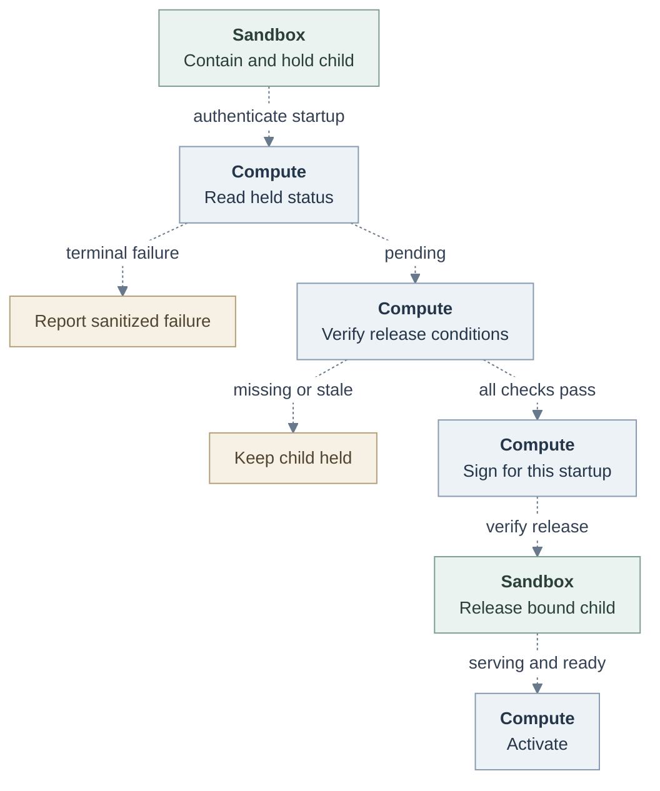

# Hold protected startup until the trusted delivery is current

Companion to [RFC-20261118-strands-box](index.md).

## Problem and decision

A failed startup can leave the Worker waiting until the deployment deadline. At commit
`962a41087083053b585b477d4791f8aded6a9f4e`,
[Kubernetes Compute](../../../apps/controller/src/drivers/compute/kubernetes/index.ts) checks
`providerHarnessReady` before reading provider
[Harness status](../../../packages/contracts/src/drivers/sandbox/index.ts). Protected enrollment
(`enrollHarness`) can run earlier. Reporting a validated failure through `harnessStatus` requires
[exactly one matching live Pod with `Ready=True`](../../../docs/reference/drivers/kubernetes-compute.md#sandbox-provisioning).
A Pod that fails while held may never pass that check. Box Sandbox support was absent at this
baseline.

Let Compute authenticate the target and ask the selected Sandbox why startup is held **before** the
Pod becomes ready. A scoped observation can report pending or a sanitized terminal failure. Only
Compute can authorize release, and only for the startup whose containment and credential delivery it
verified. Activation still requires authenticated serving status and the normal workload, transport,
and routing checks. Bypassing Pod readiness globally could expose an untrusted workload.

## CredentialProxy contract selection

For `credential_proxy`, compare the Installation setting `drivers.credential_proxy.contract` with
`oce.credentialProxyContract` in the pinned, verified installed package manifest. Each defaults to
legacy when absent. The rule applies only to this Driver category and manifest key.

| Check                    | Required decision                                                                                                                                                                                                                                                                                                                           |
| ------------------------ | ------------------------------------------------------------------------------------------------------------------------------------------------------------------------------------------------------------------------------------------------------------------------------------------------------------------------------------------- |
| Selection                | With both fields omitted, use the legacy contract and its Git binding authority. Deployment requires the literal value `'deployment'` in both fields. Never infer the contract from names, IDs, or methods, or fall back to legacy.                                                                                                         |
| Before module load       | Refuse malformed, unsupported, or mismatched inputs, a missing required declaration, or an incompatible Sandbox/CredentialProxy pair. Require **zero module loads and factory calls**, even if a legacy package has the expected deployment ID.                                                                                             |
| After factory invocation | The manifest declares compatibility. It cannot attest to or contain factory code. Validate the returned view and identifiers. For a defective result, require **one factory call, zero caller provisioning, and zero credential use by callers**. Refuse the result, run existing cleanup, and record partial or uncertain factory effects. |

Installation, Compute preparation, and the normal Worker must consume the typed deployment view from
the same selected CredentialProxy registration. Prohibit unchecked casts and second owners. Preserve
the [Installation's credential ownership](../0023-egress-proxy-credential-lifecycle/installation-credential-ownership.md), delivery profiles,
and legacy Git authority. Current registration rejects a deployment-only CredentialProxy. This
selection mechanism is proposed.

## Ownership and release

| Owner                                | Responsibility                                                                                                                                                                                       |
| ------------------------------------ | ---------------------------------------------------------------------------------------------------------------------------------------------------------------------------------------------------- |
| OpenClaw Control Plane (OCC) and IAM | OCC owns metadata and Agent bindings. IAM admits credential use.                                                                                                                                     |
| TokenService                         | Commit source values and versions, retain issuer keys and refresh grants, and issue or renew credentials.                                                                                            |
| CredentialProxy                      | Commit effective credential policy. Deliver versions and withdrawals to the trusted target. Read back each serving copy.                                                                             |
| Compute                              | Manage Agent revision Pods, storage, placement, and lifecycle. Interpret generic startup status and sign the release.                                                                                |
| Sandbox                              | Isolate processes and networks, enforce mandatory egress, hold the workload, and authenticate observation and release over private transport. The native parent would enforce these controls in Box. |
| Harness                              | Own the Agent process and conversation after release. Source resolution stays with the credential owners.                                                                                            |

The proposed Worker path separates observing, releasing, and activating a startup.

1. **Observe.** Through regular Worker preparation, Compute establishes the authorized scope of the
   read. Sandbox authenticates the observation against the Agent revision, target incarnation,
   process instance, and fresh startup challenge. Compute validates terminal diagnostics against
   that identity. Missing, forged, stale, foreign, ambiguous, or unauthenticated status keeps
   startup held.
2. **Release.** CredentialProxy confirms the expected policy and credential version on the target
   and every applicable serving copy. The trusted launcher acknowledges installation of the reviewed
   projections for that same startup. Compute rechecks tool, network, proxy, and workload conditions
   before signing. Sandbox must verify the release against the full startup identity. A transport
   bearer alone confers no release authority.
3. **Maintain protection.** Loss of authorization, revocation, expiry, replacement, companion loss,
   or an unreadable current version blocks release and further protected use. CredentialProxy
   acknowledges a push, policy change, rotation, or withdrawal only after every applicable serving
   copy reports the effective version and can enforce it. Missing, stale, foreign, or ambiguous
   readback leaves delivery unconfirmed. A failed push leaves the committed source version
   authoritative. A rejected withdrawal is incomplete.
4. **Recover.** After Worker loss or a lost reply, observe the current incarnation and delivery
   state before adoption or release. Never replay an operation with an unknown effect or fall back
   to direct egress.

**Walkthrough.** The launcher installs the projections, but its acknowledgment is lost. When the
Worker checks again, it finds a replacement child. That child must reject the old challenge,
projections, acknowledgment, and release. Compute must verify delivery and installation against the
replacement’s fresh challenge before signing.

## Trust boundary

In the native experiment, one trusted Box parent directly starts its trampoline and contained Codex
child in the same Agent Pod container. Kubernetes NetworkPolicy applies to the Pod as a whole.
Qualify the native boundary before protected use.

| Boundary            | Sandbox requirement                                                                                                                                                                                                                                                                                                                                                                                                  |
| ------------------- | -------------------------------------------------------------------------------------------------------------------------------------------------------------------------------------------------------------------------------------------------------------------------------------------------------------------------------------------------------------------------------------------------------------------- |
| Process and network | Bind launch provenance, inherited state, and the fresh challenge to the intended child. Qualify user, mount, PID, and network namespaces, restricted filesystem, and seccomp. Isolate control interfaces. Block loopback, direct DNS, direct upstream connections, and raw-socket bypasses.                                                                                                                          |
| Files and trust     | Pin the parent's live configuration and Policy files. Refuse writable aliases. Grant the child read-only access to the same pinned public CA object. Copying its bytes loses object identity. Keep the CA signing key in trusted memory.                                                                                                                                                                             |
| Credential custody  | The parent owns the vault and HTTP injector. Limit the child to reviewed filesystem grants, public trust material, and opaque placeholders without retrieval or release authority. Protect user secrets, GitHub App keys and installation tokens, model keys, PATs, issuer and broker material, private configuration, proxy controls, release authority, reusable ingress bearers, and other privileged identities. |
| Disclosure paths    | Prevent access through inherited descriptors, process inspection, file aliases, environment, arguments, mounts, shared state, home, temporary directories, persistent volumes, Pod manifests, logs, output, authentication or control endpoints, proxies, and redirects.                                                                                                                                             |

Apply
[Box Policy and independent OCE credential authorization](strands-box-agent-policy.md#policy-and-credential-boundary).
The [Agent-wide pilot](strands-box-agent-policy.md#decision) requires separate admission. Enforce
any asserted executable or port restriction or refuse the policy.

## Acceptance Criteria

Extend maintained integration coverage through the real Agent workflow.

| Criterion                            | Required evidence                                                                                                                                                                                                                                                                                                                                                                 |
| ------------------------------------ | --------------------------------------------------------------------------------------------------------------------------------------------------------------------------------------------------------------------------------------------------------------------------------------------------------------------------------------------------------------------------------- |
| AC-0 — Contract selection (P0)       | Exercise real OCC Installation setup, default installed-package loading, and Worker/Compute. Verify both valid selections, legacy Git success and refusal with the selector omitted, and the same typed deployment owner throughout. Check each [selection decision](#credentialproxy-contract-selection), including the call counts, cleanup, and refusal to infer or fall back. |
| AC-1 — Held observation              | Read pending and validated terminal status from an unready Pod without activation. Reject forged, cross-revision, stale-incarnation, and replacement reports.                                                                                                                                                                                                                     |
| AC-2 — Release                       | Prove the [release sequence](#ownership-and-release) through authenticated serving and activation. Exercise each blocking condition, including one stale peer, and reject attempts to use the launcher’s authority for another startup. Reconcile failed pushes and lost replies.                                                                                                 |
| AC-3 — Launch authority              | Through the native caller and child, verify provenance, process binding, file identities, read-only CA access, and cleanup. Refuse substitution, replacement, stale release, unintended descriptor inheritance, and writable aliases. Apply the endpoint checks below if transferring a descriptor.                                                                               |
| AC-4 — Containment and compatibility | Probe the [trust boundary](#trust-boundary) with invented sentinels. Verify Box Policy permit, deny, and absence independently of OCE admission. Exercise the [pilot criteria](strands-box-agent-policy.md#acceptance-criteria), including executable and port restrictions. Preserve OpenShell success, refusal, readiness, and exposure withdrawal.                             |
| AC-5 — Installed qualification       | Complete the [clean ARM64 Helm journey](../../plans/0053-strands-box-convergence.md#outcome-and-scope) with exact reviewed source and images, independent provider readback, and the [installation checks](../../plans/0053-strands-box-convergence.md#ordered-pull-requests).                                                                                                    |

## Delivery, alternatives, and open decisions

Submit this RFC for human review before changing Driver contracts. Agree on public startup,
status, and release fields with the incumbent v1 push-admission owners before choosing names. Those
owners retain the public fields. Keep Box internals in the paired Drivers. Their registration, the
real callback and trusted recipient, generic observation and release, delivery, independent review,
and provider and installed qualification remain pending.

**Conditional descriptor transfer.** Direct child creation avoids a separate receiver bootstrap. If
a future design introduces an independently launched receiver, the installer or runtime must
authenticate both exact endpoint incarnations on the live connection using independent trust, or
independently provision an authenticated preconnected channel for that pair. Before transfer, prove
refusal of substitute listeners, foreign first connectors, stale or cross-run peers, and unbound
same-UID processes. A UID, mode-0700 directory, peer-supplied image digest, in-band nonce, or
observed PID or pidfd alone cannot establish the expected identities.
[Box #482](https://github.com/strands-agents/box/pull/482) checks the UID and lacks this proof.
Kubernetes bootstrap for that design is unresolved. A separate trusted proxy Pod and stronger node
isolation are future options requiring qualification.

## Changelog

- 2026-11-18 — Propose a generic held-start observation and release boundary for TASK-0053.
- 2026-11-19 — Select the unqualified native Box parent experiment and make descriptor-transfer requirements conditional.
