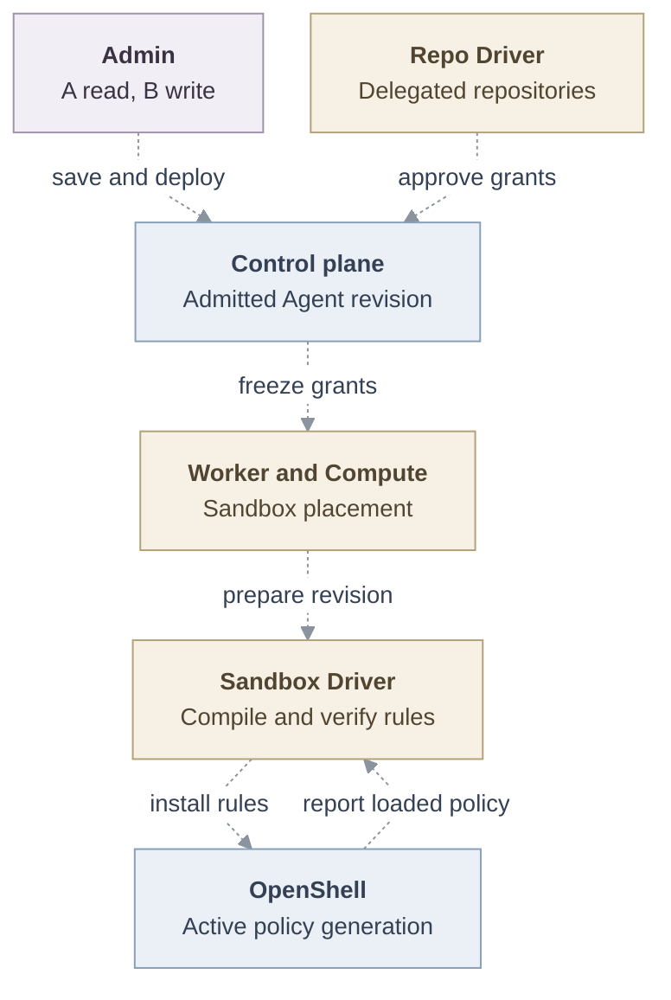
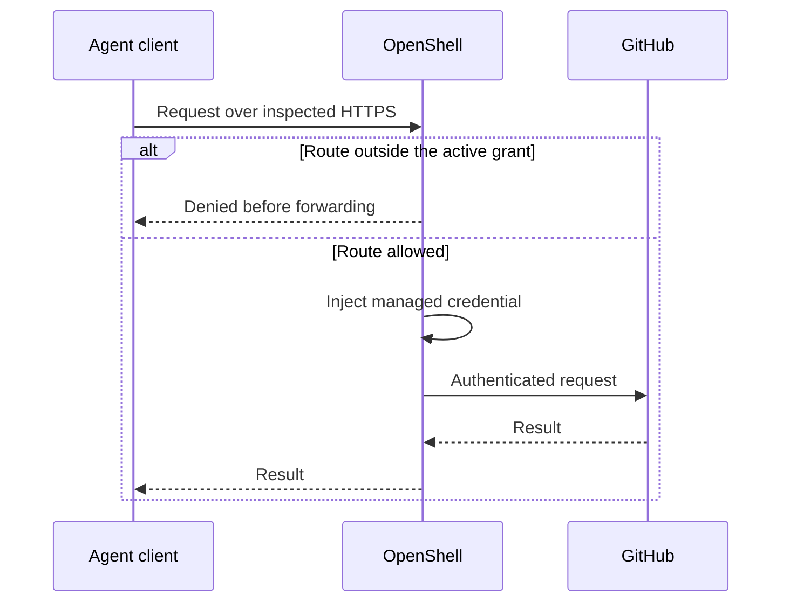

# Proposal: Per-Agent repository network policy

- **ID:** RFC-20261119-repository-network-policy
- **Created:** 2026-11-19
- **Last updated:** 2026-11-20
- **RFC PR:** [#6531](https://github.com/openclaw/openclaw-enterprise/pull/6531), originally submitted under RFC-0017.
- **Related:** [Agent egress](0017-agent-egress-0x/index.md), [Driver configuration](0022-driver-configuration-contributions.md), [repository credentials](../../docs/reference/repository-credentials.md).

## Summary

An Admin grants an Agent read access to A, write access to B and no access to C, even when its credential covers all three repositories. At deployment, the Sandbox Driver compiles native OpenShell rules and the Credential Proxy stages a managed credential outside the Agent. OpenShell checks each Git request and injects the credential without asking OCE or its Worker to authorize that request. Separate REST grants can let the Agent read issues in A and open a PR in B; restrictions on PR bodies require a trusted check outside the network matcher.

## Motivation

The current [SandboxPolicy](../../docs/reference/sandbox-policies.md) grants access by binary, host and port. A, B and C share a host. The [installation-scoped Provider](../../apps/controller/src/drivers/egress-proxy/openshell-prepared-git-provider.ts) imports wildcard Git and API routes, and OpenShell combines matching allows. Adding a narrower rule leaves the wildcard effective. The Driver must replace it and verify the policy OpenShell actually loaded.

## Goals

- **G1. Enforce Git grants for every client through native OpenShell rules.** A push to A or a request to C stops before the origin receives HTTP; allowed Git operations work without a per-request OCE authorization callback.
- **G2. Bind access to the deployed Agent revision.** An Admin can withdraw grants and verify retirement of the old Sandbox without affecting a peer.
- **G3. Support issue reads and pull requests through REST.** A bundled skill uses explicitly authorized routes. Git-only grants stay API-denied across upgrades.

## Non-goals

Repository grants cover inspected HTTPS. Branch-specific grants, GraphQL and credential issuance are outside this decision. Preserve [existing profiles](../../docs/reference/repository-credentials/access-levels.md), stronger ref and operation restrictions, and the legacy credential lifecycle. Installation grants depend on App coverage, selected `github-repository` grants retain their token permissions, and `git-and-draft-pr` retains its approved draft and refs. A network grant can narrow existing credential authority; it cannot widen it or replace a stronger grant with repository-wide access.

## Proposal

### Architecture

The proposed deployment path binds one saved policy version to one Agent revision. Dashed arrows show the new grant checks.

1. **Save.** OpenClaw Control Plane (OCC) checks the caller and Driver support, including on the first save of `[]` (deny all). The Repo Driver intersects Installation delegation with canonical [Namespace registrations](../../apps/controller/src/drivers/repo/github/access/registry.ts). Read requires an allowed profile with Contents read or write. Repository-wide write requires existing Contents write authority without a narrower push-ref restriction. App coverage alone cannot admit an unregistered repository. An absent policy preserves legacy behavior; an explicit empty list remains deny-all.
2. **Deploy.** OCC freezes the grants, credential source and delivery path after rechecking permissions and delegation. The Worker rechecks the actor and Driver support before dispatch. Admit native Git only if OpenShell can enforce every restriction of the selected source. Refuse an incompatible selection without switching delivery. The Sandbox Driver replaces the Git Provider’s wildcard and verifies the full loaded policy and generation against the revision. Refuse broader sibling rules, stale or uncertain policy, a changed source, opaque TLS and direct routes around inspection. For `[]`, omit the Provider or refuse launch.
3. **Withdraw.** Saving changes desired access. A downgrade completes once every Sandbox with the old grant has retired. If support is lost, allow authorized grant removal and Stop. If redeployment cannot enforce the withdrawal, the operator must Stop and verify retirement. Retire affected Sandboxes before workspace reuse or repository rename, transfer, deletion or path reuse.

### Request lifecycle

Proposed native Git flow after release, with a valid managed credential already attached. No OCE request authorizer participates.

**Git.** On the exact verified Git origin, read allows GET `/{owner}/{repo}.git/info/refs?service=git-upload-pack` and POST `/{owner}/{repo}.git/git-upload-pack`. Write adds the corresponding `git-receive-pack` requests without requiring an assigned branch. Reject mixed services, ambiguous paths, aliases and redirects. The [stock matcher](https://github.com/NVIDIA/OpenShell/blob/v0.1.8/crates/openshell-supervisor-network/data/sandbox-policy.rego#L761-L817) accepts HEAD for GET, repeated identical service values and extra keys. Check their effects under AC-3.

**REST.** Set [`scopedRest: "v1"`](https://github.com/openclaw/openclaw-enterprise/pull/6716) on each participating `github-repository` Namespace registration, rebind and deploy. On `https://api.github.com/repos/{owner}/{repo}`, allow only the routes below. Recheck redirects before forwarding. Native network rules constrain the origin, repository, method and path; they do not inspect JSON bodies. Enable [PR creation](https://docs.github.com/en/rest/pulls/pulls#create-a-pull-request) only through a separately qualified trusted-hook path that verifies a same-repository head, including `head_repo`, rejects issue conversion (`issue`), and preserves the selected grant’s approved base, head and draft restrictions. Disable creation if that check is unavailable.

| Operation                           | Scoped Git-only       | Scoped Git and REST                                       |
| ----------------------------------- | --------------------- | --------------------------------------------------------- |
| Fetch / push                        | Fetch A and B, push B | Same Git grants                                           |
| GET `/issues` or `/issues/{number}` | Denied                | Repository read or write and Issues read                  |
| POST `/pulls`                       | Denied                | Repository write and Pull requests write, normal or draft |

Bundle the [`github-repository-rest` skill](https://github.com/openclaw/openclaw-enterprise/pull/6658) with the Agent runtime. The operator enables it per Sandbox revision. It uses stock `gh api repos/OWNER/REPO/issues` for reads. For an explicitly requested normal PR it sends one `curl` POST with redirects and retries disabled, since `gh` can resend a POST on 307/308. If the outcome is uncertain, check GitHub. Never automatically repeat the write. Draft-only grants use the existing ref-constrained client. Every client faces the same policy.

**Credential ownership.** Token Service owns custody and renewal for its sources. OCC authorizes bindings and withdrawal. The [Credential Proxy](../../docs/reference/drivers/credential-proxy.md) delivers the managed credential to OpenShell, which injects it on an allowed request. The Agent receives a placeholder. Refuse an expired or withdrawn credential. Keep stronger grants on their existing delivery path until equivalent enforcement is verified.

**Existing protected delivery.** When the [credential path](../../docs/reference/repository-credentials/protected-openshell-git.md) requires recipient proof, the held Sandbox sends a credential-free, one-use nonce through an admitted upload-pack discovery route. The hook binds the proof to the Sandbox, workspace, binding, path and generation and denies the probe before forwarding. This check protects credential delivery. Native Git policy needs no startup challenge of its own. The legacy authorizer retains its 1 MiB upload-pack and 4 MiB receive-pack request limits.

## Interface changes

### APIs

Under `/namespaces/{namespaceId}/agents/{agentId}`, extend the existing [routes](../../packages/contracts/src/api/routes.ts) and [policy schemas](../../packages/contracts/src/api/sandbox-policy.ts). The policy path below is `/sandbox-policy/networking`.

| Change  | Operation                                        | Behavior and contract change                                                                                                                                                                                                       |
| ------- | ------------------------------------------------ | ---------------------------------------------------------------------------------------------------------------------------------------------------------------------------------------------------------------------------------- |
| Changed | PUT policy, POST policy `/validate`              | Add optional `repositoryNetworkPolicy`, a list of `{ repository, access }` with `read` or `write`. Keep `expectedVersion`. Omission preserves the saved value, including absence for legacy Agents. Preview checks without saving. |
| Changed | GET policy                                       | Return saved grants and version, Driver capability, deployed revision, active generation and enforcement state.                                                                                                                    |
| Changed | POST `/deploy`, `/deploy-first`, policy `/apply` | Deploy admits the saved list. Refuse live apply when the saved or active revision has a list.                                                                                                                                      |

### IAM

| Operation                          | Required permission and scope                                                                                                                         | What changes                                                                                                                      |
| ---------------------------------- | ----------------------------------------------------------------------------------------------------------------------------------------------------- | --------------------------------------------------------------------------------------------------------------------------------- |
| Read / edit                        | Read requires `read` on the Agent and its SandboxPolicy. Validate and save require enabled editing, Agent `manage_policy` and SandboxPolicy `update`. | Reuse [exact-resource checks](../../docs/reference/sandbox-policies.md#authority-and-admission).                                  |
| Deploy with a list, including `[]` | Agent `deploy` and `manage_policy`, SandboxPolicy `read` and `update`                                                                                 | Compose existing permissions and [recheck the actor](../../apps/controller/src/worker.ts) at dispatch. Stop uses Agent `operate`. |

### Database entities

| Entity                                                                                | Change                                       | Persistence semantics                                                   |
| ------------------------------------------------------------------------------------- | -------------------------------------------- | ----------------------------------------------------------------------- |
| [`occ.sandbox_policies.document`](../../migrations/0058_sandbox_policies.sql)         | Extend the JSON validator and version guard. | Preserve absence, `[]` and nonempty lists across unrelated edits.       |
| [`occ.agent_revisions.admitted_spec`](../../packages/occ/src/state/postgres-state.ts) | Snapshot the list in `sandbox_policy`.       | Immutable per revision. Refuse dispatch through an incompatible reader. |

### Driver contracts

- [Repo](../../packages/contracts/src/drivers/repo/index.ts) resolves each canonical repository and approves its access level. [Compute](../../packages/contracts/src/drivers/compute/index.ts) admits a placement that can enforce the frozen grants.
- [Sandbox](../../docs/reference/drivers/sandbox.md#optional-network-policy-operations) advertises support and admits the revision. Its OpenShell adapter compiles the rules, replaces the Provider wildcard and verifies the active policy. The Credential Proxy stages the selected owner’s credential for the admitted revision. Native Git uses the installed credential locally.

## Simplifications

The smallest Git delivery reuses the policy editor, revision snapshot, managed Provider and OpenShell matcher. It needs no repository ACL service or per-request OCE authorization. REST qualifies separately because PR body restrictions need trusted enforcement. No existing credential infrastructure is retired.

## Acceptance Criteria

Use a disposable installed OpenShell environment, an authorized Admin and regular saved Agents. Record the revision, policy generation, client outcome, origin observations and OCE authorization-callback attempts. Identify a controlled origin or live GitHub for each result.

- **AC-1 (G1).** Register A/B/C and select one broad synthetic credential valid for all three. Confirm the callback counter increments on a legacy request. Disable only the Worker’s Git authorization callback and reset the counter. Through the admin API, save and deploy a permissive native policy. Verify a normal A push, A receive-pack discovery and direct RPC, and discovery and direct RPC for both C services reach the origin. Count discovery and RPC separately. On the same Agent, save A read/B write, omit C and redeploy with the same credential and client. Clone and fetch A/B, push B and verify the remote commit by fresh fetch. Repeat every forbidden operation and require an OpenShell denial with zero upstream HTTP sends. The callback counter must stay at zero throughout both native phases.
- **AC-2 (G2).** With the Git callback still unavailable, downgrade B to read and redeploy the same Agent. Require zero callback attempts. Verify retirement, fresh fetch, a distinct denied push, zero forbidden HTTP and an unchanged remote ref. Repeat A push and C denials. Save `[]`, make an unrelated edit, verify persistence and redeploy. Prove retirement and launch refusal or denial of previously allowed discovery/RPC before forwarding. If deploy is refused, Stop and prove retirement. Check unsupported first save, lost authority and authorized withdrawal. In a separate control with the callback available, verify legacy fetch on an Agent with policy omitted.
- **AC-3 (G1, G3).** In Git-only mode, calibrate observation with permitted traffic. Require direct REST and GraphQL denials with zero upstream HTTP. Exercise direct TLS/IP, matcher variants, mixed services, aliases and redirects. Any unauthorized forwarding or credential disclosure blocks release.
- **AC-4 (G2).** At save and deploy, reject an unregistered App-covered path and write above the Namespace or selected credential ceiling. Refuse release for a missing or invalid managed credential, changed source, broader overlapping rule, stale generation or unverifiable loaded policy. For protected delivery that requires a probe, verify it reaches the hook under the final rules with zero origin requests. Refuse replay, stale proof and wrong recipients. Verify existing ref and draft restrictions.
- **AC-5 (G2).** Independently admit a peer in a separate workspace and verify its permitted operations after the first Agent’s downgrade. Preserve singleton preview admission and verify retirement before workspace reuse. Shared placement requires separate proof of recipient isolation.
- **AC-6 (G3).** Through the bundled skill’s documented clients, read A’s issue list and detail, create one normal PR in B and independently verify its number, repository, head, base and draft status. Verify draft-only access with the existing ref-constrained client. Deny A creation, all C access, fork heads, issue conversion, issue writes and GraphQL before forwarding. Verify that the trusted hook enforces body restrictions for direct clients and refuses creation when unavailable. Verify redirects and continued API denial after a Git-only upgrade or without REST authorization. On a revision with both grants, disable the REST hook and repeat the native Git allow/deny checks. Git must still work with zero Git callback attempts while PR creation is refused.

## Delivery and verification

Develop Git and REST in parallel. Require installed AC-1–AC-5 for native Git and AC-6 for REST. Keep existing Agents on their current credential delivery until equivalent protections pass. Controlled-origin runs provide partial evidence:

- [#6588 at `9cc39e2e`](https://github.com/openclaw/openclaw-enterprise/pull/6588) passed 1/1 on stock OpenShell 0.1.8 in k3d. Direct Provider installation with a broad managed credential proved native Git fetch, B push, pre-origin A/C denial and B downgrade against a controlled origin without an OCE request authorizer. The permissive control ran outside OpenShell. Saved-Agent deployment was outside this test.
- [#6764 at `c94ba932`](https://github.com/openclaw/openclaw-enterprise/pull/6764) passed 46/46 on k3d. It exercised saved-Agent Git, downgrade, retirement, a separate peer and selected REST operations. Allowed requests still used the [legacy Worker authorization callback](https://github.com/openclaw/openclaw-enterprise/blob/c94ba932c5ea7f9be4669fcaafe6ce47ee8fdf82/apps/controller/src/drivers/egress-proxy/openshell-online-git-authority.ts#L212-L217), and the peer used a distinct credential. This is workflow evidence, not acceptance of native network-only Git or the same-credential permissive control.
- [#6658](https://github.com/openclaw/openclaw-enterprise/pull/6658) reports 49/49 on a composed amd64 build with the skill and #6764. It exercised opt-in discovery, direct skill commands, redirect denial and one confirmed normal PR. It does not qualify the native Git path. Model selection of the skill, final runtime images and live GitHub remain unverified.

## Rationale and alternatives

Token permissions alone cannot express different network grants for Agents sharing installation coverage. A CLI wrapper leaves other clients unconstrained. A per-request Worker authorizer could enforce Git policy, but it adds an online dependency the native OpenShell matcher does not need. REST PR body restrictions still require a trusted validator.
