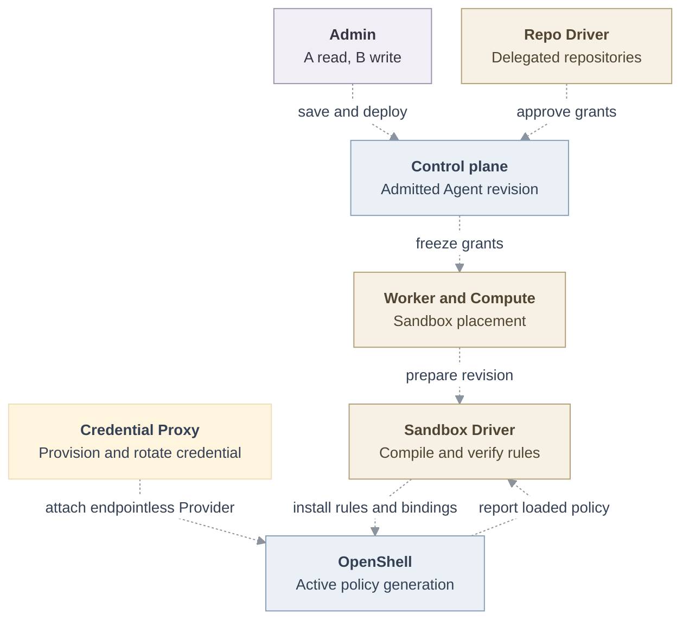
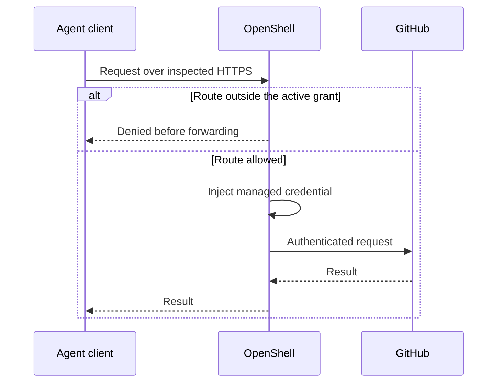

# Proposal: Per-Agent repository network policy

- **ID:** RFC-20261119-repository-network-policy
- **Created:** 2026-11-19
- **Last updated:** 2026-11-21
- **RFC PR:** [#6531](https://github.com/openclaw/openclaw-enterprise/pull/6531), originally submitted under RFC-0017.
- **Related:** [Agent egress](0017-agent-egress-0x/index.md), [Driver configuration](0022-driver-configuration-contributions.md), [repository credentials](../../docs/reference/repository-credentials.md).

## Summary

An Admin grants an Agent read access to A, write access to B and no access to C, even when its credential covers all three. The Sandbox Driver owns every repository network rule and credential binding. The Credential Proxy provisions and rotates an endpointless OpenShell Provider. OpenShell authorizes Git and injects the credential locally. Opted-in issue reads stay local. Separately authorized REST creation requires a trusted POST validator; v2 adds issue creation.

## Motivation

The current [SandboxPolicy](../../docs/reference/sandbox-policies.md) grants access by binary, host and port. A, B and C share a host. The [installation-scoped Provider](../../apps/controller/src/drivers/egress-proxy/openshell-prepared-git-provider.ts) imports wildcard Git and API routes, and OpenShell combines matching allows. Adding a narrower rule leaves the wildcard effective. An endpointless Provider lets the Sandbox policy be the sole source of network access.

## Goals

- **G1. Enforce Git grants for every client through native OpenShell rules.** A push to A or a request to C stops before the origin receives HTTP; allowed Git operations work without a per-request OCE authorization callback.
- **G2. Bind access to the deployed Agent revision.** An Admin can withdraw grants and verify retirement of the old Sandbox without affecting a peer.
- **G3. Support issue reads, issue creation and pull requests through REST.** A bundled skill uses explicitly authorized routes. Git-only grants stay API-denied across upgrades.

## Non-goals

Repository grants cover inspected HTTPS. Branch-specific grants, GraphQL and credential issuance are outside this decision. Preserve [existing profiles](../../docs/reference/repository-credentials/access-levels.md), stronger ref and operation restrictions, and the legacy credential lifecycle. Installation grants depend on App coverage, selected `github-repository` grants retain their token permissions, and `git-and-draft-pr` retains its approved draft and refs. A network grant can narrow existing credential authority; it cannot widen it or replace a stronger grant with repository-wide access.

## Proposal

### Architecture

The proposed deployment path binds one saved policy version to one Agent revision. Dashed arrows show the new grant checks.

1. **Save.** OpenClaw Control Plane (OCC) checks the caller and Driver support, including on the first save of `[]` (deny all). The Repo Driver intersects Installation delegation with canonical [Namespace registrations](../../apps/controller/src/drivers/repo/github/access/registry.ts). Read requires an allowed profile with Contents read or write. Repository-wide write requires existing Contents write authority without a narrower push-ref restriction. App coverage alone cannot admit an unregistered repository. An absent policy preserves legacy behavior; an explicit empty list remains deny-all.
2. **Deploy.** OCC rechecks authority and freezes grants, source and delivery path. The Worker checks the actor and Drivers before dispatch. Refuse native Git if a source restriction requires online authorization. Verify the loaded policy and active generation before release. For `[]`, omit the Provider or refuse launch.
3. **Withdraw.** Saving changes desired access. A downgrade completes once every Sandbox with the old grant has retired. If support is lost, allow authorized grant removal and Stop. If redeployment cannot enforce the withdrawal, the operator must Stop and verify retirement. Retire affected Sandboxes before workspace reuse or repository rename, transfer, deletion or path reuse.

### Request lifecycle

The Credential Proxy attaches a Provider whose profile has `endpoints: []`. The Sandbox Driver writes each inspected repository endpoint and sets [`credential_binding.provider`](https://docs.nvidia.com/openshell/v0.1.8/how-it-works/providers/profiles#understand-static-credential-endpoint-binding) to that attached instance. Scope the endpoint selector to the repository path and set enforcement to `ENFORCE`. Its rules constrain methods and Git service queries. Read back the complete effective policy and bindings, including sibling Providers. Rotation must preserve zero Provider endpoints and the exact Sandbox grants.

Proposed Git flow after deployment:

**Git.** On the exact verified Git origin, read allows GET `/{owner}/{repo}.git/info/refs?service=git-upload-pack` and POST `/{owner}/{repo}.git/git-upload-pack`. Write adds the corresponding `git-receive-pack` requests without requiring an assigned branch. Reject mixed services, ambiguous paths, aliases and redirects. The [stock matcher](https://github.com/NVIDIA/OpenShell/blob/v0.1.8/crates/openshell-supervisor-network/data/sandbox-policy.rego#L761-L817) accepts HEAD for GET, repeated identical service values and extra keys. Check their effects under AC-3.

### What can the Agent do on GitHub?

Under v1, the Agent can **list and read issues** through GitHub’s REST API and, with a separate write opt-in, **open pull requests**. Each operation requires the Agent’s repository grant and corresponding GitHub permission. For example, suppose the Namespace enables issue reads and PR creation for A and B. The Admin gives this Agent read access to A, write access to B, and no access to C.

| Agent action                          | A (read) | B (write) | C (no grant) |
| ------------------------------------- | -------- | --------- | ------------ |
| Clone or fetch code                   | Yes      | Yes       | No           |
| List issues or read one issue         | Yes      | Yes       | No           |
| Push a branch                         | No       | Yes       | No           |
| Open a PR (draft or ready for review) | No       | Yes       | No           |
| Create an issue (v2 only)             | No       | Yes       | No           |

**Enabling API access.** With `nativeGit: "v1"`, set [`scopedRest: "v1"`](https://github.com/openclaw/openclaw-enterprise/pull/6716) per `github-repository` Namespace registration, then rebind and redeploy. Issue reads require **Issues: read** or write and work on stock OpenShell 0.1.8 without OCE callbacks. Native creation additionally requires explicit write opt-in (currently `nativeRestWrites: true`), a supplier qualified for pre-credential method filtering, and a dedicated POST-only validator registration. Stock 0.1.8 lacks that support. PR creation requires network Write and **Pull requests: write**. Without write opt-in, v1 is read-only; without REST, native delivery is Git-only. PR merges and GraphQL remain outside both versions.

**Follow-up after v1.** [`scopedRest: "v2"`](https://github.com/openclaw/openclaw-enterprise/pull/6864) retains independently authorized v1 issue reads, constrained PR creation and their protections; it adds issue creation. Require qualified POST validation, write opt-in, network Write and independently approved **Issues: write**. Rebind and redeploy without widening authority. Admit only `POST /repos/{owner}/{repo}/issues`; validate nonblank string `title`, optional string `body` and no unknown fields before credential use. v1 denies issue creation.

**Why PR creation needs a body check.** For v1 we propose letting an Agent open a fresh PR between branches in B while keeping C inaccessible and issues read-only. GitHub’s [create endpoint](https://docs.github.com/en/rest/pulls/pulls#create-a-pull-request) accepts a fork head or converts an issue on the same POST with the same permission. OpenShell can restrict the destination to B. Only the body identifies the source and any issue to convert.

OpenShell locally enforces issue collection and numbered-detail GET routes under the authorized repository on `api.github.com`. With native writes enabled, it admits the exact PR POST and dispatches only authorized POSTs to the trusted validator before credential injection. Require unqualified head and base branches; reject `head_repo` and `issue`. Recheck redirected destinations. If the validator is unavailable, refuse REST creation while native Git and issue reads continue without OCE callbacks. If the supplier cannot isolate the validator to POST, leave native writes disabled. Legacy protected profiles retain their existing hooks, startup probes and stronger restrictions.

Codex discovers the [bundled skill](https://github.com/openclaw/openclaw-enterprise/pull/6658) automatically. It teaches stock `gh api` and grants no access. Use a JSON file with `--input` for writes, and verify the remote result before retrying. Draft-only grants retain their ref-constrained client.

### Which delivery paths need an OCE hook?

| Delivery path                                            | Startup nonce | OCE check on a request                                    |
| -------------------------------------------------------- | ------------- | --------------------------------------------------------- |
| Proposed native Git, with optional issue reads           | None          | None. OpenShell enforces the bound routes.                |
| Proposed native Git with PR or v2 issue creation         | None          | POST body only. Git and issue reads stay local.           |
| Existing protected `git-write`                           | Required      | Exact ref and optional `git-and-draft-pr` restrictions.   |
| Existing protected `github-repository` (legacy delivery) | Required      | Worker checks each permitted request against the binding. |
| Existing `github-installation` preview                   | Required      | Worker hook in the single-Sandbox workspace.              |

Native attachment binds a credential to an endpoint. The [existing protected paths](../../docs/reference/repository-credentials/protected-openshell-git.md) also require proof that a request from the held launcher reaches the authenticated Worker hook before credential release. The launcher sends a one-use nonce on an admitted discovery path. The hook binds it to the Sandbox, workspace, binding, path and generation. The launcher must receive the matching denial before release, with zero upstream requests. Preserve these paths and their limits (1 MiB upload-pack, 4 MiB receive-pack) for existing grants. Token Service retains custody and renewal for its sources. The Agent receives a placeholder.

## Interface changes

### APIs

Under `/namespaces/{namespaceId}/agents/{agentId}`, extend the existing [routes](../../packages/contracts/src/api/routes.ts) and [policy schemas](../../packages/contracts/src/api/sandbox-policy.ts). The policy path below is `/sandbox-policy/networking`.

| Change  | Operation                                        | Behavior and contract change                                                                                                                                                                                                       |
| ------- | ------------------------------------------------ | ---------------------------------------------------------------------------------------------------------------------------------------------------------------------------------------------------------------------------------- |
| Changed | PUT policy, POST policy `/validate`              | Add optional `repositoryNetworkPolicy`, a list of `{ repository, access }` with `read` or `write`. Keep `expectedVersion`. Omission preserves the saved value, including absence for legacy Agents. Preview checks without saving. |
| Changed | GET policy                                       | Return saved grants and version, Driver capability, deployed revision, active generation and enforcement state.                                                                                                                    |
| Changed | POST `/deploy`, `/deploy-first`, policy `/apply` | Deploy admits the saved list. Refuse live apply when the saved or active revision has a list.                                                                                                                                      |

### IAM

| Operation                          | Required permission and scope                                                                                                                         | What changes                                                                                                                      |
| ---------------------------------- | ----------------------------------------------------------------------------------------------------------------------------------------------------- | --------------------------------------------------------------------------------------------------------------------------------- |
| Read / edit                        | Read requires `read` on the Agent and its SandboxPolicy. Validate and save require enabled editing, Agent `manage_policy` and SandboxPolicy `update`. | Reuse [exact-resource checks](../../docs/reference/sandbox-policies.md#authority-and-admission).                                  |
| Deploy with a list, including `[]` | Agent `deploy` and `manage_policy`, SandboxPolicy `read` and `update`                                                                                 | Compose existing permissions and [recheck the actor](../../apps/controller/src/worker.ts) at dispatch. Stop uses Agent `operate`. |

### Database entities

| Entity                                                                                | Change                                       | Persistence semantics                                                   |
| ------------------------------------------------------------------------------------- | -------------------------------------------- | ----------------------------------------------------------------------- |
| [`occ.sandbox_policies.document`](../../migrations/0058_sandbox_policies.sql)         | Extend the JSON validator and version guard. | Preserve absence, `[]` and nonempty lists across unrelated edits.       |
| [`occ.agent_revisions.admitted_spec`](../../packages/occ/src/state/postgres-state.ts) | Snapshot the list in `sandbox_policy`.       | Immutable per revision. Refuse dispatch through an incompatible reader. |

### Driver contracts

- [Repo](../../packages/contracts/src/drivers/repo/index.ts) resolves each canonical repository, approves its access level and supports explicit `scopedRest: "v2"` registration. [Compute](../../packages/contracts/src/drivers/compute/index.ts) admits a placement that can enforce the frozen grants.
- [Sandbox](../../docs/reference/drivers/sandbox.md#optional-network-policy-operations) compiles repository routes, sets explicit Provider bindings and verifies the active policy. [Credential Proxy](../../docs/reference/drivers/credential-proxy.md) provisions and rotates the attached endpointless Provider. Its profile contributes zero network allowances.

## Simplifications

The smallest Git delivery reuses the policy editor, revision snapshot, managed Provider and OpenShell matcher. It needs no repository ACL service or per-request OCE authorization. REST qualifies separately because PR body restrictions need trusted enforcement. No existing credential infrastructure is retired.

## Acceptance Criteria

Use a disposable installed OpenShell environment, an authorized Admin and regular saved Agents. Record the revision, policy generation, client outcome, origin observations and OCE authorization-callback attempts. Identify a controlled origin or live GitHub for each result.

- **AC-1 (G1).** Register A/B/C and select one broad synthetic credential valid for all three. Confirm the callback counter increments on a legacy request. Disable only the Worker’s Git authorization callback and reset the counter. Through the admin API, save and deploy a permissive native policy. Verify a normal A push, A receive-pack discovery and direct RPC, and discovery and direct RPC for both C services reach the origin. Count discovery and RPC separately. On the same Agent, save A read/B write, omit C and redeploy with the same credential and client. Clone and fetch A/B, push B and verify the remote commit by fresh fetch. Repeat every forbidden operation and require an OpenShell denial with zero upstream HTTP sends. The callback counter must stay at zero throughout both native phases.
- **AC-2 (G2).** With the Git callback still unavailable, downgrade B to read and redeploy the same Agent. Require zero callback attempts. Verify retirement, fresh fetch, a distinct denied push, zero forbidden HTTP and an unchanged remote ref. Repeat A push and C denials. Save `[]`, make an unrelated edit, verify persistence and redeploy. Prove retirement and launch refusal or denial of previously allowed discovery/RPC before forwarding. If deploy is refused, Stop and prove retirement. Check unsupported first save, lost authority and authorized withdrawal. In a separate control with the callback available, verify legacy fetch on an Agent with policy omitted.
- **AC-3 (G1, G3).** In Git-only mode, calibrate observation with permitted traffic. Require direct REST and GraphQL denials with zero upstream HTTP. Exercise direct TLS/IP, matcher variants, mixed services, aliases and redirects. Any unauthorized forwarding or credential disclosure blocks release.
- **AC-4 (G2).** At save and deploy, reject an unregistered App-covered path and write above the Namespace or selected credential ceiling. Before release and after rotation, verify zero Provider endpoints, exact Sandbox bindings and the active generation. Refuse missing or invalid credentials, unexpected source changes, wrong bindings, broader sibling allows, opaque TLS and stale or unverifiable policy. Repeat AC-1 after rotation with no startup nonce or Git callback. For protected delivery that requires a probe, verify it reaches the hook under the final rules with zero origin requests. Refuse replay, stale proof and wrong recipients. Verify existing ref and draft restrictions.
- **AC-5 (G2).** Independently admit a peer in a separate workspace and verify its permitted operations after the first Agent’s downgrade. Preserve singleton preview admission and verify retirement before workspace reuse. Shared placement requires separate proof of recipient isolation.
- **AC-6 (G3, v1).** With explicit native-write opt-in and qualified POST-only validation, use the bundled skill’s clients to read A’s issue list and detail, create one normal PR in B and independently verify its number, repository, head, base and draft status. Verify draft-only access with the existing ref-constrained client. Deny A creation, all C access, fork heads, issue conversion, issue writes and GraphQL before forwarding. Verify that the trusted hook enforces body restrictions for direct clients and refuses creation when unavailable. Verify redirects and continued API denial after a Git-only upgrade or without REST authorization. On a revision with both grants, disable the REST hook and repeat the native Git allow/deny checks. Git and issue reads must succeed without OCE callbacks while PR creation is refused.
- **AC-7 (G3, v2).** Create B’s issue with stock `gh api`; independently read number/title/body. Verify issue reads/constrained PR creation through that v2 binding. Hold B’s v2 registration, native-write opt-in and network Write fixed; deny valid POST under Issues-read-only authority before origin; approved scope unchanged. Deny A/C, downgraded B, v1, invalid direct-client bodies/unknown fields and validator outage.

## Delivery and verification

Develop Git and REST in parallel. Require installed AC-1–AC-5 for native Git, AC-6 for REST v1 and AC-7 for the v2 follow-up. Keep existing Agents on their current credential delivery until equivalent protections pass. Controlled-origin runs provide partial evidence:

- [#6588](https://github.com/openclaw/openclaw-enterprise/pull/6588) established the earlier stock OpenShell Git control with a directly attached Provider.
- A disposable k3d run with a method-filter-capable supplier passed saved-Agent Git, issue reads, PR and v2 issue creation, rotation and downgrade. Readback confirmed both writes; forbidden and validator-outage writes never reached the origin. Git and reads added no callbacks. Stock mixed writes, live GitHub, redirects and v1-only installation remain unqualified.

## Rationale and alternatives

Token permissions alone cannot express different network grants for Agents sharing installation coverage. A CLI wrapper leaves other clients unconstrained. A per-request Worker authorizer could enforce Git policy, but it adds an online dependency the native OpenShell matcher does not need. REST creation body restrictions still require a trusted validator.
