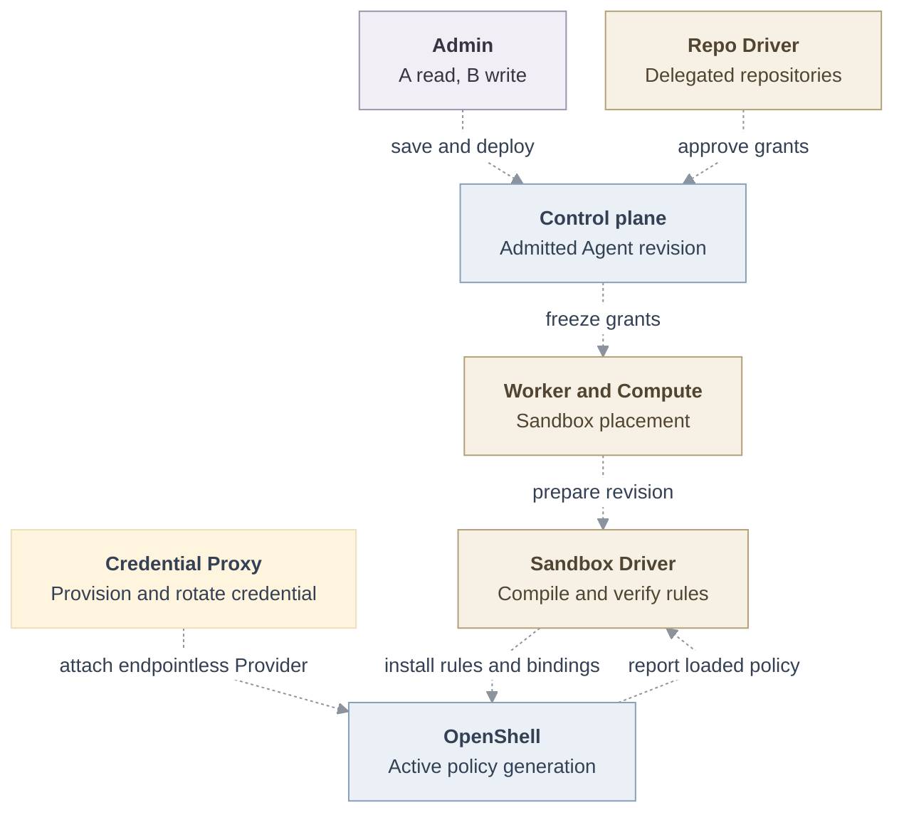
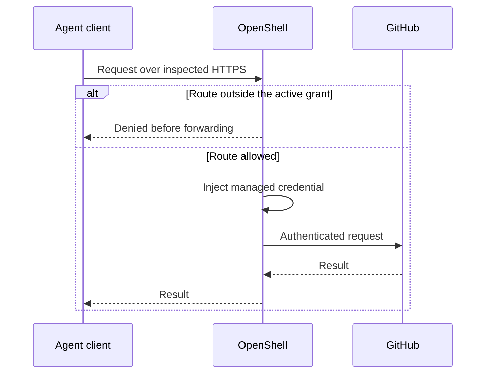

# Proposal: Per-Agent repository network policy

- **ID:** RFC-20261119-repository-network-policy
- **Created:** 2026-11-19
- **Last updated:** 2026-11-23
- **RFC PR:** [#6531](https://github.com/openclaw/openclaw-enterprise/pull/6531), originally submitted under RFC-0017.
- **Related:** [Agent egress](0017-agent-egress-0x/index.md), [Driver configuration](0022-driver-configuration-contributions.md), [repository credentials](../../docs/reference/repository-credentials.md).

## Summary

An Admin grants an Agent Read on A, Write on B and no direct access to C. On native delivery, OpenClaw Enterprise (OCE) compiles those grants at deployment and renews the credential. **OpenShell checks each request inside the Sandbox.** It refuses disallowed routes before forwarding and replaces the Agent’s placeholder with the credential on allowed routes. GitHub applies the credential’s permissions. OCE sees no requests.

## Motivation

A host grant cannot distinguish A, B and C. OpenShell combines matching allows, so adding narrower rules leaves the [installation Provider’s](../../apps/controller/src/drivers/egress-proxy/openshell-prepared-git-provider.ts) wildcard routes effective. An endpointless Provider leaves network access to the Sandbox policy.

## Goals

- **G1. Enforce Git grants for all admitted clients through native OpenShell rules.** A push to A or a request to C stops before the origin receives HTTP; allowed Git operations work without a per-request OCE authorization callback.
- **G2. Bind access to the deployed Agent revision.** An Admin can withdraw grants and verify retirement of the old Sandbox without affecting a peer.
- **G3. Support issue reads, pull request (PR) reads and PR creation through REST.** A bundled skill uses explicitly authorized routes, with no OCE service in the request path. Git-only grants still deny API access after upgrades.

## Non-goals

Repository grants cover inspected HTTPS. Preserve [existing profiles](../../docs/reference/repository-credentials/access-levels.md), including ref, draft, standing approval and installation restrictions. Grants cannot widen credential authority. [#7149](https://github.com/openclaw/openclaw-enterprise/pull/7149) separately proposes Git-only access with a fine-grained personal access token.

## Proposal

### Architecture

Native delivery binds one saved policy version to one Agent revision. Dashed arrows show deployment steps.

1. **Save.** Save the first list before the first deployment. OpenClaw Control Plane (OCC) checks each save, including Driver support for a first `[]`. The Repo Driver intersects the Installation ceiling with [Namespace registrations](../../apps/controller/src/drivers/repo/github/access/registry.ts) and selected bindings. Read requires Contents read or write. Write requires Contents write without narrower ref restrictions. Absence retains legacy delivery. An Agent previously deployed without a list needs a new Agent ID to opt in.
2. **Deploy.** OCC rechecks authority and freezes grants, source and delivery. The Worker rechecks the actor and Drivers. Native delivery requires `nativeGit: "v1"` on every binding and a [qualified dedicated Codex placement](../../docs/reference/sandbox-policies.md#repository-network-policy). Refuse launch for `[]`. Keep sources requiring online authorization off this path.
3. **Withdraw.** A downgrade completes only after every Sandbox with the old grant retires. Allow withdrawal even after Driver support is lost. If redeployment fails, Stop and verify retirement. Retire affected Sandboxes before workspace reuse or repository rename, transfer, deletion or path reuse.

### Request lifecycle

The Credential Proxy attaches a Provider whose profile has `endpoints: []`. The Sandbox Driver writes each inspected repository endpoint and sets [`credential_binding.provider`](https://github.com/ai-openshell/openshell/blob/ce58cf8e9b953281352d98a637e41616295b1318/docs/how-it-works/providers/profiles.mdx#understand-static-credential-endpoint-binding) to that attached instance. Scope the endpoint selector to the repository path and set enforcement to `ENFORCE`. Its rules constrain methods and Git service queries. Read back the complete effective policy and bindings, including sibling Providers. Rotation must preserve zero Provider endpoints and the exact Sandbox grants.

After deployment, Git clients use the following path.

**Git.** For approved executable paths on `github.com`, Read allows GET `/{owner}/{repo}.git/info/refs?service=git-upload-pack` and POST `/{owner}/{repo}.git/git-upload-pack`. Write adds the corresponding `git-receive-pack` requests without requiring an assigned branch. Reject mixed services. Normalization and redirects must preserve the grant boundary. The [stock matcher](https://github.com/ai-openshell/openshell/blob/ce58cf8e9b953281352d98a637e41616295b1318/crates/openshell-supervisor-network/data/sandbox-policy.rego#L761-L817) accepts HEAD for GET, repeated identical service values and extra keys. Check their effects under AC-3.

### What can the Agent do on GitHub?

This Agent binds A and B. Their registrations have identical permissions, including issue read and PR write. Only B has a saved Write grant. **C is unbound.**

| Agent action                          | A (read) | B (write) | C (no grant) |
| ------------------------------------- | -------- | --------- | ------------ |
| Clone or fetch code                   | Yes      | Yes       | No           |
| List issues or read one issue         | Yes      | Yes       | No           |
| List PRs or read one PR               | Yes      | Yes       | No           |
| Push a branch                         | No       | Yes       | No           |
| Open a PR (draft or ready for review) | No       | Yes       | No           |

**If C is bound without a saved grant, the Agent cannot open a PR anywhere.** The Agent keeps its permitted Git operations and REST reads. To restore creation on B, remove the binding for C and redeploy. Alternatively, grant Read on C and redeploy if the Agent needs that access. After a Worker upgrade, a Sandbox still allowing creation that these rules withhold receives no new credential. Its Git and API access end when the token expires, within an hour. Redeploy to load the current rules.

**Enable REST.** Set `nativeGit: "v1"` and `scopedRest: "v1"` on the participating `github-repository` registrations, rebind and redeploy. An unchanged REST registration with PR permissions gains eligible routes on redeployment without rebinding. Without `scopedRest`, native access stays Git-only.

The [registration and GitHub App](../../docs/reference/repository-credentials/access-levels.md#native-git-delivery) must allow `issues` for issue reads and `pull_requests` for PR reads. Creation requires `pull_requests: write` and Write on the target. Under `/repos/{owner}/{repo}`, the [rules](../../apps/controller/src/drivers/sandbox/openshell-git-network-policy.ts) allow GET on `/issues`, `/pulls` and their numbered detail paths, plus eligible POSTs to `/pulls`. Issue reads can return PRs. Issue creation, PR updates, merges and GraphQL remain unavailable.

**What creation permits.** In `POST /repos/owner/B/pulls`, the path names the destination. The rule puts no conditions on query parameters or JSON fields. GitHub’s [create endpoint](https://docs.github.com/en/rest/pulls/pulls#create-a-pull-request) allows two further actions.

- Use a readable fork as the source (`head` or `head_repo`). Its commits become visible through B’s PR ref and diff. The token covers all bindings, so the [resolver](../../apps/controller/src/drivers/repo/github/access/registry.ts) requires a grant on each before allowing creation, regardless of fork relationships.
- Convert an existing issue in B to a PR (`issue`). To prevent this, keep `pull_requests` at `read`.

The [bundled Codex skill](https://github.com/openclaw/openclaw-enterprise/pull/6658) teaches `gh api` and grants no access. Use `--input` for writes and verify the remote result before retrying.

### Which delivery paths need an OCE hook?

| Delivery path                                       | Startup nonce | OCE check on a request                                    |
| --------------------------------------------------- | ------------- | --------------------------------------------------------- |
| Native Git with optional REST reads and PR creation | None          | None while the credential is valid.                       |
| Existing protected `git-write`                      | Required      | Exact ref and optional `git-and-draft-pr` restrictions.   |
| Existing protected `github-repository`              | Required      | Worker checks each permitted request against the binding. |
| Existing `github-installation` preview              | Required      | Worker hook in the single-Sandbox workspace.              |

Native attachment binds a credential to an endpoint. The [existing protected paths](../../docs/reference/repository-credentials/protected-openshell-git.md) also require proof that a request from the held launcher reaches the authenticated Worker hook before credential release. The launcher sends a one-use nonce on an admitted discovery path. The hook binds it to the Sandbox, workspace, binding, path and generation. The launcher must receive the matching denial before release, with zero upstream requests. Preserve these paths and their limits (1 MiB upload-pack, 4 MiB receive-pack) for existing grants. Token Service retains custody and renewal for its sources. The Agent receives a placeholder.

## Interface changes

### APIs

Under `/namespaces/{namespaceId}/agents/{agentId}`, extend the existing [routes](../../packages/contracts/src/api/routes.ts) and [policy schemas](../../packages/contracts/src/api/sandbox-policy.ts). The policy path below is `/sandbox-policy/networking`.

| Operation                                        | Current behavior                                                                                                                                                                                         |
| ------------------------------------------------ | -------------------------------------------------------------------------------------------------------------------------------------------------------------------------------------------------------- |
| PUT policy                                       | To save `repositoryNetworkPolicy`, send `expectedVersion`, empty `additions` and a list of `{ repository, access }` with `read` or `write`. Omit the list to preserve it. GET shows the retained grants. |
| GET policy                                       | Return saved grants, version, capability, ceiling, save support and available deployment identifiers.                                                                                                    |
| POST `/deploy`, `/deploy-first`, policy `/apply` | Deploy admits saved grants. Refuse live apply if the saved policy or running revision contains a list.                                                                                                   |

Two proposed changes remain open. POST policy `/validate` previews only ordinary additions. GET does not report the active OpenShell generation or enforcement state.

### IAM

| Operation                          | Required permission and scope                                                                                                                                                                                                                                                         | What changes                                                                                                                      |
| ---------------------------------- | ------------------------------------------------------------------------------------------------------------------------------------------------------------------------------------------------------------------------------------------------------------------------------------- | --------------------------------------------------------------------------------------------------------------------------------- |
| Read / edit                        | Read requires `read` on the Agent and its SandboxPolicy. Saving requires enabled editing, Agent `manage_policy` and SandboxPolicy `update`. First and nonempty saves require Configuration and Harness credential source read access. Saving `[]` also requires SandboxPolicy `read`. | Reuse [exact-resource checks](../../docs/reference/sandbox-policies.md#authority-and-admission).                                  |
| Deploy with a list, including `[]` | Agent `deploy` and `manage_policy`, SandboxPolicy `read` and `update`                                                                                                                                                                                                                 | Compose existing permissions and [recheck the actor](../../apps/controller/src/worker.ts) at dispatch. Stop uses Agent `operate`. |

### Database entities

| Entity                                                                                     | Change                                       | Persistence semantics                                                                                 |
| ------------------------------------------------------------------------------------------ | -------------------------------------------- | ----------------------------------------------------------------------------------------------------- |
| [`occ.sandbox_policies.document`](../../migrations/0087_repository_network_policy.sql)     | Extend the JSON validator and version guard. | Preserve absence, `[]` and nonempty lists across unrelated edits.                                     |
| [`occ.agent_revisions.admitted_spec`](../../migrations/0087_repository_network_policy.sql) | Snapshot the list in `sandbox_policy`.       | Immutable per revision. Require a [compatible Worker](../../migrations/0090_native_git_delivery.sql). |

### Driver contracts

- The [registry](../../packages/occ/src/repository-network-policy.ts) supplies approved repositories and access levels. [Compute](../../packages/contracts/src/drivers/compute/index.ts) admits a placement that can enforce the frozen grants.
- [Sandbox](../../docs/reference/drivers/sandbox.md#optional-network-policy-operations) compiles repository routes, sets explicit Provider bindings and verifies the active policy. [Credential Proxy](../../docs/reference/drivers/credential-proxy.md) provisions and rotates the attached endpointless Provider. Its profile contributes zero network allowances.

## Simplifications

Git and REST reuse the policy editor, revision snapshot, managed Provider and OpenShell matcher. No existing credential infrastructure is retired.

## Acceptance Criteria

Use a disposable installed OpenShell environment, an authorized Admin and regular saved Agents. Record the revision, policy generation, client outcome, origin observations and OCE authorization-callback attempts. Identify a controlled origin or live GitHub for each result.

- **AC-1 (G1).** Register A/B/C and issue equally scoped synthetic credentials covering all three across revisions. Confirm a separate legacy Agent increments the callback counter. Disable only the Worker’s Git authorization callback and reset the counter. Through the admin API, save and deploy a permissive native policy. Verify a normal A push, A receive-pack discovery and direct RPC, and discovery and direct RPC for both C services reach the origin. Count discovery and RPC separately. On the same Agent, save A read/B write, omit C and redeploy with the same scope and client. Clone and fetch A/B, push B and verify the remote commit by fresh fetch. Repeat every forbidden operation and require an OpenShell denial with zero upstream HTTP sends. The callback counter must stay at zero throughout both native phases.
- **AC-2 (G2).** With the Git callback still unavailable, downgrade B to read and redeploy the same Agent. Require zero callback attempts. Verify retirement, fresh fetch, a distinct denied push, zero forbidden HTTP and an unchanged remote ref. Repeat A push and C denials. Save `[]`, make an unrelated edit, verify persistence and redeploy. Require refusal before launch or token issuance. Stop the serving revision and verify retirement before declaring access withdrawn. Check unsupported first save, lost authority and authorized withdrawal. In a separate control with the callback available, verify legacy fetch on an Agent with policy omitted.
- **AC-3 (G1, G3).** In Git-only mode, calibrate observation with permitted traffic. Require direct REST and GraphQL denials with zero upstream HTTP. Exercise direct TLS/IP, matcher variants, mixed services, aliases and redirects. Any unauthorized forwarding or credential disclosure blocks release.
- **AC-4 (G2).** At save and deploy, reject an unregistered App-covered path and write above the Namespace or selected credential ceiling. Before release and after rotation, verify zero Provider endpoints, exact Sandbox bindings and the active generation. Refuse missing or invalid credentials, unexpected source changes, wrong bindings, broader sibling allows, opaque TLS and stale or unverifiable policy. Repeat AC-1 after rotation with no startup nonce or Git callback. For protected delivery that requires a probe, verify it reaches the hook under the final rules with zero origin requests. Refuse replay, stale proof and wrong recipients. Verify existing ref and draft restrictions.
- **AC-5 (G2).** Independently admit a peer in a separate workspace and verify its permitted operations after the first Agent’s downgrade. Preserve singleton preview admission and verify retirement before workspace reuse. Shared placement requires separate proof of recipient isolation.
- **AC-6 (G3).** Disable the Worker hook. Bind A/B/C, grant A Read and B Write, and enable REST with issue read and PR write permissions. Read issue and PR lists and details in A/B with `gh api`. Require zero forwarding for PR creation anywhere, direct or redirected requests to C, writes through issue routes and GraphQL. Unbind C. Creation must still fail until redeployment. Redeploy, confirm A creation and C access stay denied, and create a normal and a draft PR in B. Independently verify repository, number, head, base and draft status. Repeat Git checks. Require zero native callbacks throughout. Verify API denial after Git-only upgrades and test protected draft access separately with the ref-constrained client.

## Delivery and verification

Require installed AC-1–AC-5 for Git and AC-6 for REST. Keep legacy Agents on protected delivery.

- [#6588](https://github.com/openclaw/openclaw-enterprise/pull/6588) covered direct Provider attachment. [#6764](https://github.com/openclaw/openclaw-enterprise/pull/6764) added saved-Agent evidence. [#6658](https://github.com/openclaw/openclaw-enterprise/pull/6658) tested the earlier opt-in skill. Automatic discovery needs separate installed proof.
- [#7118](https://github.com/openclaw/openclaw-enterprise/pull/7118) reports 24/24 checks on one private GitHub repository, including reads and both PR types. GitHub returned 422 for a query-only request and an issue conversion. Neither response establishes a policy denial.
- [#7135 at `707c2bf5`](https://github.com/openclaw/openclaw-enterprise/pull/7135#issuecomment-7105235162) passed the installed suite (5/5) and a companion check (1/1) on stock OpenShell 0.1.9 with a controlled origin. Unbinding C restored creation only after redeployment. Upgrade of an existing Agent and live GitHub on this build remain unverified.

## Rationale and alternatives

Token permissions alone cannot distinguish Agents with identical coverage. A CLI wrapper leaves other clients unconstrained. Stock OpenShell 0.1.9 [REST rules](https://github.com/ai-openshell/openshell/blob/ce58cf8e9b953281352d98a637e41616295b1318/crates/openshell-supervisor-network/data/sandbox-policy.rego#L516-L526) match methods, paths and queries. An optional [HTTP hook](https://github.com/ai-openshell/openshell/blob/ce58cf8e9b953281352d98a637e41616295b1318/docs/extensibility/supervisor-middleware/operations.mdx#L43-L61) can inspect selected POST bodies before credential injection. Its [host selector](https://github.com/ai-openshell/openshell/blob/ce58cf8e9b953281352d98a637e41616295b1318/proto/sandbox.proto#L88-L96) would also send permitted reads on `api.github.com` to the service for preflight. Native delivery omits that dependency so reads continue while the credential is valid.
