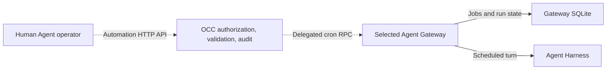

# Proposal: Schedule Agent automations through OCC

- **ID:** RFC-20261121-agent-automations
- **Created:** 2026-11-21
- **Last updated:** 2026-11-21
- **RFC PR:** [#6850](https://github.com/openclaw/openclaw-enterprise/pull/6850)
- **Implementation plan:** [Admission and scheduling](../plans/20261121-agent-automations.md)
- **Related:** [Native administration](../../docs/reference/agent-native-admin.md), [Gateway managed mode](../../docs/reference/agents/gateway-managed-mode.md), [runtime pin](../../deploy/runtime/openclaw-source.json)

## Summary

Add six OpenClaw Control Plane (OCC) HTTP operations to schedule, inspect, edit, pause, resume, and delete timed automations for a deployed Agent, and inspect their execution history. OCC authorizes the caller and calls the selected Agent Gateway. OpenClaw owns job definitions, scheduling, execution, and durable state.

## Motivation

OCE clients need an OCC scheduling and history API with exact-Agent authorization and audit. The native UI already serves administrators. [Native access](../../docs/reference/agent-native-admin.md), [OpenClaw contract](https://github.com/openclaw/openclaw/blob/cf0b3bb0f8efd6e8f230f9e1879b9fb871db96ef/packages/gateway-protocol/src/schema/cron.ts)

## Goals

- Schedule an Agent turn once, at a fixed interval, or with a cron expression.
- Inspect, edit, pause, resume, and delete a schedule, and retrieve its execution history.
- Run scheduled turns with the Agent's approved tools under the creating human's admitted authority.
- Preserve jobs across supported Gateway replacement.
- Enforce exact-Agent authority and record each OCC mutation and denial.

## Non-goals

Immediate execution, selection of result-delivery recipients, event triggers, commands, scripts, templates, service principals, and Console or CLI commands are later decisions. OpenClaw represents heartbeat monitors as ordinary jobs. [Heartbeat migration](https://github.com/openclaw/openclaw/blob/cf0b3bb0f8efd6e8f230f9e1879b9fb871db96ef/docs/gateway/heartbeat.md)

## Proposal

A human with an active session and exact-Agent `operate` can create an automation. The same permission lets its creator list, inspect, edit, pause, resume, delete, and read history for their own automations. Exact-Agent `administer` permits management of all jobs owned by that Agent. An `operate` caller receives no information about another creator's jobs; filter before pagination and totals.

OCC resolves the selected running Agent revision and validates its Compute Driver ID and implementation. The Installation and Agent must enable native access. OCC uses a private delegated automation connection with the server-derived human subject and a narrow native automation scope. The ordinary chat connection keeps its existing scope. Refuse disabled, stopped, unsupported, or unavailable Agents and replacement states that prevent safe access. Reject caller-selected Gateway addresses, scopes, ownership, native Agent IDs, or tool grants. Do not substitute a shared machine-admin identity.

The pinned OpenClaw requires `operator.admin` for direct `cron.add`, and its direct human owner scope does not cover all required reads. This RFC requires a qualified upstream native contract that admits scoped profile-based creation, binds the exact effective Agent and creator at commit, filters reads and history by owner, and admits the scheduled execution authority. OCC must fail closed until that contract is available. [Current native authorization](https://github.com/openclaw/openclaw/blob/cf0b3bb0f8efd6e8f230f9e1879b9fb871db96ef/src/gateway/server-methods/method-authorization.ts#L132-L152)



### Job contract

POST requires all four fields.

```json
{
  "name": "Daily report",
  "enabled": true,
  "schedule": {
    "kind": "cron",
    "expr": "0 9 * * *",
    "tz": "America/Los_Angeles"
  },
  "prompt": "Generate the daily report"
}
```

Supported schedules are

- `{kind:"at", at:"<RFC3339 timestamp>"}`
- `{kind:"every", everyMs:<positive integer>}`
- `{kind:"cron", expr:"<cron expression>", tz:"<IANA time zone>"}`

OCC validates the request envelope and forwards the schedule to the OpenClaw cron service. OpenClaw validates and normalizes scheduling semantics, including interval anchors and cron staggering. OCC returns the normalized native schedule and effective next execution time. Generated fields such as `anchorMs` and `staggerMs` do not make a job unsupported.

OCC maps `prompt` to an `agentTurn` with `sessionTarget:"isolated"`, `wakeMode:"now"`, and `delivery:{mode:"none"}`. The scheduled turn can use the deployed Agent's approved tools, subject to creator authority and mandatory runtime, sandbox, and tool restrictions. OpenClaw derives and retains that bounded authority from the authenticated creation context and rechecks current restrictions at execution and recovery. Native Harness tools, Gateway dynamic tools, and configured apps or MCP tools must enforce the same effective restriction. Native failure alerts can still use configured routes.

A job response contains `id`, `configRevision`, `name`, `enabled`, normalized `schedule`, `prompt`, `nextRunAtMs`, and `lastRunStatus`. List accepts bounded `offset` and `limit` and returns authorized summaries without prompts, plus `total`, `nextOffset`, and `snapshotRevision`. Restart an inventory scan if its snapshot changes. First enforce exact effective Agent and creator authority for every operation, including DELETE and history. Then check feature eligibility. Same-Agent unsupported jobs can be deleted by an authorized administrator with the observed revision; expose only ID, name, enabled state, schedule kind, and revision in their summaries. GET and PATCH reject unsupported jobs. Native eligibility must cover execution authority that public `cron.get` omits; a matching configuration revision alone cannot establish that authority.

Execution history returns paged run summaries with `runId`, start and finish times, execution `status`, whole-run `completionStatus`, `deliveryStatus`, summary, and error when present. Preserve native one-shot deletion after successful completion. History remains addressable by job ID after the job disappears, subject to native retention. The Gateway must retain enough authenticated creator and effective Agent evidence with each history record to authorize disclosure after deletion; records without that evidence fail closed. This is an upstream requirement because the pinned scoped history path requires a live visible job. [Current history admission](https://github.com/openclaw/openclaw/blob/cf0b3bb0f8efd6e8f230f9e1879b9fb871db96ef/src/gateway/server-methods/cron-runs.ts#L68-L116)

### State and failure

OpenClaw stores jobs and execution state in its shared SQLite database. Kubernetes retains the Agent-owned Gateway state volume across replacement. Agent deletion follows existing Gateway and volume cleanup. Native restart recovery and missed-slot policy remain effective. Interrupted tool effects have no general exactly-once guarantee. [Gateway storage](../../docs/reference/drivers/kubernetes-compute/storage-and-credentials.md#gateway-storage), [native recovery](https://github.com/openclaw/openclaw/blob/cf0b3bb0f8efd6e8f230f9e1879b9fb871db96ef/docs/automation/cron-jobs/how-it-works.md)

Each request binds its connection to the selected Agent revision. Stop admission when replacement prevents access. A lost reply, revision change after dispatch, or failed audit append after Gateway acknowledgement can leave a mutation outcome unknown. Return `503 UNKNOWN_OUTCOME` without automatic retry. Return an indeterminate error and do not replay it. The caller refreshes inventory before deciding what to do.

## Interface changes

### APIs

All paths start with `/namespaces/{namespaceId}/agents/{agentId}/automations`.

| Method and path  | Gateway method | Result                                                              |
| ---------------- | -------------- | ------------------------------------------------------------------- |
| POST collection  | `cron.add`     | 201 and created job                                                 |
| GET collection   | `cron.list`    | 200 and summaries                                                   |
| GET `/{id}`      | `cron.get`     | 200 and supported job                                               |
| PATCH `/{id}`    | `cron.update`  | 200 and updated job                                                 |
| DELETE `/{id}`   | `cron.remove`  | 204                                                                 |
| GET `/{id}/runs` | `cron.runs`    | 200 and paged authorized history, including after one-shot deletion |

POST, PATCH, and DELETE require OCC's existing session CSRF and Origin checks before native dispatch. PATCH accepts one or more of `name`, `enabled`, `schedule`, and `prompt`, plus required `expectedConfigRevision`. DELETE requires the revision as a query parameter. For PATCH, OCC reads and validates the current full job, requires that the revision from that same read equals the caller's expected revision, then forwards that revision to the native atomic update. Return 409 on conflict. Use the existing OCC response and error envelopes. Return 400 for invalid input, 403 for denied authority, 404 for an absent exact Agent or job, 409 for an unsupported job, and 503 for an unavailable Gateway or indeterminate mutation, with distinct machine-readable error codes.

### IAM

Reuse exact-Agent `operate` for creation and creator-owned operations, and `administer` for Agent-wide management. No new IAM action or resource. Audit successful mutations, denials, and indeterminate outcomes with Principal, Namespace, Agent, selected Agent revision, operation, job ID when known, and outcome. Exclude prompts, transcripts, credentials, and native payloads. This per-operation OCC evidence covers the new HTTP routes.

### Database entities

No changes. OpenClaw owns job persistence.

### Driver contracts

Extend the delegated Gateway request contract with an automation mode and its narrow scope. Compute resolves the private endpoint and server-owned subject and headers for the exact selected Agent revision. Unsupported Drivers and runtimes refuse the request. Submit this RFC before changing the Driver contract.

## Simplifications

The six typed routes reuse native scheduling and storage. PATCH handles pause and resume. The existing native UI remains available to administrators.

## Acceptance Criteria

- **AC1. Scheduling.** An exact-Agent operator creates each schedule type. Create, list, get, and edit round-trip the native normalized schedule. Observe a scheduled turn use an approved tool in the selected Harness.
- **AC2. Lifecycle and history.** Pause, resume, edit, and delete a job. A stale edit or delete returns 409. A successful one-shot disappears from inventory and its authorized history remains readable until native expiry.
- **AC3. Authority.** Deny unauthorized, foreign-creator, wrong-Agent, wrong-Namespace, forged-owner, service-key, and cross-origin requests before dispatch or disclosure. Test DELETE against a wrong-Agent job with a valid revision. Verify creator attribution, admitted execution authority, approved and denied tool calls, policy reduction before execution, and dedicated Harness, dynamic-tool, and MCP/app enforcement.
- **AC4. Recovery.** Replace the Gateway Pod and deploy a new Agent revision. Confirm job identity, paused state, and history retention. Exercise lost create replies, concurrent native edits, replacement, and audit failure after commit without duplicate dispatch.
- **AC5. Audit.** Verify attributable mutation, denial, and indeterminate records. Include only metadata resolved before a denial and exclude prompts, transcripts, credentials, and job payloads.

## Delivery and verification

Qualify upstream authority and history support, implement the OCC routes and Driver mode, and verify the acceptance criteria on the packaged runtime. The [implementation plan](../plans/20261121-agent-automations.md) tracks partial admission and refusal paths. Successful dispatch and the integrated native acceptance checks remain unimplemented and unrun.

## Unresolved questions

- Product and security owners must decide whether loss of the creator's OCE `operate` grant cancels or disables an existing automation. Native execution must continue to enforce the current Agent and runtime restrictions.
- Product owners must decide whether later versions add immediate execution, result delivery, or service-principal access.
