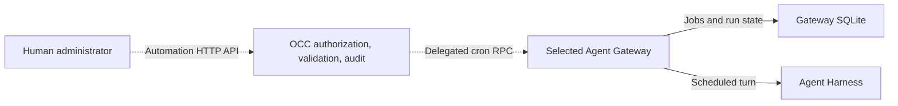

# Proposal: Schedule Agent automations through OCC

- **ID:** RFC-20261121-agent-automations
- **Created:** 2026-11-21
- **Last updated:** 2026-11-21
- **RFC PR:** [#6850](https://github.com/openclaw/openclaw-enterprise/pull/6850)
- **Related:** [Native administration](../../docs/reference/agent-native-admin.md), [Gateway managed mode](../../docs/reference/agents/gateway-managed-mode.md), [runtime pin](../../deploy/runtime/openclaw-source.json)

## Summary

Add five OpenClaw Control Plane (OCC) HTTP operations to schedule, inspect, edit, pause, resume, and delete timed automations for a deployed Agent. OCC authorizes the caller and calls the selected Agent Gateway. OpenClaw owns job definitions, scheduling, execution, and durable state.

## Motivation

An administrator can already manage automations in the native Agent UI. OCE clients need a typed OCC interface with exact-Agent authorization and attributable audit records. OpenClaw already provides the required `cron.*` Gateway methods. [Native access](../../docs/reference/agent-native-admin.md), [OpenClaw contract](https://github.com/openclaw/openclaw/blob/cf0b3bb0f8efd6e8f230f9e1879b9fb871db96ef/packages/gateway-protocol/src/schema/cron.ts)

## Goals

- Schedule an Agent turn once, at a fixed interval, or with a cron expression.
- Inspect, edit, pause, resume, and delete a schedule.
- Preserve jobs across supported Gateway replacement.
- Enforce exact-Agent authority and record each OCC mutation and denial.

## Non-goals

Immediate execution, run-history APIs, selection of result-delivery recipients, event triggers, commands, scripts, templates, service principals, and Console or CLI commands are later decisions. OpenClaw represents heartbeat monitors as ordinary jobs. [Heartbeat migration](https://github.com/openclaw/openclaw/blob/cf0b3bb0f8efd6e8f230f9e1879b9fb871db96ef/docs/gateway/heartbeat.md)

## Proposal

The API changes live Gateway state. A job edit does not deploy an Agent revision. The caller needs an active human session and `administer` on the exact Agent in the requested Namespace. OCC resolves the selected, running Agent revision and its private Gateway endpoint. This first version honors Installation native-admin enablement and Agent native-access opt-in. OCC checks the selected revision's Compute Driver ID and implementation and requires delegated-profile support. It refuses access when disabled, unsupported, stopped, unavailable, or undergoing a replacement that prevents safe access. Delegation failure cannot fall back to machine-admin authority.

OCC delegates the same server-derived human subject and `operator.admin` authority used by native administration. It refuses caller-supplied subjects, scopes, Gateway addresses, native Agent IDs, and ownership fields. The pinned Gateway requires administrator authority for direct `cron.add`. Operator-created jobs can retain operator execution authority after creation. Native job attribution and execution authority must remain bound to the admitted human. [OCE delegation](../../docs/reference/agent-native-admin.md#native-authority-and-drift), [native authorization](https://github.com/openclaw/openclaw/blob/cf0b3bb0f8efd6e8f230f9e1879b9fb871db96ef/src/gateway/server-methods/method-authorization.ts#L132-L152), [scheduled authority](https://github.com/openclaw/openclaw/blob/cf0b3bb0f8efd6e8f230f9e1879b9fb871db96ef/docs/automation/cron-jobs/managing-jobs.md#L103-L126)

The diagram shows the proposed API path. The Gateway, Harness, and SQLite store already exist.



### Job contract

POST requires all four fields.

```json
{
  "name": "Daily report",
  "enabled": true,
  "schedule": {
    "kind": "cron",
    "expr": "0 9 * * *",
    "tz": "America/Los_Angeles"
  },
  "prompt": "Generate the daily report"
}
```

A schedule is one of these objects.

- `{kind:"at", at:"<RFC3339 timestamp>"}`
- `{kind:"every", everyMs:<positive integer>}`
- `{kind:"cron", expr:"<cron expression>", tz:"<IANA time zone>"}`

OCC applies bounded input sizes and native schedule validation. It maps the prompt to `payload:{kind:"agentTurn",message:prompt,toolsAllow:[]}`, fixes `sessionTarget:"isolated"`, `wakeMode:"now"`, and `delivery:{mode:"none"}`, and derives the native execution Agent from the selected Gateway. A job can run a model turn but has no job tools or automatic result delivery. Native failure alerts and terminal auto-disable notices can still use configured routes. Broader execution permissions and recipient selection need a separate decision.

A job response contains `id`, `configRevision`, `name`, `enabled`, `schedule`, `prompt`, `nextRunAtMs`, and `lastRunStatus`. Missing runtime values are null. List accepts bounded `offset` and `limit` and returns `{jobs:[...],total,offset,limit}` with summaries that omit prompts and include disabled jobs. OCC obtains the full native projection without delivery previews so it can inspect the job revision and execution fields. Existing native jobs outside this contract appear as summaries with `supported:false` and their observed revision. Eligibility requires an exact native Agent match, the fixed session, payload, and delivery fields, an explicit empty tool selection with `toolsAllowIsDefault` absent or false, and no trigger, plugin-command payload source, failure override, or unknown execution field. GET and PATCH refuse jobs that fail these checks. Thus an edit or resume cannot activate a pre-existing command, broader tool grant, different session, or automatic result delivery. DELETE remains available to an administrator with the observed revision.

### State and failure

OpenClaw stores jobs and execution state in its shared SQLite database. Kubernetes retains the Agent-owned Gateway state volume across replacement. Agent deletion follows existing Gateway and volume cleanup. Native restart recovery and missed-slot policy remain effective. Interrupted tool effects have no general exactly-once guarantee. [Gateway storage](../../docs/reference/drivers/kubernetes-compute/storage-and-credentials.md#gateway-storage), [native recovery](https://github.com/openclaw/openclaw/blob/cf0b3bb0f8efd6e8f230f9e1879b9fb871db96ef/docs/automation/cron-jobs/how-it-works.md)

Each request binds its connection to the selected Agent revision. Stop admission when replacement prevents access. A lost reply or revision change after dispatch can leave a mutation outcome unknown. Return an indeterminate error and do not replay it. The administrator refreshes inventory before deciding what to do. A native declaration key can update an existing job and is not a general replay receipt.

## Interface changes

### APIs

All paths start with `/namespaces/{namespaceId}/agents/{agentId}/automations`.

| Method and path | Gateway method | Result                |
| --------------- | -------------- | --------------------- |
| POST collection | `cron.add`     | 201 and created job   |
| GET collection  | `cron.list`    | 200 and summaries     |
| GET `/{id}`     | `cron.get`     | 200 and supported job |
| PATCH `/{id}`   | `cron.update`  | 200 and updated job   |
| DELETE `/{id}`  | `cron.remove`  | 204                   |

PATCH accepts one or more of `name`, `enabled`, `schedule`, and `prompt`, plus required `expectedConfigRevision`. DELETE requires the revision as a query parameter. For PATCH, OCC reads and validates the current full job, requires that the revision from that same read equals the caller's expected revision, then forwards that revision to the native atomic update. OCC forwards the native revision check atomically and returns 409 on conflict. Job revision and Agent revision are distinct. Use the existing OCC response and error envelopes. Return 400 for invalid input, 403 for denied authority, 404 for an absent exact Agent or job, 409 for an unsupported job, and 503 for an unavailable Gateway or indeterminate mutation, with distinct machine-readable error codes.

### IAM

Reuse exact-Agent `administer` for all five operations. No new permission or IAM resource. Audit successful mutations, denials, and indeterminate outcomes with Principal, Namespace, Agent, selected Agent revision, operation, job ID when known, and outcome. Exclude prompts, transcripts, credentials, and native payloads. This per-operation OCC evidence covers the new HTTP routes.

### Database entities

No changes. OpenClaw owns job persistence.

### Driver contracts

No changes. Reuse Compute Gateway endpoint resolution and the existing private transport. Refuse unsupported Drivers or runtimes.

## Simplifications

The existing native Automations UI meets the browser task for administrators. The five routes add the requested OCC HTTP contract and audit evidence while reusing native scheduling and storage. PATCH handles pause and resume. A generic RPC tunnel would expose native authority and unrestricted payload types as part of the OCC API.

## Acceptance Criteria

- **AC1. Scheduling.** Create and inspect all three schedule types on a deployed Agent. Observe one scheduled turn execute in its Harness and inspect the native result.
- **AC2. Lifecycle.** Pause, resume, edit, and delete a job. A stale edit or delete returns 409 without changing it, including a concurrent native-admin edit. PATCH cannot edit or resume an unsupported job.
- **AC3. Authority.** A denied caller, service key, forged owner, wrong Namespace, or peer Agent cannot read or mutate the job. Disabled access, a mismatched Driver, or failed delegation refuses the operation. Verify human attribution and the scheduled tool and result-delivery restrictions. On dedicated Codex, attempt harmless shell, file, dynamic-tool, and configured MCP/app operations with the empty tool selection; refuse runtimes that cannot enforce it. With a configured failure destination, fail a job and verify the native alert behavior.
- **AC4. Recovery.** Replace the Gateway Pod and deploy a new Agent revision. Confirm job identity, schedule, paused state, and history retention. Exercise a lost create reply and replacement during mutation without duplicate dispatch.
- **AC5. Audit.** Verify attributable mutation, denial, and indeterminate records with sensitive job content absent.

## Delivery and verification

Implement the routes and native client adapter as one connected feature, then qualify the acceptance criteria on the packaged runtime. This RFC is based on source review. The proposed routes and integrated acceptance checks have not been implemented or run.

## Unresolved questions

- Product and security owners must decide whether a narrower permission or service-principal access is required. Direct non-admin creation needs a native authority design.
- Product and security owners must decide which tools and delivery destinations jobs may use, and whether loss of an OCE grant cancels an existing job. The initial API uses the fixed execution policy above.
