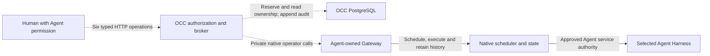

# Proposal: Schedule Agent automations through OCC

- **ID:** RFC-20261121-agent-automations
- **Created:** 2026-11-21
- **Last updated:** 2026-11-21
- **RFC PR:** [#6850](https://github.com/openclaw/openclaw-enterprise/pull/6850)
- **Implementation plan:** [Broker implementation](../plans/20261121-agent-automations.md)
- **Related:** [Native administration](../../docs/reference/agent-native-admin.md), [Gateway managed mode](../../docs/reference/agents/gateway-managed-mode.md), [runtime pin](../../deploy/runtime/openclaw-source.json)

## Summary

OpenClaw Control Plane (OCC) brokers six HTTP operations for Agent automations.
OCC authorizes the human, retains ownership records, and calls the selected
Agent's private Gateway with platform-owned administrative transport. OpenClaw
owns job definitions, scheduling, execution and run history. Scheduled turns use
the deployed Agent's service authority, constrained by its approved tools and
runtime policy. Human creator identity governs management and disclosure in OCC;
it does not supply personal credentials to a scheduled turn.

OCE manages all automations in this supported workflow. Native edits, importing
native jobs, and reconciliation with another automation manager are out of scope.
This replaces the earlier proposal for a new upstream human automation delegation.
No upstream changes are required by this broker design.

## Motivation

OCE clients need scheduling and history operations with exact-Agent authorization
and attributable audit. Existing native cron APIs already schedule and retain
jobs. OCC can apply its own human authorization boundary without exposing native
administrative credentials or depending on a new native scope.

Source review through upstream `b8b06c4824f381e6a53ace20d3f8b1f9b5de509a`
confirmed existing [cron methods](https://github.com/openclaw/openclaw/blob/b8b06c4824f381e6a53ace20d3f8b1f9b5de509a/src/gateway/methods/core-descriptors.ts#L301-L326),
[native revision checks](https://github.com/openclaw/openclaw/blob/b8b06c4824f381e6a53ace20d3f8b1f9b5de509a/src/gateway/server-methods/cron.ts),
and [operator history after deletion](https://github.com/openclaw/openclaw/blob/b8b06c4824f381e6a53ace20d3f8b1f9b5de509a/src/gateway/server-methods/cron-runs.ts#L94-L108).
Source availability does not establish packaged-runtime qualification.

## Goals

- Create a scheduled Agent turn once, periodically, or with a cron expression.
- List, inspect, edit, pause, resume and delete managed jobs, and read run history.
- Enforce human creator ownership and exact-Agent administration in OCC.
- Use approved Agent tools under mandatory runtime, sandbox and tool restrictions.
- Preserve managed job identity and ownership across supported Gateway replacement.
- Report uncertain native mutations without retry or false success.

## Non-goals

Native edits or imports, another automation manager, immediate execution,
caller-selected native Agent IDs, result-delivery recipients, commands, scripts,
event triggers, templates, service-principal API access, Console controls and CLI
commands are out of scope. Personal creator credentials are not scheduled authority.

## Proposal

### Human authorization and native transport

A human session with exact-Agent `operate` can create an automation. The same
permission admits management and history for that creator's records. Exact-Agent
`administer` admits management of all OCE-owned records for the Agent, but does not
substitute for `operate` on creation. Filter creator ownership before public
pagination, totals or disclosure. Denied foreign ownership is indistinguishable
from an absent record at the requested path.

OCC resolves the selected running Agent revision and verifies its Compute Driver
ID and implementation. Native access must be enabled for the Installation and
Agent. Disabled, stopped, unsupported and unavailable Agents are refused.
Replacement states that prevent safe access stop admission.

The Compute Driver supplies the private endpoint for that revision through its
existing transport contract. Controller composition resolves the platform-owned
Gateway credential. Neither comes from an HTTP caller. The broker authenticates
as a native operator and exposes only `cron.add`, `cron.list`, `cron.get`,
`cron.update`, `cron.remove` and `cron.runs` through typed handlers. This six-method
ceiling belongs to OCC; it is not a narrow native permission. Ordinary browser
chat and native browser administration retain their existing delegation scopes.

OCC must not forward caller headers, native scopes, ownership fields, native
Agent IDs, tool grants or arbitrary RPC methods. The broker verifies the native
operator grant and required method support before dispatch. Unsupported transport
or protocol returns an unavailable error, without a credential or identity fallback.



### Ownership records

Before sending `cron.add`, OCC reserves a public automation UUID with the exact
Namespace, Agent, authenticated human creator, server-selected native Agent and
creation time. OpenClaw allocates the native job ID; its public create API does
not accept a caller-selected ID. OCC supplies a unique declaration key derived
from its reservation and creates the job disabled. It durably binds the returned
native ID before a separate native update enables the job when requested.

Creator and target fields never change. A native ID binds once and cannot be
shared by two records for the same Agent. Records contain no prompt, credential
or duplicate job definition. OCC IDs are never reused.

Only records created by OCC authorize API access. The broker neither adopts nor
returns unregistered native jobs. This is a lookup rule, not a native-edit
reconciliation mechanism. Public list totals count authorized records with live
native jobs. Native inventory reads must use a consistent snapshot; a changed
snapshot requires the caller to restart the scan.

Ownership survives explicit deletion and native one-shot deletion. A reserved
record also survives a lost create reply: inventory or exact lookup can recover
the disabled job by its declaration key and bind its native ID. Recovery records
that association but never repeats create or enables the job automatically.
A reservation alone is not evidence that a job exists.
Agent deletion removes its ownership records with the Agent's existing lifecycle.
The supported sole-manager assumption ensures each native job ID continues to
refer to the exact OCE Agent and creator recorded at reservation.

### Job and execution contract

POST requires `name`, `enabled`, `schedule` and `prompt`:

```json
{
  "name": "Daily report",
  "enabled": true,
  "schedule": {"kind": "cron", "expr": "0 9 * * *", "tz": "America/Los_Angeles"},
  "prompt": "Generate the daily report"
}
```

Schedules are `at` with an RFC3339 timestamp, `every` with a positive integer
`everyMs`, or `cron` with an expression and IANA time zone. OCC validates the
request envelope. OpenClaw validates and normalizes scheduling semantics,
including interval anchors and cron staggering. Responses preserve those native
fields and the effective next execution time.

The broker selects the native Agent from the admitted runtime, then maps `prompt`
to an `agentTurn` with `sessionTarget: "isolated"`, `wakeMode: "now"` and
`delivery: {mode: "none"}`. Execution uses the Agent's configured service
credentials and approved tool policy. It must not gain broader runtime, sandbox,
native Harness, Gateway dynamic-tool or app/MCP access because OCC uses an
administrative transport. Qualify that boundary on each supported Harness.
A native tool selection is not evidence of a human creator's personal grant.

Job responses contain `id`, `configRevision`, `name`, `enabled`, normalized
`schedule`, `prompt`, `nextRunAtMs` and `lastRunStatus`. Lists omit prompts and
return `total`, `nextOffset` and `snapshotRevision` with bounded `offset` and
`limit`. Requests cannot change a job's creator or native Agent. Unsupported job
shapes are refused after ownership authorization; an authorized administrator can
remove a registered unsupported job with its observed native revision.

Run history returns paged `runId`, start and finish times, execution `status`,
whole-run `completionStatus`, `deliveryStatus`, summary and error when present.
After a job disappears, OCC authorizes its retained ownership record and reads
that ID's native operator history through the exact Agent's private Gateway.
History retention remains native. Missing ownership fails closed; a native ID
or history response cannot establish human ownership by itself.

### State, concurrency and failure

Native job state remains on the Agent-owned Gateway volume. OCC ownership is
PostgreSQL state. There is no distributed transaction between those stores.
The ownership reservation commits before disabled create dispatch; native-ID
binding commits before activation. A failed activation can leave a disabled job.
Successful mutation audit follows the final native acknowledgement. A lost reply, revision change after
dispatch, malformed mutation acknowledgement, or failed audit append after a
native commit returns `503 UNKNOWN_OUTCOME`. Do not retry or replay automatically.
The response supplies the public automation path in `Location` when known.
The caller inspects that job or its history before deciding what to do; a missing
live job does not prove it never executed.

PATCH reads the full authorized job, checks the expected revision from that same
read, validates eligibility, and passes the revision to native atomic update.
DELETE also uses the expected native revision. Native concurrent conflicts return
409. These checks also protect concurrent OCC requests; native edits remain out
of scope. Interrupted external tool effects have no general exactly-once guarantee.

## Interface changes

### APIs

All paths start with `/namespaces/{namespaceId}/agents/{agentId}/automations`.

| Method and path | Native method | Result |
| --- | --- | --- |
| POST collection | `cron.add` | 201 and created job |
| GET collection | `cron.list` | 200 and authorized summaries |
| GET `/{id}` | `cron.get` | 200 and supported job |
| PATCH `/{id}` | `cron.update` | 200 and updated job |
| DELETE `/{id}` | `cron.remove` | 204 |
| GET `/{id}/runs` | `cron.runs` | 200 and authorized history, including after deletion |

Mutations require existing session CSRF and Origin checks before dispatch.
PATCH accepts one or more editable fields plus `expectedConfigRevision`. DELETE
requires that revision in its query. Use OCC envelopes: 400 for invalid input,
403 for denied human or Agent authority, 404 for absent or hidden job ownership,
409 for revision conflict or unsupported job shape, and distinct 503 codes for
unavailability and indeterminate mutations.

### IAM

Reuse exact-Agent `operate` and `administer`. No new action or resource kind.
Audit successful mutations, denials and uncertain outcomes with Principal,
Namespace, Agent, selected revision, operation, job ID when known and outcome.
Include only metadata established before a denial. Exclude prompts, transcripts,
credentials and native payloads.

### Database entities

Add an Agent-owned registry with immutable public UUID, Namespace, Agent, human
creator, native Agent ID and creation time, plus a nullable native job ID that
binds once. Enforce unique native identity within the owning Agent. Enforce identity and
Agent ownership in database constraints. Retain records after job deletion;
remove them with Agent deletion. Do not duplicate native scheduling or history.

### Driver contracts

Use existing Compute endpoint resolution and controller-owned Gateway transport.
The prior reserved `automation` browser-delegation mode is unnecessary and can be
removed. No upstream scope or new native identity is introduced.

## Simplifications

OCC is the sole automation manager. There is no native-edit synchronization,
import, ownership adoption, second scheduler or duplicate run-history store.
PATCH handles pause and resume. Native browser access remains a separate feature;
editing automations there is outside this workflow's supported assumptions.

## Acceptance Criteria

- **AC1. Scheduling:** create each schedule type through OCC, preserve native
  normalization, and observe a scheduled approved-tool turn in the selected Harness.
- **AC2. Lifecycle:** edit, pause, resume and delete. Reject stale revisions.
  A successful one-shot disappears while its creator can still read retained history.
- **AC3. Authority:** deny administer-only creation, unauthorized callers,
  foreign creators, wrong Agents or Namespaces, forged authority, service keys
  and cross-origin mutations. Prove approved and denied tools under service
  authority, including policy reduction, dedicated Harness and app/MCP restrictions.
- **AC4. Recovery:** preserve identity, paused state and ownership across Gateway
  replacement and Agent revision changes. Exercise lost replies, concurrent OCC
  edits and failed post-commit audit without duplicate dispatch.
- **AC5. Persistence and audit:** verify PostgreSQL ownership constraints,
  reservation-before-dispatch, authorization after job deletion, Agent cleanup,
  attributable mutation/denial/unknown evidence and exclusion of sensitive content.

## Delivery and verification

The broker implementation and its integration checks are in progress. Submit
material protocol refinements with this RFC, then qualify the
packaged runtime through the real Agent workflow. Local fixture success does not
prove native scheduling, model execution or tool restrictions.

## Unresolved questions

Product owners may later add result delivery, immediate execution or service
principal access. Revoking a human's OCE `operate` grant removes management access;
existing jobs continue under Agent service policy unless explicitly disabled.
