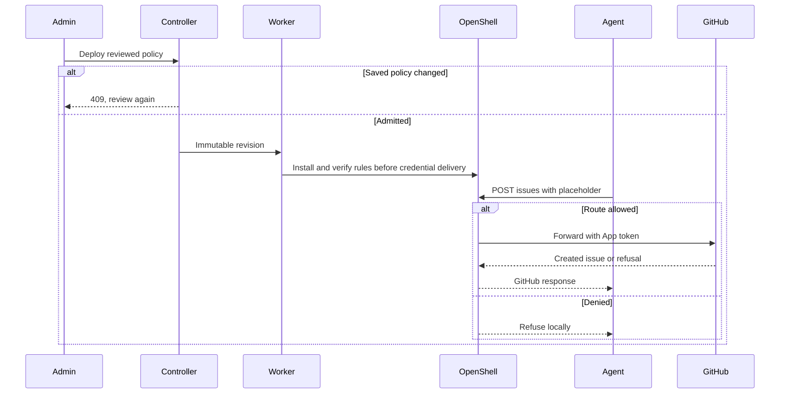

# Proposal: Issue creation with repository Write access

- **ID:** RFC-20261123-repository-issue-creation
- **Created:** 2026-11-23
- **Last updated:** 2026-11-23
- **RFC PR:** [#6861](https://github.com/openclaw/openclaw-enterprise/pull/6861)
- **Implementation plan:** [Delivery and verification](../plans/20261123-repository-issue-creation.md)
- **Related:** [Repository network policy](20261119-repository-network-policy.md) · [GitHub App implementation](https://github.com/openclaw/openclaw-enterprise/pull/6864)

## Summary

**Contributor can push code, create issues and open pull requests by default on a selected repository.** Each operation still needs the corresponding GitHub App permission, Namespace approval and Agent grant. Choose **Read-only** to prevent direct writes. Under **Advanced**, turn off either creation action independently.

## Motivation

The [shipped native policy](20261119-repository-network-policy.md) requires a separate REST setting and cannot create issues. An Admin should be able to grant useful access once, see the exceptions and change them later from the Agent.

## Goals

- **G1.** Let a Contributor open issues and PRs through `gh api` with credentials outside the Agent.
- **G2.** Let operators narrow direct requests per repository across a Namespace or for one Agent.
- **G3.** Make access easy to review before deployment and find again afterward.

## Non-goals

PATs, protected profiles, GraphQL, comments, edits, reviews, merges and JSON body inspection.

## Proposal

Keep `nativeGit: "v1"` for GitHub App delivery. Remove `scopedRest` and the separate REST upgrade approval proposed in [#7120](https://github.com/openclaw/openclaw-enterprise/pull/7120). A saved grant sets the maximum for **direct requests**.

| Agent grant         | Git          | Issues      | Pull requests |
| ------------------- | ------------ | ----------- | ------------- |
| Read-only (Read)    | Clone, fetch | List, read  | List, read    |
| Contributor (Write) | Also push    | Also create | Also open     |
| No grant            | None         | None        | None          |

For each API column, absent permission removes all routes, read permits GETs and write also permits POST for Contributor. Metadata and Contents alone mean Git-only.

Repositories sharing one selected App token need identical permission maps. With A Read, B Write and C bound but ungranted, [#7135](https://github.com/openclaw/openclaw-enterprise/pull/7135) blocks PR creation everywhere. B can still create issues. To restore PR creation, unbind C and redeploy. Filtering C leaves it bound.

### Optional API restrictions

The [operator guide](https://github.com/openclaw/openclaw-enterprise/pull/7165) generates a filter for the Namespace registration for **every Agent** using that repository. The Agent editor narrows **one Agent**. Neither filter expands permissions or changes Git access.

| `apiActions`                        | Effect                                       |
| ----------------------------------- | -------------------------------------------- |
| Omitted or `{ deny: [] }`           | All eligible actions, including future ones  |
| `{ deny: ["issues:create"] }`       | All eligible actions except issue creation   |
| `{ allow: ["pull_requests:read"] }` | Only listed actions, even as OCE adds others |
| `{ allow: [] }`                     | Git only                                     |

Accept exactly one key and unique literal names. `issues:read` and `pull_requests:read` cover list and numbered detail GETs. `issues:create` and `pull_requests:create` each cover one collection POST. Reject invalid names, extra keys and retired settings. New routes stay closed until OCE defines them.

**Limits.** Issue reads can return PRs. Creation returns a record even if GET is off. Opening a PR can convert an existing issue. GitHub can apply labels or [link a parent issue](https://docs.github.com/en/rest/issues/issues#create-an-issue) in another repository. OpenShell checks the route without inspecting those fields. Wider rollout depends on AC-4.

### Per-Agent controls (separate follow-up)

In **Create Agent → Per-repository access**, selected repositories default to Contributor where Write is permitted. Unselected repositories receive no grant. Save the draft, then customize exceptions in **Repositories → Manage permissions → Advanced**. Show exceptions beside the role before deployment.

For a running Agent, **Configuration → Edit repository permissions** opens the same editor. Preserve untouched grants and filters. Show whether the saved policy version matches the deployed revision, differs or is unknown. Deploy a new version to apply changes. An Agent first deployed without a repository policy needs a new Agent ID to adopt one.

### Request lifecycle

Proposed flow on stock OpenShell. The Admin saves the grants. The Controller rechecks Namespace limits at deploy. The version check covers only the saved Agent policy.

## Interface changes

### APIs

| Operation                                                                               | Change                                                                                                                                                                                                                                                                         |
| --------------------------------------------------------------------------------------- | ------------------------------------------------------------------------------------------------------------------------------------------------------------------------------------------------------------------------------------------------------------------------------ |
| GitHub `POST /repos/{owner}/{repo}/issues`                                              | Permit the existing endpoint. Verify an uncertain result before retrying.                                                                                                                                                                                                      |
| [Catalog, create and deploy](https://github.com/openclaw/openclaw-enterprise/pull/7178) | Return optional `githubAccess`. Atomically save initial `repositoryNetworkPolicy` with the draft. For first deployment of a scoped draft, require the Console to send `expectedRepositoryPolicyVersion`. A mismatch returns 409 without a revision. Other clients may omit it. |
| [Sandbox policy GET and PUT](https://github.com/openclaw/openclaw-enterprise/pull/7179) | GET returns optional `repositoryApiActionFilters` before Agent limits and the PR safeguard. Saved grants accept optional `apiActions`. PUT checks `expectedVersion`.                                                                                                           |

### IAM

No new permissions. Catalog hints require Installation administration and Namespace-wide Agent and policy read. Enabling edits requires Installation and Agent administration. Saving and deploying scoped grants require policy read/update and Agent `manage_policy`, in addition to normal create or deploy authority.

### Database entities

Namespace filters require no migration. The Agent follow-up extends saved grant validation and immutable revision identity. Installation limits and initial grants contain only repository and access.

### Driver contracts

Intersect eligible actions with both filters. Include filters and effective actions in credential identity, ignoring order. Verify loaded rules at issuance and renewal. Any allow list or nonempty deny list requires native enforcement even if no actions remain. Refuse stale or unenforceable restrictions. Preserve unfiltered online delivery and Stop.

## Simplifications

One grant and two optional filters replace REST versions and upgrade approvals. Keeping only Read and Write would prevent independent opt-outs. OpenShell enforces routes locally without a new CLI, request callback or fork.

## Acceptance Criteria

Use the [installed workflow and evidence by criterion](../plans/20261123-repository-issue-creation.md#verification).

- **AC-1 · G1.** With A Read, B Write and C bound without a grant, create and independently read back B’s issue. Deny A writes, C access and all PR creation.
- **AC-2 · G1.** Unbind C, redeploy and verify both creations in B. Disable issue creation there. PRs, reads, push and another Contributor repository still work.
- **AC-3 · G2.** Rotate, tighten and redeploy. Refuse stale renewal and forbidden routes. Verify retirement of the previous Sandbox.
- **AC-4 · G2.** Inspect both sides of live parent links from B. Maintainers hold wider rollout if read-only A changes or denied C is exposed or changed.
- **AC-5 · G2.** Reject invalid configuration. Verify PR-read-only, issue-create-only and Git-only filters independently.
- **AC-6 · G2.** Without native enforcement, refuse restricted issuance and renewal. Unfiltered delivery still works.
- **AC-7 · G2.** With Issues read, even an explicit allow cannot enable issue creation.
- **AC-8 · G3.** Create, reopen, customize and deploy an Agent. Refuse stale review. Verify each opt-out independently at GitHub without changing a peer.

## Delivery and verification

Remove `scopedRest` before upgrade. Existing Write grants can gain issue or PR creation on redeployment. Set restrictions first. A running Sandbox keeps its loaded rules and can lose renewal after a change. The operator must Stop and verify Sandbox retirement to withdraw access immediately.

The [plan](../plans/20261123-repository-issue-creation.md) separates the Namespace change from the Console follow-up. Controlled installed checks cover parts of AC-1–AC-7. Live parent-link effects and the full deployed Console journey remain unverified.
