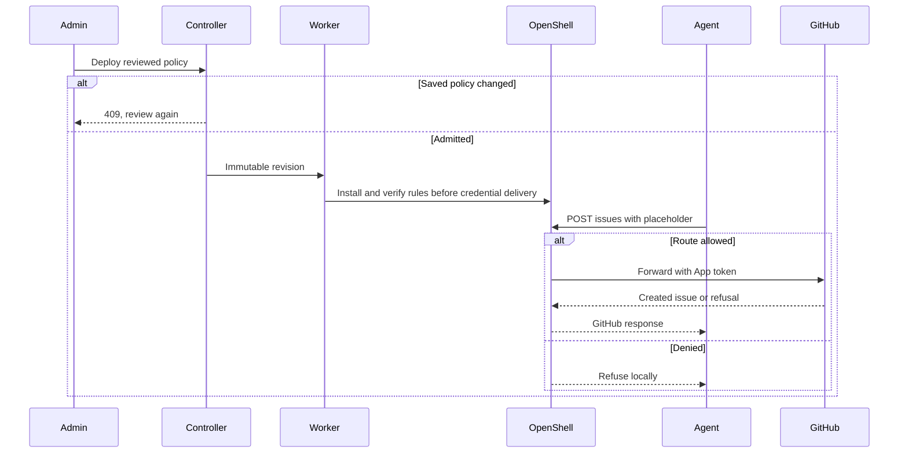

# Proposal: Issue creation with repository Write access

- **ID:** RFC-20261123-repository-issue-creation
- **Created:** 2026-11-23
- **Last updated:** 2026-11-23
- **RFC PR:** [#6861](https://github.com/openclaw/openclaw-enterprise/pull/6861)
- **Implementation plan:** [Delivery and verification](../plans/20261123-repository-issue-creation.md)
- **Related:** [Repository network policy](20261119-repository-network-policy.md) · [GitHub App implementation](https://github.com/openclaw/openclaw-enterprise/pull/6864)

<a id="problem-and-decision"></a>

## Summary

An Agent needs to push fixes and open pull requests (PRs) in `acme/web`, but the team wants people to file issues. **Contributor** permits push, issue creation and PR creation by default where GitHub and the Namespace allow them. Choose Contributor and set **Advanced → Issues → Read-only** for this Agent.

## Motivation

The [shipped GitHub App policy](20261119-repository-network-policy.md) requires a separate REST setting and cannot create issues. An Admin should be able to choose one role per repository, review exceptions and edit them later from the Agent.

<a id="scope"></a>

## Goals

- **G1.** Let a Contributor open issues and PRs through `gh api` with credentials outside the Agent.
- **G2.** Let operators narrow direct requests per repository across a Namespace or for one Agent.
- **G3.** Make access easy to review before deployment and find again afterward.

## Non-goals

Personal access tokens, protected profiles, GraphQL, comments, edits, reviews, merges and JSON body inspection.

<a id="design"></a>

## Proposal

With `nativeGit: "v1"` for a selected GitHub App, the Agent’s saved grant sets the maximum for **direct requests**.

| Agent grant         | Git          | Issues      | Pull requests |
| ------------------- | ------------ | ----------- | ------------- |
| Read-only (Read)    | Clone, fetch | List, read  | List, read    |
| Contributor (Write) | Also push    | Also create | Also open     |
| No grant            | None         | None        | None          |

The GitHub App installation and the Namespace’s token [`permissions`](../../docs/reference/repository-credentials/access-levels.md#native-git-delivery) must both permit the operation. Issues and Pull requests are independent. Metadata and Contents alone give Git access only.

Repositories sharing one token need identical token permission maps. A PR can expose commits from another bound repository. If any binding lacks a grant, the [existing safeguard](https://github.com/openclaw/openclaw-enterprise/pull/7135) blocks PR creation everywhere. Contributors can still create issues. Unbind the unused repository and redeploy to restore PR creation.

### Optional API restrictions

Set `apiLimits` on a repository’s [Namespace registration](https://github.com/openclaw/openclaw-enterprise/pull/7165) for **every Agent** or on its saved grant for **one Agent**. For each resource, the stricter limit wins. Neither changes Git access, token permissions or bindings.

For the `acme/web` example, Advanced saves this grant. Pull requests inherit the usual Contributor access.

```json
{ "repository": "acme/web", "access": "write", "apiLimits": { "issues": "read" } }
```

Use GitHub’s resource names `issues` for `/issues` and `pull_requests` for `/pulls`. Each accepts one limit.

| Limit   | Eligible direct requests under `/repos/{owner}/{repo}` |
| ------- | ------------------------------------------------------ |
| `none`  | None for this resource                                 |
| `read`  | GET the list or a numbered item                        |
| `write` | Also POST to that collection to create an issue or PR  |

Creation always includes read. A limit cannot add permissions or enable other endpoints. Omit `apiLimits` to keep the defaults. Unlisted resources inherit eligible access as OCE adds support.

To block **all unlisted resources, including future ones**, set `"default": "none"`. By itself this leaves Git only. Add `"pull_requests": "read"` to keep PR reads.

`none` is the only valid `default`. Reject an empty `apiLimits` object, unknown keys, invalid values and the retired `apiActions` and `scopedRest` settings.

**Indirect effects.** OpenShell checks direct routes without inspecting the request body. Issue reads can return PRs. Opening a PR can [convert an issue](https://docs.github.com/en/rest/pulls/pulls#create-a-pull-request) even with issue creation off. GitHub can label a new issue and [link it to a parent](https://docs.github.com/en/rest/issues/issues#create-an-issue) in another repository. Wider rollout depends on AC-4.

### Per-Agent controls (separate follow-up)

In **Create Agent → Per-repository access**, selected repositories default to Contributor where Write is permitted. Unselected repositories receive no grant. Save the draft, then customize exceptions in **Repositories → Manage permissions → Advanced**. Set Issues or Pull requests to Read-only to turn off creation independently. Show exceptions beside the role before deployment. A saved opt-out persists if the Namespace later permits that action.

For a running Agent, **Configuration → Edit repository permissions** opens the same editor. Preserve untouched grants and limits, including `default`. Show whether the saved policy version matches the deployed revision, differs or is unknown. Redeploy to apply changes. An Agent first deployed without a repository policy needs a new Agent ID to adopt one.

### Request lifecycle

This proposed flow shows first deployment from the Console on stock OpenShell. The Controller rechecks Namespace limits at deploy. The version check covers only the Agent policy. Expanding Namespace permissions can enable new actions at deployment even if the Agent policy version stays the same.



## Interface changes

### APIs

No new endpoints. Permit GitHub’s existing `POST /repos/{owner}/{repo}/issues`. Verify an uncertain write before retrying.

- The [catalog](https://github.com/openclaw/openclaw-enterprise/pull/7178) can return `githubAccess`. Agent creation saves the initial `repositoryNetworkPolicy` atomically with the draft.
- On a GitHub draft’s first deploy, the Console sends `expectedRepositoryPolicyVersion` with the reviewed version or `null` for no saved policy. A mismatch returns 409 without a revision. Other clients may omit the precondition.
- [Sandbox policy GET](https://github.com/openclaw/openclaw-enterprise/pull/7179) can return `repositoryApiMaxima` for each repository and access level. These are the highest eligible levels for Issues and Pull requests before Agent limits and the PR safeguard. PUT accepts `apiLimits` on each saved grant and checks `expectedVersion`.

### IAM

No new permissions. Catalog hints require Installation administration and Namespace-wide Agent and policy read. Enabling edits requires Installation and Agent administration. Saving and deploying scoped grants require policy read/update and Agent `manage_policy`, in addition to normal create or deploy authority.

### Database entities

Namespace limits require no migration. Extend saved grant validation and immutable Agent revisions to retain `apiLimits`. Installation ceilings and initial grants contain only repository and access.

### Driver contracts

The Worker includes both limits and effective routes in credential identity, ignoring key order. At issuance and renewal, verify loaded rules. **Any explicit limit requires native enforcement**, even `write` or a limit with no eligible routes. Refuse stale or unenforceable limits. Without a saved policy or explicit limits, keep online delivery. Always preserve Stop.

## Simplifications

Remove `scopedRest` and drop the separate upgrade approval proposed in [#7120](https://github.com/openclaw/openclaw-enterprise/pull/7120). Reuse GitHub’s read and write levels to control each resource independently. OpenShell enforces routes without a new CLI, request callback or fork.

## Acceptance Criteria

Use the [installed workflow and evidence by criterion](../plans/20261123-repository-issue-creation.md#verification).

- **AC-1 · G1.** With A Read, B Write and C bound without a grant, create and independently read back B’s issue. Deny direct A writes, direct C access and all PR creation.
- **AC-2 · G1.** Unbind C, redeploy and verify both creation routes through the same Agent and binding in B. Disable issue creation there. PRs, reads, push and another Contributor repository still work.
- **AC-3 · G2.** Rotate, tighten and redeploy. Refuse stale renewal and forbidden routes. Verify retirement of the previous Sandbox.
- **AC-4 · G2.** Inspect both sides of live parent links from B. Maintainers hold wider rollout if read-only A changes or denied C is exposed or changed.
- **AC-5 · G2.** Reject invalid limits. Verify PR reads alone, issue reads with creation, and Git only. With conflicting limits, enforce the stricter one.
- **AC-6 · G2.** Without native enforcement, refuse restricted issuance and renewal. With no policy or limits, verify online delivery.
- **AC-7 · G2.** Grant B Write with token permission `issues: read`. Set `apiLimits.issues` to `write`. The POST must stop before GitHub. Token permissions stay unchanged.
- **AC-8 · G3.** Create, reopen, customize and deploy an Agent. Refuse stale review. Verify each opt-out independently at GitHub without changing a peer.

## Delivery and verification

Remove retired settings before upgrade. Existing Write grants can gain issue or PR creation on redeployment. Set restrictions first. A running Sandbox keeps its loaded rules and can lose renewal after a change. The operator must Stop and verify Sandbox retirement to withdraw access immediately.

The [plan](../plans/20261123-repository-issue-creation.md) records earlier controlled checks. Repeat them with `apiLimits`. Live parent-link effects and the deployed Console workflow remain unverified.
