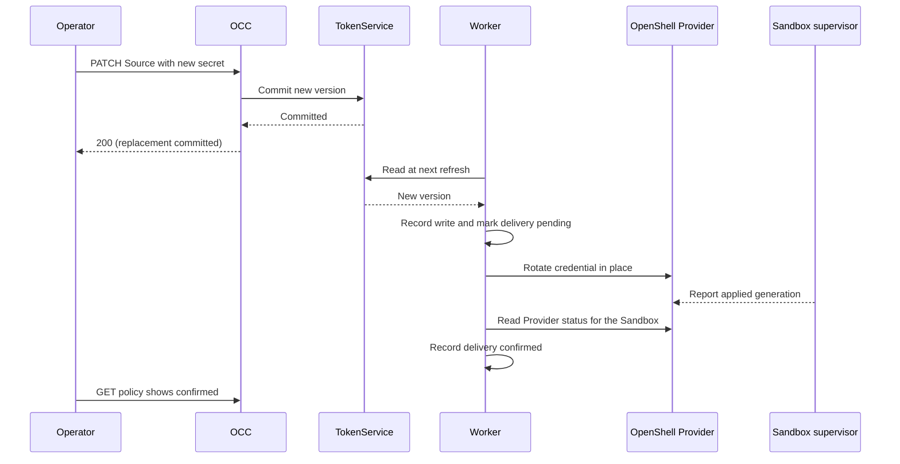

# Proposal: Repository token Source for native Git

- **ID:** RFC-20261123-repository-token-source
- **Created:** 2026-11-23
- **Last updated:** 2026-11-23
- **RFC PR:** [#7149](https://github.com/openclaw/openclaw-enterprise/pull/7149)
- **Related:** [Issue #6993](https://github.com/openclaw/openclaw-enterprise/issues/6993), [Per-Agent repository network policy](20261119-repository-network-policy.md), [credential source ownership](0023-egress-proxy-credential-lifecycle/credential-source-ownership.md), [managed static Sources](../../docs/reference/credential-sources/managed-static.md), [native Git delivery](../../docs/reference/repository-credentials/openshell-git.md)

## Summary

A Namespace can give its Agents native Git access with a fine-grained GitHub personal access token instead of a GitHub App. The token is a managed TokenService Source in that Namespace, selected by ID in the Namespace's repository registration. The Source carries its own repository and access ceiling, which OCC intersects with the Installation ceiling, the registration and each Agent's saved grants. The Worker lends the token to an endpointless OpenShell Provider for at most 15 minutes at a time; the workload sees only a placeholder. Pull request API access stays on the GitHub App path.

## Motivation

Native Git delivery under [RFC-20261119](20261119-repository-network-policy.md) accepts only GitHub App authority: the [repository registry](../../apps/controller/src/drivers/repo/github/access/registry.ts) requires `appId` and `githubInstallationId`, and the [Git Provider](../../apps/controller/src/drivers/egress-proxy/openshell-prepared-git-provider.ts) and [bound rule](../../apps/controller/src/drivers/sandbox/openshell-git-network-policy.ts) accept only an installation Provider. Without a GitHub App, an operator has no supported production path to Git.

TokenService Sources already provide enrolment, write-only custody, audited replacement while bound ([#7006](https://github.com/openclaw/openclaw-enterprise/pull/7006)) and guarded deletion ([`managed-credential-sources.ts`](../../packages/occ/src/managed-credential-sources.ts)). Their only permitted use today is a model provider: the [preset list](../../packages/contracts/src/model-providers.ts) holds `openai` alone.

## Goals

- **G1.** A Source-backed registration gets the same per-Agent read and write enforcement as the App path.
- **G2.** The token never enters the workload, and no API returns it. A Source that holds a repository token never becomes a model credential.
- **G3.** Replacement reaches running Agents without a redeploy; committed and delivered are separate events, and delivered means the target Sandbox applied it.
- **G4.** Revocation, retirement and Stop end access within a stated bound; a stale or uncertain write never extends it, and no installed copy outlives its Source.
- **G5.** App-backed registrations, including pull request access, are unchanged. An Installation without a GitHub App installs and starts.

## Non-goals

REST or GraphQL access with a token; other token classes; selection on the Agent; two credentials in one Agent revision; any OCE check of the token's expiry, permissions or revocation at GitHub.

## Proposal

### Enrol the Source

A caller with `credential_source:create` registers a managed static Source with `POST /namespaces/{namespaceId}/credential-sources`. The preset `github` in `config.provider_preset` marks its permitted use: native Git only. Before custody, OCC accepts only a fine-grained token that the native Git Provider can install, within its size limit and free of the reserved placeholder marker, and refuses every other value. OCC makes no GitHub call. The value is write-only.

The Source config also holds the **Source ceiling** in `config.repositories`: an explicit list of `{ repository, access }` grants, the same shape as the saved policy. OCC refuses a ceiling change in the same request as a new value, and while the registry names the Source.

**Git use is immutable.** The preset is chosen at registration and never changes, whether or not a registration names the Source. OCC refuses, with `409`, adding `github` to an existing Source, removing it or replacing it with another preset, and clearing `config`. A `github` Source therefore never becomes eligible for model delivery or workload projection: every model consumer, Harness authentication and an Agent's `credentialSources` refuse it, and a model Source never becomes a Git credential. The marker stays the existing preset field rather than a separate Git-use field, because the preset already carries destination authority for every Source and needs no migration and no new setting.

### Select it from the registration

A Namespace registration in the repository registry selects the Source with `credentialSource: "cs_…"`. The Source must be in the same Namespace. This is the opt-in; nothing changes for a Namespace whose registrations do not name a Source.

The registry accepts `credentialSource` only with `profiles: ["github-repository"]`, `nativeGit: "v1"` and permissions of metadata and contents. It refuses it with `scopedRest`, `allowStandingApproval`, `pushRefAllowlist`, `transport`, `pullRequestBase` and `draftPullLimit`. The App fields at the registry root become optional together; a registry without an App can hold only Source-backed registrations.

The registry grant identity includes `credentialSource`, so a changed selection makes earlier revisions stale through the existing check. App grant identities stay byte-identical.

**One permission set per selection.** Registrations that one Agent selection resolves to the same Source must carry identical permissions, as the selected-set resolver already requires on the App path. A selection whose registrations differ, for example contents read on one repository and contents write on another, is refused with a reason that names the differing permissions. Per-repository read or write comes from the saved grants, not from differing registrations.

### Effective access

Effective access is the intersection of the Installation's `repositoryNetworkPolicyCeiling`, the registration's contents permission, the Source ceiling and the Agent's saved grants. OpenShell enforces it per repository path: upload-pack for read, plus receive-pack for write. GitHub also enforces the token's own repositories and permissions; where they are narrower, GitHub refuses the request and Git shows that error.

Source-backed delivery keeps the Git-only boundary of RFC-20261119 at deployment and after every replacement: the Provider has zero endpoints, the Sandbox binds exactly the saved repository paths to that Provider, and REST and GraphQL requests are denied before forwarding. Source-backed delivery requires a saved native repository network policy with at least one grant. Without one, deploy refuses the revision; it never falls back to legacy delivery.

### Read the policy

The policy editor keeps the same per-Agent grants. `GET .../sandbox-policy/networking` adds `repositoryCredential`, never the token:

- For an App-backed selection: `{ kind: "github_app" }`.
- For a Source-backed selection and a caller with exact `credential_source:read` on that Source: `{ kind: "credential_source", id, name, state, ceiling }`, the effective access, and the delivery state of each running revision (below).
- For a Source-backed selection and a caller without that permission: `{ kind: "credential_source", readable: false }`. The response names no Source ID, name, state or ceiling and omits effective access and delivery state, which would reveal the ceiling and the Source's versions. The saved grants, version and Installation ceiling stay visible, as today, so the caller can still review and clear them.

### Save and deploy

At save, validate and deploy, OCC resolves the Agent's grants to one credential. With a Source, it refuses:

| Condition                                                                       | Answer                              |
| ------------------------------------------------------------------------------- | ----------------------------------- |
| Source missing, not `ready`, or wrong Namespace, TokenService or preset         | `409`                               |
| Caller or Agent principal lacks `credential_source:operate`                     | `403`                               |
| A saved grant exceeds the Source ceiling                                        | `409` on `/repositoryNetworkPolicy` |
| Grants resolve to more than one credential (App and Source, two Sources)        | `409`                               |
| Registrations that resolve to the Source carry different permissions            | `409`, naming the permissions       |
| Deploy with no saved repository network policy, or an empty one, for the Source | `409` on `/repositoryNetworkPolicy` |

One credential per revision follows from the bound rule, which binds every repository to one Provider.

**Withdrawal survives lost authority.** These refusals never apply to clearing the saved Git grants. A caller with the existing permissions to edit the Agent's policy can always save an empty list, and Stop, with Agent `operate`, always works, while the Source is missing, not `ready` or `deleting`, or the caller or Agent principal has lost `credential_source:operate` or `read` on it.

### Custody and loan

TokenService keeps the value in its Installation-private store, with a new random version per write. The Worker reads it into memory and installs it in an endpointless OpenShell Provider; the workload sees only a stable placeholder.

At each loan the Worker rechecks the Source state, preset, owner, the revision's saved grants against the current ceiling, the Agent principal's `operate` and the token class. A loan ends at most 15 minutes after the authority check that admitted it, and never after the grant's own expiry. It renews before it ends. The loan end is the Provider credential's expiry, not the token's expiry at GitHub, which OCE cannot learn or shorten. The 15-minute bound stays provisional until AC-5 passes.

### Record installed copies

OCC durably records each native Git Provider copy of a Source, per Source and owner, independent of the registry file:

- **Created at deploy.** The deploy transaction that admits a Source-backed revision records the Source ID, its TokenService instance, the Namespace, the Agent and the revision, before the deployment is queued. A pending deployment is therefore already a recorded copy.
- **Completed by the Worker.** The Worker adds the Provider name when it installs the copy, the Source version of each write, whether the target Sandbox confirmed that version, and any write whose outcome is unknown. It records each write before it dispatches it.
- **Retired by the Worker.** The Worker retires a copy, and records the retirement once it reads back that the Provider is gone, at Stop, when the revision is retired or replaced or its deployment ends without a Sandbox, and at start for every copy not yet retired whose revision no longer runs.
- **Kept while the Sandbox runs.** OpenShell does not delete a Provider that a running Sandbox still attaches. A revision that keeps running after the registry stopped selecting its Source therefore keeps its recorded copy. It gets no further loan, the Provider credential expires with the last loan, and the copy is retired when the operator stops or redeploys the Agent. A copy the Worker cannot retire, because the Provider is still attached or the Gateway does not answer, stays recorded with that reason and is retried at the next cleanup or start.

The record survives Worker and controller restarts. It builds on the per-revision delivery record that the Worker already keeps for native Git, which holds the Provider target, the observed generation and a pending write across restarts and survives execution cleanup. What is new is the association with the Source and its owner, its creation at deploy, the Source version and confirmation per write, and the retirement state.

### Replace

The operator sends `PATCH /namespaces/{namespaceId}/credential-sources/{credentialSourceId}` with `credential_source:update` and the new `secret`. The value passes the same checks as at enrolment before custody. TokenService commits the new version and `PATCH` returns: **replacement committed**. OCC sends no model-copy update to the Credential Proxy for a `github` Source; Git delivery has its own path.

The [native Git runtime](../../apps/controller/src/drivers/egress-proxy/openshell-git-runtime.ts) refreshes every 10 seconds, sees the changed material and rotates the same Provider in place. The Provider write being accepted is not delivery. **Delivery confirmed** for a revision means the target Sandbox's supervisor reports, through OpenShell's Provider status for that Sandbox, that it applied the Provider generation written for the new Source version: credentials installed, the expected Provider resource version and environment revision, the bound policy active and read back. Until then that revision's delivery is **pending**. The Worker records both states per revision and Source version, and the policy read shows them. We expect delivery within about one minute.

The operator revokes the old token at GitHub only after the policy read shows delivery confirmed for the new version on every running revision that uses the Source. A Sandbox whose delivery is pending may still hold the old value.

Proposed flow. The class check runs before the commit: a refused token leaves the earlier value in custody and in use.

### Serialize Provider writes

OCC releases its metadata lock before the TokenService write, so that lock cannot order Provider writes. TokenService holds an exclusive lock on the Source's catalog row while it writes custody, and OCC marks a Source `deleting` under the same lock. The Worker holds a shared lock on that row, with a bounded wait, from its state and version check until the Provider write returns. The database ends a hold, and the Worker transaction that reads the loan, once idle past 60 seconds, so a Worker frozen or partitioned while lending cannot block replacement or retirement for longer, and the Worker confirms the hold on its database session immediately before the write. The write also requires the Provider resource version the Worker last observed and runs under the runtime's existing write fence. A Worker that finds a newer version, a Source that is not `ready` or a changed Provider writes nothing.

**Uncertain writes stay fenced.** A Provider write whose outcome is unknown, because its response timed out or was lost, may still take effect after the hold ends. The recorded write keeps the Source fenced: `PATCH` with a new value and `DELETE` answer `409`, naming the unreconciled write, until the Worker has read the Provider back and either superseded the write with a confirmed conditional write of the current version or retired the Provider. The fence is in the copy record, so it survives a Worker or controller restart. Because a loan ends at most 15 minutes after its authority check and never after the grant's expiry, a write that lands late cannot extend access beyond that bound.

### Revocation, stale Sources and Stop

A Source that becomes unauthorized or stale, for example when the Agent principal loses `operate`, is refused at the next save, deploy and loan. The Worker logs a named code once per revision, version and reason. A revision whose saved access exceeds the Source's current limits is refused the same way. The installed loan stays usable until it ends, so access lapses within the provisional 15-minute bound.

Stop retires the Sandbox, as on the App path, and the Worker renews no loan for a stopped revision and retires its recorded copy. The token stays valid at GitHub; OCE cannot revoke it there.

### Retire

`DELETE` with `credential_source:delete` returns `409`, with a reason that names the blocking condition, while:

- the loaded registry names the Source;
- any recorded copy of the Source is not confirmed retired, including a copy whose registry entry was removed before a restart and a copy for a pending deployment;
- a write to a copy has an unknown outcome.

To retire a Source, the operator removes it from the registry and restarts, then stops or redeploys each Agent that used it. Until then those revisions fail the grant check and get no further loan, and their copies stay recorded. The Worker retires each copy once its Sandbox is gone. Once every recorded copy is confirmed retired, `DELETE` marks the Source `deleting` and TokenService removes the value. OCC calls no model-copy retirement for a `github` Source.

### Install and start without a GitHub App

An Installation whose registry holds only Source-backed registrations needs no App key:

- **Helm.** `repositoryCredentials.appKeySecretName` and `repositoryCredentials.appKeyKey` become optional together; setting only one fails rendering. The prepared custody key stays required.
- **Worker Secret projection.** Without those values, the Worker's projected repository volume omits the App key.
- **Signing-key validation.** The Worker validates and opens the App signing key at start only when the loaded registry names an App. A registry with App fields and no readable, valid key still refuses start, as today. App issuance is never reachable without App fields.

The registry decides; there is no new setting.

### Attribution and audit

GitHub attributes pushes to the token's owner, not to the Agent. OCC already audits Source create, update and delete without the value. Deploy adds the Source ID. Worker logs carry the Source ID and version for refusals, pending and confirmed delivery and copy retirement, never the value or a digest of it.

## Interface changes

### APIs

| Change  | Operation                                                                        | Behavior and contract change                                                                                                                                                                                                                              |
| ------- | -------------------------------------------------------------------------------- | --------------------------------------------------------------------------------------------------------------------------------------------------------------------------------------------------------------------------------------------------------- |
| Changed | POST `/namespaces/{namespaceId}/credential-sources`                              | Preset `github` and the Source ceiling in `config`. Value checked before custody. Model consumers refuse the preset.                                                                                                                                      |
| Changed | PATCH `/namespaces/{namespaceId}/credential-sources/{credentialSourceId}`        | Value checked before custody. `409` for any change to or removal of the `github` preset, clearing `config`, and a new value while a write to a copy is unreconciled. Ceiling changes only without a new value and while no registration names the Source. |
| Changed | DELETE `/namespaces/{namespaceId}/credential-sources/{credentialSourceId}`       | `409` with a named reason while the loaded registry names the Source, a recorded copy is not confirmed retired, or a write is unreconciled.                                                                                                               |
| Changed | GET, PUT and POST `/validate` on `.../sandbox-policy/networking`, POST `/deploy` | Refusals in the save table; clearing grants is never refused for Source reasons. GET adds `repositoryCredential`; Source metadata, effective access and delivery state require exact `credential_source:read`.                                            |

### IAM

| Operation or capability              | Required permission and scope                                                                                     | What changes                                                                   |
| ------------------------------------ | ----------------------------------------------------------------------------------------------------------------- | ------------------------------------------------------------------------------ |
| Enrol, replace, retire               | `credential_source:create`, `update`, `delete` in the Namespace                                                   | No changes; reused.                                                            |
| Save and deploy                      | Existing policy permissions plus `credential_source:operate` on the Source for the caller and the Agent principal | Reused, as for model Sources; checked again at each loan. Not needed to clear. |
| Read Source metadata in a policy GET | Existing policy read plus exact `credential_source:read` on the Source                                            | New field-level check; without it the Source is reported only as unreadable.   |
| Clear grants, Stop                   | Existing policy edit permissions; Agent `operate` for Stop                                                        | No Source permission or state required.                                        |

### Database entities

| Entity                       | Change                                                                                                                                                                      | Persistence semantics                                                                                                              |
| ---------------------------- | --------------------------------------------------------------------------------------------------------------------------------------------------------------------------- | ---------------------------------------------------------------------------------------------------------------------------------- |
| Repository Source copy (new) | Per Source-backed revision: Source ID, TokenService instance, Namespace, Agent, revision, Provider name, Source version per write, confirmation, unknown write, retirement. | Created in the deploy transaction; updated by the Worker before each write and after each read-back; survives restarts. Migration. |

The revision still freezes the Source through the existing registry grant identity, the catalog row already exists and the value stays in TokenService custody.

### Driver contracts

- Repo: the registration field `credentialSource`, optional App fields, and a resolved credential that is the App installation or a Source reference.
- Credential Proxy: the native Git Provider accepts a Source reference in place of an installation ID, with its own name prefix and a 15-minute loan limit. It reports the generation the target Sandbox applied, and retires a recorded copy by Provider name with read-back confirmation.
- Sandbox: the bound Git rule accepts the Source Provider name; one Provider per revision stays.
- TokenService: no change; `resolveCredential` already returns the custody version.

## Simplifications

Selection in the registry needs no Agent model change or admission version; the copy record needs one migration. Reusing the Source lifecycle avoids a Worker-mounted Secret, a Helm value and file-based versioning. No infrastructure simplifications.

## Acceptance Criteria

Use an installed OpenShell environment, a controlled Git origin that accepts fake token values, regular saved Agents and an authorized Admin. AC-1 to AC-6 keep their numbers and are extended; AC-7 to AC-10 are new.

- **AC-1 (G1, G5).** With a Source-backed registration, repeat AC-1 and AC-2 of RFC-20261119 for Git: A read, B write, C none; forbidden operations are denied with zero origin requests; narrowing is confirmed by readback. Carry forward its AC-3 and AC-4 for the Source Provider: direct REST and GraphQL requests are denied with zero upstream requests, the Provider has zero endpoints, and the Sandbox binds exactly the saved repository paths to it. The App journey passes unchanged.
- **AC-2 (G2).** After deploy, after replacement and on a peer Agent, the token is absent from the Sandbox's process environments, command lines, Git configuration and files.
- **AC-3 (G3).** `PATCH` a new value; the origin receives it without a redeploy. Record replacement committed, delivery pending and delivery confirmed as separate timestamps; confirmed follows the target Sandbox's applied-generation report, and the policy read shows pending, then confirmed. After the replacement, repeat the AC-1 boundary checks: REST and GraphQL denials with zero upstream requests, zero Provider endpoints and the exact Sandbox binding. A classic token is refused at `PATCH`, and the earlier value keeps working.
- **AC-4 (G4).** Serialize native Provider writes with Source replacement and retirement. Exercise a paused Worker across replacement and across retirement. Make a Provider write whose response is lost: `PATCH` with a new value and `DELETE` answer `409` until the Worker reads the Provider back and reconciles, also across a Worker restart, and the late write never extends access beyond 15 minutes after its authority check or past the grant's expiry. A stale write never extends access or restores the old value after rotation.
- **AC-5 (G4).** Prove the 15-minute bound with a saved Agent whose Worker cannot renew and a fake token the test origin still accepts. The supervisor stops injecting at expiry, and a peer Agent is unaffected by the withdrawal. The bound stays provisional until observed.
- **AC-6 (G4).** Each refusal in the save table answers as listed at save and deploy, including differing registration permissions and a deploy with no saved policy, which never falls back to legacy delivery. Removing the Agent principal's `operate` refuses the next loan. With the Source missing, not `ready`, and with the caller's `operate` removed, clearing the saved grants succeeds and Stop retires the Sandbox. A policy reader without `credential_source:read` sees the saved grants and no Source ID, name, state, ceiling, effective access or delivery state. `DELETE` answers `409` while the registry names the Source. After Stop, no request receives the token.
- **AC-7 (G2).** For a bound and an unbound Source, `PATCH` that adds `github`, removes it, replaces it with another preset or clears `config` answers `409` and leaves the Source unchanged. A `github` Source is refused as Harness authentication and in an Agent's `credentialSources`.
- **AC-8 (G4).** Deploy a Source-backed Agent, remove the Source from the registry and restart the controller and Worker. While the Agent keeps running, `DELETE` answers `409` naming the unretired copy, and after the last loan ends the Sandbox's Git requests no longer receive the token. After Stop or a redeploy without the Source, the Worker confirms the Provider retired and `DELETE` succeeds. Repeat with a deployment still pending at the registry removal, and with the Worker stopped during retirement and restarted.
- **AC-9 (G5).** Install with a Source-only registry and no App key Secret or Helm App-key values. The controller and Worker start, and a saved Agent performs a Git read and a write. A registry with App fields and no key refuses start, and an App-backed installation keeps its key validation.
- **AC-10 (G1).** Two registrations select the same Source with contents read and contents write. Saving and deploying an Agent bound to both answers `409` naming the differing permissions; with identical permissions and saved grants A read and B write, the deploy succeeds and AC-1's enforcement holds.

## Delivery and verification

Implementation proceeds in parallel with this review, in three draft PRs: Source enrolment for Git (inert alone), native Git delivery with the saved-Agent tests, and the policy read, Console and docs. No criterion has run on this design; the file-based prototype is partial evidence for AC-1 to AC-3.

Not yet implemented in any draft: the copy record and the `DELETE` and `PATCH` refusals that read it (AC-4, AC-8), delivery state in the policy read and the Source metadata it adds (AC-3, AC-6), and the optional Helm App-key values (AC-9).

## Rationale and alternatives

- **Select the Source on the Agent.** Self-service, but it needs a migration relaxing the v9 admission rule in [0090](../../migrations/0090_native_git_delivery.sql), an end to the rule that a TokenService Source authenticates the Harness, and Compute changes. It can follow later.
- **A Kubernetes Secret mounted in the Worker.** Smaller, but replacement has no actor in the audit and needs `kubectl`.
- **A GitHub probe at enrolment.** It adds a network call to enrolment, and its result goes stale.
- **A separate Git-use field.** It would duplicate the destination authority the preset already carries and need its own immutability rules.
- **Per-repository permissions under one Source.** The runtime checks one contents permission per selection; saved grants already give per-repository read or write.

## Unresolved questions

1. **Serialization (Credential Delivery).** Is a shared row lock plus a conditional Provider write, with a durable fence for uncertain writes, acceptable? AC-4 binds either way.
2. **Loan window (Credential Delivery).** Is 15 minutes the right revocation lag?
3. **Ceiling encoding.** Config values are strings of at most 2,048 characters, so the ceiling is one encoded value. Is a typed field preferred?
