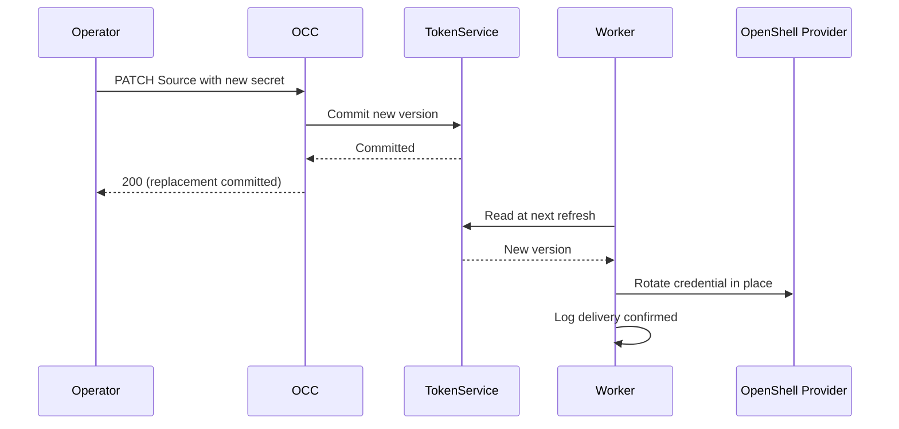

# Proposal: Repository token Source for native Git

- **ID:** RFC-20261123-repository-token-source
- **Created:** 2026-11-23
- **Last updated:** 2026-11-23
- **RFC PR:** [#7149](https://github.com/openclaw/openclaw-enterprise/pull/7149)
- **Related:** [Issue #6993](https://github.com/openclaw/openclaw-enterprise/issues/6993), [Per-Agent repository network policy](20261119-repository-network-policy.md), [credential source ownership](0023-egress-proxy-credential-lifecycle/credential-source-ownership.md), [managed static Sources](../../docs/reference/credential-sources/managed-static.md), [native Git delivery](../../docs/reference/repository-credentials/openshell-git.md)

## Summary

A Namespace can give its Agents native Git access with a fine-grained GitHub personal access token instead of a GitHub App. The token is a managed TokenService Source in that Namespace, selected by ID in the Namespace's repository registration. The Source carries its own repository and access ceiling, which OCC intersects with the Installation ceiling, the registration and each Agent's saved grants. The Worker lends the token to an endpointless OpenShell Provider for at most 15 minutes at a time; the workload sees only a placeholder. Pull request API access stays on the GitHub App path.

## Motivation

Native Git delivery under [RFC-20261119](20261119-repository-network-policy.md) accepts only GitHub App authority: the [repository registry](../../apps/controller/src/drivers/repo/github/access/registry.ts) requires `appId` and `githubInstallationId`, and the [Git Provider](../../apps/controller/src/drivers/egress-proxy/openshell-prepared-git-provider.ts) and [bound rule](../../apps/controller/src/drivers/sandbox/openshell-git-network-policy.ts) accept only an installation Provider. Without a GitHub App, an operator has no supported production path to Git.

TokenService Sources already provide enrolment, write-only custody, audited replacement while bound ([#7006](https://github.com/openclaw/openclaw-enterprise/pull/7006)) and guarded deletion ([`managed-credential-sources.ts`](../../packages/occ/src/managed-credential-sources.ts)). Their only permitted use today is a model provider: the [preset list](../../packages/contracts/src/model-providers.ts) holds `openai` alone.

## Goals

- **G1.** A Source-backed registration gets the same per-Agent read and write enforcement as the App path.
- **G2.** The token never enters the workload, and no API returns it.
- **G3.** Replacement reaches running Agents without a redeploy; committed and delivered are separate events.
- **G4.** Revocation, retirement and Stop end access within a stated bound; a stale write never extends it.
- **G5.** App-backed registrations, including pull request access, are unchanged.

## Non-goals

REST or GraphQL access with a token; other token classes; selection on the Agent; two credentials in one Agent revision; any OCE check of the token's expiry, permissions or revocation at GitHub.

## Proposal

### Enrol the Source

A caller with `credential_source:create` registers a managed static Source with `POST /namespaces/{namespaceId}/credential-sources`. The new preset `github` marks its permitted use. Before custody, OCC accepts a fine-grained token and refuses every other class. OCC makes no GitHub call. The value is write-only.

The Source config also holds the **Source ceiling**: an explicit list of `{ repository, access }` grants, the same shape as the saved policy. OCC refuses a change to the preset or the ceiling while the registry names the Source.

### Select it from the registration

A Namespace registration in the repository registry selects the Source with `credentialSource: "cs_…"`. The Source must be in the same Namespace. This is the opt-in; nothing changes for a Namespace whose registrations do not name a Source.

The registry accepts `credentialSource` only with `profiles: ["github-repository"]`, `nativeGit: "v1"` and permissions of metadata and contents. It refuses it with `scopedRest`, `allowStandingApproval`, `pushRefAllowlist`, `transport`, `pullRequestBase` and `draftPullLimit`. The App fields at the registry root become optional together; a registry without an App can hold only Source-backed registrations.

The registry grant identity includes `credentialSource`, so a changed selection makes earlier revisions stale through the existing check. App grant identities stay byte-identical.

### Effective access

Effective access is the intersection of the Installation's `repositoryNetworkPolicyCeiling`, the registration's contents permission, the Source ceiling and the Agent's saved grants. OpenShell enforces it per repository path: upload-pack for read, plus receive-pack for write. GitHub also enforces the token's own repositories and permissions; where they are narrower, GitHub refuses the request and Git shows that error.

The policy editor keeps the same per-Agent grants. The policy read adds Source metadata and effective access, never the token.

### Save and deploy

At save, validate and deploy, OCC resolves the Agent's grants to one credential. With a Source, it refuses:

| Condition                                                                | Answer                              |
| ------------------------------------------------------------------------ | ----------------------------------- |
| Source missing, not `ready`, or wrong Namespace, TokenService or preset  | `409`                               |
| Caller or Agent principal lacks `credential_source:operate`              | `403`                               |
| A saved grant exceeds the Source ceiling                                 | `409` on `/repositoryNetworkPolicy` |
| Grants resolve to more than one credential (App and Source, two Sources) | `409`                               |

One credential per revision follows from the bound rule, which binds every repository to one Provider.

### Custody and loan

TokenService keeps the value in its Installation-private store, with a new random version per write. The Worker reads it into memory and installs it in an endpointless OpenShell Provider; the workload sees only a stable placeholder.

At each loan the Worker rechecks the Source state, preset, owner and ceiling, the Agent principal's `operate` and the token class. A loan lasts at most 15 minutes and renews before it ends. The loan end is the Provider credential's expiry, not the token's expiry at GitHub, which OCE cannot learn or shorten.

### Replace

The operator sends `PATCH` with `credential_source:update` and the new `secret`. TokenService commits the new version and `PATCH` returns: **replacement committed**. The Credential Proxy update from #7006 finds no per-Source Provider copy for native Git and does nothing.

The [native Git runtime](../../apps/controller/src/drivers/egress-proxy/openshell-git-runtime.ts) refreshes every 10 seconds, sees the changed material and rotates the same Provider in place. The Worker then logs **delivery confirmed** per Agent revision with the Source ID and version. We expect a delay of about one minute; a file-based prototype measured 42.5 to 68.8 seconds, and this path is not yet measured. The operator revokes the old token at GitHub once delivery is confirmed for every running revision, or after one loan window.

Proposed flow. The class check runs before the commit: a refused token leaves the earlier value in custody and in use.

### Serialize Provider writes

OCC releases its metadata lock before the TokenService write, so that lock cannot order Provider writes. TokenService holds an exclusive lock on the Source's catalog row while it writes custody, and OCC marks a Source `deleting` under the same lock. The Worker holds a shared lock on that row, with a bounded wait, from its state and version check until the Provider write returns. The database ends a hold that stays idle past 60 seconds, so a frozen or partitioned Worker cannot block replacement or retirement for longer, and the Worker confirms the hold on its database session immediately before the write. The write also requires the Provider resource version the Worker last observed and runs under the runtime's existing write fence. A Worker that finds a newer version, a Source that is not `ready` or a changed Provider writes nothing.

### Revocation, stale Sources and Stop

A Source that becomes unauthorized or stale, for example when the Agent principal loses `operate`, is refused at the next save, deploy and loan. The Worker logs a named code once per revision, version and reason. A revision whose saved access exceeds the Source's current limits is refused the same way. The installed loan stays usable until it ends, so access lapses within the provisional 15-minute bound.

Stop retires the Sandbox, as on the App path, and the Worker renews no loan for a stopped revision. The token stays valid at GitHub; OCE cannot revoke it there.

### Retire

`DELETE` with `credential_source:delete` also returns `409` while the loaded registry names the Source. To retire a Source, the operator removes it from the registry and restarts; revisions that used it fail the grant check and get no further loan. Then `DELETE` marks the Source `deleting` and TokenService removes the value.

### Attribution and audit

GitHub attributes pushes to the token's owner, not to the Agent. OCC already audits Source create, update and delete without the value. Deploy adds the Source ID. Worker logs carry the Source ID and version for refusals and confirmed delivery, never the value or a digest of it.

## Interface changes

### APIs

| Change  | Operation                                                                        | Behavior and contract change                                                                                               |
| ------- | -------------------------------------------------------------------------------- | -------------------------------------------------------------------------------------------------------------------------- |
| Changed | POST and PATCH `/namespaces/{namespaceId}/credential-sources`                    | Preset `github` and the Source ceiling in `config`. Token class checked before custody. Model consumers refuse the preset. |
| Changed | DELETE `/namespaces/{namespaceId}/credential-sources/{id}`                       | `409` while the loaded registry names the Source.                                                                          |
| Changed | GET, PUT and POST `/validate` on `.../sandbox-policy/networking`, POST `/deploy` | Refusals in the save table. GET adds `repositoryCredential` (kind, Source ID, name, state, ceiling) and effective access.  |

### IAM

| Operation or capability | Required permission and scope                                                                                     | What changes                                              |
| ----------------------- | ----------------------------------------------------------------------------------------------------------------- | --------------------------------------------------------- |
| Enrol, replace, retire  | `credential_source:create`, `update`, `delete` in the Namespace                                                   | No changes; reused.                                       |
| Save and deploy         | Existing policy permissions plus `credential_source:operate` on the Source for the caller and the Agent principal | Reused, as for model Sources; checked again at each loan. |

### Database entities

No changes. The revision freezes the Source through the existing registry grant identity, the catalog row already exists and the value stays in TokenService custody.

### Driver contracts

- Repo: the registration field `credentialSource`, optional App fields, and a resolved credential that is the App installation or a Source reference.
- Credential Proxy: the native Git Provider accepts a Source reference in place of an installation ID, with its own name prefix and a 15-minute loan limit.
- Sandbox: the bound Git rule accepts the Source Provider name; one Provider per revision stays.
- TokenService: no change; `resolveCredential` already returns the custody version.

## Simplifications

Selection in the registry needs no migration, admission version or Agent model change. Reusing the Source lifecycle avoids a Worker-mounted Secret, a Helm value and file-based versioning. No infrastructure simplifications.

## Acceptance Criteria

Use an installed OpenShell environment, a controlled Git origin that accepts fake token values, regular saved Agents and an authorized Admin.

- **AC-1 (G1, G5).** With a Source-backed registration, repeat AC-1 and AC-2 of RFC-20261119 for Git: A read, B write, C none; forbidden operations are denied with zero origin requests; narrowing is confirmed by readback. The App journey passes unchanged.
- **AC-2 (G2).** After deploy, after replacement and on a peer Agent, the token is absent from the Sandbox's process environments, command lines, Git configuration and files.
- **AC-3 (G3).** `PATCH` a new value; the origin receives it without a redeploy. Record replacement committed and delivery confirmed as separate timestamps. A classic token is refused at `PATCH`, and the earlier value keeps working.
- **AC-4 (G4).** Serialize native Provider writes with Source replacement and retirement. Exercise a paused Worker across replacement and across retirement. A stale write never extends access or restores the old value after rotation.
- **AC-5 (G4).** Prove the 15-minute bound with a saved Agent whose Worker cannot renew and a fake token the test origin still accepts. The supervisor stops injecting at expiry, and a peer Agent is unaffected by the withdrawal. The bound stays provisional until observed.
- **AC-6 (G4).** Each refusal in the save table answers as listed at save and deploy. Removing the Agent principal's `operate` refuses the next loan. `DELETE` answers `409` while the registry names the Source. After Stop, no request receives the token.

## Delivery and verification

Implementation proceeds in parallel with this review, in three draft PRs: Source enrolment for Git (inert alone), native Git delivery with the saved-Agent tests, and the policy read, Console and docs. No criterion has run on this design; the file-based prototype is partial evidence for AC-1 to AC-3.

## Rationale and alternatives

- **Select the Source on the Agent.** Self-service, but it needs a migration relaxing the v9 admission rule in [0090](../../migrations/0090_native_git_delivery.sql), an end to the rule that a TokenService Source authenticates the Harness, and Compute changes. It can follow later.
- **A Kubernetes Secret mounted in the Worker.** Smaller, but replacement has no actor in the audit and needs `kubectl`.
- **A GitHub probe at enrolment.** It adds a network call to enrolment, and its result goes stale.

## Unresolved questions

1. **Serialization (Credential Delivery).** Is a shared row lock plus a conditional Provider write acceptable? AC-4 binds either way.
2. **Loan window (Credential Delivery).** Is 15 minutes the right revocation lag?
3. **Permitted use.** Is preset `github` the right marker, or should Git use be a separate config key?
4. **Ceiling encoding.** Config values are strings of at most 2,048 characters, so the ceiling is one encoded value. Is a typed field preferred?
5. **Delivery visibility.** Should the policy read show delivery confirmed per revision, or is the Worker log enough?
