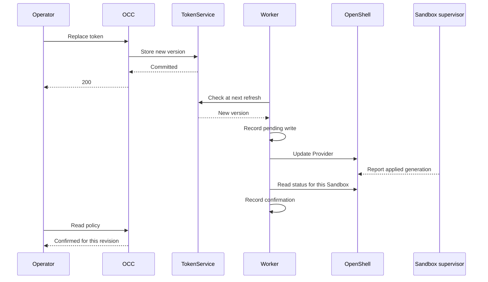

# Installed copies, replacement and retirement of the repository token Source

[The proposal](index.md) lets a Namespace use a fine-grained token for Git. An operator needs two answers after changing it. Which Sandboxes have the new token? Can any still use the old one? The Worker keeps a record for each revision so it can answer both questions after a restart.

## Register and read a Source

A registration selects a Source in its own Namespace with `profiles: ["github-repository"]`, `nativeGit: "v1"` and only metadata and contents permissions. It rejects `scopedRest`, `allowStandingApproval`, `pushRefAllowlist`, `transport`, `pullRequestBase` and `draftPullLimit`. Registry fields `appId` and `githubInstallationId` are optional together. Without them every registration must name a Source.

`GET .../sandbox-policy/networking` adds `repositoryCredential`. App selections return `{ kind: "github_app" }`. With exact Source read access, callers see `{ kind: "credential_source", id, name, state, ceiling }`, effective access and [delivery by running revision](lifecycle.md#replace). Others see only `{ kind: "credential_source", readable: false }` plus the usual saved grants, version and Installation ceiling.

## Save and deploy

| At save, validation and deployment                                 | Result                                                              |
| ------------------------------------------------------------------ | ------------------------------------------------------------------- |
| Source missing, unready or wrong Namespace, TokenService or preset | `409`                                                               |
| Caller or Agent principal lacks Source `operate`                   | `403`                                                               |
| Grant exceeds the Source's list                                    | `409` on `/repositoryNetworkPolicy`                                 |
| Two Sources or a Source and an App                                 | `409`                                                               |
| Selected registrations have different permissions                  | `409` naming the difference                                         |
| Deploy with missing or empty saved policy                          | `409` on `/repositoryNetworkPolicy`. No fallback to legacy delivery |

Create and replacement reject a token of the wrong class, an oversized value or a value containing the reserved placeholder marker before storage. Check the actual GitHub permissions again on replacement. Even on an unbound Source, changing to or from the `github` preset or clearing its configuration returns `409`. Change the repository list separately from the token and only while no registration names the Source.

## Record installed copies

In the transaction that queues deployment, OCC records the Source ID, TokenService instance, Namespace, Agent and revision. Even a queued deployment can leave a copy behind. The Worker adds the Provider name and records each write before sending it, the Source version it sent, whether the Sandbox confirmed it and whether the write's outcome is unknown. The copy record is separate from the native Git delivery record and survives execution cleanup.

At Stop, replacement or retirement of a revision, or if deployment ends without a Sandbox, the Worker checks that the Provider is gone before marking the copy retired. OpenShell cannot delete a Provider while a Sandbox uses it. If a Sandbox still holds it or the Gateway cannot answer, the Worker records the reason. It checks again during cleanup, at startup and every five minutes. On startup it checks every unretired copy whose revision no longer runs.

## Replace

For routine rotation, the operator sends a new `secret` to `PATCH /namespaces/{namespaceId}/credential-sources/{credentialSourceId}`. The same checks apply as at [registration](index.md#enrol-the-source). A rejected value leaves the old one in use.

| What the operator sees | What happened                                                                                                                                                                                                                     |
| ---------------------- | --------------------------------------------------------------------------------------------------------------------------------------------------------------------------------------------------------------------------------- |
| Replacement committed  | TokenService stored the value under a new random version. `PATCH` returns `200`. A Sandbox can still use the old token.                                                                                                           |
| `pending`              | The [native Git runtime](../../../apps/controller/src/drivers/egress-proxy/openshell-git-runtime.ts) checks every 10 seconds and updates the existing Provider. The Worker is waiting for the target Sandbox to apply the change. |
| `confirmed`            | The Worker read the target supervisor's report through OpenShell. Credentials are installed, the Provider resource version and environment revision match, and the bound policy is active and verified.                           |
| `unreconciled`         | The Worker cannot tell how a write ended. Stop or redeploy the named Agent to retire the copy.                                                                                                                                    |

For a routine rotation, read the policy and wait for `confirmed` on every running revision using the Source before revoking the old token at GitHub. For a compromised token, revoke it at GitHub immediately, even if that interrupts other users of the token.

The sequence below shows a proposed successful rotation for one running revision.

## Serialize Provider writes

TokenService takes an exclusive lock on the Source catalog row for replacement. Deletion takes the same lock to mark the Source `deleting`. The Worker waits a limited time for a shared lock and holds it from the authority and version check through the Provider response. A 60-second idle timeout on the lock and loan transactions limits how long a stalled Worker can hold them. This does not guarantee a response within 60 seconds.

Immediately before sending a write, the Worker confirms it still holds the lock on its database session. The existing runtime write fence applies. The Provider must still have the resource version the Worker read. If the Source version or Provider changed, the lock was lost or the Source is no longer `ready`, the Worker must not send the write.

A timeout cannot cancel a write already in flight. The Worker clears the record only when it proves the outcome. Until then, a new value or `DELETE` returns `409` naming the Agent and revision. Metadata edits can proceed. A change to the repository list still requires an unbound Source. The Worker sends no further credential to that revision, even after restart. It does not overwrite a write whose outcome it cannot establish. Stop or redeploy releases the block once the Worker confirms the Provider is gone. A late write retains its original expiration.

## Revocation, stale Sources and Stop

At each loan the Worker checks the Source owner, state and preset, the revision's saved grants against the current list, the Agent principal's `credential_source:operate` and the token class. It renews before expiry only while those checks pass. If the Agent loses authority or a saved grant exceeds the new limits, the Worker refuses the next loan. Saving or deploying the same grants also fails.

- **Healthy connection.** The proposal calls for the Worker to withdraw the installed credential promptly when it detects lost authority. Record when the Sandbox stops sending it. Today the draft refuses renewal and an installed credential can keep working until expiry.
- **Outage.** If the Worker cannot reach the Sandbox, its supervisor must stop injecting the credential when the loan expires. The draft fixes the maximum at 15 minutes from the authority check, even if the write arrives late. This proposal keeps that upper bound and lets operators set a shorter limit. The shorter limit is not implemented. A loan must never outlast its grant. This deadline does not change the PAT's lifetime at GitHub. [AC-5](acceptance.md#acceptance-criteria) tests both cases.
- **Stop.** The Worker ends renewal, removes the Sandbox and confirms retirement of its Provider. Revoking the PAT at GitHub affects every user of that token. Stopping one Agent leaves its peers alone.
- **Upgrade.** A revision whose Worker no longer delivers to it gets no renewal or replacement. Its loan expires and a replacement reads `pending`. Redeploy to create a new copy and retire the old one.

## Retire

Remove the Source from the registry and restart to load the change. At startup the Worker checks running revisions against the registry. A revision that lost its binding fails that check. The Worker removes its Sandbox and retires its copy automatically. The Agent needs a new deployment to run again.

`DELETE` returns `409` with the reason while the loaded registry names the Source, any copy remains unretired (including queued deployments) or any write is unresolved. Once all three conditions clear, OCC marks the Source `deleting` and TokenService removes the value. Neither replacement nor retirement uses the model delivery path.

## Install and start without a GitHub App

For native Git with only Source registrations, keep the separate repository broker off and leave `repositoryCredentials.appKeySecretName` empty. Helm can keep the default `appKeyKey` filename. If you specify an App key Secret, Helm requires its key name too. The Worker volume omits the App key and still requires the prepared custody key. The Worker opens and validates an App signing key only if the loaded registry names an App. Then a missing or invalid key blocks startup. Without an App the Worker cannot issue App tokens. The separate repository broker still requires an App key.

## Attribution and audit

GitHub attributes pushes to the token owner. OCC audits Source creation, updates and deletion and records the Source ID at deployment. The Worker logs each refusal code once per revision, available version and reason. It records pending delivery, confirmation and retirement with Source ID and version when available. Logs and audit events contain neither the token nor its digest.

See [acceptance criteria and delivery](acceptance.md) for the tests and observed limits.
