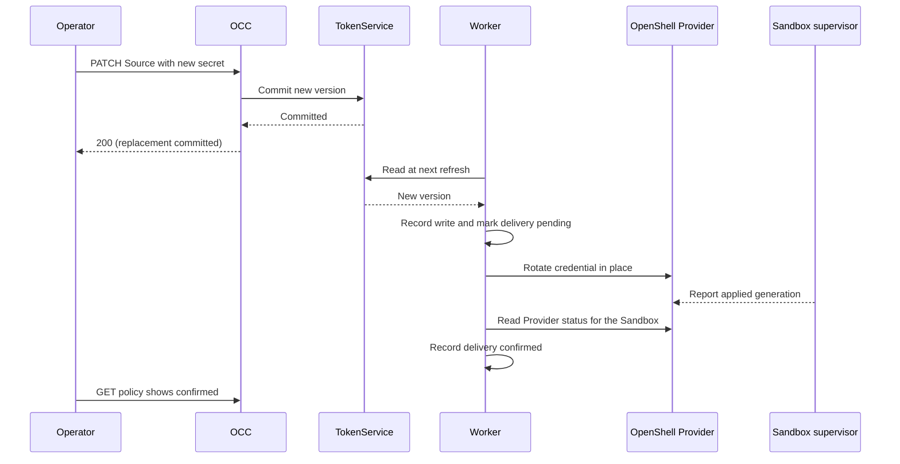

# Installed copies, replacement and retirement of the repository token Source

This companion continues the proposal of [RFC-20261123-repository-token-source](index.md): how OCC records installed copies of a Source, replaces and serializes Provider writes, handles revocation and Stop, retires a Source, starts without a GitHub App and audits the result. The RFC entry point owns enrolment, selection, effective access, the policy read, the save table, custody and the loan. [Acceptance criteria](acceptance.md) bind this behaviour.

## Record installed copies

OCC durably records each native Git Provider copy of a Source, per Source and owner, independent of the registry file:

- **Created at deploy.** The deploy transaction that admits a Source-backed revision records the Source ID, its TokenService instance, the Namespace, the Agent and the revision, before the deployment is queued. A pending deployment is therefore already a recorded copy.
- **Completed by the Worker.** The Worker adds the Provider name when it installs the copy, the Source version of each write, whether the target Sandbox confirmed that version, and any write whose outcome is unknown. It records each write before it dispatches it.
- **Retired by the Worker.** The Worker retires a copy, and records the retirement once it reads back that the Provider is gone, at Stop, when the revision is retired or replaced or its deployment ends without a Sandbox, and at start for every copy not yet retired whose revision no longer runs.
- **Kept while the Sandbox runs.** OpenShell does not delete a Provider that a running Sandbox still attaches. A revision that keeps running after the registry stopped selecting its Source therefore keeps its recorded copy. It gets no further loan, the Provider credential expires with the last loan, and the copy is retired when the operator stops or redeploys the Agent. A copy the Worker cannot retire, because the Provider is still attached or the Gateway does not answer, stays recorded with that reason and is retried at the next cleanup or start.

The record survives Worker and controller restarts. It builds on the per-revision delivery record that the Worker already keeps for native Git, which holds the Provider target, the observed generation and a pending write across restarts and survives execution cleanup. What is new is the association with the Source and its owner, its creation at deploy, the Source version and confirmation per write, and the retirement state.

## Replace

The operator sends `PATCH /namespaces/{namespaceId}/credential-sources/{credentialSourceId}` with `credential_source:update` and the new `secret`. The value passes the same checks as at enrolment before custody. TokenService commits the new version and `PATCH` returns: **replacement committed**. OCC sends no model-copy update to the Credential Proxy for a `github` Source; Git delivery has its own path.

The [native Git runtime](../../../apps/controller/src/drivers/egress-proxy/openshell-git-runtime.ts) refreshes every 10 seconds, sees the changed material and rotates the same Provider in place. The Provider write being accepted is not delivery. **Delivery confirmed** for a revision means the target Sandbox's supervisor reports, through OpenShell's Provider status for that Sandbox, that it applied the Provider generation written for the new Source version: credentials installed, the expected Provider resource version and environment revision, the bound policy active and read back. Until then that revision's delivery is **pending**. The Worker records both states per revision and Source version, and the policy read shows them. We expect delivery within about one minute.

The operator revokes the old token at GitHub only after the policy read shows delivery confirmed for the new version on every running revision that uses the Source. A Sandbox whose delivery is pending may still hold the old value.

Proposed flow. The class check runs before the commit: a refused token leaves the earlier value in custody and in use.

## Serialize Provider writes

OCC releases its metadata lock before the TokenService write, so that lock cannot order Provider writes. TokenService holds an exclusive lock on the Source's catalog row while it writes custody, and OCC marks a Source `deleting` under the same lock. The Worker holds a shared lock on that row, with a bounded wait, from its state and version check until the Provider write returns. The database ends a hold, and the Worker transaction that reads the loan, once idle past 60 seconds, so a Worker frozen or partitioned while lending cannot block replacement or retirement for longer, and the Worker confirms the hold on its database session immediately before the write. The write also requires the Provider resource version the Worker last observed and runs under the runtime's existing write fence. A Worker that finds a newer version, a Source that is not `ready` or a changed Provider writes nothing.

**Uncertain writes stay fenced.** A Provider write whose outcome is unknown, because its response timed out or was lost, may still take effect after the hold ends. The recorded write keeps the Source fenced: `PATCH` with a new value and `DELETE` answer `409`, naming the unreconciled write, until the Worker has read the Provider back and either superseded the write with a confirmed conditional write of the current version or retired the Provider. The fence is in the copy record, so it survives a Worker or controller restart. Because a loan ends at most 15 minutes after its authority check and never after the grant's expiry, a write that lands late cannot extend access beyond that bound.

## Revocation, stale Sources and Stop

A Source that becomes unauthorized or stale, for example when the Agent principal loses `operate`, is refused at the next save, deploy and loan. The Worker logs a named code once per revision, version and reason. A revision whose saved access exceeds the Source's current limits is refused the same way. The installed loan stays usable until it ends, so access lapses within the provisional 15-minute bound.

Stop retires the Sandbox, as on the App path, and the Worker renews no loan for a stopped revision and retires its recorded copy. The token stays valid at GitHub; OCE cannot revoke it there.

## Retire

`DELETE` with `credential_source:delete` returns `409`, with a reason that names the blocking condition, while:

- the loaded registry names the Source;
- any recorded copy of the Source is not confirmed retired, including a copy whose registry entry was removed before a restart and a copy for a pending deployment;
- a write to a copy has an unknown outcome.

To retire a Source, the operator removes it from the registry and restarts, then stops or redeploys each Agent that used it. Until then those revisions fail the grant check and get no further loan, and their copies stay recorded. The Worker retires each copy once its Sandbox is gone. Once every recorded copy is confirmed retired, `DELETE` marks the Source `deleting` and TokenService removes the value. OCC calls no model-copy retirement for a `github` Source.

## Install and start without a GitHub App

An Installation whose registry holds only Source-backed registrations needs no App key:

- **Helm.** `repositoryCredentials.appKeySecretName` and `repositoryCredentials.appKeyKey` become optional together; setting only one fails rendering. The prepared custody key stays required.
- **Worker Secret projection.** Without those values, the Worker's projected repository volume omits the App key.
- **Signing-key validation.** The Worker validates and opens the App signing key at start only when the loaded registry names an App. A registry with App fields and no readable, valid key still refuses start, as today. App issuance is never reachable without App fields.

The registry decides; there is no new setting.

## Attribution and audit

GitHub attributes pushes to the token's owner, not to the Agent. OCC already audits Source create, update and delete without the value. Deploy adds the Source ID. Worker logs carry the Source ID and version for refusals, pending and confirmed delivery and copy retirement, never the value or a digest of it.
