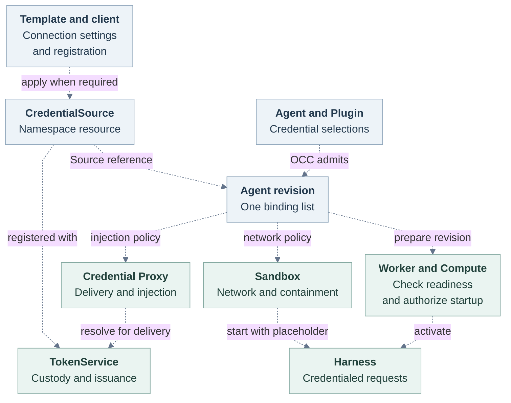
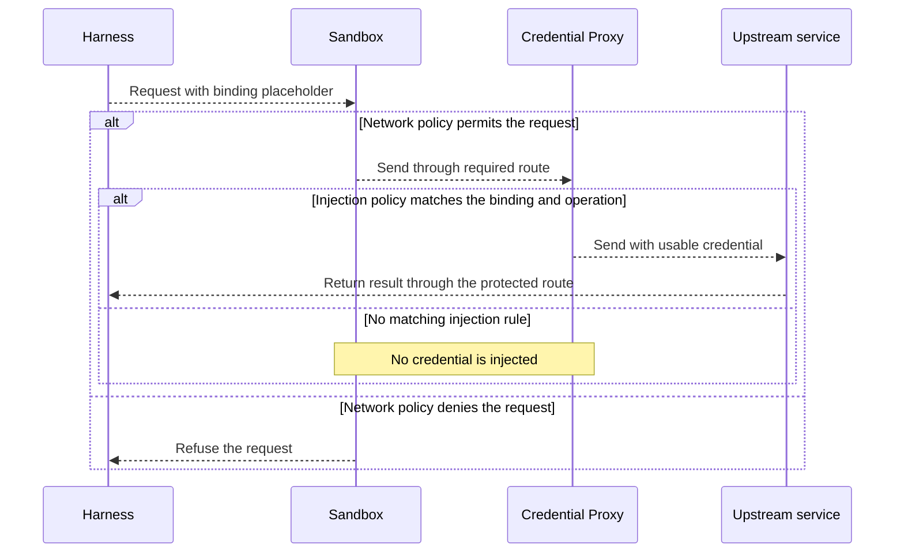

# Credential Design 1.0

**RFC-20261124-credential-design-1-0** · [Original proposal #7223](https://github.com/openclaw/openclaw-enterprise/pull/7223) · Created 2026-11-24

An Agent might need a model API key, GitHub repository access, and a Google account for a Plugin. An operator selects each Agent's credentials and approved access. The OpenClaw Control Plane (OCC) admits those choices into each Agent's revision. TokenService keeps the credential, and the Credential Proxy injects it into permitted requests. The Harness makes requests with a placeholder.

This 1.0 target consolidates the credential amendments to [RFC-0023](../0023-egress-proxy-credential-lifecycle/index.md) and [RFC-0027](../0027-agent-oauth-connections/index.md). The [Credential Sources implementation status](../../../docs/reference/credential-sources.md#implementation-status) records which paths are currently available.

## Credential resources and ownership

| Resource            | Purpose and owner                                                                                                                                                 |
| ------------------- | ----------------------------------------------------------------------------------------------------------------------------------------------------------------- |
| Connection Template | Defines approved OAuth consent and lifecycle settings, static HTTP destinations, or an MCP server endpoint.                                                       |
| OAuth2Client        | OCC records the application's issuer, ID, endpoints, and authentication method. TokenService holds any confidential client secret.                                |
| GitHubAppClient     | OCC records the App ID. TokenService uses its signing key to mint installation tokens.                                                                            |
| CredentialSource    | Identifies an enrolled credential in a Namespace. TokenService owns its lifecycle and any Template or client references. OCC exposes metadata and authorizes use. |

Templates and clients are independent. For example, an Installation-wide OAuth Template can be used with a compatible client registered in the user's Namespace. TokenService declares which client scopes it supports for each purpose. OpenShell supports Namespace-scoped OAuth clients through its Workspace. GitHub App clients have Installation scope.

The Installation selects one TokenService instance to own its Sources and private client material. The OCC implementation uses SecretDriver for storage. OpenShell can own the credential in its native provider. OCC privately binds registrations to that instance, preventing a replacement store from resolving existing Sources under a reused Driver name. Rotating an App key changes the next mint while its cached installation tokens remain usable until renewal.

## From enrollment to an Agent revision

An authorized caller enrolls a static or account credential. For Git, OCC authorizes Source creation or reuse before TokenService resolves it at deployment. For browser OAuth, the caller selects a compatible Template and OAuth2Client. OCC completes consent and the initial authorization-code exchange, then gives the resulting grant to TokenService. For Codex, TokenService uses a fixed issuer and public client and creates the Source after successful authorization.

The operator selects a Source for model authentication or a named Plugin connection. PluginDriver describes the selected Plugin's tools, network requirements, and credential connections. OCC checks that the deployer and Agent principal can operate each exact Source, applies the Installation ceiling, and derives one admitted binding list for the revision. A shared Git token also uses a Source binding. Separate Repository grants constrain its use.

For a Template-backed Plugin Source, OCC checks the current compatible Template and freezes its version in the new revision. The Source retains the Template ID. An OAuth Source also retains its original consent version, selected client, and granted scopes. Updating a Template can affect a new admission while an existing revision keeps its admitted policy.

Dashed arrows show proposed handoffs.

## Prepare and start the Agent

Compute prepares an idle Sandbox and arranges the tools and credential delivery required by the revision. SandboxDriver applies network access and containment. CredentialProxyDriver configures each binding's injection policy and returns a credential projection descriptor. When OCC TokenService owns the credential, the Proxy can resolve that exact Source to initialize a delivery resource. With compatible OpenShell ownership, the Proxy attaches the native provider.

Compute checks that the required policies and delivery resources are ready. The Worker rechecks Agent and Source authorization before activation. The runtime installs a fresh placeholder when Sandbox starts the Harness. Compute exposes user routes after authenticated readiness. Unsupported required rules prevent startup.

## Make a credentialed request

The revision's `NetworkAccessPolicy` defines which requests executables may send. Each credential binding has a `CredentialInjectionPolicy` that defines which requests may receive its credential. A Plugin can have network access without a credential binding. OpenShell's supervisor enforces both policies in its native implementation.

OCC derives injection authority from the Source and the consumer's requested operations. Rules can restrict the executable, destination, port, HTTP method, and exact path or path subtree. For MCP, OCC checks the Template's server endpoint and derives RPC method and tool restrictions from the admitted Plugin operation. An issuer can return a valid initial OAuth grant broader than requested. TokenService records requested and granted scopes separately; refresh can keep or narrow the grant. The upstream service enforces that grant independently of OCE's injection rules. An allowed endpoint can expose capabilities of a broad grant.

## Refresh, retry, and withdraw

TokenService owns issuance and renewal. After committing a replacement credential, it notifies the Proxy with the Source reference and version when known. If a delivery resource exists, the Proxy resolves the current value, updates that resource, and acknowledges success after every required serving copy can use the resolved version. Otherwise, notification succeeds without resolving material or creating a resource. OpenShell can renew a provider it owns internally.

If delivery fails after the commit, the replacement credential remains authoritative. OCC reports the delivery failure separately from issuance or refresh status, and an authorized operator can retry the push. Automatic recovery is deferred in 1.0.

Withdrawal detaches the binding for that Agent and removes its request authority. Other Agents can continue using the same Source. Stop removes the deployment and leaves the Source registered. When the last binding is removed, the Proxy retires its delivery resource. OCC refuses Source deletion while blocking references remain. Once delivery cleanup succeeds, TokenService removes the Source and its authoritative material.

## Examples

| Use          | How the design applies                                                                                                                                                                                                 |
| ------------ | ---------------------------------------------------------------------------------------------------------------------------------------------------------------------------------------------------------------------- |
| Model preset | Select an API-key Source. The model provider's reviewed profile supplies the inference destination and credential header.                                                                                              |
| Codex OAuth  | Complete device login, then select the resulting Source. Dedicated Codex receives a placeholder and the account context needed for its login state.                                                                    |
| GitHub App   | Select an App installation and approved repositories. At deployment, OCC asks TokenService to reuse or enroll a matching Namespace Source. Agents selecting A and B share its token under different read/write grants. |
| Plugin OAuth | Connect an account with a Template and OAuth2Client, then select the Source for a named Plugin connection. The request rule and granted OAuth scopes constrain the operation.                                          |
| Static HTTP  | Select a static Source for a Plugin. Intersect the Plugin's requested HTTP operations with the Template's allowed destinations.                                                                                        |
| MCP          | Bind the selected Source to the admitted MCP endpoint and restrict RPC methods or tools. Discovery can use a separate network-only rule.                                                                               |

Multiple accounts need distinct projections and a Plugin that selects the account per invocation.

## 1.0 scope and tradeoffs

- OCC TokenService can use OpenShell's embedded Proxy or a compatible standalone Proxy such as iron-proxy, with routing enforced by the Sandbox. OpenShell TokenService uses native OpenShell delivery. Each composition requires qualification.
- Git uses a cached, short-lived token per Source with finite repository scope. TokenService renews the token independently of Agent grants, which can expire at their own deadline or last until removed. The shared-token path excludes pull request creation until it can authorize the head and base repositories. Existing PR-capable and stronger ref modes remain available. Per-Agent token downscoping is future work.
- Sandbox delivery uses push or native providers. Request-time credential pulls, automatic push recovery, and embedded Harness adoption are deferred. Trusted Console and OpenClaw Gateway consumers use separately authorized access to supported Sources.
- Credential Gateway and Credential Refresh Drivers retire after their consumers migrate. The OpenClaw Gateway continues to serve the Agent.

## Detailed decisions

The companions preserve the submitted proposals. Source ownership and fresh Harness amendments supersede earlier registration and startup decisions. The Codex companion also records the separate release fence for the existing held Git launcher.

- [Client registration, custody, and rotation](client-registration-and-custody.md) from the original proposal
- [OAuth client selection and consent](oauth-client-associations.md)
- [Initial OAuth grant scopes and renewal](https://github.com/openclaw/openclaw-enterprise/blob/9d10e151360455757205c3f602152cfd2717d549/specs/rfcs/0027-agent-oauth-connections/contracts.md#client-authentication-and-account-custody) (submitted RFC-0027 amendment in #7224)
- [Installation ownership and delivery](installation-credential-ownership.md) and [TokenService identity and updates](token-service-instance-and-updates.md)
- [Source registration and lifecycle](credential-source-ownership.md)
- [Worker preparation and activation](worker-credential-configuration.md)
- [Codex device login and account projection](codex-device-login.md)
- [Shared GitHub App tokens and Agent repository access](github-app-template-policy.md)
- Proposed: [Codex PAT Source adoption and Dedicated OpenClaw native Git placement (#7217)](https://github.com/openclaw/openclaw-enterprise/pull/7217)
