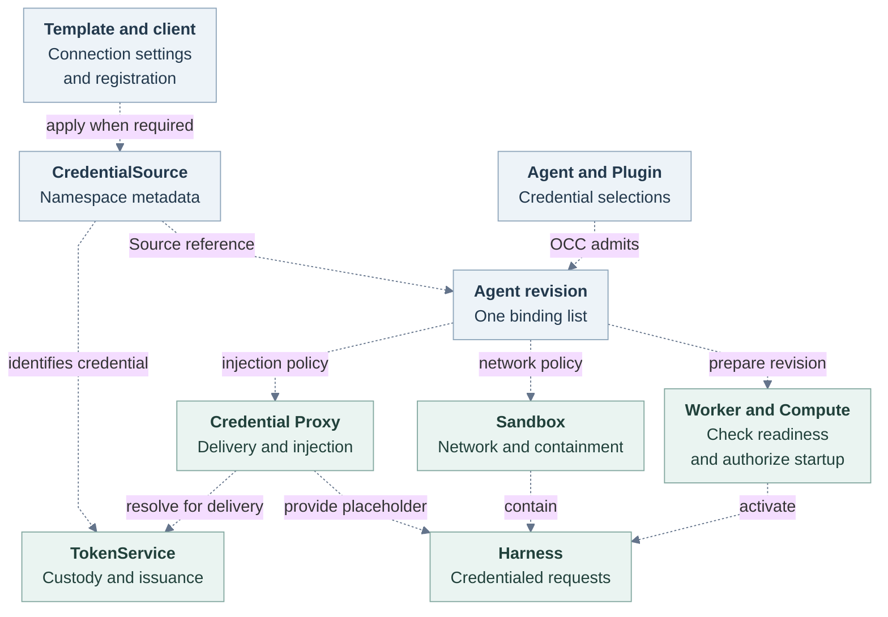
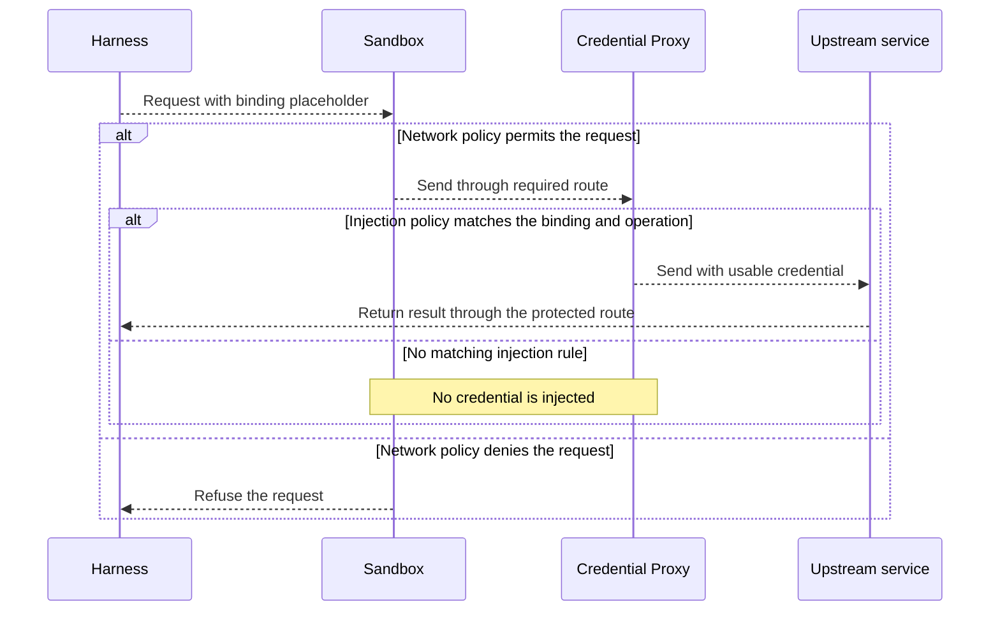

# Credential Design 1.0

**RFC-20261124-credential-design-1-0** · [Original proposal #7223](https://github.com/openclaw/openclaw-enterprise/pull/7223) · Created 2026-11-24

An operator can enroll a credential once and grant individual Agents different uses of it. The OpenClaw Control Plane (OCC) records what each Agent may use and where in its revision. The selected TokenService owns the credential. The Credential Proxy supplies it on authorized requests. The Harness uses a placeholder.

This RFC describes the 1.0 target. It carries forward the credential ownership and delivery amendments to [RFC-0023](../0023-egress-proxy-credential-lifecycle/index.md) and the OAuth consent changes to [RFC-0027](../0027-agent-oauth-connections/index.md). See [implementation status](../../../docs/reference/credential-sources.md#implementation-status) for current support.

## Resources and owners

| Resource or component           | Responsibility                                                                                                                                                                                                                                 |
| ------------------------------- | ---------------------------------------------------------------------------------------------------------------------------------------------------------------------------------------------------------------------------------------------- |
| Connection Template             | Defines the settings permitted for a connection type, such as OAuth issuer and consent settings or the HTTP and MCP operations that can use a credential.                                                                                      |
| OAuth2Client or GitHubAppClient | Identifies the application registration independently of any Template. OCC stores client metadata. TokenService holds any confidential OAuth client secret or GitHub App signing key in private custody.                                       |
| CredentialSource                | Identifies an enrolled credential in a Namespace. OCC exposes the Source metadata. The Source can refer to a Template and a client where the enrollment method requires them.                                                                  |
| TokenService                    | The Installation selects one instance. It registers Sources, holds their authoritative material, and issues or refreshes usable credentials.                                                                                                   |
| Agent and Plugin selections     | The operator selects credentials for the model and for named Plugin connections. PluginDriver describes what each selected Plugin needs. OCC admits the exact Sources for the deployer and Agent and records one binding list in the revision. |
| Credential Proxy                | Configures injection for each binding, maintains delivery resources, and supplies the Harness projection. The Proxy can resolve the usable value for that Source when delivery requires it.                                                    |
| Sandbox, Compute, and Worker    | Sandbox enforces network access and containment. Compute prepares the Sandbox, tools, and credential delivery. The Worker authorizes activation after preparation. Compute asks the Sandbox to start the Harness.                              |

Dashed arrows show the proposed 1.0 deployment handoffs.

## Enroll and admit a credential

1. An authorized caller enrolls a static credential or connects an account. For standard OAuth, the caller chooses a compatible Template and client. OCC owns the browser consent flow and initial authorization-code exchange. TokenService registers the resulting credential and owns subsequent renewal. The built-in Codex device flow uses a fixed issuer and public client through TokenService. It creates a Source after the grant succeeds.
2. The operator saves the Agent's selections. OCC checks the deployer and the Agent principal against each exact Source. It checks Plugin requirements against the Source's permitted destinations and the Installation ceiling. For a Template-backed Plugin Source, the Source keeps the Template ID, and the revision freezes the current compatible version at admission. An OAuth grant retains its original consent version, selected client, and granted scopes.
3. Compute prepares an idle Sandbox and verifies policy and credential delivery. The Worker rechecks Agent and Source authorization before activation. The Sandbox starts the Harness. Compute publishes user routes after the Harness and workspace node report authenticated readiness. A required policy or binding that the selected implementation cannot enforce prevents activation.

OCC keeps the TokenService instance and backend locator private. The selected instance owns each registration across restarts. Replacing the credential store requires a new instance identity and an explicit migration or reset for existing registrations. See [Source ownership](credential-source-ownership.md) and [TokenService identity](token-service-instance-and-updates.md#source-identity-and-replacement).

## Send a credentialed request

`NetworkAccessPolicy` controls which requests the Sandbox lets an executable send. `CredentialInjectionPolicy` controls where the Credential Proxy can use a specific binding. A connection can be allowed without an injection rule. With OpenShell, one supervisor enforces both policies.

Injection checks the executable and destination, then the operation. It can match an HTTP method and exact path or path subtree, or an MCP method and tool, where the selected implementation supports those rules. The upstream service enforces the credential's scopes and capabilities. Review the upstream grant together with the OCE rule. A broad upstream grant can allow additional operations within a permitted endpoint.

## Update, withdraw, and clean up

- **Update or refresh.** TokenService commits the replacement value before notifying the Proxy of the Source and version. A push updates an existing delivery resource and succeeds after the required serving copies can use that version. OpenShell can attach and renew its own native provider internally.
- **Retry.** A delivery failure leaves the new value authoritative. OCC reports the delivery failure separately from issuance. An authorized operator can retry delivery. An update before first use creates no delivery resource.
- **Withdraw or stop.** Remove the affected deployment's access and preserve delivery for Agents still using the Source. The Proxy retires its own delivery resource after the last binding. OCC checks for blocking references before Source deletion. TokenService removes the authoritative credential after delivery cleanup.

## Examples

| Selection                         | Enrollment and permitted use                                                                                                                                                                                                                                      |
| --------------------------------- | ----------------------------------------------------------------------------------------------------------------------------------------------------------------------------------------------------------------------------------------------------------------- |
| Model preset                      | Select an API-key Source for a model provider. The reviewed provider profile determines the destination and header.                                                                                                                                               |
| Codex OAuth                       | Complete device login and select the resulting Source. Dedicated Codex uses a placeholder plus account context.                                                                                                                                                   |
| Git                               | Enroll a Source with a GitHub App client, installation, and finite repository scope. Agents can share the installation token, while each revision's repository and operation grants constrain its own requests.                                                   |
| Plugin OAuth, static HTTP, or MCP | Select the Source for a named Plugin connection. Match the admitted endpoint and operation for that connection. A network-only Plugin can run without a Source. Multiple accounts require distinct projections and a Plugin that can select the intended account. |

## 1.0 boundaries

- The target pairs OCC TokenService with OpenShell's embedded Proxy or a standalone Proxy such as iron-proxy, with Sandbox-enforced routing. OpenShell TokenService uses native OpenShell delivery and Workspace-scoped OAuth clients. Installation-wide Templates can still be used with eligible Namespace clients. Each combination needs its own qualification.
- The shared Git token model relies on Agent repository rules with finite scope. The shared-token path excludes pull request creation until it can authorize the head and base repositories. Existing PR-capable and stronger ref modes continue to serve those operations.
- The target retires the Credential Gateway and Credential Refresh Drivers after their consumers migrate. The OpenClaw Gateway still serves the Agent. Sandbox credentials use push or native provider delivery. Request-time pulls and automatic push recovery are deferred, as is embedded Harness adoption of this delivery model. Trusted Console and Gateway consumers use separately authorized access to supported Sources.

## Detailed decisions

The amendments retain the decisions as submitted with RFC-0023. Use the Source ownership amendment for the canonical Source record, including OAuth consent. Use the fresh Harness amendments for staged activation. The Codex companion records the separate release fence for the existing held Git launcher.

- [Client registration, custody, and rotation](client-registration-and-custody.md) from the original proposal
- [Independent OAuth client selection and consent](oauth-client-associations.md)
- [Installation ownership and delivery](installation-credential-ownership.md), with the later [TokenService instance and update contract](token-service-instance-and-updates.md)
- [Source registration and lifecycle](credential-source-ownership.md)
- [Worker preparation and activation](worker-credential-configuration.md)
- [Codex device login and account projection](codex-device-login.md)
- [Shared GitHub App tokens and per-Agent repository access](github-app-template-policy.md)
