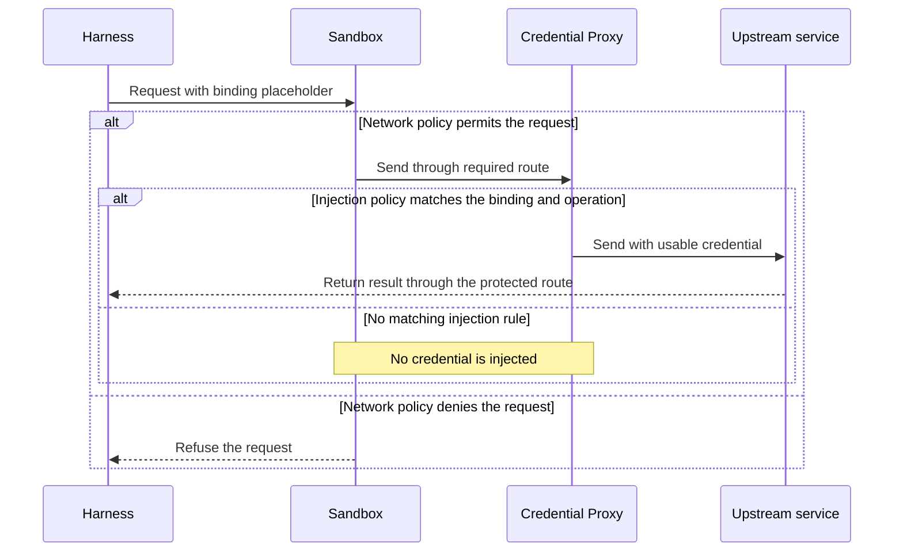

# Credential Design 1.0

**RFC-20261124-credential-design-1-0** · [Original proposal #7223](https://github.com/openclaw/openclaw-enterprise/pull/7223) · Created 2026-11-24

An operator selects credentials and approved access for an Agent. The OpenClaw Control Plane (OCC) admits those choices into the Agent revision. TokenService keeps credentials. The Credential Proxy injects them into permitted Harness requests with placeholders.

This target consolidates amendments to [RFC-0023](../0023-egress-proxy-credential-lifecycle/index.md) and [RFC-0027](../0027-agent-oauth-connections/index.md). See [implementation status](../../../docs/reference/credential-sources.md#implementation-status) for available paths.

## Amendment: name the custody owner CredentialService

Rename TokenService to CredentialService because the selected Driver owns static credentials, OAuth grants, and GitHub App issuance as well as tokens. Rename the Driver contract to `CredentialServiceDriver`, its serialized capability and Installation selection key from `token_service` to `credential_service`, and associated API and configuration identifiers consistently. Driver operations and their required behavior remain unchanged.

One database migration converts the current schema and persisted identifiers while preserving Source and Client IDs, credential contents, Secret references, and existing installations. Older migration files and receipts remain immutable. External configuration and generated API clients must use the new names; no compatibility alias is proposed. Custody, authorization, issuance, renewal, and Credential Proxy delivery keep their existing owners and behavior.

## Credential resources and ownership

| Resource            | Purpose and owner                                                                                                                                                 |
| ------------------- | ----------------------------------------------------------------------------------------------------------------------------------------------------------------- |
| Connection Template | Defines verified OAuth endpoints and approved consent and lifecycle settings, static HTTP destinations, or an MCP server endpoint.                                |
| OAuth2Client        | OCC records the application's issuer, ID, and authentication method. TokenService holds any confidential client secret.                                           |
| GitHubAppClient     | OCC records the App ID. TokenService uses its signing key to mint installation tokens.                                                                            |
| CredentialSource    | Identifies an enrolled credential in a Namespace. TokenService owns its lifecycle and any Template or client references. OCC exposes metadata and authorizes use. |

Both client kinds support Installation or Namespace scope if TokenService supports that scope for their purpose. A Namespace Source may use an eligible Installation or same-Namespace client, never another Namespace’s client. An Installation-wide OAuth Template can use a compatible Namespace client. See the [cutover custody contract](tokenservice-cutover-contract.md#secret-driver-placement).

OCE scope governs ownership. The Installation selects one TokenService instance. OCC TokenService uses the selected SecretDriver’s private store, outside tenant workload namespaces with Kubernetes. OpenShell can own a native Provider. OCC binds registrations to that instance so another store cannot resolve Sources under a reused Driver name.

## From enrollment to an Agent revision

Authorized callers enroll static or account credentials. For browser OAuth, they select a compatible Template and OAuth2Client. OCC completes consent and the authorization-code exchange, then gives TokenService the grant. Codex uses a fixed issuer and public client; TokenService creates the Source after authorization.

The operator selects Sources for the model or named Plugin connections. PluginDriver declares tools, network needs, and connections. OCC checks deployer and Agent authority to operate each Source, applies the Installation ceiling, and derives one admitted binding list for the revision. A shared Git Source binding also requires separate Repository grants.

Each new Agent revision freezes the current compatible Template version for a Template-backed Plugin Source. A running Agent keeps its saved policy until redeployment. To end access sooner, withdraw the binding or stop the Agent. This supersedes [RFC-0027’s live Template reconciliation](../0027-agent-oauth-connections/index.md#versions-and-consent). The Source retains the Template ID and, for OAuth, its consent version, client, and granted scopes.

## Prepare and start the Agent

Compute prepares an idle Sandbox, tools, and credential delivery. SandboxDriver applies network policy and containment. CredentialProxyDriver configures injection rules and returns a projection descriptor. Proxy resolves the exact Source for OCC custody or attaches the native OpenShell Provider.

Compute checks policy and delivery readiness. The Worker rechecks Agent and Source authorization before activation. The runtime installs a fresh placeholder at Harness startup. Compute exposes user routes after authenticated readiness. Unsupported required rules prevent startup.

## Make a credentialed request

The revision's `NetworkAccessPolicy` defines which requests executables may send. Each credential binding has a `CredentialInjectionPolicy` that defines which requests may receive its credential. A Plugin can have network access without a credential binding. OpenShell's supervisor enforces both policies in its native implementation.

OCC derives injection rules from the Source and requested operations. Rules can restrict the executable, destination, port, HTTP method, and exact path or subtree. For MCP, OCC checks the Template endpoint and derives RPC method and tool restrictions from the admitted Plugin operation. OAuth issuers can grant broader scopes than requested. TokenService records both; refresh can keep or narrow the grant. The upstream service enforces the grant independently. An allowed endpoint can expose capabilities of a broad grant.

## Refresh, retry, and withdraw

TokenService commits updates before notifying Credential Proxy. For OCC custody, Proxy resolves the credential only for existing delivery copies, updates them, and waits for each serving copy to load the version. With OpenShell custody, TokenService updates the authoritative Provider; Proxy checks its version. A manual push verifies metadata, not Harness consumption.

If delivery fails after commit, the replacement remains authoritative. OCC reports delivery separately; authorized operators can retry the push. The OCC API schedules Git renewal through TokenService and retries recorded pending delivery with the committed version before renewal is due. This narrows the earlier [automatic-retry deferral](token-service-instance-and-updates.md#notify-the-proxy-when-a-credential-changes). Detecting missed notifications without a pending record and broad reconciliation remain deferred.

Withdrawal removes the Agent's request authority and detaches its binding. Other Agents retain access. Stop removes the deployment but preserves Source registration. Proxy retires only its delivery copies after the last detach. OpenShell custody keeps the authoritative Provider until Source deletion. OCC refuses deletion while blocking references remain; TokenService then removes the Source and custody.

## Examples

| Use          | How the design applies                                                                                                                                                                                                             |
| ------------ | ---------------------------------------------------------------------------------------------------------------------------------------------------------------------------------------------------------------------------------- |
| Model preset | Select an API-key Source. The model provider's reviewed profile supplies the inference destination and credential header.                                                                                                          |
| Codex OAuth  | Complete device login, then select the resulting Source. Dedicated Codex receives a placeholder and the account context needed for its login state.                                                                                |
| Codex PAT    | Enroll a new static Codex PAT Source, or issue a fresh ChatGPT ServiceAccount PAT into TokenService. OCC returns a Source reference. The ServiceAccount Driver retains issuer-side revocation.                                     |
| GitHub App   | Select a GitHub App Client and approved repositories. At deployment, OCC authorizes creation or reuse of a matching Namespace Source, which TokenService resolves. Agents share its cached token under separate read/write grants. |
| Plugin OAuth | Connect an account with a Template and OAuth2Client, then select the Source for a named Plugin connection. The request rule and granted OAuth scopes constrain the operation.                                                      |
| Static HTTP  | Select a static Source for a Plugin. Intersect the Plugin's requested HTTP operations with the Template's allowed destinations.                                                                                                    |
| MCP          | Bind the selected Source to the admitted MCP endpoint and restrict RPC methods or tools. Discovery can use a separate network-only rule.                                                                                           |

Multiple accounts need distinct projections and a Plugin that selects the account per invocation.

## Shared Git policy

An Agent revision using a shared TokenService Source records the approved Repository grant, which remains valid until the OpenClaw Control Plane withdraws it or its explicit deadline passes. Each native Git request still requires a valid credential from the selected Source and must match the saved Repository policy. TokenService renews the separate GitHub installation token, which typically expires after one hour. See [original #7217 submission](https://github.com/openclaw/openclaw-enterprise/blob/1284f025f8f951a4c03a97ba3dd1785ffff96fd5/specs/rfcs/20261124-credential-cutover-pat-and-native-git/index.md#lifetime-of-source-backed-repository-policy).

Repository grants permit Read or Read/write Git. GitHub enforces repository and branch rules; OCE does not enforce an Agent branch allowlist. The shared Source currently supplies credentials for Git transport. Repository policy can separately allow credential-free public metadata reads for selected repositories. [Native GitHub pull request publication](../20261126-native-github-pr-publication.md) proposes adding a Repo-authorized REST rule for stock `gh` with the same shared Source and Credential Proxy binding. For publication, the Agent needs Read or Write access to every repository covered by the token; Git transport can use a narrower Agent grant. The cutover design calls for retiring legacy protected repository exchanges, exact-ref modes, and PR/quota features. Legacy Driver removal remains pending. This design superseded the [earlier requirement to retain stronger modes](github-app-template-policy.md). Per-Agent token downscoping remains future work.

## 1.0 scope and tradeoffs

- OCC TokenService can use OpenShell's embedded Proxy or a compatible standalone Proxy such as iron-proxy, with routing enforced by the Sandbox. OpenShell TokenService uses native OpenShell delivery. Each composition requires qualification.
- Sandbox delivery uses push or native providers. Request-time credential pulls and embedded Harness adoption are deferred. Trusted Console consumers require separate Source authorization.
- The proposed [Gateway startup credentials RFC](../20261125-gateway-startup-credentials.md) would let an operator explicitly bind a static Source to the dedicated OpenClaw Gateway. That binding authorizes a usable copy outside Credential Proxy request restrictions. This path is not implemented; Slack Channel startup still uses Namespace Secrets.
- Credential-free metadata uses separately admitted Sandbox network access. For example, an Agent can send `GET https://api.github.com/repos/acme/widgets` and receive the upstream response. No Source, credential injection, OCC callback, or response filtering is required. This retires the [earlier protected metadata offer](tokenservice-cutover-contract.md#proposed-change-to-protected-github-metadata).
- Remove `LegacyEgressProxyDriver` after retiring its protected exchanges. Its implementation remains in current code pending removal. Credential Gateway and Credential Refresh Driver selection is already unsupported; the separate OpenClaw Gateway continues to serve the Agent.

## Detailed decisions

Companions preserve earlier decisions, including the Codex held-launcher release fence.

- [TokenService cutover contract](tokenservice-cutover-contract.md) and the [original client registration, custody, and rotation proposal](client-registration-and-custody.md)
- [OAuth client selection and consent](oauth-client-associations.md)
- [OAuth endpoint authority](../20261125-oauth-endpoint-authority.md) supersedes the earlier client endpoint binding.
- [Initial OAuth grant scopes and renewal](../0027-agent-oauth-connections/contracts.md#client-authentication-and-account-custody)
- [Installation ownership and delivery](installation-credential-ownership.md) and [TokenService identity and updates](token-service-instance-and-updates.md)
- [Source registration and lifecycle](credential-source-ownership.md)
- [Worker preparation and activation](worker-credential-configuration.md), including [optional Plugin Source withdrawal](worker-credential-configuration.md#amendment-continue-without-a-withdrawn-optional-plugin-source)
- [Codex device login and account projection](codex-device-login.md)
- [Shared GitHub App tokens and Agent repository access](github-app-template-policy.md)
- Proposed [Dedicated OpenClaw Git RFC](../20261124-credential-cutover-pat-and-native-git/index.md). [#7224](https://github.com/openclaw/openclaw-enterprise/pull/7224) implemented [PAT enrollment](../../../docs/reference/credential-sources.md#use-a-codex-pat-source), [ServiceAccount issuance and revocation](../../../docs/reference/service-accounts.md#account-and-credential-lifecycle), and [Dedicated Codex Git](../../../docs/reference/repository-credentials/access-levels.md#native-git-delivery). Dedicated OpenClaw Git remains unsupported.
